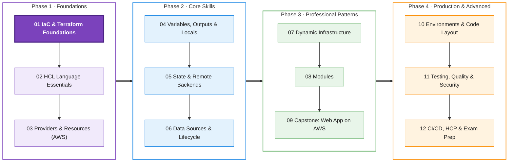
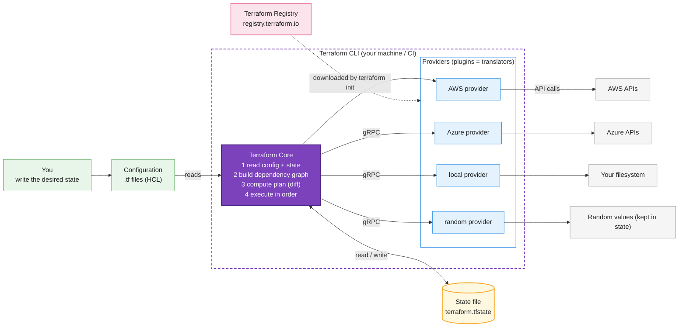
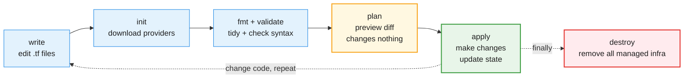
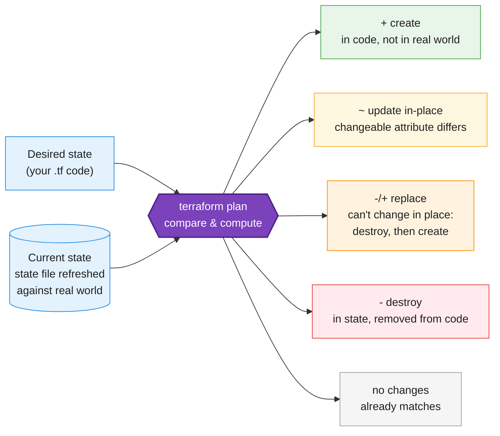
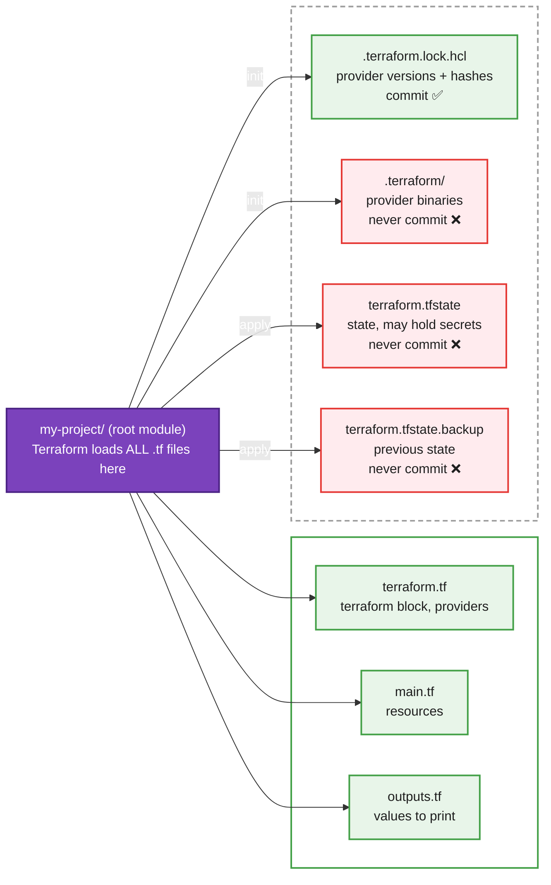
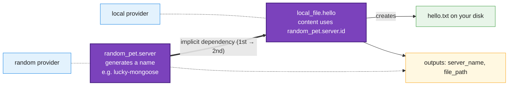

<a id="top"></a>

<div align="center">

# Terraform: Zero to Advanced

### Module 01 — Infrastructure as Code & Terraform Foundations

[](https://developer.hashicorp.com/terraform/install)


*Understand what Terraform is, how it works under the hood, and run your first complete Terraform workflow.*

</div>

| | |
|---|---|
| **Level** | Absolute beginner |
| **Time** | 3–4 hours (concepts + lab) |
| **Cost** | Free — everything runs on your own laptop |
| **Terraform** | 1.6 or newer (current release line: 1.16.x) |

📄 **Full illustrated version:** [Module-01-Terraform-Foundations.pdf](./Module-01-Terraform-Foundations.pdf)

## Contents

- [0. Your Learning Path](#0-your-learning-path)
- [1. Module Overview](#1-module-overview)
- [2. Core Concepts](#2-core-concepts)
- [3. Install & Set Up](#3-install--set-up)
- [4. Hands-on Lab — Your First Terraform Project](#4-hands-on-lab--your-first-terraform-project)
- [5. Quick Reference](#5-quick-reference)
- [6. Knowledge Check](#6-knowledge-check)
- [7. Summary & Next Steps](#7-summary--next-steps)

---

## 0. Your Learning Path

This course takes you from *zero* to *production-ready* Terraform in **12 modules** grouped into **4 phases**. Every module follows the same rhythm, so you always know what comes next:

1. **Concept brief** — the *why* and *what*, in plain language with analogies.
2. **Diagrams** — the big picture, so the moving parts click into place.
3. **Hands-on lab** — you type real code, run real commands and compare with the expected output.
4. **Quick reference + knowledge check** — lock in what you learned.


<p align="center"><em>Figure 0 — Course roadmap. You are here: Module 01 (highlighted).</em></p>

| # | Module | You will be able to… | Hands-on lab |
|---|---|---|---|
| 01 | IaC & Terraform Foundations | Explain IaC, Terraform's architecture and run init → plan → apply → destroy | First project on your laptop (local + random providers) |
| 02 | HCL Language Essentials | Read and write any HCL: blocks, types, expressions, functions, style | HCL playground with `terraform console` |
| 03 | Providers & Resources (AWS) | Configure the AWS provider safely, pin versions, create real cloud resources | S3 bucket + EC2 instance (free tier) |
| 04 | Variables, Outputs & Locals | Make code reusable with inputs, validation, tfvars and outputs | Parameterise the AWS stack |
| 05 | State & Remote Backends | Understand state deeply, use an S3 backend with locking, import resources | Migrate local state to S3; import a bucket |
| 06 | Data Sources & Lifecycle | Query existing infra, control dependencies and lifecycle rules | Look up AMIs; zero-downtime replacement |
| 07 | Dynamic Infrastructure | Use count, for_each, conditionals, for-expressions and dynamic blocks | Build many resources from one map |
| 08 | Modules | Write, compose, version and publish modules; use the Registry | Build a reusable network module |
| 09 | Capstone: Web App on AWS | Design and ship a real multi-tier architecture end-to-end | VPC, subnets, ALB, Auto Scaling web tier |
| 10 | Environments & Code Layout | Run dev / staging / prod safely: directories vs workspaces | Promote one stack across 2 environments |
| 11 | Testing, Quality & Security | Validate, lint, scan and test Terraform like a professional | tflint + trivy + `terraform test` |
| 12 | CI/CD, HCP & Exam Prep | Automate plan/apply in pipelines, refactor safely, pass the Associate exam | GitHub Actions pipeline + mock exam |

> [!IMPORTANT]
> **Why we start on your laptop:** Modules 01–02 use providers that need **no cloud account and cost nothing**. You learn the Terraform workflow without worrying about bills or credentials. From Module 03 we move to **AWS** — the most widely used cloud and the one used in the official certification tutorials.

<p align="right"><a href="#top">↑ Back to top</a></p>

---

## 1. Module Overview

#### Learning objectives — by the end of this module you can:

- Explain **Infrastructure as Code (IaC)** and why teams use it.
- Describe the difference between **declarative** and **imperative** approaches.
- Explain Terraform's architecture: **Core, Providers, State, Registry**.
- Install Terraform and set up a professional editor (VS Code).
- Run the full lifecycle: `init` → `fmt` / `validate` → `plan` → `apply` → `destroy`.
- Read a plan and predict whether Terraform will **create, update, replace or destroy**.
- Know which project files belong in Git — and which must **never** go there.

#### Prerequisites

- Basic terminal skills: `cd`, `mkdir`, listing files. That's it.
- A text editor (we'll install VS Code + the official Terraform extension).
- **No** cloud account, **no** programming experience needed.

<p align="right"><a href="#top">↑ Back to top</a></p>

---

## 2. Core Concepts

### 2.1 The problem: building infrastructure by hand

Imagine your team needs a web server, a database and some firewall rules. The traditional way is to log in to a cloud console and click through forms — often called **ClickOps**. It works once. Then problems appear:

| Problem | What it looks like in real life |
|---|---|
| Not repeatable | Building the *same* setup for testing or another region means clicking everything again — and missing a step. |
| No documentation | Nobody knows exactly which settings were chosen, or why. The knowledge lives in one person's head. |
| No review | A mistaken click goes straight to production. There is no 'pull request' for a console. |
| Drift | Dev, staging and prod slowly become different. Bugs appear in prod that you can't reproduce in dev. |
| Slow recovery | If something is deleted, rebuilding it from memory takes hours or days. |

### 2.2 Infrastructure as Code (IaC)

**Infrastructure as Code** means describing your infrastructure — servers, networks, databases, DNS, permissions — in **text files**, and letting a tool create and maintain it for you. Because it is just code, you get everything software engineers already rely on:

- **Version control** — every change is in Git history: who, what, when, why.
- **Code review** — teammates review infrastructure changes in pull requests before they happen.
- **Repeatability** — run the same code to get identical environments (dev = staging = prod).
- **Automation** — pipelines can test and apply changes without manual clicking.
- **Documentation** — the code *is* the up-to-date description of your infrastructure.

> [!NOTE]
> **Analogy:** An architect doesn't build a house 'by eye'. They draw a **blueprint** and builders follow it. If you want a second identical house, you reuse the blueprint. Terraform code is the blueprint for your infrastructure.

### 2.3 Declarative vs imperative

There are two ways to tell a computer what to do:

|   | Imperative (HOW) | Declarative (WHAT) |
|---|---|---|
| You describe | The **steps** to perform | The **end result** you want |
| Example | 'Create 3 servers.' | 'There should be 3 servers.' |
| Run it twice | You now have **6** servers | Still **3** servers — nothing to do |
| Who works out the steps? | You | The tool |
| Typical tools | Shell scripts, CLI commands | **Terraform**, CloudFormation, Kubernetes YAML |

Terraform is **declarative**. You write the *desired state*; Terraform compares it with what really exists and performs only the actions needed to close the gap. Running the same code again with no changes does nothing — this property is called **idempotency**.

> [!NOTE]
> **Analogy:** A **thermostat** is declarative: you set 24 °C and it decides whether to heat, cool or do nothing. You never say 'run the heater for 7 minutes'. Terraform is the thermostat for your infrastructure.

### 2.4 What is Terraform?

**Terraform** is an Infrastructure as Code tool created by **HashiCorp**. You write configuration in **HCL (HashiCorp Configuration Language)**, a simple, human-readable language, and Terraform builds and manages the matching infrastructure on almost any platform — AWS, Azure, Google Cloud, Kubernetes, GitHub, Cloudflare, Datadog and thousands more.

- **Declarative** — describe the end state; Terraform plans the steps.
- **Multi-platform** — one tool and one workflow for every provider.
- **Plan before apply** — you always see a preview of changes before anything happens.
- **State** — Terraform remembers what it created, so it can update and delete accurately.
- **Modules** — package and reuse infrastructure like functions in programming (Module 08).

#### Where Terraform fits

| Tool | Main job | Language | Platforms |
|---|---|---|---|
| **Terraform** | Provisioning (create/change/delete infra) | HCL (declarative) | Almost any (thousands of providers) |
| AWS CloudFormation | Provisioning | JSON / YAML | AWS only |
| Pulumi | Provisioning | Python, TypeScript, Go… | Many |
| Ansible | Configuration management (set up software *inside* servers) | YAML playbooks | Servers, network devices |

> [!TIP]
> **Provisioning vs configuration:** Terraform *builds the house* (servers, networks, databases). Tools like Ansible *furnish the rooms* (install packages, edit config files). Many teams use both together.

> [!IMPORTANT]
> **Licensing note:** since 2023 Terraform is source-available under the Business Source License (BSL). It is free to use for your own infrastructure. **OpenTofu** is a community fork (Linux Foundation) that stays open source and is largely compatible — everything you learn here transfers to it.

### 2.5 How Terraform works: the architecture


<p align="center"><em>Figure 1 — Terraform architecture: Core is the brain, providers are translators, state is the memory.</em></p>

Terraform has four main pieces. Understanding them removes 80% of the 'magic':

| Component | What it is | Analogy |
|---|---|---|
| **Configuration** | Your `.tf` files describing the desired state. | The blueprint |
| **Terraform Core** | The `terraform` program. Reads configuration and state, builds a **dependency graph**, computes the plan and executes it in the right order (in parallel where possible). | The project manager |
| **Providers** | Plugins that know how to talk to one specific API (AWS, Azure, local files…). Core never talks to clouds directly — it asks providers via gRPC. | Specialist contractors who speak each platform's language |
| **State** | A JSON file (`terraform.tfstate`) mapping each resource in your code to the real object it created (IDs, attributes). | The project's record book |
| **Registry** | registry.terraform.io — the public catalogue where `terraform init` downloads providers and modules. | The app store |

> [!IMPORTANT]
> **Key idea:** Terraform itself knows nothing about AWS, Azure or files. **All platform knowledge lives in providers.** That is why the same workflow works everywhere: learn it once, use it with any provider.

### 2.6 The core workflow


<p align="center"><em>Figure 2 — The Terraform workflow. You repeat write → plan → apply many times; destroy happens once at the end.</em></p>

| Command | What it does | When you run it | Changes infra? |
|---|---|---|---|
| `terraform init` | Downloads providers/modules, prepares the backend, writes the lock file | First time, and after adding/upgrading providers or modules | No |
| `terraform fmt` | Rewrites `.tf` files in the canonical style | Before every commit | No |
| `terraform validate` | Checks syntax and internal consistency | Before plan / in CI | No |
| `terraform plan` | Shows exactly what *would* change | Before every apply | **No** |
| `terraform apply` | Shows the plan again, asks for `yes`, then makes the changes and updates state | When the plan looks right | **Yes** |
| `terraform destroy` | Deletes everything this configuration manages | When you no longer need it | **Yes** |

> [!WARNING]
> **Always read the plan.** `plan` is your safety net. A professional never applies a change they haven't read. Watch especially for **destroy** and **replace** actions — in the cloud they can mean data loss or downtime.

### 2.7 How Terraform decides what to do

Every `plan` is a comparison between two pictures: the **desired state** (your code) and the **current state** (the state file, refreshed against the real world). The difference becomes a list of actions:


<p align="center"><em>Figure 3 — Plan = desired state minus current state. Every resource gets exactly one action.</em></p>

| Symbol | Action | Meaning |
|---|---|---|
| `+` | create | The resource is in your code but doesn't exist yet. |
| `~` | update in-place | It exists; a changeable attribute is different (e.g. a tag). |
| `-/+` | replace | An attribute that **cannot** be changed in place differs. Terraform destroys the old object, then creates a new one. The plan marks the cause with `# forces replacement`. |
| `-` | destroy | It is in state but you removed it from your code. |
| `<=` | read | A *data source* is read (Module 06). |

### 2.8 Anatomy of HCL — reading your first block

```hcl
resource "local_file" "hello" {   # block type | resource type (local provider) | local name
  filename = "hello.txt"           # argument:  name = value
  content  = "Hi!"                 # argument
}
# address: local_file.hello   ->   reference: local_file.hello.filename
```
<p align="center"><em>Figure 4 — The parts of a resource block.</em></p>

| Part | Example | Meaning |
|---|---|---|
| Block type | `resource` | What kind of thing this block declares |
| Resource type | `"local_file"` | Provider prefix + type: `local_file` → `local` provider |
| Local name | `"hello"` | Your label, unique per resource type |
| Arguments | `filename = "hello.txt"` | `name = value` pairs inside the body |
| Address | `local_file.hello` | How you refer to it elsewhere |

Almost everything in Terraform is a **block**: a block type, zero or more labels, and a body in `{ }` containing **arguments** (`name = value`). The resource type always starts with the provider name — `local_file` belongs to the `local` provider, `aws_instance` to the `aws` provider. The combination of type and local name, `local_file.hello`, is the resource's **address**: you use it to reference the resource elsewhere, e.g. `local_file.hello.filename`.

Every project also has a special `terraform` block that declares which providers it needs:

```hcl
terraform {
  required_version = ">= 1.6.0"          # which Terraform CLI versions may run this code

  required_providers {
    local = {
      source  = "hashicorp/local"        # = registry.terraform.io/hashicorp/local
      version = "~> 2.5"                 # any 2.x version from 2.5 upward, never 3.0
    }
  }
}
```

| Constraint | Allows | Use it when |
|---|---|---|
| `= 2.5.3` | Exactly 2.5.3 | You need a specific build (rare) |
| `>= 2.5` | 2.5 and anything newer, including 3.x, 4.x… | Minimum only — risky for providers |
| `~> 2.5` | ≥ 2.5 and < 3.0 (the 'pessimistic' operator) | **Recommended for providers** — get fixes, avoid breaking majors |
| `>= 2.5, < 2.8` | A custom range | Fine-grained control |

### 2.9 Project files — and what goes into Git


<p align="center"><em>Figure 5 — Files you write vs files Terraform generates, and which belong in version control.</em></p>

A Terraform project is just a folder. Terraform loads **every** `.tf` file in the folder together (file names and order don't matter to Terraform) — this folder is called the **root module**. File names matter to *humans*, so HashiCorp's style guide recommends a standard layout:

| File | Contains |
|---|---|
| `terraform.tf` | The `terraform` block: `required_version`, `required_providers` (some teams call it `versions.tf`) |
| `providers.tf` | Provider configuration, e.g. AWS region (from Module 03) |
| `main.tf` | Resources and data sources |
| `variables.tf` | Input variables (Module 04) |
| `outputs.tf` | Output values |
| `locals.tf` | Local values (Module 04) |

Use this `.gitignore` in every Terraform repository (based on GitHub's standard Terraform template):

**`.gitignore`**

```gitignore
# Local provider binaries and module cache
.terraform/

# State files: may contain secrets, never commit
*.tfstate
*.tfstate.*

# Crash logs and saved plan files
crash.log
crash.*.log
*.tfplan

# Variable files often hold secrets (decide per project)
*.tfvars
*.tfvars.json

# Local overrides and CLI config
override.tf
override.tf.json
*_override.tf
*_override.tf.json
.terraformrc
terraform.rc
```

> [!WARNING]
> **Do commit** `.terraform.lock.hcl` — it guarantees every teammate and pipeline uses the exact same provider versions. **Never commit** `terraform.tfstate`: it can contain passwords and keys in plain text. In Module 05 we move state to a secure remote backend.

<p align="right"><a href="#top">↑ Back to top</a></p>

---

## 3. Install & Set Up

### 3.1 Install Terraform

#### Windows

Open **PowerShell** and use the built-in package manager *winget*:

```powershell
winget install --id Hashicorp.Terraform -e
```

Alternatives: `choco install terraform` (Chocolatey), or download the ZIP from the official install page, extract `terraform.exe` to a folder such as `C:\terraform` and add that folder to your **PATH** environment variable. Close and reopen the terminal afterwards.

#### macOS

```bash
brew tap hashicorp/tap
brew install hashicorp/tap/terraform
```

#### Linux (Ubuntu / Debian)

```bash
sudo apt-get update && sudo apt-get install -y gnupg software-properties-common wget
wget -O- https://apt.releases.hashicorp.com/gpg | \
  sudo gpg --dearmor -o /usr/share/keyrings/hashicorp-archive-keyring.gpg
echo "deb [signed-by=/usr/share/keyrings/hashicorp-archive-keyring.gpg] \
https://apt.releases.hashicorp.com $(lsb_release -cs) main" | \
  sudo tee /etc/apt/sources.list.d/hashicorp.list
sudo apt-get update && sudo apt-get install -y terraform
```

#### Verify

```bash
terraform version
```

*Expected output:*

```text
Terraform v1.16.x
on windows_amd64
```

Any version **1.6 or newer** works for this course. The platform line will say `darwin_arm64`, `linux_amd64`, etc. depending on your machine.

### 3.2 Set up your editor

- Install **Visual Studio Code**.
- Open the Extensions panel and install **HashiCorp Terraform** (publisher: *HashiCorp*). It gives syntax highlighting, auto-completion, inline docs, validation and format-on-save.
- Enable format-on-save: *Settings → search 'Format On Save' → tick it*.
- macOS/Linux only (optional): `terraform -install-autocomplete` adds tab-completion for commands in bash/zsh.

<p align="right"><a href="#top">↑ Back to top</a></p>

---

## 4. Hands-on Lab — Your First Terraform Project

**Goal:** experience the complete Terraform lifecycle — create, inspect, change, recover from drift, add a second provider with a dependency, and destroy — all on your own machine, at zero cost.


<p align="center"><em>Figure 6 — What you will build by the end of the lab.</em></p>

| Provider | What it manages | Why we use it here |
|---|---|---|
| `hashicorp/local` | Files on your disk (`local_file`) | You can *see* the result instantly in your file explorer |
| `hashicorp/random` | Random values (`random_pet`, `random_id`…) | Shows dependencies and values that are only *known after apply* |

Final folder structure:

```text
lab-01-first-project/
├── terraform.tf      # terraform block + required providers
├── main.tf           # resources
└── outputs.tf        # outputs
```

### Task 1 — Create the project and write the configuration

Create a folder and open it in VS Code:

```bash
mkdir lab-01-first-project
cd lab-01-first-project
code .
```

Create the three files below. Type them yourself rather than copy-pasting — your fingers learn the syntax.

**`terraform.tf`**

```hcl
terraform {
  required_version = ">= 1.6.0"

  required_providers {
    local = {
      source  = "hashicorp/local"
      version = "~> 2.5"
    }
  }
}
```

**`main.tf`**

```hcl
# A text file on your own disk, managed by Terraform.
resource "local_file" "hello" {
  filename = "${path.module}/hello.txt"
  content  = "Hello, Terraform!"
}
```

**`outputs.tf`**

```hcl
output "file_path" {
  description = "Where the file was created"
  value       = local_file.hello.filename
}
```

> [!TIP]
> **Tip:** `${...}` is **string interpolation**: it inserts a value into a string. `path.module` is a built-in value meaning 'the folder this code lives in'. The `local` provider needs no settings, so there is no `providers.tf` yet.

### Task 2 — Initialise: terraform init

```bash
terraform init
```

*Expected output:*

```text
Initializing the backend...
Initializing provider plugins...
- Finding hashicorp/local versions matching "~> 2.5"...
- Installing hashicorp/local v2.5.x...
- Installed hashicorp/local v2.5.x (signed by HashiCorp)
Terraform has created a lock file .terraform.lock.hcl to record the provider
selections it made above. Include this file in your version control repository
so that Terraform can guarantee to make the same selections by default when
you run "terraform init" in the future.

Terraform has been successfully initialized!
```

**What just happened?** Terraform read `required_providers`, asked the Registry for a matching version, downloaded the provider binary into `.terraform/providers/…`, and recorded the exact version and checksums in `.terraform.lock.hcl`. Open the lock file — it looks like this:

**`.terraform.lock.hcl`**

```hcl
# This file is maintained automatically by "terraform init".
# Manual edits may be lost in future updates.

provider "registry.terraform.io/hashicorp/local" {
  version     = "2.5.x"
  constraints = "~> 2.5"
  hashes = [
    "h1:...",
    ...
  ]
}
```

### Task 3 — Format and validate

Break the formatting on purpose: open `main.tf` and misalign the `=` signs and indentation, then run:

```bash
terraform fmt          # rewrites files; prints the names of files it changed
terraform fmt -check   # only checks; non-zero exit code if unformatted (CI)
```

Now introduce a typo — rename `filename` to `filenme` — and validate:

```bash
terraform validate
```

*Expected output:*

```text
Error: Missing required argument

  on main.tf line 2, in resource "local_file" "hello":
   2: resource "local_file" "hello" {

The argument "filename" is required, but no definition was found.

Error: Unsupported argument

  on main.tf line 3, in resource "local_file" "hello":
   3:   filenme  = "${path.module}/hello.txt"

An argument named "filenme" is not expected here. Did you mean "filename"?
```

Read errors from the top: **file, line, block**, then the explanation. Fix the typo and run validate again:

*Expected output:*

```text
Success! The configuration is valid.
```

### Task 4 — Preview: terraform plan

```bash
terraform plan
```

*Expected output:*

```text
Terraform used the selected providers to generate the following execution plan.
Resource actions are indicated with the following symbols:
  + create

Terraform will perform the following actions:

  # local_file.hello will be created
  + resource "local_file" "hello" {
      + content              = "Hello, Terraform!"
      + content_base64sha256 = (known after apply)
      + content_md5          = (known after apply)
      + content_sha1         = (known after apply)
      + directory_permission = "0777"
      + file_permission      = "0777"
      + filename             = "./hello.txt"
      + id                   = (known after apply)
      ...
    }

Plan: 1 to add, 0 to change, 0 to destroy.

Changes to Outputs:
  + file_path = "./hello.txt"
```

How to read it: `+` means **create**. Values you set are shown; values the provider computes are `(known after apply)`. `directory_permission` and `file_permission` are **defaults** you didn't write. The summary line is the most important line in any plan. **Check: no `hello.txt` exists yet** — plan changed nothing.

### Task 5 — Create: terraform apply

```bash
terraform apply
```

*Expected output:*

```text
(the same plan is shown again)

Do you want to perform these actions?
  Terraform will perform the actions described above.
  Only 'yes' will be accepted to approve.

  Enter a value: yes

local_file.hello: Creating...
local_file.hello: Creation complete after 0s [id=6a3f...]

Apply complete! Resources: 1 added, 0 changed, 0 destroyed.

Outputs:

file_path = "./hello.txt"
```

Verify the result, then prove idempotency by planning again:

```bash
cat hello.txt        # Windows CMD: type hello.txt   (PowerShell understands cat)
terraform plan
```

*Expected output:*

```text
local_file.hello: Refreshing state... [id=6a3f...]

No changes. Your infrastructure matches the configuration.
```

> [!IMPORTANT]
> **Idempotency in action:** the code didn't change and the real world matches, so Terraform does nothing. This is the declarative model from section 2.3 working for you.

### Task 6 — Inspect the state

```bash
terraform state list
terraform state show local_file.hello
```

*Expected output:*

```text
local_file.hello

# local_file.hello:
resource "local_file" "hello" {
    content              = "Hello, Terraform!"
    directory_permission = "0777"
    file_permission      = "0777"
    filename             = "./hello.txt"
    id                   = "6a3f..."
    ...
}
```

Now open `terraform.tfstate` in VS Code (read only!). It is JSON that links the address `local_file.hello` to the real file and records every attribute:

**`terraform.tfstate (simplified)`**

```json
{
  "version": 4,
  "terraform_version": "1.16.x",
  "serial": 1,
  "lineage": "…",
  "outputs": { "file_path": { "value": "./hello.txt", "type": "string" } },
  "resources": [
    {
      "mode": "managed",
      "type": "local_file",
      "name": "hello",
      "provider": "provider[\"registry.terraform.io/hashicorp/local\"]",
      "instances": [ { "attributes": { "filename": "./hello.txt", "...": "..." } } ]
    }
  ]
}
```

> [!WARNING]
> **Never edit the state file by hand.** A broken state means Terraform loses track of your infrastructure. Use `terraform state` commands instead (covered in Module 05).

### Task 7 — Change something and observe a replacement

Edit `main.tf` and change the content:

```hcl
  content  = "Hello again, Terraform!"
```

```bash
terraform plan
```

*Expected output:*

```text
  # local_file.hello must be replaced
-/+ resource "local_file" "hello" {
      ~ content              = "Hello, Terraform!" -> "Hello again, Terraform!" # forces replacement
      ~ content_base64sha256 = "…" -> (known after apply)
      ~ id                   = "6a3f…" -> (known after apply)
        # (unchanged attributes hidden)
    }

Plan: 1 to add, 0 to change, 1 to destroy.
```

**Why replace and not update?** The `local` provider can't edit a file in place — every `local_file` argument *forces replacement*, so the old file is deleted and a new one written (`-/+`). Cloud resources differ: changing an AWS instance's tags is a `~` in-place update, but changing its AMI forces a replacement. **The provider decides**, and the plan always tells you. Run `terraform apply` and confirm with `yes`.

### Task 8 — Drift: someone changed things behind Terraform's back

Delete the file manually — simulating a colleague 'fixing' things in the console:

```bash
rm hello.txt         # Windows CMD: del hello.txt
terraform plan
```

*Expected output:*

```text
Note: Objects have changed outside of Terraform

Terraform detected the following changes made outside of Terraform since the
last "terraform apply" which may have affected this plan:

  # local_file.hello has been deleted
  - resource "local_file" "hello" { … }

…

  # local_file.hello will be created
  + resource "local_file" "hello" { … }

Plan: 1 to add, 0 to change, 0 to destroy.
```

Terraform **refreshed** state against the real world, noticed the file is gone (**drift**) and plans to bring reality back to the desired state. Run `terraform apply` to heal it.

> [!IMPORTANT]
> **Key idea:** Once Terraform manages something, **the code is the source of truth**. Manual changes are either overwritten or flagged as drift. Make every change through code — that is the discipline IaC requires.

### Task 9 — Add a second provider and a dependency

Add the `random` provider to `terraform.tf` (inside `required_providers`, under `local`):

**`terraform.tf (addition)`**

```hcl
    random = {
      source  = "hashicorp/random"
      version = "~> 3.6"
    }
```

Replace the contents of `main.tf` with:

**`main.tf`**

```hcl
# Generates a random, human-friendly name such as "lucky-mongoose".
resource "random_pet" "server" {
  length = 2
}

resource "local_file" "hello" {
  filename = "${path.module}/hello.txt"
  content  = "Hello from server ${random_pet.server.id}! Managed by Terraform."
}
```

And add a second output to `outputs.tf`:

**`outputs.tf (addition)`**

```hcl
output "server_name" {
  description = "The generated pet name"
  value       = random_pet.server.id
}
```

Run `terraform plan` **before** `init` — this mistake is very common, so see it once on purpose:

*Expected output:*

```text
Error: Inconsistent dependency lock file

The following dependency selections recorded in the lock file are inconsistent
with the current configuration:
  - provider registry.terraform.io/hashicorp/random: required by this configuration
    but no version is selected

To make the initial dependency selections that will initialize the dependency
lock file, run:
  terraform init
```

The new provider isn't downloaded yet. Fix it and plan again:

```bash
terraform init
terraform plan
```

*Expected output:*

```text
  # local_file.hello must be replaced
-/+ resource "local_file" "hello" {
      ~ content              = "Hello again, Terraform!" -> (known after apply) # forces replacement
      …
    }

  # random_pet.server will be created
  + resource "random_pet" "server" {
      + id        = (known after apply)
      + length    = 2
      + separator = "-"
    }

Plan: 2 to add, 0 to change, 1 to destroy.
```

Look closely: the file's new content is `(known after apply)` because it depends on a name that doesn't exist yet. By referencing `random_pet.server.id`, you created an **implicit dependency** — Terraform's dependency graph now knows it must create the pet *before* writing the file. You never specified the order; the reference did it.

```bash
terraform apply
terraform output
terraform output -raw server_name
```

*Expected output:*

```text
random_pet.server: Creating...
random_pet.server: Creation complete after 0s [id=lucky-mongoose]
local_file.hello: Destroying... [id=…]
local_file.hello: Destruction complete after 0s
local_file.hello: Creating...
local_file.hello: Creation complete after 0s [id=…]

Apply complete! Resources: 2 added, 0 changed, 1 destroyed.

Outputs:

file_path = "./hello.txt"
server_name = "lucky-mongoose"
```

Your pet name will differ — it's random. The exact line order of the apply log can vary slightly, but the file is always created **after** the pet. Optional: run `terraform graph` to print the dependency graph in DOT format (if you have Graphviz installed: `terraform graph | dot -Tpng > graph.png`).

### Task 10 — Clean up: terraform destroy

```bash
terraform destroy
terraform state list
```

*Expected output:*

```text
Plan: 0 to add, 0 to change, 2 to destroy.

Do you really want to destroy all resources?
  Terraform will destroy all your managed infrastructure, as shown above.
  There is no undo. Only 'yes' will be accepted to confirm.

  Enter a value: yes

local_file.hello: Destroying... [id=…]
local_file.hello: Destruction complete after 0s
random_pet.server: Destroying... [id=lucky-mongoose]
random_pet.server: Destruction complete after 0s

Destroy complete! Resources: 2 destroyed.
```

`terraform state list` now prints nothing and `hello.txt` is gone. Notice the order: destroy runs the dependency graph **in reverse** — the file goes first, then the pet it depends on.

### Challenge — predict before you run

Run `terraform apply` to rebuild the Task 9 setup. Then, **without looking at the solution**:

1. Add a resource `local_file.goodbye` that writes `goodbye.txt` containing `Goodbye from <pet name>!`.
2. Add an output `goodbye_path`.
3. **Before** running plan, write down your prediction of the summary line. Then run plan and compare.

#### Solution

**`main.tf (addition)`**

```hcl
resource "local_file" "goodbye" {
  filename = "${path.module}/goodbye.txt"
  content  = "Goodbye from ${random_pet.server.id}!"
}
```

**`outputs.tf (addition)`**

```hcl
output "goodbye_path" {
  value = local_file.goodbye.filename
}
```

*Expected plan summary:*

```text
Plan: 1 to add, 0 to change, 0 to destroy.
```

Only one resource is added: the pet and `hello.txt` already exist and are unchanged, and the pet's name is already known, so nothing is replaced. If you predicted that, you understand how Terraform thinks. Finish with `terraform destroy`.

#### Lab complete when you can tick every box

- [ ] I ran `init`, `fmt`, `validate`, `plan`, `apply` and `destroy` myself.
- [ ] I can explain the difference between `+`, `~`, `-/+` and `-` in a plan.
- [ ] I saw drift detected and healed.
- [ ] I know why `init` must be re-run after adding a provider.
- [ ] I know which files to commit and which to ignore.

<p align="right"><a href="#top">↑ Back to top</a></p>

---

## 5. Quick Reference

### 5.1 Command cheat sheet

| Command | Purpose |
|---|---|
| `terraform init` | Download providers/modules, set up backend, create lock file |
| `terraform init -upgrade` | Upgrade providers to the newest versions allowed by your constraints |
| `terraform fmt` / `fmt -check` | Format code / check formatting only |
| `terraform validate` | Check syntax and configuration consistency |
| `terraform plan` | Preview changes (safe, read-only) |
| `terraform plan -out=main.tfplan` | Save a plan to a file… |
| `terraform apply main.tfplan` | …and apply exactly that saved plan (used in CI/CD) |
| `terraform apply` | Plan + confirm + execute |
| `terraform apply -auto-approve` | Skip the confirmation — only in automation, never by habit |
| `terraform destroy` | Delete all managed resources |
| `terraform output [-raw NAME]` | Show output values |
| `terraform state list` / `state show ADDR` | List / inspect resources in state |
| `terraform graph` | Print the dependency graph (DOT format) |
| `terraform version` | Show CLI and provider versions |

### 5.2 Common errors and fixes

| Error / symptom | Cause | Fix |
|---|---|---|
| `terraform: command not found` / 'not recognized' | Binary not on PATH | Reinstall or add its folder to PATH; reopen the terminal |
| `Inconsistent dependency lock file` | Provider added/changed but not installed | `terraform init` |
| `Unsupported argument` / `Missing required argument` | Typo or missing argument | Read the line number; check the provider docs in the Registry |
| `No configuration files` | Running in the wrong folder | `cd` into the folder containing your `.tf` files |
| `Failed to query available provider packages` | No internet, proxy, or impossible version constraint | Check network/proxy; check `source` spelling and `version` |
| `Error acquiring the state lock` | Another Terraform run is in progress | Wait for it to finish (state locking is covered in Module 05) |

<p align="right"><a href="#top">↑ Back to top</a></p>

---

## 6. Knowledge Check

**Q1. Terraform is declarative. What does that mean in practice?**

<details><summary>Show answer</summary>

You describe the desired end state; Terraform works out the steps. Running unchanged code again makes no changes (idempotency).

</details>

**Q2. Which command downloads providers, and when must you run it again?**

<details><summary>Show answer</summary>

`terraform init` — the first time, and whenever you add or change providers, modules or the backend.

</details>

**Q3. Does `terraform plan` ever change your infrastructure?**

<details><summary>Show answer</summary>

No. It only refreshes state and shows proposed changes. Only `apply` and `destroy` change infrastructure.

</details>

**Q4. What is the state file for?**

<details><summary>Show answer</summary>

It maps resources in your code to real-world objects (IDs and attributes), so Terraform can compute accurate diffs, updates and deletions.

</details>

**Q5. A plan shows `-/+` and `# forces replacement`. What will happen?**

<details><summary>Show answer</summary>

The existing object is destroyed and a new one created, because an attribute that can't change in place was modified.

</details>

**Q6. Which of these belong in Git: `.terraform/`, `.terraform.lock.hcl`, `terraform.tfstate`?**

<details><summary>Show answer</summary>

Only `.terraform.lock.hcl`. Never commit `.terraform/` (binaries) or state files (may contain secrets).

</details>

**Q7. You manually deleted a file that Terraform manages. What does the next plan show?**

<details><summary>Show answer</summary>

Drift: the object 'has been deleted' outside Terraform, and the plan will create it again (`+`).

</details>

**Q8. What versions does `version = "~> 2.5"` allow?**

<details><summary>Show answer</summary>

Any version ≥ 2.5 and < 3.0 — minor and patch updates, but no new major version.

</details>

**Q9. In `resource "local_file" "hello"`, what are `local_file` and `hello`, and what is the address?**

<details><summary>Show answer</summary>

`local_file` is the resource type (from the `local` provider), `hello` is the local name, and the address is `local_file.hello`.

</details>

**Q10. How did Terraform know to create `random_pet.server` before `local_file.hello`?**

<details><summary>Show answer</summary>

The file's content references `random_pet.server.id`, creating an implicit dependency in the dependency graph.

</details>

<p align="right"><a href="#top">↑ Back to top</a></p>

---

## 7. Summary & Next Steps

- **IaC** turns infrastructure into reviewable, repeatable, version-controlled code.
- Terraform is **declarative**: you describe the end state; it calculates the actions.
- **Core** plans and orchestrates, **providers** talk to APIs, **state** remembers what exists.
- The workflow is **init → fmt/validate → plan → apply**, repeated; **destroy** at the end.
- Always read the plan: `+` create, `~` update, `-/+` replace, `-` destroy.
- References between resources create **implicit dependencies** — Terraform orders the work for you.
- Commit `.tf` files and `.terraform.lock.hcl`; never commit `.terraform/` or state files.

**Next — Module 02: HCL Language Essentials.** You'll master the language itself: blocks and arguments, data types (string, number, bool, list, map, object), expressions, operators, conditionals, built-in functions and `terraform console` — the foundation for writing any real-world Terraform.

#### Official references

- [Terraform documentation](https://developer.hashicorp.com/terraform/docs)
- [Install Terraform](https://developer.hashicorp.com/terraform/install)
- [Terraform style guide](https://developer.hashicorp.com/terraform/language/style)
- [local provider docs](https://registry.terraform.io/providers/hashicorp/local/latest/docs)
- [random provider docs](https://registry.terraform.io/providers/hashicorp/random/latest/docs)

<p align="right"><a href="#top">↑ Back to top</a></p>
