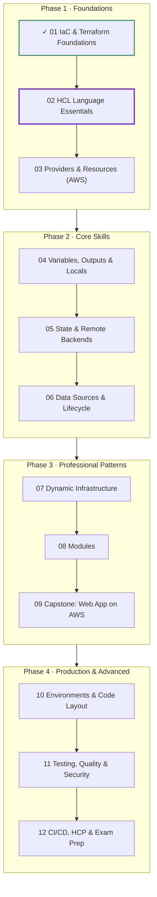
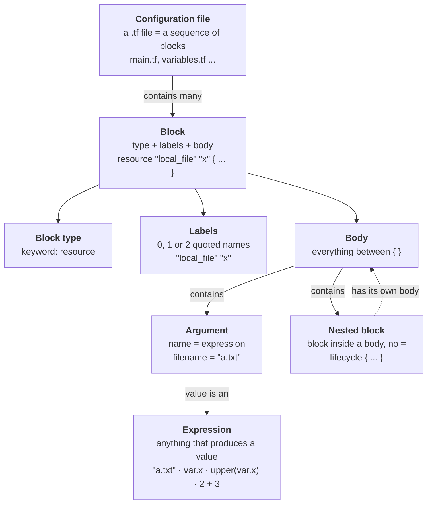
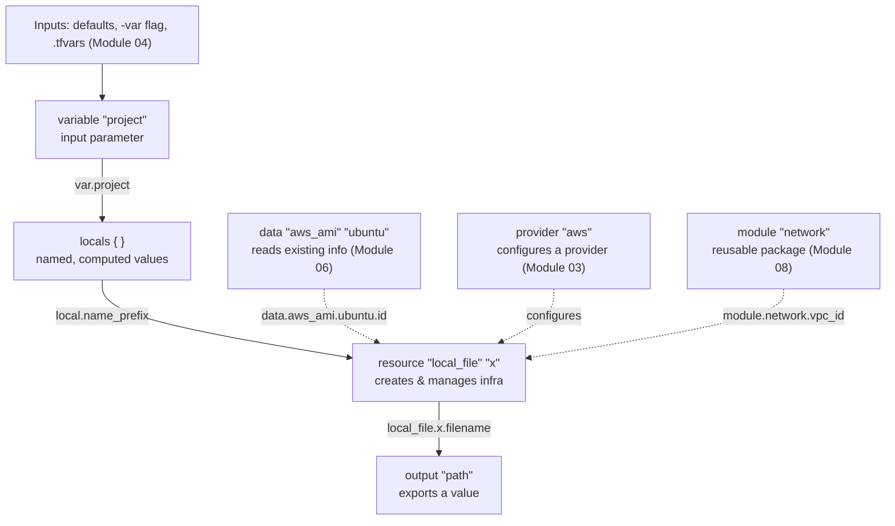
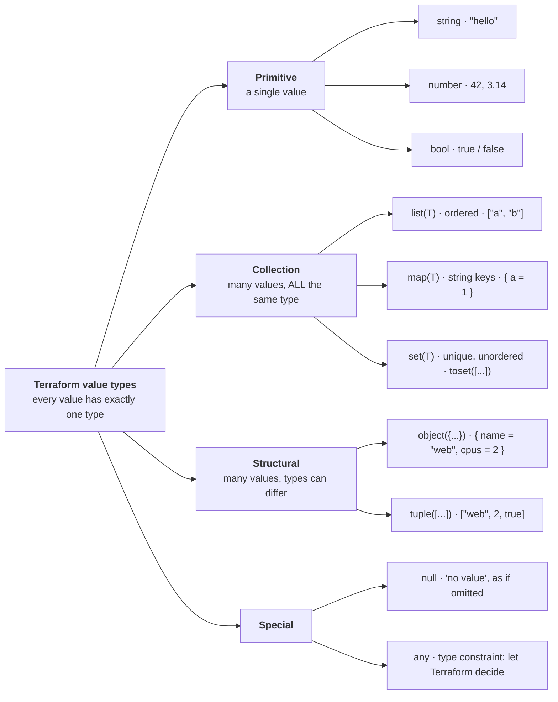
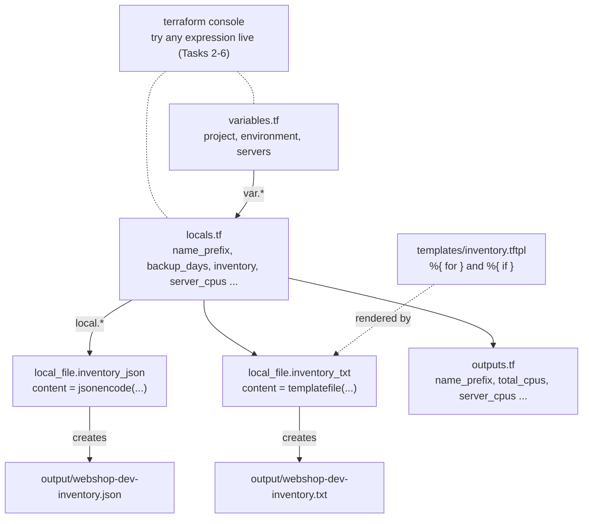

# Terraform: Zero to Advanced
## Module 02 — HCL Language Essentials

> Learn the language Terraform is written in: blocks, types, expressions, functions and templates — and write clean, professional HCL.

| | |
|---|---|
| **Level** | Beginner (Module 01 completed) |
| **Time** | 4–5 hours (concepts + lab) |
| **Cost** | Free — everything runs on your own laptop |
| **Terraform** | 1.6 or newer (current release line: 1.16.x) |

📄 **Full illustrated version:** [Module-02-HCL-Language-Essentials.pdf](./Module-02-HCL-Language-Essentials.pdf)

## Contents

- [1. Module Overview](#1-module-overview)
- [2. Core Concepts](#2-core-concepts)
- [3. Hands-on Lab — HCL Playground & Inventory Generator](#3-hands-on-lab--hcl-playground--inventory-generator)
- [4. Quick Reference](#4-quick-reference)
- [5. Knowledge Check](#5-knowledge-check)
- [6. Summary & Next Steps](#6-summary--next-steps)

---

## 1. Module Overview


*Figure 0 — Where you are: Module 01 done, Module 02 in progress.*

In Module 01 you learned *what* Terraform does and ran the workflow. In this module you learn the **language** itself — **HCL (HashiCorp Configuration Language)**. Every Terraform file you will ever read or write, from a single file resource to a production AWS network, uses the same small set of building blocks covered here. Master them now and every later module becomes about *what* to build, not *how* to write it.

#### Learning objectives — by the end of this module you can:

- Describe HCL's structure: **blocks, labels, bodies, arguments and expressions**.
- Name the main block types and how values flow between them using **references**.
- Use every Terraform **type**: string, number, bool, list, map, set, object, tuple and null.
- Write **expressions**: operators, conditionals, string templates, heredocs, indexing and splat.
- Transform collections with **for expressions**.
- Use the most important **built-in functions**, and experiment safely with `terraform console`.
- Generate files from data using `jsonencode()` and `templatefile()`.
- Follow HashiCorp's **style conventions** and read HCL error messages quickly.

#### Prerequisites

- Module 01 completed: Terraform installed, VS Code with the HashiCorp Terraform extension.
- Comfortable running `init`, `plan`, `apply` and `destroy`.

## 2. Core Concepts

### 2.1 HCL in one picture


*Figure 1 — The grammar of HCL. Everything you write is one of these six things.*

HCL is deliberately small. A configuration file is a list of **blocks**. A block has a **type** (a keyword such as `resource`), zero or more **labels** (quoted names), and a **body** in curly braces. Inside a body you write **arguments** — `name = value` — and sometimes **nested blocks**. The value on the right of every `=` is an **expression**: anything that produces a value, from a simple `"hello"` to `upper(var.project)`.

**`anatomy.tf`**

```hcl
# A comment. Blocks contain arguments and nested blocks.
resource "local_file" "notes" {      # block type + 2 labels
  filename = "notes.txt"             # argument: name = expression
  content  = upper("remember me")    # the expression is a function call

  lifecycle {                        # nested block: no "=" sign
    prevent_destroy = false
  }
}
```

| Rule | Example | Why it matters |
|---|---|---|
| Arguments use `=`; nested blocks don't | `tags = { ... }` vs `lifecycle { ... }` | Mixing them up is one of the most common beginner errors |
| One argument per line | `name = "web"` | Two arguments on one line is a syntax error |
| Identifiers: letters, digits, `_`, `-`; can't start with a digit | `web_server`, `server-1` | Applies to block labels you reference and argument names |
| Comments: use `#` (`//` and `/* */` also work) | `# managed by platform team` | The style guide calls `//` and `/* */` non-idiomatic — use `#` for single- and multi-line comments |
| Order of blocks and files doesn't matter | outputs.tf can reference main.tf | Terraform builds a dependency graph, not a top-to-bottom script |

> [!IMPORTANT]
> **Key idea:** HCL is **declarative**, not a programming language: there are no loops that *run*, no variables you can *re-assign*, and no statement order. You describe values; Terraform works out how and when to evaluate them.

### 2.2 Block types and how values flow between them


*Figure 2 — Values flow between blocks through references. The arrow labels are the exact syntax you type.*

| Block | Labels | Purpose | Deep dive |
|---|---|---|---|
| `terraform` | none | Settings: required Terraform version, required providers, backend | 01, 05 |
| `provider` | provider name | Configure a provider (region, credentials…) | 03 |
| `resource` | type, name | Something Terraform creates and manages | 01, 03 |
| `data` | type, name | Read information about something that already exists | 06 |
| `variable` | name | An input parameter (introduced here, deep dive later) | 04 |
| `locals` | none | Named values computed inside the configuration | this module, 04 |
| `output` | name | Export a value to the CLI or to other configurations | 04 |
| `module` | name | Call a reusable package of Terraform code | 08 |

A **reference** is how one block uses a value from another. References also create the **dependency graph** you saw in Module 01 — Terraform evaluates a value only after everything it references is ready.

| You want… | Syntax | Example |
|---|---|---|
| An input variable | `var.<NAME>` | `var.project` |
| A local value | `local.<NAME>` | `local.name_prefix` |
| A resource attribute | `<TYPE>.<NAME>.<ATTRIBUTE>` | `local_file.notes.filename` |
| A data source attribute | `data.<TYPE>.<NAME>.<ATTRIBUTE>` | `data.aws_ami.ubuntu.id` |
| A module output | `module.<NAME>.<OUTPUT>` | `module.network.vpc_id` |
| Filesystem paths | `path.module`, `path.root`, `path.cwd` | `"${path.module}/files/a.txt"` |
| Current workspace | `terraform.workspace` | `"default"` (Module 10) |

> [!WARNING]
> **Warning:** The block is called `locals` (**plural**) but you reference it as `local.name` (**singular**). Writing `locals.name_prefix` is a classic error.

#### A first look at variable, locals and output

You need these three blocks to practise the language, so here is the minimum. Module 04 covers them in depth.

```hcl
variable "project" {                 # input: can be overridden from outside
  type        = string
  description = "Short project name"
  default     = "webshop"
}

locals {                             # computed values: one block, many names
  name_prefix = "${var.project}-dev"
  is_long     = length(var.project) > 10
}

output "name_prefix" {               # result printed after apply
  value = local.name_prefix
}
```

### 2.3 The type system


*Figure 3 — Terraform's types. Collections hold one element type; structural types mix types.*

| Type | Literal example | Notes |
|---|---|---|
| `string` | `"hello"` | Always double quotes. Escapes: `\n`, `\"`, `\\` |
| `number` | `42`, `3.14`, `-7` | Integers and decimals are the same type |
| `bool` | `true`, `false` | No quotes — `"true"` is a string |
| `list(T)` | `["a", "b"]` | Ordered; index starts at 0: `list[0]` |
| `map(T)` | `{ env = "dev", team = "core" }` | Keys are strings; access with `map["env"]` or `map.env` |
| `set(T)` | `toset(["a", "b"])` | Unique values, no order, no index — used heavily with `for_each` (Module 07) |
| `object({...})` | `{ name = "web", cpus = 2 }` | Like a map but each attribute has its own type |
| `tuple([...])` | `["web", 2, true]` | Like a list but each position has its own type |
| `null` | `null` | Means *no value*: an argument set to `null` behaves as if you omitted it |

#### Automatic type conversion

Terraform converts between types when the target is obvious: the number `5` becomes `"5"` where a string is needed, and `"10"` becomes `10` in arithmetic. A bracket literal like `["a", "b"]` is technically a *tuple*, and `{ a = 1 }` an *object*, but they convert to `list(string)` and `map(number)` automatically when an argument or variable expects those. That is why `terraform console` sometimes shows values wrapped as `tolist([...])`, `tomap({...})` or `toset([...])` — it is telling you the exact type.

> [!WARNING]
> **Warning:** Conversion is not comparison: `"5" == 5` is **false**, because the values have different types. Convert explicitly first: `tostring(5) == "5"` is **true**.

When you declare a variable you give it a **type constraint**. Terraform rejects values that can't be converted:

```hcl
variable "servers" {
  type = list(object({
    name    = string
    size    = string
    enabled = bool
  }))
}
```

### 2.4 Expressions

An expression is anything that produces a value. You will combine these pieces constantly:

| Kind | Syntax | Example → result |
|---|---|---|
| Arithmetic | `+  -  *  /  %` | `10 / 4` → `2.5`,  `10 % 4` → `2` |
| Comparison | `==  !=  <  <=  >  >=` | `length(var.project) > 3` → `true` |
| Logical | `&&  \|\|  !` | `var.enabled && !var.is_prod` |
| Conditional | `condition ? true_val : false_val` | `var.env == "prod" ? 30 : 7` → `7` |
| Index | `list[i]`, `map["key"]` | `["a", "b"][1]` → `"b"` |
| Attribute | `object.attr` | `var.server.name` |
| Splat | `list[*].attr` | `var.servers[*].name` → all names |
| Function call | `name(arg, ...)` | `upper("web")` → `"WEB"` |
| For expression | `[for x in coll : expr]` | see section 2.5 |

**Operator precedence**, highest first: `!` and unary `-` → `*` `/` `%` → `+` `-` → `>` `>=` `<` `<=` → `==` `!=` → `&&` → `||` → `? :`. So `2 + 3 * 4` is `14`. Use parentheses whenever it helps the reader.

> [!WARNING]
> **Warning:** Both results of a conditional should have the **same type**. `var.on ? "yes" : 0` mixes a string and a number; Terraform converts where it can, but mixing object or list shapes fails with *Inconsistent conditional result types*.

#### Strings: interpolation, directives and heredocs

Inside double quotes, `${ ... }` inserts the value of any expression (**interpolation**) and `%{ ... }` runs a **directive** — an `if` or a `for` inside the text:

```hcl
locals {
  greeting = "Hello, ${var.project}!"                                # "Hello, webshop!"
  mode     = "%{ if var.environment == "prod" }LIVE%{ else }test%{ endif }"
  literal  = "Use $${var.x} to write a literal dollar-brace"         # $${ escapes ${
}
```

For multi-line text use a **heredoc**. `<<EOT` keeps the text exactly as written; `<<-EOT` (with a dash) removes the common leading indentation so the text can be indented to match your code:

```hcl
locals {
  members = ["ana", "ben"]

  welcome = <<-EOT
    Team members:
    %{ for m in local.members ~}
    - ${m}
    %{ endfor ~}
  EOT
}
```

*Value of local.welcome:*

```text
Team members:
- ana
- ben
```

The `~` (**strip marker**) removes the whitespace and newline next to a directive, so the `for` lines don't leave empty lines in the result. `EOT` ("end of text") is a convention — any word works as long as the opening and closing markers match.

### 2.5 For expressions: transforming collections

```hcl
[ for s in var.servers : upper(s.name) if s.enabled ]
#  │   │     │              │               └─ filter (optional): keep only matching items
#  │   │     │              └─ transform: evaluated for each item, goes into the result
#  │   │     └─ source collection: list, set, tuple, map or object
#  │   └─ iterator: name for the current item (for i, s -> also index/key)
#  └─ brackets: [ ] -> tuple (list)   { } -> object (map), uses key => value

# result: ["WEB", "API"]
```
*Figure 4 — Anatomy of a for expression.*

A **for expression** builds a new collection from an existing one. It is how you reshape data in HCL — there are no loops that run statements. The bracket you choose decides the result:

```hcl
# [ ] -> tuple/list: transform each element
[for s in var.servers : upper(s.name)]              # ["WEB", "API", "BATCH"]

# with a filter
[for s in var.servers : s.name if s.enabled]        # ["web", "api"]

# { } -> object/map: key => value
{for s in var.servers : s.name => s.size}
# { api = "medium", batch = "large", web = "small" }

# two iterators: index (list) or key (map) + value
[for i, s in var.servers : "${i}-${s.name}"]        # ["0-web", "1-api", "2-batch"]
{for k, v in { a = 1, b = 2 } : upper(k) => v * 10} # { A = 10, B = 20 }
```

A **splat expression** `[*]` is a shortcut for the most common for expression — picking one attribute from every element: `var.servers[*].name` is the same as `[for s in var.servers : s.name]`.

> [!TIP]
> **Tip:** For expressions *reshape data*. To create **many resources** from a collection you will use the `count` and `for_each` meta-arguments — Module 07 builds directly on what you learn here.

### 2.6 Built-in functions

Terraform ships with 100+ built-in functions, called as `name(arguments)`. You can't define your own functions in HCL (since Terraform 1.8, providers can ship extra ones, called as `provider::<name>::<function>`). These are the ones you will use most:

| Category | Function | Example → result |
|---|---|---|
| String | `upper`, `lower`, `title` | `title("hello world")` → `"Hello World"` |
|  | `format` | `format("%s-%03d", "web", 7)` → `"web-007"` |
|  | `join`, `split` | `join("-", ["a", "b"])` → `"a-b"` |
|  | `replace`, `substr`, `trimspace` | `replace("a b", " ", "_")` → `"a_b"` |
| Numeric | `min`, `max`, `ceil`, `floor`, `abs` | `max(5, 12, 9)` → `12`,  `ceil(2.1)` → `3` |
| Collection | `length` | `length(["a", "b"])` → `2` |
|  | `contains` | `contains(["dev", "prod"], "dev")` → `true` |
|  | `lookup` | `lookup({ a = 1 }, "b", 0)` → `0` (default if key missing) |
|  | `keys`, `values` | `keys({ a = 1, b = 2 })` → `["a", "b"]` |
|  | `merge` | `merge({ a = 1 }, { b = 2 })` → `{ a = 1, b = 2 }` |
|  | `concat`, `flatten` | `flatten([["a"], ["b", "c"]])` → `["a", "b", "c"]` |
|  | `toset`, `distinct` | `toset(["a", "b", "a"])` → set of `"a"`, `"b"` |
|  | `element`, `index` | `element(["a", "b", "c"], 4)` → `"b"` (wraps around) |
|  | `sum`, `range` | `sum([1, 2, 3])` → `6`,  `range(3)` → `[0, 1, 2]` |
| Type conversion | `tostring`, `tonumber`, `tobool`, `tolist`, `tomap`, `toset` | `tonumber("42")` → `42` |
| Encoding | `jsonencode`, `jsondecode`, `yamlencode`, `base64encode` | `jsonencode({ a = 1 })` → `"{\"a\":1}"` |
| Filesystem | `file`, `templatefile`, `fileexists` | `file("${path.module}/id_rsa.pub")` |
| IP network | `cidrsubnet`, `cidrhost` | `cidrsubnet("10.0.0.0/16", 8, 1)` → `"10.0.1.0/24"` |
| Errors / defaults | `coalesce`, `try`, `can` | `coalesce("", "fallback")` → `"fallback"` |

> [!TIP]
> **Tip:** Bookmark the [functions reference](https://developer.hashicorp.com/terraform/language/functions). Professionals don't memorise every function — they know the categories and test in `terraform console`.

#### Generating files: jsonencode() and templatefile()

Two functions turn your data into file content. `jsonencode(value)` produces valid JSON from any HCL value — never build JSON by hand with string concatenation. `templatefile(path, vars)` renders a separate template file (convention: `.tftpl` extension) using the same `${}` and `%{}` syntax as strings. Templates keep long text out of your `.tf` files — you will use them for server start-up scripts and policies in later modules.

### 2.7 terraform console: your HCL playground

`terraform console` opens an interactive prompt where you type any expression and see its value immediately. Run inside a project folder (after `terraform init`), it can also read that project's `var.*` and `local.*` values — and resource attributes once they exist in state. It never changes infrastructure.

```bash
terraform console
> upper("hello")
"HELLO"
> exit
```

> [!TIP]
> **Tip:** `type(<expression>)` is a special function that only works in the console: it shows the exact type Terraform inferred. It's the fastest way to understand a confusing type error.

### 2.8 Writing HCL like a professional

HashiCorp publishes an official [style guide](https://developer.hashicorp.com/terraform/language/style). The rules that matter most at this stage:

| Rule | Good | Avoid |
|---|---|---|
| Indent 2 spaces; align `=` of consecutive single-line arguments | `name  = "web"`  /  `count = 2` | tabs, ragged `=` |
| Arguments first, then nested blocks, separated by a blank line | `ami = ...` then `tags { ... }` | blocks mixed between arguments |
| Names in `snake_case`, lowercase | `web_server`, `name_prefix` | `WebServer`, `namePrefix` |
| Don't repeat the resource type in its name | `aws_instance.web` | `aws_instance.web_instance` |
| Give every variable and output a `description` (and variables a `type`) | `description = "Deployment environment"` | undocumented inputs |
| Order variable arguments: `type`, `description`, `default`, `sensitive`, `validation` | see Task 9 | random order |
| Use `#` for all comments; explain *why*, not *what* | `# 30 days: audit requirement` | `// set days to 30` |
| Run `terraform fmt` and `terraform validate` before every commit | — | committing unformatted code |

---

## 3. Hands-on Lab — HCL Playground & Inventory Generator

**Goal:** practise every concept from this module. First you explore types, strings, operators, collections and for expressions live in `terraform console`. Then you use them to turn a list of servers into a computed **inventory** — written as a JSON file and a human-readable report. Everything runs locally at zero cost.


*Figure 5 — What you will build. The console lets you test every expression before you use it.*

Final folder structure:

```text
lab-02-hcl-playground/
├── terraform.tf              # terraform block + required providers
├── variables.tf              # inputs
├── locals.tf                 # all the computed values (the heart of this lab)
├── main.tf                   # two local_file resources
├── outputs.tf                # outputs
└── templates/
    └── inventory.tftpl       # text template
```

### Task 1 — Create the project

```bash
mkdir lab-02-hcl-playground
cd lab-02-hcl-playground
code .
```

Create the first three files. Type them — reading HCL is easy, but *writing* it is the skill.

**`terraform.tf`**

```hcl
terraform {
  required_version = ">= 1.6.0"

  required_providers {
    local = {
      source  = "hashicorp/local"
      version = "~> 2.5"
    }
  }
}
```

**`variables.tf`**

```hcl
variable "project" {
  type        = string
  description = "Short project name, used as a prefix for everything"
  default     = "webshop"
}

variable "environment" {
  type        = string
  description = "Deployment environment: dev, staging or prod"
  default     = "dev"
}

variable "servers" {
  type = list(object({
    name    = string
    size    = string
    enabled = bool
  }))
  description = "Servers we plan to run"
  default = [
    { name = "web", size = "small", enabled = true },
    { name = "api", size = "medium", enabled = true },
    { name = "batch", size = "large", enabled = false },
  ]
}
```

**`locals.tf`**

```hcl
locals {
  # String interpolation
  name_prefix = "${var.project}-${var.environment}"

  # Comparison + conditional expression
  is_production = var.environment == "prod"
  backup_days   = local.is_production ? 30 : 7

  # A map used as a lookup table: size -> CPU cores
  size_to_cpu = {
    small  = 1
    medium = 2
    large  = 4
  }

  # For expression with a filter: keep only enabled servers
  enabled_servers = [for s in var.servers : s if s.enabled]

  # For expression with an index, building a list of objects
  inventory = [
    for i, s in local.enabled_servers : {
      name   = "${local.name_prefix}-${s.name}"
      cpus   = local.size_to_cpu[s.size]
      subnet = cidrsubnet("10.0.0.0/16", 8, i + 1)
    }
  ]

  # For expression producing a map, a splat expression, and a function
  server_cpus  = { for s in local.inventory : s.name => s.cpus }
  server_names = local.inventory[*].name
  total_cpus   = sum(local.inventory[*].cpus)

  common_tags = {
    project     = var.project
    environment = var.environment
    managed_by  = "terraform"
  }
}
```

Initialise the project — the console needs the providers installed:

```bash
terraform init
```

*Expected output (last line):*

```text
Terraform has been successfully initialized!
```

### Task 2 — Types and conversion

Start the console from inside the project folder, then type each line after the `>` prompt:

```bash
terraform console
> "hello"
> 42
> true
> null
> type(42)
> type("42")
> 5 + "10"
> "5" == 5
> tostring(5) == "5"
> 5 + "five"
```

*Expected output:*

```text
"hello"
42
true
null
number
string
15
false
true
╷
│ Error: Invalid operand
│
│   on <console-input> line 1:
│   (source code not available)
│
│ Unsuitable value for right operand: a number is required.
╵
```

`5 + "10"` works because `"10"` converts cleanly to a number; `"five"` can't, so you get a type error. `"5" == 5` is `false`: equality never converts types. The console keeps running after an error — carry on.

### Task 3 — Strings and templates

```bash
> var.project
> "${var.project}-${var.environment}"
> upper(var.project)
> title("hello terraform")
> length("terraform")
> substr("terraform", 0, 5)
> replace("web shop app", " ", "-")
> format("%s-%03d", "web", 7)
> join(", ", ["a", "b", "c"])
> split(",", "a,b,c")
> "%{ if var.environment == "prod" }LIVE%{ else }test%{ endif }"
```

*Expected output:*

```text
"webshop"
"webshop-dev"
"WEBSHOP"
"Hello Terraform"
9
"terra"
"web-shop-app"
"web-007"
"a, b, c"
tolist([
  "a",
  "b",
  "c",
])
"test"
```

Notice `split` returns `tolist([...])`: the console is telling you the result is a real `list(string)`, not a tuple. `%03d` in `format` means *an integer, padded with zeros to 3 digits* — useful for names like `web-007`.

### Task 4 — Numbers, operators and conditionals

```bash
> 10 / 4
> 10 % 4
> 2 + 3 * 4
> (2 + 3) * 4
> max(5, 12, 9)
> ceil(2.1)
> floor(2.9)
> var.environment == "prod" ? 30 : 7
> local.backup_days
> !local.is_production && length(var.project) > 3
```

*Expected output:*

```text
2.5
2
14
20
12
3
2
7
7
true
```

`local.backup_days` gives the same answer as the expression before it — because that *is* its definition in `locals.tf`. The console is the perfect place to check a local before using it.

### Task 5 — Collections

```bash
> local.size_to_cpu
> local.size_to_cpu["medium"]
> local.size_to_cpu.large
> lookup(local.size_to_cpu, "xlarge", 8)
> keys(local.size_to_cpu)
> length(var.servers)
> var.servers[0].name
> contains(["dev", "staging", "prod"], var.environment)
> toset(["b", "a", "b"])
> merge(local.common_tags, { owner = "platform-team" })
```

*Expected output:*

```text
{
  "large" = 4
  "medium" = 2
  "small" = 1
}
2
4
8
[
  "large",
  "medium",
  "small",
]
3
"web"
true
toset([
  "a",
  "b",
])
{
  "environment" = "dev"
  "managed_by" = "terraform"
  "owner" = "platform-team"
  "project" = "webshop"
}
```

Three lessons: maps and objects are shown with keys in **alphabetical order**; `lookup` returns the default (`8`) instead of failing when a key is missing; and a set **removes duplicates and has no order** — `toset(["b", "a", "b"])` keeps only `"a"` and `"b"`.

### Task 6 — For expressions, splat and network functions

```bash
> [for s in var.servers : upper(s.name)]
> [for s in var.servers : s.name if s.enabled]
> {for s in var.servers : s.name => s.size}
> cidrsubnet("10.0.0.0/16", 8, 1)
> local.inventory
> local.inventory[*].name
> local.total_cpus
> type(local.server_names)
> exit
```

*Expected output:*

```text
[
  "WEB",
  "API",
  "BATCH",
]
[
  "web",
  "api",
]
{
  "api" = "medium"
  "batch" = "large"
  "web" = "small"
}
"10.0.1.0/24"
[
  {
    "cpus" = 1
    "name" = "webshop-dev-web"
    "subnet" = "10.0.1.0/24"
  },
  {
    "cpus" = 2
    "name" = "webshop-dev-api"
    "subnet" = "10.0.2.0/24"
  },
]
[
  "webshop-dev-web",
  "webshop-dev-api",
]
3
tuple([
    string,
    string,
])
```

Trace `local.inventory` back through `locals.tf`: the filter dropped `batch` (disabled); `size_to_cpu` turned `small`/`medium` into `1`/`2`; and `cidrsubnet` carved the `/16` network into a `/24` subnet per server (index `0` → `.1.0/24`, index `1` → `.2.0/24`). You will use exactly this pattern to plan AWS subnets in Module 09.

> [!IMPORTANT]
> **Key idea:** You just computed a realistic server inventory **without creating anything**. Locals and expressions are pure calculation; only resources touch the real world.

### Task 7 — Generate files from your data

Now put the values to work. Create the template, the resources and the outputs:

**`templates/inventory.tftpl`**

```text
Inventory: ${prefix}
Mode: %{ if production }PRODUCTION%{ else }non-production%{ endif }
Backups kept for ${backup_days} days

%{ for s in servers ~}
- ${s.name}: ${s.cpus} vCPU, subnet ${s.subnet}
%{ endfor ~}
Total: ${total} vCPU
```

**`main.tf`**

```hcl
# Machine-readable inventory: jsonencode builds valid JSON from any HCL value.
resource "local_file" "inventory_json" {
  filename = "${path.module}/output/${local.name_prefix}-inventory.json"
  content = jsonencode({
    project     = var.project
    environment = var.environment
    servers     = local.inventory
    total_cpus  = local.total_cpus
    tags        = local.common_tags
  })
}

# Human-readable report rendered from a template file.
resource "local_file" "inventory_txt" {
  filename = "${path.module}/output/${local.name_prefix}-inventory.txt"
  content = templatefile("${path.module}/templates/inventory.tftpl", {
    prefix      = local.name_prefix
    production  = local.is_production
    backup_days = local.backup_days
    servers     = local.inventory
    total       = local.total_cpus
  })
}
```

**`outputs.tf`**

```hcl
output "name_prefix" {
  description = "Prefix used for all names"
  value       = local.name_prefix
}

output "server_names" {
  description = "Full names of the enabled servers"
  value       = local.server_names
}

output "server_cpus" {
  description = "vCPUs per server"
  value       = local.server_cpus
}

output "total_cpus" {
  description = "Total vCPUs across enabled servers"
  value       = local.total_cpus
}

output "backup_days" {
  description = "Backup retention in days"
  value       = local.backup_days
}
```

Every variable the template uses must be passed in the map — the template can't see `var.*` or `local.*` directly. That isolation is deliberate: a template is a small, reusable function of its inputs.

```bash
terraform fmt
terraform validate
terraform plan
```

*Expected output (abridged):*

```text
Terraform will perform the following actions:

  # local_file.inventory_json will be created
  + resource "local_file" "inventory_json" {
      + content              = jsonencode(
            {
              + environment = "dev"
              + project     = "webshop"
              + servers     = [ ... ]
              ...
            }
        )
      + filename             = "./output/webshop-dev-inventory.json"
      ...
    }

  # local_file.inventory_txt will be created
  + resource "local_file" "inventory_txt" {
      + content              = <<-EOT
            Inventory: webshop-dev
            Mode: non-production
            ...
        EOT
      + filename             = "./output/webshop-dev-inventory.txt"
      ...
    }

Plan: 2 to add, 0 to change, 0 to destroy.

Changes to Outputs:
  + backup_days  = 7
  + name_prefix  = "webshop-dev"
  ...
```

Look at how the plan displays the content: Terraform recognises JSON and multi-line strings and shows them readably (`jsonencode(...)`, `<<-EOT`). Now apply and inspect the results:

```bash
terraform apply
cat output/webshop-dev-inventory.txt
terraform output
```

*Expected output:*

```text
Apply complete! Resources: 2 added, 0 changed, 0 destroyed.

Inventory: webshop-dev
Mode: non-production
Backups kept for 7 days

- webshop-dev-web: 1 vCPU, subnet 10.0.1.0/24
- webshop-dev-api: 2 vCPU, subnet 10.0.2.0/24
Total: 3 vCPU

backup_days = 7
name_prefix = "webshop-dev"
server_cpus = {
  "webshop-dev-api" = 2
  "webshop-dev-web" = 1
}
server_names = [
  "webshop-dev-web",
  "webshop-dev-api",
]
total_cpus = 3
```

Open `output/webshop-dev-inventory.json` in VS Code. `jsonencode` writes compact JSON on one line with keys sorted alphabetically — use *Format Document* (Shift+Alt+F) to view it nicely. On Windows CMD use `type output\webshop-dev-inventory.txt` instead of `cat`.

### Task 8 — Change an input and read the plan

Inputs make the same code produce different results. Override `environment` for one run with `-var` — **don't apply**, just read the plan:

```bash
terraform plan -var="environment=prod"
```

*Expected output (abridged):*

```text
  # local_file.inventory_json must be replaced
-/+ resource "local_file" "inventory_json" {
      ~ content  = jsonencode(
          ~ {
              ~ environment = "dev" -> "prod"
              ...
            }
        )
      ~ filename = "./output/webshop-dev-inventory.json"
                -> "./output/webshop-prod-inventory.json" # forces replacement
      ...
    }

  # local_file.inventory_txt must be replaced
-/+ resource "local_file" "inventory_txt" {
      ~ content  = <<-EOT
          - Inventory: webshop-dev
          - Mode: non-production
          - Backups kept for 7 days
          + Inventory: webshop-prod
          + Mode: PRODUCTION
          + Backups kept for 30 days
          ...
        EOT
      ~ filename = ... # forces replacement
      ...
    }

Plan: 2 to add, 0 to change, 2 to destroy.

Changes to Outputs:
  ~ backup_days  = 7 -> 30
  ~ name_prefix  = "webshop-dev" -> "webshop-prod"
  ...
```

One changed input rippled through the whole graph: `name_prefix` → file names and server names; `is_production` → `backup_days` and the *Mode* line. Before you run this, try to **predict** which outputs change — that habit is what makes you safe in production. Your real files are unchanged because you didn't apply.

### Task 9 — Style and error messages

**Formatting.** Create a scratch file `messy.tf` with this badly formatted variable:

**`messy.tf`**

```hcl
variable "owner"{
default="platform-team"
type=string
    description   = "Team that owns this stack"
}
```

```bash
terraform fmt
```

*Expected output (files that were changed):*

```text
messy.tf
```

**`messy.tf after fmt`**

```hcl
variable "owner" {
  default     = "platform-team"
  type        = string
  description = "Team that owns this stack"
}
```

`fmt` fixed indentation, spacing and alignment — but it **does not reorder arguments**. Reorder them by hand to the style-guide order (`type`, `description`, `default`), run `terraform fmt -check` (no output = all good), then delete `messy.tf`.

**Reading errors.** In `main.tf`, change `local.name_prefix` in the first `filename` to `local.name_prefx`, then:

```bash
terraform validate
```

*Expected output:*

```text
╷
│ Error: Reference to undeclared local value
│
│   on main.tf line 3, in resource "local_file" "inventory_json":
│    3:   filename = "${path.module}/output/${local.name_prefx}-inventory.json"
│
│ A local value with the name "name_prefx" has not been declared. Did you mean "name_prefix"?
╵
```

Read it top-down: **what** (undeclared local value), **where** (file, line, block), **why** and often a **suggestion**. Fix the typo and validate again until you see `Success! The configuration is valid.`

### Task 10 — Clean up

```bash
terraform destroy
```

*Expected output (abridged):*

```text
Plan: 0 to add, 0 to change, 2 to destroy.
...
Destroy complete! Resources: 2 destroyed.
```

Both inventory files are removed. The `output/` folder itself may remain, empty — Terraform only manages the files it was told about. Delete it by hand if you like.

### Challenge — add a cost estimate

Run `terraform apply` again to rebuild, then extend the configuration **without looking at the solution**:

1. Add a local map `size_to_price` with monthly prices: small = 10, medium = 20, large = 40.
2. Add a `price` attribute to every object in `local.inventory`.
3. Add a local `monthly_cost` (total of all prices) and a local `big_servers`: names of servers with 2 or more vCPUs.
4. Output both, and add a line `Estimated cost: <n> USD/month` to the template.
5. **Before** running plan, write down: the value of each new output, and the plan summary line. Then check.

#### Solution

**`locals.tf (changes)`**

```hcl
  size_to_price = {
    small  = 10
    medium = 20
    large  = 40
  }

  inventory = [
    for i, s in local.enabled_servers : {
      name   = "${local.name_prefix}-${s.name}"
      cpus   = local.size_to_cpu[s.size]
      price  = local.size_to_price[s.size]
      subnet = cidrsubnet("10.0.0.0/16", 8, i + 1)
    }
  ]

  monthly_cost = sum(local.inventory[*].price)
  big_servers  = [for s in local.inventory : s.name if s.cpus >= 2]
```

**`outputs.tf (additions)`**

```hcl
output "monthly_cost" {
  description = "Estimated monthly cost in USD"
  value       = local.monthly_cost
}

output "big_servers" {
  description = "Servers with 2 or more vCPUs"
  value       = local.big_servers
}
```

**`templates/inventory.tftpl (last line)`**

```text
Estimated cost: ${cost} USD/month
```

…and pass it into the template map in `main.tf`: `cost = local.monthly_cost`.

*Expected plan summary:*

```text
Plan: 2 to add, 0 to change, 2 to destroy.

Changes to Outputs:
  + big_servers  = [
      + "webshop-dev-api",
    ]
  + monthly_cost = 30
```

Why **replace** both files? Their `content` changed — the JSON now includes `price`, the report has a new line — and every `local_file` argument forces replacement (Module 01, Task 7). `monthly_cost` is 10 + 20 = **30** because `batch` is disabled. Apply it, check the report, then finish with `terraform destroy`.

#### Lab complete when you can tick every box

- [ ] I can predict the console output for strings, numbers, collections and for expressions.
- [ ] I can explain why `"5" == 5` is false and why the console shows `tolist(...)`.
- [ ] I built a list of objects with a for expression and turned it into a map.
- [ ] I generated files with `jsonencode()` and `templatefile()`.
- [ ] I predicted how one input change ripples through a plan.
- [ ] I know what `terraform fmt` fixes — and what it doesn't.

---

## 4. Quick Reference

### 4.1 Syntax cheat sheet

| Need | Syntax |
|---|---|
| Comment | `# comment` (use `#` on each line for multi-line) |
| String with a value inside | `"app-${var.env}"` |
| Literal `${` in a string | `"$${not_interpolated}"` |
| If inside a string | `"%{ if cond }yes%{ else }no%{ endif }"` |
| Multi-line string | `<<-EOT` … `EOT` |
| Conditional | `cond ? a : b` |
| List / map / object literal | `["a", "b"]`   `{ key = "value" }` |
| Index / key / attribute | `list[0]`   `map["key"]`   `obj.attr` |
| Splat | `list[*].attr` |
| Transform a list | `[for x in list : f(x)]` |
| Filter a list | `[for x in list : x if cond]` |
| List → map | `{for x in list : x.key => x.value}` |
| Default for a missing key | `lookup(map, "key", default)` |
| Inspect a type (console only) | `type(expr)` |

### 4.2 Common errors and fixes

| Error | Usual cause | Fix |
|---|---|---|
| `Reference to undeclared local value / input variable` | Typo, or `locals.x` instead of `local.x` | Use the suggestion in the message; references are `local.` and `var.` |
| `Unsupported attribute` | Attribute name doesn't exist on that object | Check spelling; use `type()` in the console to see the attributes |
| `Invalid operand` / `Unsuitable value` | Wrong type in an operator, e.g. `5 + "five"` | Convert with `tonumber()`/`tostring()` or fix the value |
| `Inconsistent conditional result types` | `? :` branches have different types | Make both branches the same type |
| `Invalid index` / `Invalid key` | List index out of range, or map key missing | Check `length()`; use `lookup()` with a default |
| `An argument or block definition is required here` | Missing `=`, or two arguments on one line | One `name = value` per line |
| `Invalid value for input variable` | Value doesn't match the variable's `type` | Pass a value of the declared type |
| Template: `vars map does not contain key` | Template uses a variable you didn't pass | Add it to the `templatefile()` map |

## 5. Knowledge Check

**Q1. What are the parts of a block, and how do you tell an argument from a nested block?**

<details><summary>Show answer</summary>

Block type, labels and body. An argument uses `=` (`name = value`); a nested block has no `=` (`lifecycle { ... }`).

</details>

**Q2. How do you reference a local value defined in a `locals` block?**

<details><summary>Show answer</summary>

`local.<name>` — singular `local`, even though the block is `locals`.

</details>

**Q3. What is the difference between a list and a tuple, and a map and an object?**

<details><summary>Show answer</summary>

Lists and maps hold elements of one type; tuples and objects allow a different type per position or attribute.

</details>

**Q4. What do `"5" == 5` and `5 + "10"` return?**

<details><summary>Show answer</summary>

`false` (equality doesn't convert types) and `15` (arithmetic converts `"10"` to a number).

</details>

**Q5. What does `[for s in var.servers : s.name if s.enabled]` produce?**

<details><summary>Show answer</summary>

A list (tuple) of the names of the servers whose `enabled` is true.

</details>

**Q6. How do you build a map from a list with a for expression?**

<details><summary>Show answer</summary>

Use curly braces and `=>`: `{for s in list : s.name => s.size}`.

</details>

**Q7. What is `var.servers[*].name` equivalent to?**

<details><summary>Show answer</summary>

`[for s in var.servers : s.name]` — the splat expression picks one attribute from every element.

</details>

**Q8. Why use `jsonencode()` and `templatefile()` instead of building strings by hand?**

<details><summary>Show answer</summary>

`jsonencode` always produces valid JSON; `templatefile` keeps long text in a separate, reusable template with explicit inputs.

</details>

**Q9. What does the `~` in `%{ for x in list ~}` do?**

<details><summary>Show answer</summary>

It's a strip marker: it removes the adjacent whitespace and newline so directives don't leave blank lines.

</details>

**Q10. What does `terraform fmt` fix, and what doesn't it?**

<details><summary>Show answer</summary>

It fixes indentation, spacing and `=` alignment. It doesn't reorder arguments, rename things or check logic — `terraform validate` checks correctness.

</details>

## 6. Summary & Next Steps

- HCL is **blocks** (type, labels, body) containing **arguments** and **nested blocks**; every value is an **expression**.
- Blocks connect through **references** — `var.`, `local.`, `<type>.<name>.`, `data.`, `module.` — which also build the dependency graph.
- Types: **primitive** (string, number, bool), **collection** (list, map, set), **structural** (object, tuple) and **null**.
- Expressions: operators, `? :`, `${}` interpolation, `%{}` directives, heredocs, indexing and splat.
- **For expressions** reshape data: `[ ]` builds a list, `{ }` with `=>` builds a map; `if` filters.
- Learn the function **categories**; test anything in `terraform console`, and use `type()` there to debug types.
- Style: 2-space indent, aligned `=`, snake_case, descriptions everywhere; `terraform fmt` + `validate` before every commit.

**Next — Module 03: Providers & Resources (AWS).** You leave the laptop and build real cloud infrastructure: creating a free-tier AWS account safely, configuring credentials and the AWS provider, pinning versions, and creating an S3 bucket and an EC2 instance — using the HCL skills from this module.

#### Official references

- [Configuration syntax](https://developer.hashicorp.com/terraform/language/syntax/configuration)
- [Types and values](https://developer.hashicorp.com/terraform/language/expressions/types)
- [Expressions](https://developer.hashicorp.com/terraform/language/expressions)
- [Built-in functions](https://developer.hashicorp.com/terraform/language/functions)
- [terraform console](https://developer.hashicorp.com/terraform/cli/commands/console)
- [Style guide](https://developer.hashicorp.com/terraform/language/style)
