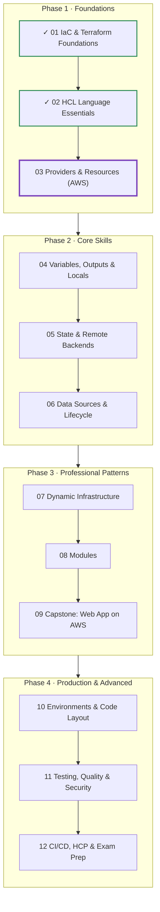
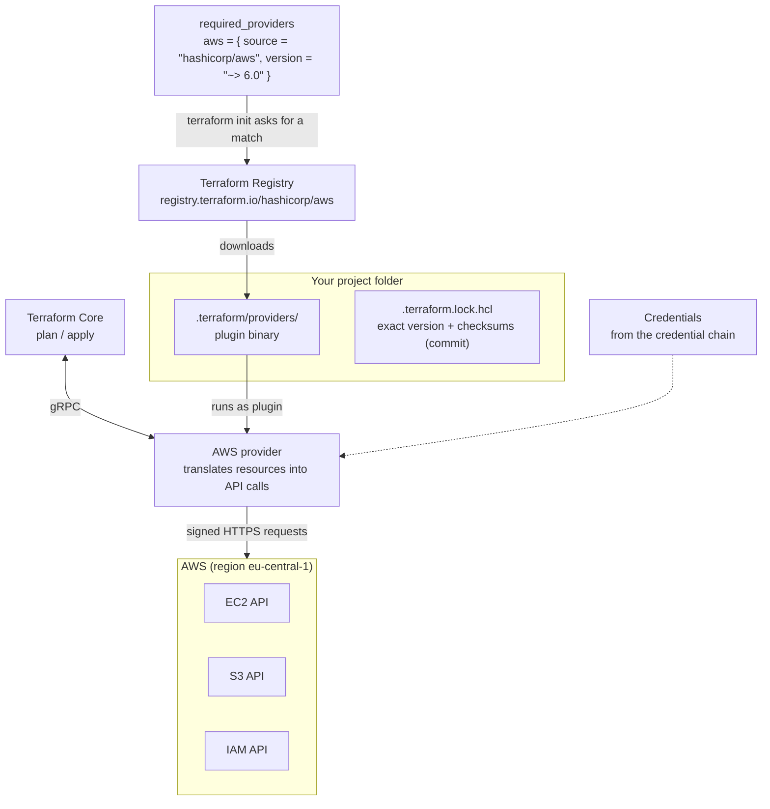
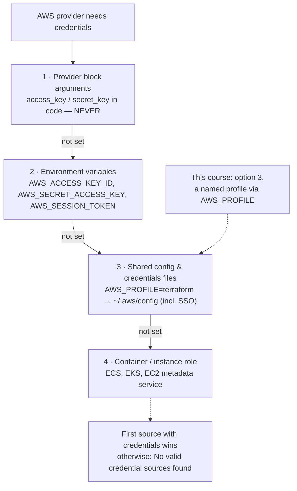
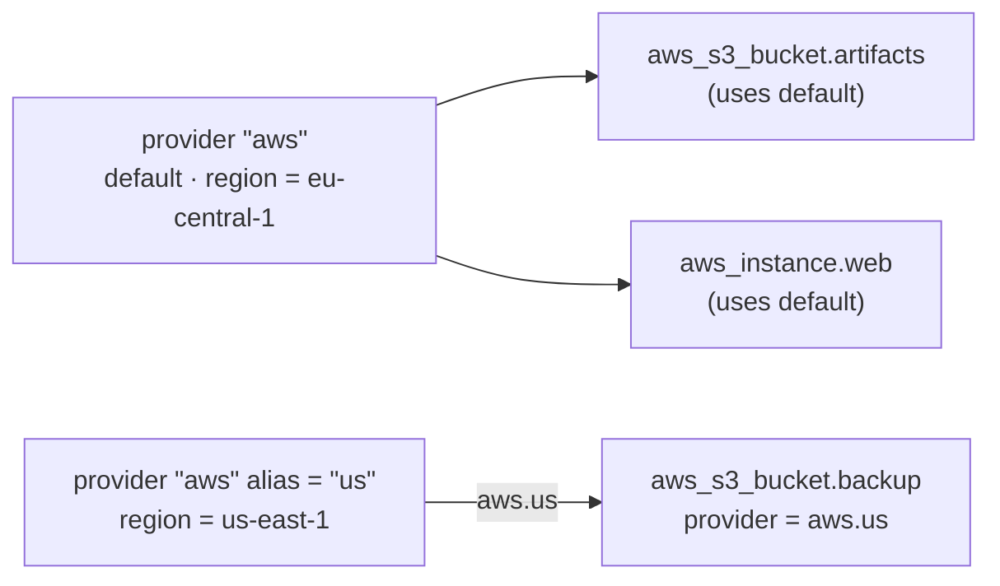
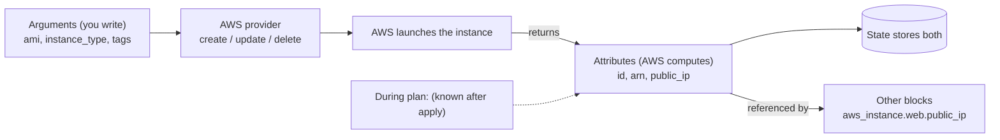
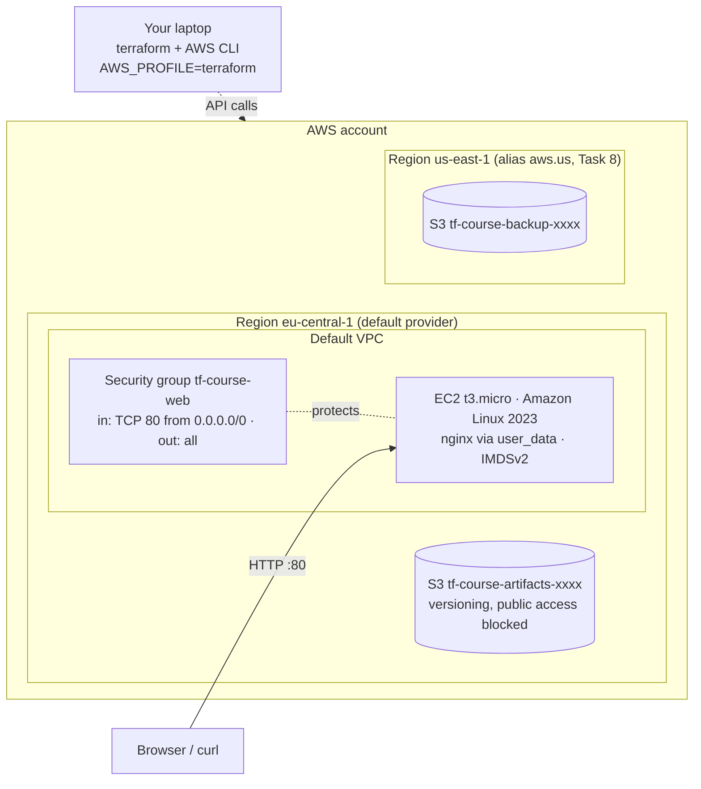

# Terraform: Zero to Advanced
## Module 03 — Providers & Resources (AWS)

> Connect Terraform to AWS safely, understand how providers work, and build your first real cloud infrastructure: an S3 bucket and a web server on EC2.

| | |
|---|---|
| **Level** | Beginner (Modules 01–02 completed) |
| **Time** | 4–5 hours (concepts + lab) |
| **Cost** | ≈ $0 on the AWS Free Tier if you destroy at the end |
| **Terraform** | 1.12 or newer · AWS provider 6.x |

📄 **Full illustrated version:** [Module-03-Providers-and-Resources-AWS.pdf](./Module-03-Providers-and-Resources-AWS.pdf)

## Contents

- [1. Module Overview](#1-module-overview)
- [2. Core Concepts](#2-core-concepts)
- [3. Hands-on Lab — Your First AWS Infrastructure](#3-hands-on-lab--your-first-aws-infrastructure)
- [4. Quick Reference](#4-quick-reference)
- [5. Knowledge Check](#5-knowledge-check)
- [6. Summary & Next Steps](#6-summary--next-steps)

---

## 1. Module Overview


*Figure 0 — Where you are: Modules 01–02 done, Module 03 in progress.*

Until now everything ran on your laptop. In this module Terraform starts managing **real cloud infrastructure on AWS**. You will set up an AWS account the safe way, connect Terraform to it without ever putting secrets in code, learn exactly how providers are installed and versioned, and build an S3 bucket and a working web server on EC2 — then tear everything down so it costs nothing.

#### Learning objectives — by the end of this module you can:

- Explain how providers are **sourced, versioned, installed and locked**.
- Secure a new AWS account: MFA, a non-root identity for Terraform and a **budget alert**.
- Authenticate Terraform to AWS through the **credential chain**, using a named profile — never hard-coded keys.
- Configure the AWS provider: `region`, `default_tags` and **multiple configurations with `alias`**.
- Read the Registry documentation of any resource: **arguments vs attributes**, and which changes **force replacement**.
- Create, update, replace and destroy real AWS resources: S3 bucket, security group and EC2 instance.
- Detect and fix **drift** caused by manual console changes.

#### Prerequisites

- Modules 01–02 completed.
- An email address and a payment card for the AWS sign-up (AWS verifies the card; the lab stays within the Free Tier).
- Basic AWS vocabulary helps (region, EC2, S3, IAM) — the Cloud Practitioner level is plenty.

## 2. Core Concepts

### 2.1 How providers work


*Figure 1 — terraform init installs the provider; during plan/apply Core talks to it, and it talks to AWS.*

Terraform Core knows nothing about AWS. All AWS knowledge lives in the **AWS provider**, a separate program maintained by HashiCorp and published on the Registry. Each provider has a **source address** of the form `<HOSTNAME>/<NAMESPACE>/<TYPE>`; the hostname defaults to `registry.terraform.io`, so `hashicorp/aws` means `registry.terraform.io/hashicorp/aws`.

| Namespace / tier | Maintained by | Examples |
|---|---|---|
| **Official** | HashiCorp | `hashicorp/aws`, `hashicorp/azurerm`, `hashicorp/random` |
| **Partner** | The technology company, verified by HashiCorp | `cloudflare/cloudflare`, `datadog/datadog` |
| **Community** | Individuals and community groups | thousands of niche providers — check activity and stars |

#### Versions, constraints and the lock file

Providers release often — the AWS provider ships a new version almost every week. You control which versions are allowed with a **constraint** in `required_providers`, and Terraform records the version it actually chose in `.terraform.lock.hcl`:

| Situation | What happens |
|---|---|
| First `terraform init` | Picks the **newest** version that matches the constraint; writes it and its checksums to the lock file |
| Later `terraform init` (lock file exists) | Reuses the **locked** version, even if newer ones exist — everyone gets the same build |
| `terraform init -upgrade` | Re-selects the newest version allowed by the constraint and updates the lock file |
| Constraint no longer matches the lock | `init` fails and asks you to run `terraform init -upgrade` |

> [!IMPORTANT]
> **Key idea:** Use `~> 6.0` style constraints for providers (any 6.x, never 7.0), **commit the lock file**, and upgrade deliberately with `terraform init -upgrade` on a branch — then read the plan. Major versions can contain breaking changes; HashiCorp publishes an upgrade guide for each.

### 2.2 Authenticating to AWS — the credential chain


*Figure 2 — The AWS provider tries each credential source in order; the first that provides credentials wins.*

The provider looks for credentials in a fixed order. You will use **option 3**: a named profile stored in your AWS CLI configuration and selected with the `AWS_PROFILE` environment variable. Your `.tf` files never contain a secret, so they are safe to commit and share.

| Identity option | How it works | Verdict |
|---|---|---|
| **Root user** | The email you signed up with — full, unrestricted power | Never use for daily work or Terraform |
| **IAM Identity Center (SSO)** user | Log in with `aws sso login`; the CLI receives **short-lived** credentials (hours) | **Recommended** — nothing long-lived on disk |
| **IAM user + access key** | A long-lived key pair stored in `~/.aws/credentials` | Acceptable for a personal learning account; rotate and protect it |
| **IAM role** (OIDC, instance profile) | Credentials issued to a machine or pipeline | What CI/CD uses — Module 12 |

> [!WARNING]
> **Never** put `access_key` / `secret_key` in a `.tf` file, a `.tfvars` file or anything committed to Git. Leaked AWS keys are found by bots within minutes and used for crypto-mining at your expense.

### 2.3 Configuring the provider

A `provider` block configures *how* the provider connects — mainly the region. Put it in `providers.tf`:

**`providers.tf`**

```hcl
provider "aws" {
  region = var.aws_region            # every resource goes here unless told otherwise

  default_tags {                     # added to EVERY taggable resource automatically
    tags = {
      Project   = "terraform-course"
      ManagedBy = "terraform"
    }
  }
}
```

`default_tags` is a professional habit: every resource is labelled with its project and owner, which makes cost reports and clean-up easy. In plans you will see both `tags` (set on the resource) and `tags_all` (resource tags plus default tags).

#### Multiple configurations: alias


*Figure 3 — A second configuration with an alias; a resource selects it with the provider meta-argument.*

Need resources in two regions (or two accounts)? Declare the provider again with an `alias` and select it on individual resources with the `provider` **meta-argument**. Resources without it use the default configuration. Aliases are the general mechanism — they also work for different **accounts or credentials** — and they're what the certification exam tests.

```hcl
provider "aws" {
  alias  = "us"
  region = "us-east-1"
}

resource "aws_s3_bucket" "backup" {
  provider = aws.us                  # meta-argument: no quotes, <name>.<alias>
  bucket   = "my-backup-bucket"
}
```

### 2.4 Resources in depth: arguments, attributes and replacement


*Figure 4 — You set arguments; AWS computes attributes; both are stored in state and can be referenced.*

Every resource page in the Registry (e.g. *aws_instance*) follows the same layout. Learn to read it and you can use any of the 1,500+ AWS resource types without a tutorial:

| Section of the docs page | What it tells you |
|---|---|
| **Example Usage** | A working snippet — the fastest starting point |
| **Argument Reference** | What you can set. *Required* vs *Optional*; some say **forces new resource** |
| **Attribute Reference** | Extra values available after creation: `id`, `arn`, `public_ip`… |
| **Import** | How to bring an existing resource under Terraform (Module 05) |

Whether a change is an **update in place** (`~`) or a **replacement** (`-/+`) depends on the cloud API, not on Terraform. Typical AWS examples:

| Change | Result | Why |
|---|---|---|
| Tags on any resource | `~` update in place | AWS can re-tag an existing object |
| `instance_type` of an EC2 instance | `~` update (instance is stopped and started) | AWS can resize a stopped instance |
| `ami` of an EC2 instance | `-/+` replace | You can't swap the disk image of a running machine |
| `bucket` name of an S3 bucket | `-/+` replace | Bucket names are permanent |
| `user_data` with `user_data_replace_on_change = true` | `-/+` replace | You asked for a fresh instance on every script change |

> [!WARNING]
> **Warning:** On real infrastructure **replace means downtime or data loss** — a replaced database is a *new, empty* database. Always find the `# forces replacement` comment in a plan before you approve it.

### 2.5 Cost and safety rules for this course

AWS bills per second or per hour of usage. The labs are designed to stay within the **Free Tier**, which depends on when your account was created:

|   | Account created on/after 15 July 2025 | Account created before 15 July 2025 |
|---|---|---|
| Model | **Free plan**: $100 sign-up credit + up to $100 more for completing activities | Monthly usage limits |
| Duration | 6 months, or until credits run out | 12 months from sign-up |
| Free EC2 types | `t3.micro`, `t3.small`, `t4g.micro`, `t4g.small`, `c7i-flex.large`, `m7i-flex.large` | `t2.micro`, `t3.micro` |

- Labs use `t3.micro`, which is free-tier eligible under **both** models.
- **Always finish with `terraform destroy`** and check the console for leftovers.
- Create a **budget alert** before you create anything (Lab Task 1).
- Prefer one region for everything (this course uses `eu-central-1`; choose the region closest to you and use it consistently).

---

## 3. Hands-on Lab — Your First AWS Infrastructure

**Goal:** set up AWS safely, connect Terraform, then build and evolve real infrastructure: a versioned S3 bucket and an nginx web server on EC2 reachable from your browser. You will see in-place updates, a replacement, a second region via an alias, and drift — and finish at zero cost.


*Figure 5 — What you will build.*

Final folder structure:

```text
lab-03-aws-first-steps/
├── terraform.tf      # required_version + required_providers (aws, random)
├── providers.tf      # provider "aws" (default + alias)
├── variables.tf      # aws_region
├── main.tf           # S3 bucket + settings
├── web.tf            # security group + EC2 web server
└── outputs.tf        # bucket name, public IP, URL
```

### Task 1 — Secure your AWS account (one-time, ~20 minutes)

Do these in the AWS Management Console. They protect you for the whole course.

1. **Sign up** at aws.amazon.com (choose the *Free* plan if offered). Sign in as the **root user**.
2. **Enable MFA on the root user**: account menu → *Security credentials* → *Assign MFA device* (an authenticator app is fine).
3. **Create a budget**: search *Budgets* → *Create budget* → template **Zero spend budget** (or *Monthly cost budget* of $5) → your email. You'll be warned the moment anything costs money.
4. **Create an identity for Terraform** — choose one:
5. **Option A (recommended): IAM Identity Center.** Search *IAM Identity Center* → *Enable*. Create a user for yourself, create a *permission set* from the predefined **AdministratorAccess** policy, and assign user + permission set to your AWS account. Note the **AWS access portal URL** shown on the dashboard.
6. **Option B: IAM user.** Search *IAM* → *Users* → *Create user* `terraform-learner` → attach **AdministratorAccess** → open the user → *Security credentials* → *Create access key* → use case *Command Line Interface*. Download the key **once** and keep it private.
7. From now on **sign out of the root user** and use only the identity from step 4.

> [!TIP]
> **Tip:** AdministratorAccess is convenient for a personal learning account. In companies, Terraform gets narrowly scoped roles — you'll design those in Module 12.

### Task 2 — Install the AWS CLI and create a profile

Install AWS CLI v2 from the official *Installing the AWS CLI* page (MSI on Windows, PKG on macOS, ZIP on Linux), then create a profile named `terraform`:

```bash
# Option A: IAM Identity Center
aws configure sso --profile terraform
#   SSO session name: course
#   SSO start URL:    <your AWS access portal URL>
#   SSO region:       <region where you enabled Identity Center>
#   -> a browser window opens; approve, choose your account and AdministratorAccess
#   CLI default region: eu-central-1     output format: json

# Option B: IAM user access key
aws configure --profile terraform
#   AWS Access Key ID / Secret Access Key: <from Task 1>
#   Default region name: eu-central-1     Default output format: json
```

Select the profile for this terminal session and confirm who you are:

```bash
export AWS_PROFILE=terraform           # macOS / Linux
$env:AWS_PROFILE = "terraform"         # Windows PowerShell

aws sts get-caller-identity
```

*Expected output:*

```text
{
    "UserId": "AIDA...EXAMPLE",
    "Account": "123456789012",
    "Arn": "arn:aws:iam::123456789012:user/terraform-learner"
}
```

With Identity Center the ARN looks like `arn:aws:sts::123456789012:assumed-role/AWSReservedSSO_AdministratorAccess_.../you`. SSO sessions expire after some hours — when commands fail with an expired-token error, run `aws sso login --profile terraform` again.

> [!WARNING]
> **Warning:** Set `AWS_PROFILE` in **every new terminal** before running Terraform (or add it to your shell profile). If Terraform says *No valid credential sources found*, this is almost always the reason.

### Task 3 — Write the configuration

```bash
mkdir lab-03-aws-first-steps
cd lab-03-aws-first-steps
```

**`terraform.tf`**

```hcl
terraform {
  required_version = ">= 1.12.0"

  required_providers {
    aws = {
      source  = "hashicorp/aws"
      version = "~> 6.0"
    }
    random = {
      source  = "hashicorp/random"
      version = "~> 3.7"
    }
  }
}
```

**`variables.tf`**

```hcl
variable "aws_region" {
  type        = string
  description = "AWS region for all resources in this lab"
  default     = "eu-central-1"
}
```

**`providers.tf`**

```hcl
provider "aws" {
  region = var.aws_region

  default_tags {
    tags = {
      Project   = "terraform-course"
      Module    = "03"
      ManagedBy = "terraform"
    }
  }
}
```

**`main.tf`**

```hcl
# S3 bucket names are global across ALL AWS accounts, so add a random suffix.
resource "random_id" "suffix" {
  byte_length = 4
}

resource "aws_s3_bucket" "artifacts" {
  bucket        = "tf-course-artifacts-${random_id.suffix.hex}"
  force_destroy = true # lab only: allows destroy even if the bucket holds objects
}

resource "aws_s3_bucket_versioning" "artifacts" {
  bucket = aws_s3_bucket.artifacts.id

  versioning_configuration {
    status = "Enabled"
  }
}

resource "aws_s3_bucket_public_access_block" "artifacts" {
  bucket = aws_s3_bucket.artifacts.id

  block_public_acls       = true
  block_public_policy     = true
  ignore_public_acls      = true
  restrict_public_buckets = true
}
```

**`outputs.tf`**

```hcl
output "bucket_name" {
  description = "Name of the artifacts bucket"
  value       = aws_s3_bucket.artifacts.bucket
}
```

Notice the AWS S3 design: the **bucket** and each of its **settings** (versioning, public access, encryption, lifecycle…) are separate resources linked by `bucket = aws_s3_bucket.artifacts.id`. Many AWS resources follow this pattern in provider 4.0 and later.

```bash
terraform init
terraform fmt
terraform validate
```

*Expected output (abridged):*

```text
Initializing provider plugins...
- Finding hashicorp/aws versions matching "~> 6.0"...
- Finding hashicorp/random versions matching "~> 3.7"...
- Installing hashicorp/aws v6.x.x...
- Installed hashicorp/aws v6.x.x (signed by HashiCorp)
- Installing hashicorp/random v3.x.x...
- Installed hashicorp/random v3.x.x (signed by HashiCorp)
...
Terraform has been successfully initialized!

Success! The configuration is valid.
```

The AWS provider is large (several hundred MB) — the first `init` may take a minute.

### Task 4 — Create the bucket

```bash
terraform plan
terraform apply
```

*Expected output (abridged; your suffix differs):*

```text
  # aws_s3_bucket.artifacts will be created
  + resource "aws_s3_bucket" "artifacts" {
      + arn           = (known after apply)
      + bucket        = (known after apply)
      + force_destroy = true
      + id            = (known after apply)
      + tags_all      = {
          + "ManagedBy" = "terraform"
          + "Module"    = "03"
          + "Project"   = "terraform-course"
        }
      ...
    }
  ...
Plan: 4 to add, 0 to change, 0 to destroy.
...
random_id.suffix: Creation complete after 0s [id=Gn0x3w]
aws_s3_bucket.artifacts: Creation complete after 2s [id=tf-course-artifacts-1a7d31df]
aws_s3_bucket_public_access_block.artifacts: Creation complete after 1s [id=tf-course-arti...]
aws_s3_bucket_versioning.artifacts: Creation complete after 2s [id=tf-course-arti...]

Apply complete! Resources: 4 added, 0 changed, 0 destroyed.

Outputs:

bucket_name = "tf-course-artifacts-1a7d31df"
```

`bucket` is *known after apply* because it depends on the random suffix. `tags_all` shows the **default tags** arriving automatically. Verify from outside Terraform:

```bash
aws s3 ls
```

*Expected output:*

```text
2026-10-27 10:15:02 tf-course-artifacts-1a7d31df
```

### Task 5 — Update in place

Add a `tags` argument to the bucket in `main.tf`:

**`main.tf (change)`**

```hcl
resource "aws_s3_bucket" "artifacts" {
  bucket        = "tf-course-artifacts-${random_id.suffix.hex}"
  force_destroy = true

  tags = {
    Name = "artifacts"
  }
}
```

```bash
terraform apply
```

*Expected output (abridged):*

```text
  # aws_s3_bucket.artifacts will be updated in-place
  ~ resource "aws_s3_bucket" "artifacts" {
        id            = "tf-course-artifacts-1a7d31df"
      + tags          = {
          + "Name" = "artifacts"
        }
      ~ tags_all      = {
          + "Name"      = "artifacts"
            # (3 unchanged elements hidden)
        }
        # (unchanged attributes hidden)
    }

Plan: 0 to add, 1 to change, 0 to destroy.
```

`~` — the same bucket is modified. No downtime, no new name.

### Task 6 — Launch a web server

Create `web.tf`. Two **data sources** look up things that already exist — your default VPC and the latest Amazon Linux 2023 image. You'll study data sources properly in Module 06; for now read `data` as *"find me"*.

**`web.tf`**

```hcl
# Find existing things (Module 06 covers data sources in depth)
data "aws_vpc" "default" {
  default = true
}

data "aws_ami" "al2023" {
  most_recent = true
  owners      = ["amazon"]

  filter {
    name   = "name"
    values = ["al2023-ami-2023.*-x86_64"]
  }
}

# Firewall for the instance
resource "aws_security_group" "web" {
  name        = "tf-course-web"
  description = "Allow HTTP in, everything out"
  vpc_id      = data.aws_vpc.default.id
}

resource "aws_vpc_security_group_ingress_rule" "http" {
  security_group_id = aws_security_group.web.id
  description       = "HTTP from anywhere"
  cidr_ipv4         = "0.0.0.0/0"
  ip_protocol       = "tcp"
  from_port         = 80
  to_port           = 80
}

resource "aws_vpc_security_group_egress_rule" "all" {
  security_group_id = aws_security_group.web.id
  description       = "All outbound traffic"
  cidr_ipv4         = "0.0.0.0/0"
  ip_protocol       = "-1"
}

resource "aws_instance" "web" {
  ami                    = data.aws_ami.al2023.id
  instance_type          = "t3.micro"
  vpc_security_group_ids = [aws_security_group.web.id]

  user_data = <<-EOT
    #!/bin/bash
    dnf install -y nginx
    echo "<h1>Hello from Terraform - Module 03</h1>" > /usr/share/nginx/html/index.html
    systemctl enable --now nginx
  EOT
  user_data_replace_on_change = true

  metadata_options {
    http_tokens = "required" # IMDSv2 only - security best practice
  }

  tags = {
    Name = "tf-course-web"
  }
}
```

**`outputs.tf (additions)`**

```hcl
output "public_ip" {
  description = "Public IP of the web server"
  value       = aws_instance.web.public_ip
}

output "website_url" {
  description = "Open this in a browser"
  value       = "http://${aws_instance.web.public_ip}"
}
```

Things to notice: security group rules are **separate resources** (the current best practice — easier to change one rule without touching the others); `user_data` is a shell script that runs **once at first boot**; `http_tokens = "required"` enforces IMDSv2, protecting the instance's credentials from a common class of attacks.

```bash
terraform apply
```

*Expected output (abridged; IDs and IP differ):*

```text
data.aws_vpc.default: Reading...
data.aws_ami.al2023: Reading...
data.aws_vpc.default: Read complete after 1s [id=vpc-0a1b2c3d4e5f6a7b8]
data.aws_ami.al2023: Read complete after 1s [id=ami-0123456789abcdef0]
...
Plan: 4 to add, 0 to change, 0 to destroy.
...
aws_security_group.web: Creation complete after 2s [id=sg-0aa11bb22cc33dd44]
aws_vpc_security_group_ingress_rule.http: Creation complete after 1s [id=sgr-0...]
aws_vpc_security_group_egress_rule.all: Creation complete after 1s [id=sgr-0...]
aws_instance.web: Still creating... [00m10s elapsed]
aws_instance.web: Creation complete after 13s [id=i-0f1e2d3c4b5a69788]

Apply complete! Resources: 4 added, 0 changed, 0 destroyed.

Outputs:

bucket_name = "tf-course-artifacts-1a7d31df"
public_ip = "3.70.12.34"
website_url = "http://3.70.12.34"
```

Terraform created the security group **before** the instance because the instance references it — the implicit dependency from Module 01, now with real cloud resources. Wait **1–2 minutes** for the boot script, then:

```bash
curl http://<public_ip>
```

*Expected output:*

```text
<h1>Hello from Terraform - Module 03</h1>
```

Or open the `website_url` in your browser. Look at the instance in the EC2 console too: the tags `Project`, `Module` and `ManagedBy` came from `default_tags`.

### Task 7 — Force a replacement

Change the message in `user_data` to `Hello again - version 2`, then plan:

```bash
terraform plan
```

*Expected output (abridged):*

```text
  # aws_instance.web must be replaced
-/+ resource "aws_instance" "web" {
      ~ id                          = "i-0f1e2d3c4b5a69788" -> (known after apply)
      ~ public_ip                   = "3.70.12.34" -> (known after apply)
      ~ user_data                   = <<-EOT
            #!/bin/bash
            dnf install -y nginx
          - echo "<h1>Hello from Terraform - Module 03</h1>" > /usr/share/nginx/html/index.html
          + echo "<h1>Hello again - version 2</h1>" > /usr/share/nginx/html/index.html
            systemctl enable --now nginx
        EOT # forces replacement
        # (unchanged attributes hidden)
    }

Plan: 1 to add, 0 to change, 1 to destroy.

Changes to Outputs:
  ~ public_ip   = "3.70.12.34" -> (known after apply)
  ~ website_url = "http://3.70.12.34" -> (known after apply)
```

Since AWS provider 6.0, `user_data` is stored in clear text, so the plan shows exactly which line changed (which also means: **never put secrets in user_data** — anyone who can read the state or the instance can read it). Because of `user_data_replace_on_change = true`, Terraform will destroy the old instance and create a new one — with a **new public IP**. In production this would be downtime; Modules 06 and 09 show how to avoid it. Apply, wait a minute and `curl` the new IP.

### Task 8 — A second region with a provider alias

Add a second provider configuration and a bucket that uses it:

**`providers.tf (addition)`**

```hcl
provider "aws" {
  alias  = "us"
  region = "us-east-1"

  default_tags {
    tags = {
      Project   = "terraform-course"
      Module    = "03"
      ManagedBy = "terraform"
    }
  }
}
```

**`main.tf (addition)`**

```hcl
resource "aws_s3_bucket" "backup" {
  provider      = aws.us
  bucket        = "tf-course-backup-${random_id.suffix.hex}"
  force_destroy = true
}
```

```bash
terraform apply
aws s3api get-bucket-location --bucket tf-course-backup-<suffix>
```

*Expected output (abridged):*

```text
Plan: 1 to add, 0 to change, 0 to destroy.
...
Apply complete! Resources: 1 added, 0 changed, 0 destroyed.

{
    "LocationConstraint": null
}
```

For historical reasons S3 reports `us-east-1` as `null`; for the first bucket it would say `"eu-central-1"`. Same project, same state file, two regions. Note that `default_tags` belongs to each provider configuration, so it's repeated here.

> [!TIP]
> **Tip:** Since **AWS provider 6.0**, most regional resources also accept a `region` argument. For several regions in the *same account* you can therefore skip the alias and write `region = "us-east-1"` directly on the resource. Aliases remain necessary for different accounts or credentials, and in older code you will see them everywhere — so know both.

### Task 9 — Drift: a manual change in the console

In the EC2 console, select `tf-course-web` → *Tags* → *Manage tags* → add `Owner = me` → *Save*. Then:

```bash
terraform plan
```

*Expected output (abridged):*

```text
aws_instance.web: Refreshing state... [id=i-0...]
...
  # aws_instance.web will be updated in-place
  ~ resource "aws_instance" "web" {
        id                          = "i-0..."
      ~ tags                        = {
          - "Owner" = "me" -> null
            # (1 unchanged element hidden)
        }
      ~ tags_all                    = {
          - "Owner"     = "me" -> null
            # (4 unchanged elements hidden)
        }
        # (unchanged attributes hidden)
    }

Plan: 0 to add, 1 to change, 0 to destroy.
```

Terraform refreshed the real instance, noticed a tag that isn't in the code, and plans to **remove** it — the code is the source of truth. Either apply (tag removed) or, if the tag is wanted, add it to `web.tf` so code and reality agree. In Module 06 you'll learn `ignore_changes` for attributes that other systems legitimately manage.

### Task 10 — Destroy everything and verify

```bash
terraform destroy
aws ec2 describe-instances --filters "Name=tag:Project,Values=terraform-course" \
  --query "Reservations[].Instances[].State.Name"
```

*Expected output (abridged):*

```text
Plan: 0 to add, 0 to change, 9 to destroy.
...
Destroy complete! Resources: 9 destroyed.

[
    "terminated"
]
```

Nine resources: the random ID, two buckets, two bucket settings, the security group, two rules and the instance. Terminated instances stay visible for about an hour and cost nothing. Data sources are never destroyed — they only *read*. Finally glance at the *Billing → Free tier* or *Credits* page: you should see no charges.

### Challenge — a dynamic home page

Rebuild with `terraform apply`, then make the web page show the **bucket name** and the **region**:

1. Move the boot script into `templates/user_data.sh.tftpl` with placeholders `${bucket}` and `${region}`.
2. In `web.tf`, set `user_data = templatefile("${path.module}/templates/user_data.sh.tftpl", { ... })`.
3. Before planning, predict: will the instance be updated in place or replaced? Will the bucket change?
4. Apply, `curl` the new IP, then `terraform destroy`.

#### Solution

**`templates/user_data.sh.tftpl`**

```bash
#!/bin/bash
dnf install -y nginx
cat > /usr/share/nginx/html/index.html <<HTML
<h1>Hello from Terraform</h1>
<p>Artifacts bucket: ${bucket}</p>
<p>Region: ${region}</p>
HTML
systemctl enable --now nginx
```

**`web.tf (aws_instance.web, changed lines)`**

```hcl
  user_data = templatefile("${path.module}/templates/user_data.sh.tftpl", {
    bucket = aws_s3_bucket.artifacts.bucket
    region = var.aws_region
  })
  user_data_replace_on_change = true
```

*Expected plan summary:*

```text
Plan: 1 to add, 0 to change, 1 to destroy.
```

The instance is **replaced** (its `user_data` changed and replacement on change is enabled); the bucket is untouched because nothing about it changed. The template now *references* the bucket, so on a fresh build Terraform creates the bucket first. Remember to `terraform destroy` when you're done.

#### Lab complete when you can tick every box

- [ ] My root user has MFA, I have a budget alert, and I never use root for Terraform.
- [ ] `aws sts get-caller-identity` works with my `terraform` profile.
- [ ] I can explain what `terraform init` downloaded and what the lock file records.
- [ ] I saw an in-place update (`~`), a replacement (`-/+`) and drift being corrected.
- [ ] I used a provider alias to work in a second region.
- [ ] I destroyed everything and confirmed nothing is left running.

---

## 4. Quick Reference

### 4.1 Commands

| Command | Purpose |
|---|---|
| `aws configure sso --profile NAME` | Create an IAM Identity Center profile |
| `aws sso login --profile NAME` | Refresh expired SSO credentials |
| `aws configure --profile NAME` | Create an access-key profile |
| `export AWS_PROFILE=NAME` / `$env:AWS_PROFILE="NAME"` | Select a profile for this terminal |
| `aws sts get-caller-identity` | Who am I? (always the first check) |
| `terraform init -upgrade` | Upgrade providers within the constraints, update the lock file |
| `terraform providers` | Show which providers the configuration requires |
| `terraform providers lock -platform=linux_amd64 -platform=windows_amd64` | Add checksums for other OSes to the lock file (teams on mixed OSes) |
| `terraform state list` | List the managed AWS resources |

### 4.2 Common errors and fixes

| Error | Usual cause | Fix |
|---|---|---|
| `No valid credential sources found` | `AWS_PROFILE` not set in this terminal, or profile misspelled | Set `AWS_PROFILE`; test with `aws sts get-caller-identity` |
| `ExpiredToken` / `token has expired` | SSO session ended | `aws sso login --profile terraform` |
| `BucketAlreadyExists` | Bucket names are global; someone owns that name | Use a unique name or random suffix |
| `UnauthorizedOperation` / `AccessDenied` | Identity lacks permissions | Check the permission set / policy attached to your identity |
| `InvalidAMIID.NotFound` | AMI ID from another region | Look AMIs up with a data source per region |
| `VPCIdNotSpecified` / no default VPC | Default VPC was deleted | `aws ec2 create-default-vpc` |
| `Failed to query available provider packages` | Typo in `source`, no network, or impossible constraint | Check `source`/`version`; run `terraform init -upgrade` |
| Website doesn't load | Boot script still running, or wrong port/SG rule | Wait 2 minutes; check the SG allows TCP 80; use `http://` not `https://` |

## 5. Knowledge Check

**Q1. What does the source address `hashicorp/aws` expand to?**

<details><summary>Show answer</summary>

`registry.terraform.io/hashicorp/aws` — hostname, namespace, type.

</details>

**Q2. You run `terraform init` on a project whose lock file pins aws 6.10.0, while 6.70.0 is available and the constraint is `~> 6.0`. Which version is installed?**

<details><summary>Show answer</summary>

6.10.0 — the locked version. Only `terraform init -upgrade` moves to 6.70.0.

</details>

**Q3. Why should `.terraform.lock.hcl` be committed?**

<details><summary>Show answer</summary>

So every teammate and pipeline installs exactly the same provider versions, verified by checksums.

</details>

**Q4. Name the credential sources the AWS provider tries, in order.**

<details><summary>Show answer</summary>

Provider arguments → environment variables → shared config/credentials files (profiles, SSO) → container/instance role.

</details>

**Q5. Why is IAM Identity Center preferred over an IAM user access key?**

<details><summary>Show answer</summary>

It issues short-lived credentials, so no long-lived secret sits on disk.

</details>

**Q6. What does `default_tags` do, and what is `tags_all`?**

<details><summary>Show answer</summary>

It adds tags to every taggable resource of that provider; `tags_all` = resource `tags` + default tags.

</details>

**Q7. How do you create one resource in us-east-1 when the default provider is eu-central-1?**

<details><summary>Show answer</summary>

Declare a second `provider "aws"` with `alias = "us"` and `region = "us-east-1"`, then set `provider = aws.us` on the resource.

</details>

**Q8. What is the difference between an argument and an attribute?**

<details><summary>Show answer</summary>

Arguments are inputs you set; attributes are values the provider/AWS returns after creation (e.g. `id`, `public_ip`).

</details>

**Q9. Changing an EC2 instance's AMI shows `-/+`. What does that mean in practice?**

<details><summary>Show answer</summary>

The instance is destroyed and a new one is created: new ID, new public IP, data on its disk lost.

</details>

**Q10. Someone adds a tag in the console. What does the next plan do?**

<details><summary>Show answer</summary>

It detects drift and plans an in-place update that removes the tag, unless you add it to the code (or ignore it).

</details>

## 6. Summary & Next Steps

- Providers are plugins with a **source address** and **version constraint**; `init` installs them and the **lock file** pins them.
- Secure AWS first: root MFA, a non-root identity, a **budget alert**.
- The AWS provider finds credentials through the **credential chain**; use a named profile and never put keys in code.
- `provider` blocks set `region` and `default_tags`; `alias` + `provider = aws.<alias>` gives multiple regions or accounts.
- Registry docs: **arguments** in, **attributes** out; look for *forces new resource*.
- Real cloud changes are `~` (in place) or `-/+` (replace) — read every plan, and always `terraform destroy` lab resources.

**Next — Module 04: Variables, Outputs & Locals.** Your AWS code has hard-coded values: names, instance type, the region in two places. Next you'll make it **configurable and reusable** — input variables with types and validation, `.tfvars` files per environment, outputs, locals for naming and tagging, and how to handle secrets with sensitive, ephemeral and write-only values.

#### Official references

- [Provider requirements](https://developer.hashicorp.com/terraform/language/providers/requirements)
- [Dependency lock file](https://developer.hashicorp.com/terraform/language/files/dependency-lock)
- [AWS provider documentation](https://registry.terraform.io/providers/hashicorp/aws/latest/docs)
- [AWS Free Tier for EC2](https://docs.aws.amazon.com/AWSEC2/latest/UserGuide/ec2-free-tier-usage.html)
- [Configure the AWS CLI with IAM Identity Center](https://docs.aws.amazon.com/cli/latest/userguide/cli-configure-sso.html)
