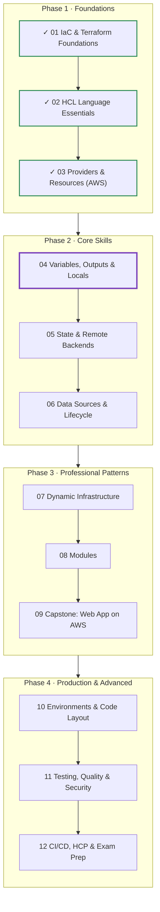
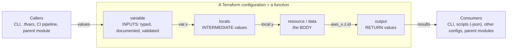
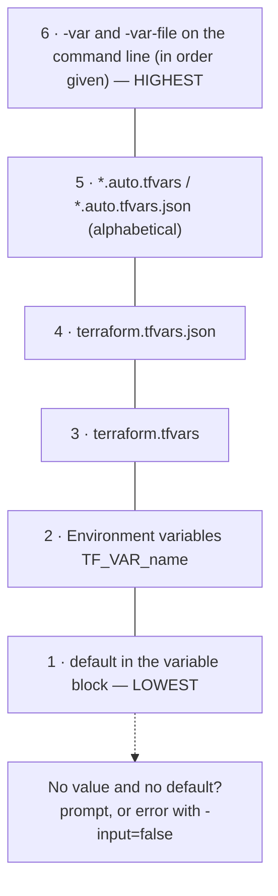
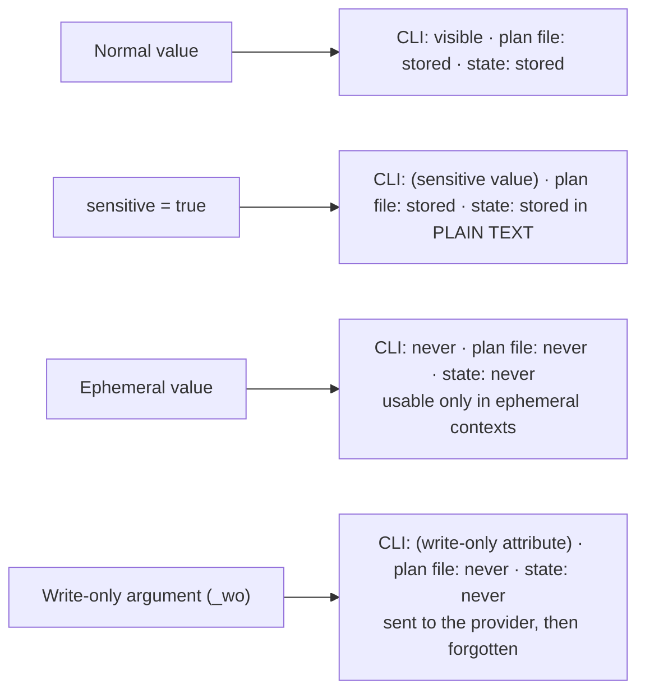
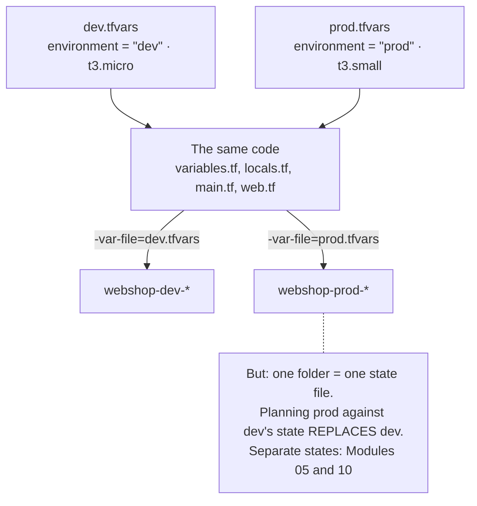
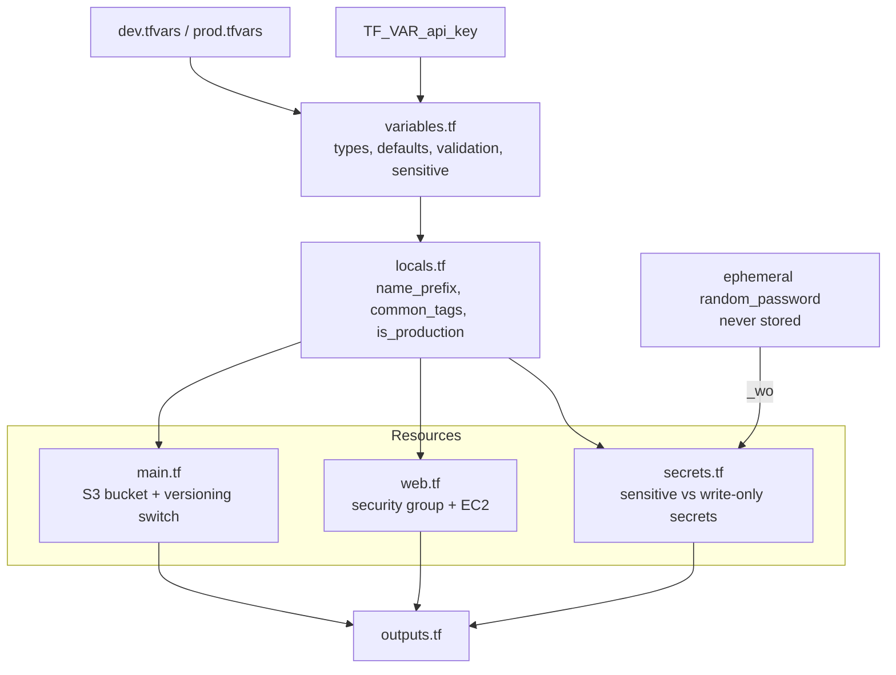

# Terraform: Zero to Advanced
## Module 04 — Variables, Outputs & Locals

> Turn hard-coded configuration into reusable, validated, environment-aware code — and learn how to handle secrets so they never leak into your state.

| | |
|---|---|
| **Level** | Beginner → Intermediate |
| **Time** | 4–5 hours (concepts + lab) |
| **Cost** | A few cents at most if you destroy at the end |
| **Terraform** | 1.12 or newer · AWS provider 6.x |

📄 **Full illustrated version:** [Module-04-Variables-Outputs-Locals.pdf](./Module-04-Variables-Outputs-Locals.pdf)

## Contents

- [1. Module Overview](#1-module-overview)
- [2. Core Concepts](#2-core-concepts)
- [3. Hands-on Lab — Make the AWS Stack Configurable](#3-hands-on-lab--make-the-aws-stack-configurable)
- [4. Quick Reference](#4-quick-reference)
- [5. Knowledge Check](#5-knowledge-check)
- [6. Summary & Next Steps](#6-summary--next-steps)

---

## 1. Module Overview


*Figure 0 — Where you are: Modules 01–03 done, Module 04 in progress.*

Your Module 03 code works, but it is full of fixed values: names, the instance type, the region, the allowed network range. To use the same code for dev and prod — or to share it with a teammate — those values must become **inputs**. In this module you learn the complete interface of a Terraform configuration: **input variables** (with types, defaults and validation), **local values** for naming and tagging, **outputs**, and the professional way to handle **secrets**.

#### Learning objectives — by the end of this module you can:

- Treat a configuration like a **function**: inputs, intermediate values, body and return values.
- Declare variables with `type`, `description`, `default`, `sensitive`, `nullable` and `validation`.
- Set variable values five different ways and predict which one **wins** (precedence).
- Write **validation rules**, including rules that compare two variables.
- Use **locals** for consistent names and tags, and **outputs** for humans and scripts (`-json`, `-raw`).
- Explain the difference between **sensitive**, **ephemeral** and **write-only** values — and keep a secret out of state.
- Drive one codebase with per-environment **`.tfvars`** files.

#### Prerequisites

- Module 03 completed: AWS account, `terraform` profile, `AWS_PROFILE` set in your terminal.

## 2. Core Concepts

### 2.1 A configuration is a function


*Figure 1 — Variables are parameters, locals are local variables, resources are the body, outputs are return values.*

If you have programmed before, this analogy makes everything in this module obvious. If not, think of a vending machine: you press buttons (**variables**), the machine does its internal work (**locals** and **resources**), and something comes out of the slot (**outputs**). The same machine serves everyone; only the buttons differ.

| Programming | Terraform | Referenced as |
|---|---|---|
| Function parameters | `variable` blocks | `var.<name>` |
| Local variables | `locals` block | `local.<name>` |
| Function body | `resource` and `data` blocks | `<type>.<name>.<attr>` |
| Return values | `output` blocks | `terraform output`, or `module.<name>.<output>` from a parent |

> [!IMPORTANT]
> **Key idea:** When you call your own code from another configuration in Module 08, the variables become the module's inputs and the outputs become its results. Designing a good interface now pays off later.

### 2.2 Input variables in depth

A variable declaration documents and constrains what callers may pass in. Every argument is optional, but professional code always has `type` and `description`:

```hcl
variable "instance_type" {
  type        = string                            # type constraint (Module 02 types)
  description = "EC2 instance type for the web server"
  default     = "t3.micro"                        # makes the variable optional
  sensitive   = false                             # true hides the value in CLI output
  nullable    = false                             # false: passing null uses the default instead

  validation {                                    # zero or more rules
    condition     = contains(["t3.micro", "t3.small"], var.instance_type)
    error_message = "Only t3.micro or t3.small are allowed."
  }
}
```

| Argument | Meaning |
|---|---|
| `type` | Type constraint: `string`, `number`, `bool`, `list(string)`, `map(string)`, `object({...})`, `any`… |
| `description` | Shown in prompts and documentation. Write it for the person calling your code |
| `default` | Value used when nothing else is set. **No default = required variable** |
| `sensitive` | Hides the value in plan/apply output (but not in state — see 2.7) |
| `nullable` | `false` means `null` can't be passed explicitly; Terraform uses the default |
| `ephemeral` | The value is never saved to plan or state (Terraform 1.10+, see 2.7) |
| `validation` | Custom rules checked before any change is planned |

#### Optional attributes in objects

For a structured input, `optional()` lets callers skip attributes and gives them defaults:

```hcl
variable "web" {
  type = object({
    instance_type = optional(string, "t3.micro")
    port          = optional(number, 80)
    public        = optional(bool, true)
  })
  default = {}
}
# var.web = { port = 8080 }  ->  { instance_type = "t3.micro", port = 8080, public = true }
```

### 2.3 Setting values — and which one wins


*Figure 2 — Variable precedence: when a value is set in several places, the higher source wins.*

A `.tfvars` file is plain HCL containing only `name = value` lines. Terraform loads `terraform.tfvars` and any `*.auto.tfvars` automatically; other files are loaded with `-var-file`.

**`dev.tfvars`**

```hcl
project     = "webshop"
environment = "dev"

extra_tags = {
  Owner = "your-name"
}
```

| Method | Example | Typical use |
|---|---|---|
| Default | `default = "t3.micro"` | Sensible values most callers want |
| Environment variable | `export TF_VAR_api_key=...` | Secrets and CI pipelines — nothing written to disk |
| `terraform.tfvars` / `*.auto.tfvars` | loaded automatically | Shared values for this folder |
| `-var-file=FILE` | `terraform plan -var-file=prod.tfvars` | **One file per environment** |
| `-var NAME=VALUE` | `-var="instance_type=t3.small"` | Quick one-off overrides |
| Interactive prompt | asked when a required value is missing | Never in automation: use `-input=false` |

> [!TIP]
> **Tip:** Pass `-var-file` to **every** command for that environment — `plan`, `apply` *and* `destroy`. A missing file means missing values, and Terraform either prompts or plans with defaults.

### 2.4 Validation rules

Validation catches bad input **before** Terraform contacts AWS, with a message written by you. A rule has a `condition` (must be `true`) and an `error_message` (a full sentence). Useful building blocks:

| Check | Condition |
|---|---|
| Value from a list | `contains(["dev", "staging", "prod"], var.environment)` |
| Pattern / naming rule | `can(regex("^[a-z][a-z0-9-]{2,19}$", var.project))` |
| Number range | `var.disk_gb >= 8 && var.disk_gb <= 100` |
| Valid CIDR | `can(cidrhost(var.cidr, 0))` |
| Every list element | `alltrue([for p in var.ports : p > 0 && p < 65536])` |
| Rule across two variables (1.9+) | `var.environment != "prod" \|\| var.instance_type == "t3.small"` |

`can(expr)` returns `true` if the expression evaluates without an error — perfect for "is this a valid regex match / CIDR / number?" checks.

### 2.5 Locals: name things once

Locals hold values computed **inside** the configuration. Use them to avoid repeating an expression, to give a complex expression a meaningful name, and above all for **consistent naming and tagging**:

```hcl
locals {
  name_prefix   = "${var.project}-${var.environment}"   # webshop-dev
  is_production = var.environment == "prod"

  common_tags = merge(
    {
      Project     = var.project
      Environment = var.environment
      ManagedBy   = "terraform"
    },
    var.extra_tags,                                    # caller-supplied tags win on conflicts
  )
}
```

| Use a variable when… | Use a local when… |
|---|---|
| the **caller** should decide the value | **your code** derives the value |
| it differs between environments | it's the same rule everywhere (naming convention, tag set) |
| e.g. `environment`, `instance_type` | e.g. `name_prefix`, `common_tags`, `is_production` |

> [!WARNING]
> **Warning:** Don't create locals that merely rename a variable (`local.env = var.environment`). It adds a layer without adding meaning.

### 2.6 Outputs

Outputs print results after `apply`, expose values to scripts, and — in Module 08 — return values from modules.

```hcl
output "website_url" {
  description = "URL of the web server"
  value       = "http://${aws_instance.web.public_ip}"
}

output "db_connection" {
  description = "Connection string for the app"
  value       = local.connection_string
  sensitive   = true                     # required if the value contains sensitive data
}
```

| Command | Result |
|---|---|
| `terraform output` | All outputs; sensitive ones shown as `<sensitive>` |
| `terraform output website_url` | One output (quoted string) |
| `terraform output -raw website_url` | Raw value without quotes — ideal in scripts: `curl $(terraform output -raw website_url)` |
| `terraform output -json` | Everything as JSON (includes sensitive values!) for tools like `jq` |

### 2.7 Secrets: sensitive vs ephemeral vs write-only


*Figure 3 — Where a value ends up depending on how it is declared.*

This is one of the most misunderstood topics in Terraform — and it is on the Associate 004 exam:

- **`sensitive = true`** only *redacts the display*. The value is still written to the **state file in plain text**. Anyone who can read your state can read your secrets.
- **Ephemeral values** (Terraform 1.10+) exist only while Terraform runs: ephemeral variables, ephemeral outputs in child modules, and **ephemeral resources** such as `ephemeral "random_password"`. They are never stored. Terraform only lets you use them where they can't leak — mainly in write-only arguments and provider configuration.
- **Write-only arguments** (Terraform 1.11+, names ending in `_wo`) are sent to the provider and then forgotten. Because Terraform can't see the old value, each has a companion `_wo_version` argument: **increase the version to push a new secret**.

```hcl
ephemeral "random_password" "db" {          # generated during the run, never saved
  length = 24
}

resource "aws_secretsmanager_secret_version" "db" {
  secret_id                = aws_secretsmanager_secret.db.id
  secret_string_wo         = ephemeral.random_password.db.result   # write-only: not in state
  secret_string_wo_version = 1                                     # bump to rotate
}
```

> [!IMPORTANT]
> **Key idea:** Defence in depth: (1) keep secrets out of code and `.tfvars` in Git — use `TF_VAR_` variables or a secrets manager; (2) prefer **ephemeral + write-only** so they never reach state; (3) store state remotely with **encryption and restricted access** anyway (Module 05).

### 2.8 One codebase, many environments — with a catch


*Figure 4 — The same code produces dev or prod depending on the .tfvars file.*

Per-environment `.tfvars` files are the simplest way to reuse code. But a folder has **one state file**, and the state remembers *the dev resources*. Planning with `prod.tfvars` in the same folder doesn't create a second environment — it proposes to **replace dev with prod**. You'll see this happen in Task 9, and fix it properly with remote state keys (Module 05) and environment layouts (Module 10).

---

## 3. Hands-on Lab — Make the AWS Stack Configurable

**Goal:** rebuild the Module 03 web stack as a reusable configuration: validated inputs, per-environment `.tfvars`, consistent names and tags from locals, useful outputs — and two secrets that show the difference between *sensitive* and *write-only*.


*Figure 5 — Lab structure.*

```text
lab-04-variables/
├── terraform.tf        # versions (aws, random)
├── providers.tf        # region + default_tags from locals
├── variables.tf        # all inputs
├── locals.tf           # naming + tagging
├── main.tf             # S3 bucket
├── web.tf              # security group + EC2
├── secrets.tf          # added in Tasks 7-8
├── outputs.tf
├── dev.tfvars
├── prod.tfvars
└── templates/
    └── user_data.sh.tftpl
```

### Task 1 — Write the configuration

`terraform.tf` is the same as in Module 03 (aws `~> 6.0`, random `~> 3.7`, `required_version = ">= 1.12.0"`). Create the other files:

**`variables.tf`**

```hcl
variable "aws_region" {
  type        = string
  description = "AWS region to deploy into"
  default     = "eu-central-1"
}

variable "project" {
  type        = string
  description = "Short project name used in all resource names"

  validation {
    condition     = can(regex("^[a-z][a-z0-9-]{2,19}$", var.project))
    error_message = "project must be 3-20 chars: a-z, 0-9 and hyphens, starting with a letter."
  }
}

variable "environment" {
  type        = string
  description = "Deployment environment"

  validation {
    condition     = contains(["dev", "staging", "prod"], var.environment)
    error_message = "environment must be one of: dev, staging, prod."
  }
}

variable "instance_type" {
  type        = string
  description = "EC2 instance type for the web server"
  default     = "t3.micro"

  validation {
    condition     = contains(["t3.micro", "t3.small"], var.instance_type)
    error_message = "Only free-tier friendly types are allowed: t3.micro or t3.small."
  }
}

variable "http_ingress_cidr" {
  type        = string
  description = "IPv4 CIDR allowed to reach the web server on port 80"
  default     = "0.0.0.0/0"

  validation {
    condition     = can(cidrhost(var.http_ingress_cidr, 0))
    error_message = "http_ingress_cidr must be a valid IPv4 CIDR, e.g. 203.0.113.0/24."
  }
}

variable "enable_versioning" {
  type        = bool
  description = "Keep old versions of objects in the artifacts bucket"
  default     = false
}

variable "extra_tags" {
  type        = map(string)
  description = "Additional tags merged into every resource"
  default     = {}
}
```

**`locals.tf`**

```hcl
locals {
  name_prefix   = "${var.project}-${var.environment}"
  is_production = var.environment == "prod"

  common_tags = merge(
    {
      Project     = var.project
      Environment = var.environment
      ManagedBy   = "terraform"
    },
    var.extra_tags,
  )
}
```

**`providers.tf`**

```hcl
provider "aws" {
  region = var.aws_region

  default_tags {
    tags = local.common_tags
  }
}
```

**`main.tf`**

```hcl
resource "random_id" "suffix" {
  byte_length = 4
}

resource "aws_s3_bucket" "artifacts" {
  bucket        = "${local.name_prefix}-artifacts-${random_id.suffix.hex}"
  force_destroy = true # lab only
}

resource "aws_s3_bucket_versioning" "artifacts" {
  bucket = aws_s3_bucket.artifacts.id

  versioning_configuration {
    # S3 can never return to "never versioned"; Suspended stops new versions.
    status = var.enable_versioning ? "Enabled" : "Suspended"
  }
}

resource "aws_s3_bucket_public_access_block" "artifacts" {
  bucket = aws_s3_bucket.artifacts.id

  block_public_acls       = true
  block_public_policy     = true
  ignore_public_acls      = true
  restrict_public_buckets = true
}
```

**`web.tf`**

```hcl
data "aws_vpc" "default" {
  default = true
}

data "aws_ami" "al2023" {
  most_recent = true
  owners      = ["amazon"]

  filter {
    name   = "name"
    values = ["al2023-ami-2023.*-x86_64"]
  }
}

resource "aws_security_group" "web" {
  name        = "${local.name_prefix}-web"
  description = "HTTP in, everything out"
  vpc_id      = data.aws_vpc.default.id
}

resource "aws_vpc_security_group_ingress_rule" "http" {
  security_group_id = aws_security_group.web.id
  cidr_ipv4         = var.http_ingress_cidr
  ip_protocol       = "tcp"
  from_port         = 80
  to_port           = 80
}

resource "aws_vpc_security_group_egress_rule" "all" {
  security_group_id = aws_security_group.web.id
  cidr_ipv4         = "0.0.0.0/0"
  ip_protocol       = "-1"
}

resource "aws_instance" "web" {
  ami                    = data.aws_ami.al2023.id
  instance_type          = var.instance_type
  vpc_security_group_ids = [aws_security_group.web.id]

  user_data = templatefile("${path.module}/templates/user_data.sh.tftpl", {
    project     = var.project
    environment = var.environment
  })
  user_data_replace_on_change = true

  metadata_options {
    http_tokens = "required"
  }

  tags = {
    Name = "${local.name_prefix}-web"
  }
}
```

**`templates/user_data.sh.tftpl`**

```bash
#!/bin/bash
dnf install -y nginx
cat > /usr/share/nginx/html/index.html <<HTML
<h1>${project}</h1>
<p>Environment: ${environment}</p>
HTML
systemctl enable --now nginx
```

**`outputs.tf`**

```hcl
output "name_prefix" {
  description = "Prefix used for all resource names"
  value       = local.name_prefix
}

output "instance_type" {
  description = "Instance type actually used (handy to test precedence)"
  value       = var.instance_type
}

output "bucket_name" {
  description = "Artifacts bucket name"
  value       = aws_s3_bucket.artifacts.bucket
}

output "website_url" {
  description = "URL of the web server"
  value       = "http://${aws_instance.web.public_ip}"
}
```

**`dev.tfvars`**

```hcl
project     = "webshop"
environment = "dev"

extra_tags = {
  Owner = "your-name"
}
```

**`prod.tfvars`**

```hcl
project           = "webshop"
environment       = "prod"
instance_type     = "t3.small"
enable_versioning = true

extra_tags = {
  CostCenter = "1234"
}
```

```bash
terraform init
terraform fmt
terraform validate
```

*Expected output (last line):*

```text
Success! The configuration is valid.
```

### Task 2 — Required variables and prompts

`project` and `environment` have no default, so they are **required**. Run a plan without giving them:

```bash
terraform plan
```

*Expected output:*

```text
var.environment
  Deployment environment

  Enter a value:
```

Terraform prompts, using your `description`. Press **Ctrl+C** to cancel. In automation a prompt would hang the pipeline forever, so CI always runs with `-input=false`, which turns a missing value into an error instead.

### Task 3 — Validation in action

```bash
terraform plan -var-file=dev.tfvars -var="environment=test"
```

*Expected output:*

```text
╷
│ Error: Invalid value for variable
│
│   on variables.tf line 17:
│   17: variable "environment" {
│     ├────────────────
│     │ var.environment is "test"
│
│ environment must be one of: dev, staging, prod.
│
│ This was checked by the validation rule at variables.tf:21,3-13.
╵
```

Your rule rejected the value **before** any AWS call. Also notice the precedence: `-var` came after `-var-file` on the command line, so it overrode `environment = "dev"`. Try two more invalid values and read the messages: `-var="project=Web_Shop"` and `-var="http_ingress_cidr=10.0.0.300/24"`.

### Task 4 — Precedence experiment

Predict the result *before* each command, then check the `instance_type` line under *Changes to Outputs*.

1. Create `terraform.tfvars` containing `instance_type = "t3.small"`, then run `terraform plan -var-file=dev.tfvars` → **t3.small** (terraform.tfvars beats the default).
2. Set an environment variable — `export TF_VAR_instance_type=t3.micro` (PowerShell: `$env:TF_VAR_instance_type="t3.micro"`) — and plan again → still **t3.small** (terraform.tfvars beats environment variables).
3. Run `terraform plan -var-file=dev.tfvars -var="instance_type=t3.micro"` → **t3.micro** (the command line beats everything).
4. Clean up: delete `terraform.tfvars` and remove the variable (`unset TF_VAR_instance_type` / `Remove-Item Env:TF_VAR_instance_type`).

*Expected output for steps 1 and 2 (abridged):*

```text
Changes to Outputs:
  ...
  + instance_type = "t3.small"
  ...
```

### Task 5 — Deploy dev

```bash
terraform apply -var-file=dev.tfvars
```

*Expected output (abridged):*

```text
Plan: 8 to add, 0 to change, 0 to destroy.
...
Apply complete! Resources: 8 added, 0 changed, 0 destroyed.

Outputs:

bucket_name = "webshop-dev-artifacts-1a7d31df"
instance_type = "t3.micro"
name_prefix = "webshop-dev"
website_url = "http://3.70.12.34"
```

Open the EC2 console: the instance is called `webshop-dev-web` and carries the tags `Project`, `Environment`, `ManagedBy` and `Owner` — all from `local.common_tags`. After a minute the page shows *webshop / Environment: dev*.

### Task 6 — Use outputs from scripts

```bash
terraform output
terraform output -raw website_url
curl "$(terraform output -raw website_url)"
terraform output -json
```

*Expected output (abridged):*

```text
bucket_name = "webshop-dev-artifacts-1a7d31df"
instance_type = "t3.micro"
name_prefix = "webshop-dev"
website_url = "http://3.70.12.34"

http://3.70.12.34

<h1>webshop</h1>
<p>Environment: dev</p>

{
  "bucket_name": {
    "sensitive": false,
    "type": "string",
    "value": "webshop-dev-artifacts-1a7d31df"
  },
  ...
}
```

`-raw` prints the bare value — no quotes, no newline formatting — which is exactly what scripts need. `-json` gives a machine-readable structure including each output's type.

### Task 7 — A sensitive variable (and why it is not enough)

Add a secret supplied from the environment and store it in AWS Secrets Manager:

**`variables.tf (addition)`**

```hcl
variable "api_key" {
  type        = string
  description = "API key for a third-party service (set with TF_VAR_api_key)"
  sensitive   = true
}
```

**`secrets.tf`**

```hcl
resource "aws_secretsmanager_secret" "api_key" {
  name                    = "${local.name_prefix}-api-key"
  recovery_window_in_days = 0 # lab only: delete immediately on destroy
}

resource "aws_secretsmanager_secret_version" "api_key" {
  secret_id     = aws_secretsmanager_secret.api_key.id
  secret_string = var.api_key
}
```

**`outputs.tf (addition — on purpose without sensitive)`**

```hcl
output "api_key_echo" {
  value = var.api_key
}
```

```bash
export TF_VAR_api_key="demo-key-12345"
# PowerShell: $env:TF_VAR_api_key="demo-key-12345"
terraform plan -var-file=dev.tfvars
```

*Expected output:*

```text
╷
│ Error: Output refers to sensitive values
│
│   on outputs.tf line 21:
│   21: output "api_key_echo" {
│
│ To reduce the risk of accidentally exporting sensitive data that was intended to be only
│ internal, Terraform requires that any root module output containing sensitive data be
│ explicitly marked as sensitive, to confirm your intent.
│
│ If you do intend to export this data, annotate the output value as sensitive by adding the
│ following argument:
│     sensitive = true
╵
```

Terraform tracks sensitivity through expressions and refuses to print it by accident. Add `sensitive = true` to the output, then apply and investigate:

```bash
terraform apply -var-file=dev.tfvars
terraform output
terraform output -raw api_key_echo
terraform state pull | grep -c "demo-key-12345"
# PowerShell: (terraform state pull | Select-String "demo-key-12345").Count
```

*Expected output (abridged):*

```text
  + resource "aws_secretsmanager_secret_version" "api_key" {
      + secret_string  = (sensitive value)
      ...
Apply complete! Resources: 2 added, 0 changed, 0 destroyed.

Outputs:

api_key_echo = <sensitive>
...

demo-key-12345

2
```

> [!WARNING]
> **Warning:** The plan hid the value — but `terraform output -raw` printed it, and the **state file contains it twice in plain text** (in the secret version and in the output). `sensitive` protects your screen and logs, not your data. Remove the `api_key_echo` output now; Task 8 shows the real fix.

### Task 8 — Ephemeral + write-only: a secret that never touches state

**`secrets.tf (addition)`**

```hcl
ephemeral "random_password" "app" {
  length  = 24
  special = false
}

resource "aws_secretsmanager_secret" "app_password" {
  name                    = "${local.name_prefix}-app-password"
  recovery_window_in_days = 0 # lab only
}

resource "aws_secretsmanager_secret_version" "app_password" {
  secret_id                = aws_secretsmanager_secret.app_password.id
  secret_string_wo         = ephemeral.random_password.app.result
  secret_string_wo_version = 1
}
```

```bash
terraform apply -var-file=dev.tfvars
```

*Expected output (abridged):*

```text
ephemeral.random_password.app: Opening...
ephemeral.random_password.app: Opening complete after 0s
...
  # aws_secretsmanager_secret_version.app_password will be created
  + resource "aws_secretsmanager_secret_version" "app_password" {
      + arn                      = (known after apply)
      + id                       = (known after apply)
      + secret_id                = (known after apply)
      + secret_string_wo         = (write-only attribute)
      + secret_string_wo_version = 1
      + version_id               = (known after apply)
      + version_stages           = (known after apply)
    }
...
ephemeral.random_password.app: Closing...
Apply complete! Resources: 2 added, 0 changed, 0 destroyed.
```

Ephemeral resources are **opened** and **closed** during the run instead of being created. Now prove the password exists in AWS but not in your state:

```bash
PW=$(aws secretsmanager get-secret-value --secret-id webshop-dev-app-password \
       --query SecretString --output text)
echo "$PW"
terraform state pull | grep -c "$PW"
```

*Expected output (your password differs):*

```text
Xk3mQ8rTz1VbN7wLp2Hs9dYc
0
```

AWS has the secret; Terraform's state has **zero** copies. To rotate it, change `secret_string_wo_version` to `2` and apply: the plan shows `~ secret_string_wo_version = 1 -> 2` and a freshly generated password is written.

### Task 9 — Why one folder isn't two environments

Plan prod with the **same** state — read it, **don't apply**:

```bash
terraform plan -var-file=prod.tfvars
```

*Expected output (abridged):*

```text
  # aws_instance.web must be replaced
-/+ resource "aws_instance" "web" {
      ~ instance_type = "t3.micro" -> "t3.small"
      ~ tags          = {
          ~ "Name" = "webshop-dev-web" -> "webshop-prod-web"
        }
      ~ user_data     = <<-EOT
            ...
          - <p>Environment: dev</p>
          + <p>Environment: prod</p>
            ...
        EOT # forces replacement
      ...
  # aws_s3_bucket.artifacts must be replaced
-/+ resource "aws_s3_bucket" "artifacts" {
      ~ bucket = "webshop-dev-artifacts-1a7d31df"
              -> "webshop-prod-artifacts-1a7d31df" # forces replacement
      ...
Plan: 11 to add, 0 to change, 11 to destroy.
```

Terraform wants to **destroy dev and build prod in its place** — names changed, so everything that depends on a name is replaced. Only `random_id.suffix` survives. This is the problem that separate state files solve.

### Task 10 — Clean up

```bash
terraform destroy -var-file=dev.tfvars
```

*Expected output (abridged):*

```text
Plan: 0 to add, 0 to change, 12 to destroy.
...
Destroy complete! Resources: 12 destroyed.
```

`TF_VAR_api_key` must still be set — required variables are needed even to destroy. The two secrets are deleted immediately thanks to `recovery_window_in_days = 0` (the default is a 30-day recovery window, which also blocks re-using the name). Finally `unset TF_VAR_api_key`.

### Challenge — a rule that spans two variables

Require production to use `t3.small`. Add a second `validation` block to `instance_type` that refers to `var.environment` (allowed since Terraform 1.9). Then predict and check:

1. `terraform plan -var-file=prod.tfvars -var="instance_type=t3.micro"` → ?
2. `terraform plan -var-file=dev.tfvars -var="instance_type=t3.small"` → ?

#### Solution

**`variables.tf (inside variable "instance_type")`**

```hcl
  validation {
    condition     = var.environment != "prod" || var.instance_type == "t3.small"
    error_message = "Production must use t3.small."
  }
```

Command 1 fails with *Production must use t3.small.*; command 2 is allowed — the rule only constrains prod. Read the condition as *"either this isn't prod, or the type is t3.small"*: the `!= ... ||` pattern is the standard way to write *if A then B* in a validation.

#### Lab complete when you can tick every box

- [ ] My variables all have `type` and `description`; required ones have no default.
- [ ] I can predict which value wins when the same variable is set in several places.
- [ ] I wrote validation rules, including one that compares two variables.
- [ ] I used `terraform output -raw` and `-json` in commands.
- [ ] I proved that `sensitive` values are stored in state and write-only values are not.
- [ ] I can explain why prod.tfvars against dev's state would replace dev.

---

## 4. Quick Reference

### 4.1 Cheat sheet

| Need | Syntax |
|---|---|
| Required input | `variable "x" { type = string }` (no default) |
| Optional input | `default = ...` |
| Structured input with defaults | `type = object({ port = optional(number, 80) })` |
| Validation | `validation { condition = ...  error_message = "..." }` |
| Values file | `terraform apply -var-file=dev.tfvars` |
| Override one value | `-var="name=value"` |
| From the environment | `TF_VAR_name=value` |
| No prompts (CI) | `-input=false` |
| Local value | `locals { x = ... }` → `local.x` |
| Output for scripts | `terraform output -raw NAME` / `-json` |
| Hide in CLI output | `sensitive = true` (variable or output) |
| Keep out of state | `ephemeral` resources/variables + `_wo` arguments with `_wo_version` |

### 4.2 Common errors and fixes

| Error | Usual cause | Fix |
|---|---|---|
| `No value for required variable` | Required variable not set and `-input=false` | Pass `-var-file` / `-var`, or set `TF_VAR_` |
| `Invalid value for variable` | A validation rule returned false | Read your own error message; fix the value |
| `Value for undeclared variable` | A `.tfvars` sets a name that has no `variable` block (typo) | Fix the name or declare the variable |
| `Output refers to sensitive values` | Output derives from a sensitive value | Add `sensitive = true` (if you really want to output it) |
| `Variables not allowed` | `default` refers to another variable | Defaults must be literals; use a local instead |
| `Ephemeral value not allowed` | Ephemeral value used in a normal argument or root output | Use it only in `_wo` arguments, provider config or ephemeral outputs of child modules |
| `Invalid template interpolation value` | `templatefile` received a list/map where a string is needed | Convert with `join()` / `jsonencode()` or loop with `%{ for }` |

## 5. Knowledge Check

**Q1. How do you make a variable required?**

<details><summary>Show answer</summary>

Declare it without a `default`.

</details>

**Q2. `instance_type` is set in `terraform.tfvars`, in `TF_VAR_instance_type`, and with `-var` on the command line. Which wins?**

<details><summary>Show answer</summary>

The `-var` on the command line. Order: default < env var < terraform.tfvars < *.auto.tfvars < -var / -var-file.

</details>

**Q3. Why should CI pipelines use `-input=false`?**

<details><summary>Show answer</summary>

So a missing variable fails fast instead of waiting forever at an interactive prompt.

</details>

**Q4. What does `can()` do in a validation rule?**

<details><summary>Show answer</summary>

It returns true if its expression evaluates without error, false otherwise — e.g. `can(cidrhost(var.cidr, 0))`.

</details>

**Q5. When should you use a local instead of a variable?**

<details><summary>Show answer</summary>

When the value is derived by your code (naming, tags) rather than chosen by the caller.

</details>

**Q6. Is a value with `sensitive = true` safe in the state file?**

<details><summary>Show answer</summary>

No. It is hidden in CLI output but stored in state in plain text.

</details>

**Q7. What is a write-only argument, and why does it need a `_wo_version`?**

<details><summary>Show answer</summary>

An argument sent to the provider but never stored in plan or state. Terraform can't detect changes to it, so you bump the version to push a new value.

</details>

**Q8. Where can an ephemeral value be used?**

<details><summary>Show answer</summary>

Only in ephemeral contexts: write-only arguments, provider configuration, ephemeral variables/outputs and other ephemeral resources.

</details>

**Q9. What does `terraform output -raw website_url` print, and why is it useful?**

<details><summary>Show answer</summary>

The bare string value without quotes — ideal for shell scripts.

</details>

**Q10. Why did planning `prod.tfvars` in the dev folder show 11 replacements?**

<details><summary>Show answer</summary>

One folder has one state, which holds dev's resources. Changing names via prod values replaces them instead of creating a separate environment.

</details>

## 6. Summary & Next Steps

- A configuration is a **function**: variables in, locals and resources inside, outputs out.
- Give every variable a `type` and `description`; omit `default` to make it required; add `validation` with clear messages.
- Precedence: default < `TF_VAR_` < `terraform.tfvars` < `*.auto.tfvars` < `-var` / `-var-file`.
- Locals give you consistent naming and tags; outputs serve humans (`terraform output`) and scripts (`-raw`, `-json`).
- `sensitive` hides values on screen only; **ephemeral + write-only** keep secrets out of plan and state.
- `.tfvars` per environment reuse code — but one folder is one state; real environment separation comes next.

**Next — Module 05: State & Remote Backends.** You'll open up the state file, move it to an **S3 backend with locking and versioning** so a team can share it safely, migrate existing state, and learn the professional tools for refactoring: `moved`, `removed` and `import` blocks.

#### Official references

- [Input variables](https://developer.hashicorp.com/terraform/language/values/variables)
- [Local values](https://developer.hashicorp.com/terraform/language/values/locals)
- [Output values](https://developer.hashicorp.com/terraform/language/values/outputs)
- [Ephemeral values](https://developer.hashicorp.com/terraform/language/manage-sensitive-data/ephemeral)
- [Write-only arguments](https://developer.hashicorp.com/terraform/language/manage-sensitive-data/write-only)
