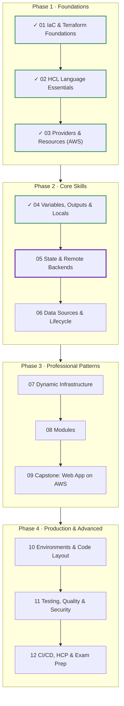
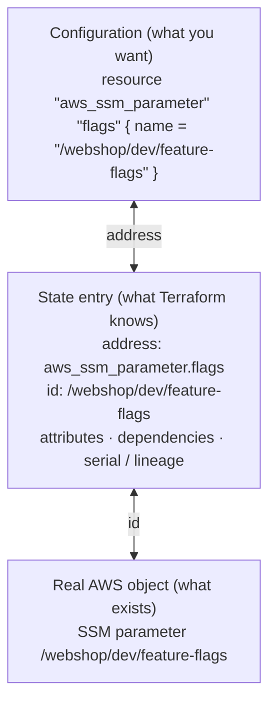
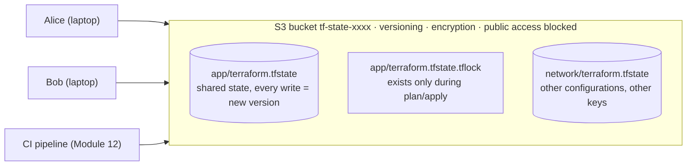
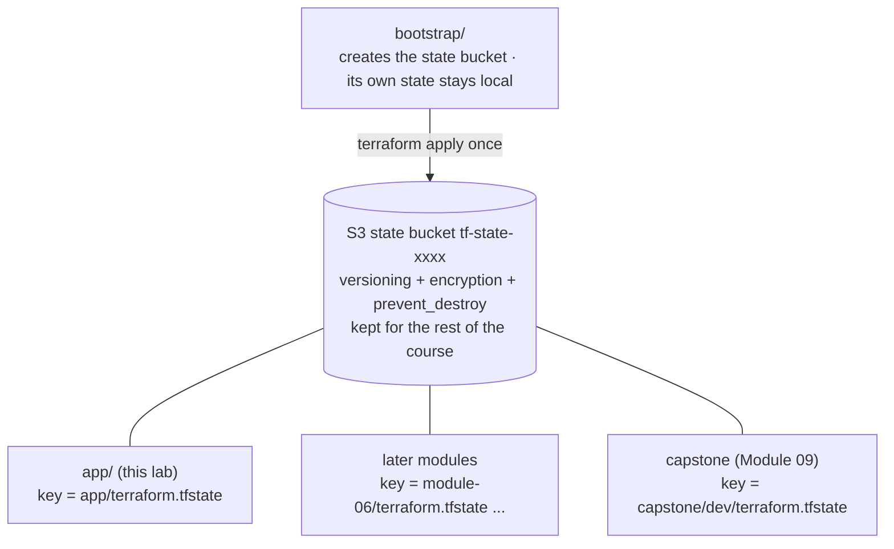
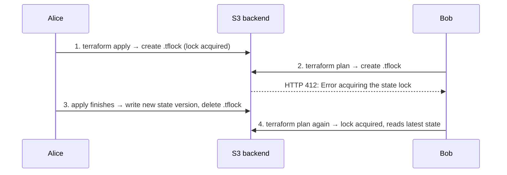
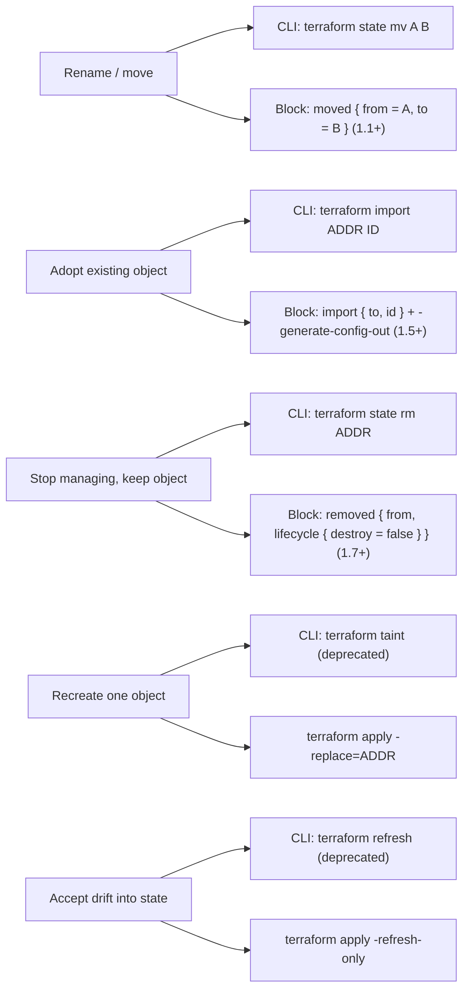
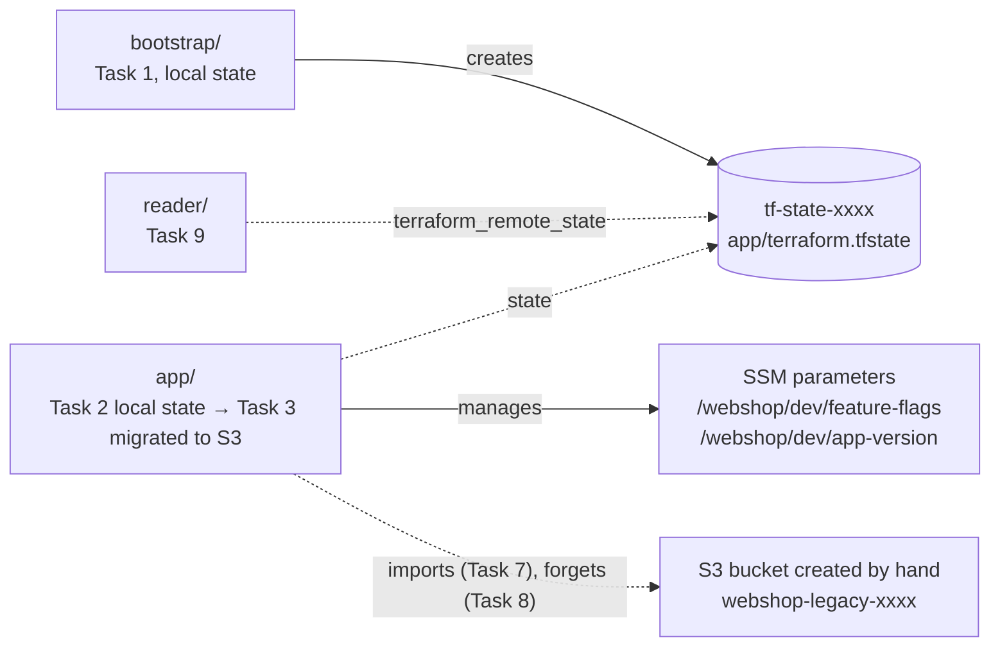

# Terraform: Zero to Advanced
## Module 05 — State & Remote Backends

> Understand Terraform's memory, move it to a secure shared S3 backend with locking, and refactor safely with moved, import and removed blocks.

| | |
|---|---|
| **Level** | Intermediate |
| **Time** | 4–5 hours (concepts + lab) |
| **Cost** | ≈ $0 (SSM parameters and a tiny S3 bucket) |
| **Terraform** | 1.12 or newer · AWS provider 6.x |

📄 **Full illustrated version:** [Module-05-State-and-Remote-Backends.pdf](./Module-05-State-and-Remote-Backends.pdf)

## Contents

- [1. Module Overview](#1-module-overview)
- [2. Core Concepts](#2-core-concepts)
- [3. Hands-on Lab — Remote State, Locking and Refactoring](#3-hands-on-lab--remote-state-locking-and-refactoring)
- [4. Quick Reference](#4-quick-reference)
- [5. Knowledge Check](#5-knowledge-check)
- [6. Summary & Next Steps](#6-summary--next-steps)

---

## 1. Module Overview


*Figure 0 — Where you are: Modules 01–04 done, Module 05 in progress.*

So far your state has lived in a `terraform.tfstate` file on your laptop. That's fine for learning, and dangerous for anything else: lose the laptop and Terraform forgets your infrastructure; share the file by email and two people overwrite each other's changes; commit it to Git and you publish your secrets. In this module you learn what the state really contains, move it to a **remote S3 backend** with **locking** and **versioning**, and use the modern, reviewable tools for changing state: `moved`, `import` and `removed` blocks.

#### Learning objectives — by the end of this module you can:

- Explain what state stores and why Terraform needs it (mapping, dependencies, performance, collaboration).
- Handle **drift**: revert it with apply, or accept it with `-refresh-only`.
- Configure an **S3 backend** with native locking (`use_lockfile`), encryption and versioning, using partial configuration.
- Solve the **bootstrap** problem and **migrate** existing local state to a remote backend.
- Read a lock error and know when (not) to use `force-unlock`.
- Refactor with **`moved`**, adopt resources with **`import`** blocks and generated config, and stop managing them with **`removed`**.
- Inspect state safely with `terraform state` commands and share outputs with `terraform_remote_state`.

#### Prerequisites

- Modules 03–04 completed; `AWS_PROFILE` set; Terraform 1.12+ (`use_lockfile` needs 1.11+).

## 2. Core Concepts

### 2.1 What state is — and why Terraform needs it


*Figure 1 — State links each address in your code to the ID of a real object.*

Your code says *what should exist*. AWS knows *what does exist*. The **state** is the bridge: for every resource address it records the real object's **ID** plus all attributes. Without it Terraform could not tell whether `aws_ssm_parameter.flags` already exists, which object it is, or what changed.

| State provides… | Why it matters |
|---|---|
| **Mapping** address ↔ real object ID | So `plan` updates the right object instead of creating duplicates |
| **Attributes** of every object | So other resources can reference values like `arn` and `id` |
| **Dependencies** | So `destroy` happens in the correct order even after code is deleted |
| **Performance cache** | Large configurations can plan with `-refresh=false` when appropriate |
| **serial** and **lineage** | A version counter and a unique ID that stop an old or foreign state from overwriting a newer one |

> [!WARNING]
> **Warning:** State contains **every attribute in plain text** — including values marked `sensitive` (Module 04). Treat the state file like a password file: never commit it, encrypt it at rest, restrict who can read it.

#### Drift: when reality and state disagree

Every `plan` first **refreshes**: it reads the real objects and compares them with state. If someone changed something outside Terraform you have two choices:

| Choice | Command | Result |
|---|---|---|
| **Revert** the manual change | `terraform apply` | Reality is changed back to match the code |
| **Accept** the manual change | `terraform apply -refresh-only`, then update the code | State records reality; no objects change. Update the code too, or the next plan reverts it |

### 2.2 Remote backends


*Figure 2 — A remote backend: one shared, versioned, encrypted state per configuration.*

A **backend** decides where state is stored and how it's locked. The default is `local`. Remote options include `s3` (AWS), `azurerm`, `gcs`, `pg`, `consul`, `http` — and **HCP Terraform** (the `cloud` block, Module 12). For AWS teams, S3 is the standard choice:

**`terraform.tf`**

```hcl
terraform {
  backend "s3" {
    bucket       = "tf-state-1a7d31df"        # an existing bucket
    key          = "app/terraform.tfstate"    # path of this configuration's state
    region       = "eu-central-1"
    use_lockfile = true                       # native S3 locking (Terraform 1.11+ GA)
    encrypt      = true                       # server-side encryption
  }
}
```

- **`key`** separates configurations inside one bucket. Use a clear convention such as `<project>/<environment>/<component>/terraform.tfstate`.
- **`use_lockfile = true`** creates a `<key>.tflock` object with an S3 *conditional write* while an operation runs. The older DynamoDB-table locking (`dynamodb_table`) is **deprecated** — you will still see it in older projects.
- **Backend blocks can't use variables or locals** — they're read before anything else. Use **partial configuration** instead: leave the block empty (`backend "s3" {}`) and pass a file with `terraform init -backend-config=backend.hcl`.

#### Hardening the state bucket

| Setting | Why |
|---|---|
| **Versioning** enabled | Every state write is kept; you can recover from a bad apply or a corrupted state |
| **Encryption** (SSE-S3 or SSE-KMS) | State contains secrets; KMS also lets you control *who* can decrypt |
| **Block all public access** | State must never be public |
| **`prevent_destroy`** on the bucket | A careless `terraform destroy` can't delete everyone's state |
| **Least-privilege IAM** | `s3:ListBucket` on the bucket; `GetObject`/`PutObject` on the state key; plus `DeleteObject` on the `.tflock` key |

### 2.3 The bootstrap problem


*Figure 3 — A small bootstrap configuration creates the bucket that all other configurations use.*

Terraform needs the bucket *before* it can store state in it — so who creates the bucket? The common answer is a tiny **bootstrap** configuration with **local** state that creates (and protects) the bucket once. Its own state is small and rarely changes; keep it safe (or, once the bucket exists, migrate the bootstrap state into the bucket too). In this course the bucket you create today stores the state of **every later module**.

### 2.4 Migrating state

Changing the backend is done with `terraform init`:

| Flag | Use when |
|---|---|
| `terraform init -migrate-state` | You **moved** to a new backend and want to **copy** the existing state there |
| `terraform init -reconfigure` | You want to point at a different backend/key and **ignore** what was configured before (no copy) |

To go back to local state, delete the `backend` block and run `terraform init -migrate-state` again.

### 2.5 Locking


*Figure 4 — The lock makes concurrent runs safe: the second one waits instead of corrupting state.*

Without locking, two applies at the same time can both read serial 7, both write serial 8 — and one set of changes silently disappears from state. Every command that writes state takes the lock automatically.

- `-lock-timeout=5m` makes a command wait for the lock instead of failing immediately (useful in CI).
- `terraform force-unlock LOCK_ID` removes a **stale** lock left by a crashed run. Only use it when you are sure nobody is running — otherwise you re-create the corruption locking prevents.
- `-lock=false` exists. Don't use it on shared state.

### 2.6 Changing state the professional way


*Figure 5 — Prefer configuration blocks: they are planned, reviewed and versioned like any other change.*

The `terraform state` CLI commands change state immediately, invisibly to your teammates. Since Terraform 1.1–1.7 the same jobs can be done with **blocks in your configuration**: they show up in `plan`, go through code review, and are applied by the normal workflow — so they're the recommended approach.

```hcl
# Rename without destroy/recreate
moved {
  from = aws_ssm_parameter.flags
  to   = aws_ssm_parameter.feature_flags
}

# Adopt an object that was created outside Terraform
import {
  to = aws_s3_bucket.legacy
  id = "webshop-legacy-1a7d31df"
}

# Stop managing an object but keep it in AWS
removed {
  from = aws_s3_bucket.legacy

  lifecycle {
    destroy = false
  }
}
```

With an `import` block, `terraform plan -generate-config-out=generated.tf` even **writes the resource block for you** from the real object's attributes — review and tidy it, then apply.

#### Read-only state commands (always safe)

| Command | Shows |
|---|---|
| `terraform state list` | All resource addresses in state |
| `terraform state show ADDR` | All attributes of one resource |
| `terraform show` | The whole state in human-readable form |
| `terraform state pull` | The raw JSON (e.g. to make a backup) — contains secrets! |

---

## 3. Hands-on Lab — Remote State, Locking and Refactoring

**Goal:** create a protected state bucket, move a small configuration's state into it, watch locking stop a concurrent run, handle drift, and practise `moved`, `import` and `removed`. All resources are free or nearly free; the state bucket is **kept** for the rest of the course.


*Figure 6 — Lab overview.*

```text
lab-05-state/
├── bootstrap/          # creates the state bucket (local state)
│   ├── terraform.tf
│   ├── main.tf
│   └── outputs.tf
├── app/                # a small configuration whose state moves to S3
│   ├── terraform.tf
│   ├── backend.hcl     # Task 3
│   ├── main.tf
│   └── outputs.tf
└── reader/             # Task 9: reads app's outputs
    └── main.tf
```

### Task 1 — Bootstrap the state bucket

**`bootstrap/terraform.tf`**

```hcl
terraform {
  required_version = ">= 1.12.0"

  required_providers {
    aws = {
      source  = "hashicorp/aws"
      version = "~> 6.0"
    }
    random = {
      source  = "hashicorp/random"
      version = "~> 3.7"
    }
  }
}

provider "aws" {
  region = "eu-central-1"
}
```

**`bootstrap/main.tf`**

```hcl
resource "random_id" "suffix" {
  byte_length = 4
}

resource "aws_s3_bucket" "state" {
  bucket        = "tf-state-${random_id.suffix.hex}"
  force_destroy = true # only matters at the very end of the course

  lifecycle {
    prevent_destroy = true # protects everyone's state from an accidental destroy
  }
}

resource "aws_s3_bucket_versioning" "state" {
  bucket = aws_s3_bucket.state.id

  versioning_configuration {
    status = "Enabled"
  }
}

resource "aws_s3_bucket_server_side_encryption_configuration" "state" {
  bucket = aws_s3_bucket.state.id

  rule {
    apply_server_side_encryption_by_default {
      sse_algorithm = "AES256"
    }
  }
}

resource "aws_s3_bucket_public_access_block" "state" {
  bucket = aws_s3_bucket.state.id

  block_public_acls       = true
  block_public_policy     = true
  ignore_public_acls      = true
  restrict_public_buckets = true
}
```

**`bootstrap/outputs.tf`**

```hcl
output "state_bucket" {
  description = "Bucket that stores the state of every later lab"
  value       = aws_s3_bucket.state.bucket
}
```

```bash
cd bootstrap
terraform init
terraform apply
```

*Expected output (abridged):*

```text
Plan: 5 to add, 0 to change, 0 to destroy.
...
Apply complete! Resources: 5 added, 0 changed, 0 destroyed.

Outputs:

state_bucket = "tf-state-1a7d31df"
```

> [!IMPORTANT]
> **Write down your bucket name** — you'll use it in this lab and in every later module. Keep the `bootstrap/` folder (with its `terraform.tfstate`) until the end of the course.

### Task 2 — A configuration with local state

**`app/terraform.tf`**

```hcl
terraform {
  required_version = ">= 1.12.0"

  required_providers {
    aws = {
      source  = "hashicorp/aws"
      version = "~> 6.0"
    }
  }
}

provider "aws" {
  region = "eu-central-1"
}
```

**`app/main.tf`**

```hcl
resource "aws_ssm_parameter" "flags" {
  name  = "/webshop/dev/feature-flags"
  type  = "String"
  value = jsonencode({ new_checkout = false, dark_mode = true })
}

resource "aws_ssm_parameter" "app_version" {
  name  = "/webshop/dev/app-version"
  type  = "String"
  value = "1.0.0"
}
```

**`app/outputs.tf`**

```hcl
output "parameter_names" {
  description = "Names of the SSM parameters managed here"
  value       = [aws_ssm_parameter.flags.name, aws_ssm_parameter.app_version.name]
}
```

```bash
cd ../app
terraform init
terraform apply
terraform state list
terraform state show aws_ssm_parameter.app_version
```

*Expected output (abridged):*

```text
Apply complete! Resources: 2 added, 0 changed, 0 destroyed.
...
aws_ssm_parameter.app_version
aws_ssm_parameter.flags

# aws_ssm_parameter.app_version:
resource "aws_ssm_parameter" "app_version" {
    arn       = "arn:aws:ssm:eu-central-1:123456789012:parameter/webshop/dev/app-version"
    data_type = "text"
    id        = "/webshop/dev/app-version"
    name      = "/webshop/dev/app-version"
    tier      = "Standard"
    type      = "String"
    value     = (sensitive value)
    version   = 1
    ...
}
```

Open `terraform.tfstate` (read only) and find `serial`, `lineage` and the two resources. The provider marks `value` as sensitive, so the CLI hides it — yet in the JSON file you can read `{"dark_mode":true,"new_checkout":false}` in plain text. That file is what we'll now move to S3.

### Task 3 — Migrate the state to S3

Add an **empty** backend block and put the settings in a separate file:

**`app/terraform.tf (change)`**

```hcl
terraform {
  required_version = ">= 1.12.0"

  backend "s3" {}   # settings come from backend.hcl (partial configuration)

  required_providers {
    aws = {
      source  = "hashicorp/aws"
      version = "~> 6.0"
    }
  }
}
```

**`app/backend.hcl`**

```hcl
bucket       = "tf-state-1a7d31df"      # your bucket from Task 1
key          = "app/terraform.tfstate"
region       = "eu-central-1"
use_lockfile = true
encrypt      = true
```

```bash
terraform init -backend-config=backend.hcl -migrate-state
```

*Expected output (abridged):*

```text
Initializing the backend...
Do you want to copy existing state to the new backend?
  Pre-existing state was found while migrating the previous "local" backend to the
  newly configured "s3" backend. No existing state was found in the newly
  configured "s3" backend. Do you want to copy this state to the new "s3"
  backend? Enter "yes" to copy and "no" to start with an empty state.

  Enter a value: yes

Successfully configured the backend "s3"! Terraform will automatically
use this backend unless the backend configuration changes.
...
Terraform has been successfully initialized!
```

```bash
aws s3 ls s3://tf-state-1a7d31df/app/
terraform plan
```

*Expected output:*

```text
2026-10-27 11:02:15       3412 terraform.tfstate

No changes. Your infrastructure matches the configuration.
```

The state now lives in S3 and Terraform reads it from there. Delete the local `terraform.tfstate` and `terraform.tfstate.backup` files — leaving an outdated copy around only causes confusion.

> [!TIP]
> **Tip:** `backend.hcl` contains no secrets, so it's usually committed. Teammates run `terraform init -backend-config=backend.hcl` once and share the same state.

### Task 4 — Locking in action

Change the version so that `apply` has something to do: in `main.tf` set `value = "1.1.0"` on `aws_ssm_parameter.app_version`. Open **two terminals** in `app/` (set `AWS_PROFILE` in both).

1. **Terminal A:** run `terraform apply` and **stop at the** `Enter a value:` **prompt** — don't answer yet. Terraform holds the lock while it waits.
2. **Terminal B:** run `terraform plan`.

*Expected output in Terminal B (abridged):*

```text
╷
│ Error: Error acquiring the state lock
│
│ Error message: operation error S3: PutObject, https response error StatusCode: 412,
│ ... PreconditionFailed: At least one of the pre-conditions you specified did not hold
│ Lock Info:
│   ID:        6c1f0a3e-4b2d-9e8f-1a2b-3c4d5e6f7a8b
│   Path:      tf-state-1a7d31df/app/terraform.tfstate
│   Operation: OperationTypeApply
│   Who:       you@your-laptop
│   Version:   1.16.x
│   Created:   2026-10-27 11:10:42.123 +0000 UTC
│   Info:
│
│ Terraform acquires a state lock to protect the state from being written
│ by multiple users at the same time. Please resolve the issue above and try
│ again. For most commands, you can disable locking with the "-lock=false"
│ flag, but this is not recommended.
╵
```

While Terminal A waits, `aws s3 ls s3://<bucket>/app/` also lists `terraform.tfstate.tflock`. Now answer **yes** in Terminal A; the apply finishes and releases the lock. Run the plan in Terminal B again — it works and shows *No changes*, because it read Alice's (Terminal A's) newest state. Finally look at the state history:

```bash
aws s3api list-object-versions --bucket tf-state-1a7d31df --prefix app/terraform.tfstate \
  --query "Versions[].{Version:VersionId,Modified:LastModified,Latest:IsLatest}" --output table
```

*Expected output (IDs differ):*

```text
---------------------------------------------------------------------------
|                           ListObjectVersions                            |
+--------+-------------------------------+--------------------------------+
| Latest |          Modified             |            Version             |
+--------+-------------------------------+--------------------------------+
|  True  |  2026-10-27T11:11:05+00:00    |  3sL4kqtAf...                  |
|  False |  2026-10-27T11:02:15+00:00    |  Ub8Hd1Rz9...                  |
+--------+-------------------------------+--------------------------------+
```

Every apply produced a new version. If a state is ever corrupted, an older version can be restored — the reason versioning is non-negotiable for state buckets.

### Task 5 — Drift: revert or accept?

Change the parameter outside Terraform, then ask Terraform only to *refresh*:

```bash
aws ssm put-parameter --name /webshop/dev/app-version --value 1.2.0 --overwrite
terraform plan -refresh-only
```

*Expected output (abridged):*

```text
Note: Objects have changed outside of Terraform

Terraform detected the following changes made outside of Terraform since the
last "terraform apply" which may have affected this plan:

  # aws_ssm_parameter.app_version has changed
  ~ resource "aws_ssm_parameter" "app_version" {
        id        = "/webshop/dev/app-version"
      ~ value     = (sensitive value)
      ~ version   = 2 -> 3
        # (unchanged attributes hidden)
    }

This is a refresh-only plan, so Terraform will not take any actions to undo these.
If you were expecting these changes then you can apply this plan to record the
updated values in the Terraform state without changing any remote objects.
```

Decide like a professional: here 1.2.0 was a legitimate hot-fix, so **accept** it — run `terraform apply -refresh-only`, *and* change the code to `value = "1.2.0"`. Then `terraform plan` shows *No changes*. (If you only accepted it into state, the next normal plan would set it back to 1.1.0.)

### Task 6 — Rename safely with moved

The name `flags` is vague; rename the resource to `feature_flags` in `main.tf` (and in `outputs.tf`). Plan *without* a moved block first:

```bash
terraform plan
```

*Expected output (abridged):*

```text
  # aws_ssm_parameter.feature_flags will be created
  + resource "aws_ssm_parameter" "feature_flags" { ... }

  # aws_ssm_parameter.flags will be destroyed
  # (because aws_ssm_parameter.flags is not in configuration)
  - resource "aws_ssm_parameter" "flags" { ... }

Plan: 1 to add, 0 to change, 1 to destroy.
```

To Terraform a new name is a new resource. For a database that would mean *delete the data, create an empty one*. Add a `moved` block to `main.tf` and plan again:

**`main.tf (addition)`**

```hcl
moved {
  from = aws_ssm_parameter.flags
  to   = aws_ssm_parameter.feature_flags
}
```

*Expected output (abridged):*

```text
  # aws_ssm_parameter.flags has moved to aws_ssm_parameter.feature_flags
    resource "aws_ssm_parameter" "feature_flags" {
        id        = "/webshop/dev/feature-flags"
        name      = "/webshop/dev/feature-flags"
        # (unchanged attributes hidden)
    }

Plan: 0 to add, 0 to change, 0 to destroy.
```

Apply it. Only the **address in state** changed. Keep `moved` blocks for a while (anyone with an older copy of the code benefits) and delete them once everyone has applied.

### Task 7 — Import a resource created by hand

Simulate legacy infrastructure: create a bucket with the CLI (use your own suffix), then adopt it:

```bash
aws s3api create-bucket --bucket webshop-legacy-1a7d31df --region eu-central-1 \
  --create-bucket-configuration LocationConstraint=eu-central-1
```

**`imports.tf`**

```hcl
import {
  to = aws_s3_bucket.legacy
  id = "webshop-legacy-1a7d31df"
}
```

```bash
terraform plan -generate-config-out=generated.tf
```

*Expected output (abridged):*

```text
aws_s3_bucket.legacy: Preparing import... [id=webshop-legacy-1a7d31df]
aws_s3_bucket.legacy: Refreshing state... [id=webshop-legacy-1a7d31df]

Terraform will perform the following actions:

  # aws_s3_bucket.legacy will be imported
  # (config will be generated)
    resource "aws_s3_bucket" "legacy" {
        arn    = "arn:aws:s3:::webshop-legacy-1a7d31df"
        bucket = "webshop-legacy-1a7d31df"
        ...
    }

Plan: 1 to import, 0 to add, 0 to change, 0 to destroy.
...
Terraform has generated configuration and written it to generated.tf. Please review the
configuration and edit it as necessary before adding it to version control.
```

Open `generated.tf`. It lists *every* argument with its current value — including many defaults and `null`s. **Tidy it** to what you would have written yourself:

**`generated.tf (after tidying)`**

```hcl
resource "aws_s3_bucket" "legacy" {
  bucket = "webshop-legacy-1a7d31df"
}
```

```bash
terraform plan
terraform apply
```

*Expected output (abridged):*

```text
Plan: 1 to import, 0 to add, 0 to change, 0 to destroy.
...
Apply complete! Resources: 1 imported, 0 added, 0 changed, 0 destroyed.
```

If your tidied version differs from reality, the plan shows *import + update* — always aim for *0 to change* on an import, so adopting a resource doesn't modify it. You can delete `imports.tf` afterwards.

### Task 8 — Stop managing it with removed

Suppose the legacy bucket belongs to another team after all. Delete the `aws_s3_bucket.legacy` resource block (from `generated.tf`) and add:

**`main.tf (addition)`**

```hcl
removed {
  from = aws_s3_bucket.legacy

  lifecycle {
    destroy = false
  }
}
```

```bash
terraform plan
terraform apply
aws s3 ls | grep legacy
```

*Expected output (abridged):*

```text
  # aws_s3_bucket.legacy will no longer be managed by Terraform
 resource "aws_s3_bucket" "legacy" {
        id     = "webshop-legacy-1a7d31df"
        ...
    }
...
2026-10-27 11:30:02 webshop-legacy-1a7d31df
```

Terraform forgot the bucket; AWS still has it. Without the `removed` block, deleting the resource code would have **destroyed** the bucket. Clean up by hand: `aws s3 rb s3://webshop-legacy-1a7d31df`.

### Task 9 — Read another configuration's outputs

Create `reader/main.tf` (same `terraform`/`provider` blocks as `app`, without a backend) that reads app's state:

**`reader/main.tf (after the terraform and provider blocks)`**

```hcl
data "terraform_remote_state" "app" {
  backend = "s3"

  config = {
    bucket = "tf-state-1a7d31df"
    key    = "app/terraform.tfstate"
    region = "eu-central-1"
  }
}

output "app_parameters" {
  value = data.terraform_remote_state.app.outputs.parameter_names
}
```

```bash
cd ../reader
terraform init
terraform apply
```

*Expected output:*

```text
Apply complete! Resources: 0 added, 0 changed, 0 destroyed.

Outputs:

app_parameters = [
  "/webshop/dev/feature-flags",
  "/webshop/dev/app-version",
]
```

Only **outputs** of the other configuration are exposed — but the reader needs read access to the *whole* state file, secrets included. Many teams therefore publish shared values to SSM Parameter Store instead (Module 06).

### Task 10 — Clean up (keep the state bucket)

```bash
cd ../app
terraform destroy
cd ../bootstrap
terraform plan -destroy
```

*Expected output (abridged):*

```text
Destroy complete! Resources: 2 destroyed.

╷
│ Error: Instance cannot be destroyed
│
│   on main.tf line 5:
│    5: resource "aws_s3_bucket" "state" {
│
│ Resource aws_s3_bucket.state has lifecycle.prevent_destroy set, but the plan calls for
│ this resource to be destroyed. To avoid this error and continue with the plan, either
│ disable lifecycle.prevent_destroy or reduce the scope of the plan using the -target flag.
╵
```

`prevent_destroy` did its job. **Keep the bucket** — Modules 06–12 store their state in it. (The app's state object remains too, now empty; that's harmless.) At the end of the course you'll set `prevent_destroy = false` and destroy the bootstrap.

### Challenge — same code, second state

Give the app a **prod** state without touching dev: create `backend-prod.hcl` with `key = "app/prod/terraform.tfstate"`, then switch to it and plan. Predict the plan *before* you run it.

#### Solution

```bash
cp backend.hcl backend-prod.hcl          # then edit: key = "app/prod/terraform.tfstate"
terraform init -reconfigure -backend-config=backend-prod.hcl
terraform plan
```

*Expected plan summary:*

```text
Plan: 2 to add, 0 to change, 0 to destroy.
```

A new key means an **empty state**, so Terraform plans to create everything — a fully separate environment. (Here both would use the same SSM names, so in reality you'd also parameterise the names, as in Module 04.) Use `-reconfigure`, not `-migrate-state`: you don't want to copy dev's state into prod. Switch back with `terraform init -reconfigure -backend-config=backend.hcl`. Module 10 turns this into a proper layout.

#### Lab complete when you can tick every box

- [ ] My state bucket has versioning, encryption, blocked public access and `prevent_destroy`.
- [ ] I migrated local state to S3 with partial backend configuration.
- [ ] I saw a lock error, read its Lock Info, and saw the lock released.
- [ ] I handled drift with `-refresh-only` and updated the code.
- [ ] I renamed with `moved`, imported with an `import` block and forgot with `removed` — all with *0 to destroy*.
- [ ] I know my bucket name and kept the bootstrap folder.

---

## 4. Quick Reference

### 4.1 Commands

| Command | Purpose |
|---|---|
| `terraform init -backend-config=FILE` | Initialise with partial backend settings |
| `terraform init -migrate-state` | Copy state to a newly configured backend |
| `terraform init -reconfigure` | Switch backend/key without copying state |
| `terraform plan -refresh-only` / `apply -refresh-only` | Show / accept drift into state |
| `terraform apply -replace=ADDR` | Force recreation of one resource |
| `terraform plan -generate-config-out=FILE` | Write config for resources in `import` blocks |
| `terraform state list` / `show ADDR` | Inspect state |
| `terraform state mv` / `rm` | Imperative rename / forget (prefer `moved` / `removed`) |
| `terraform state pull > backup.tfstate` | Download the raw state (contains secrets) |
| `terraform force-unlock LOCK_ID` | Remove a stale lock after a crash — only if nobody is running |
| `-lock-timeout=5m` | Wait for a lock instead of failing |

### 4.2 Common errors and fixes

| Error | Usual cause | Fix |
|---|---|---|
| `Error acquiring the state lock` | Another run holds the lock, or a crashed run left it | Wait; check *Who/Created*; `force-unlock` only if stale |
| `Backend initialization required` | Backend block added/changed but `init` not run | `terraform init` (with `-migrate-state` or `-reconfigure`) |
| `Variables may not be used here` | Variables/locals inside a `backend` block | Use `-backend-config` files |
| `AccessDenied` on state | Missing S3 permissions on bucket, key or `.tflock` | Grant ListBucket, Get/PutObject, DeleteObject on the lock file |
| `Instance cannot be destroyed` | `prevent_destroy = true` | Intended protection; set to false first if you really mean it |
| `state data in S3 does not have the expected content` | State changed outside Terraform, or wrong digest | Check you use the right key; restore a known-good version |
| Import plan shows changes | Your config doesn't match the real object | Adjust config until the import plan shows *0 to change* |

## 5. Knowledge Check

**Q1. Name three things Terraform stores in state and why.**

<details><summary>Show answer</summary>

Address↔ID mapping (to update the right object), attributes (for references), dependencies (for destroy order); also serial/lineage.

</details>

**Q2. Is it safe to commit `terraform.tfstate` to Git? Why?**

<details><summary>Show answer</summary>

No — it contains all attributes in plain text, including secrets, and Git gives no locking.

</details>

**Q3. Why can't you write `bucket = var.state_bucket` in a backend block, and what do you do instead?**

<details><summary>Show answer</summary>

Backends are initialised before variables are evaluated. Use partial configuration with `-backend-config`.

</details>

**Q4. What does `use_lockfile = true` do?**

<details><summary>Show answer</summary>

Enables native S3 locking: a `.tflock` object is created with a conditional write during operations. DynamoDB locking is deprecated.

</details>

**Q5. Difference between `init -migrate-state` and `init -reconfigure`?**

<details><summary>Show answer</summary>

`-migrate-state` copies existing state to the new backend; `-reconfigure` switches without copying.

</details>

**Q6. When is `terraform force-unlock` appropriate?**

<details><summary>Show answer</summary>

Only for a stale lock left by a crashed run, when you are certain no operation is running.

</details>

**Q7. A teammate changed a value in the console and it should stay. What do you do?**

<details><summary>Show answer</summary>

`terraform apply -refresh-only` to record it in state, and update the code so the next plan doesn't revert it.

</details>

**Q8. You rename `aws_db_instance.db` to `aws_db_instance.main`. How do you avoid recreating the database?**

<details><summary>Show answer</summary>

Add `moved { from = aws_db_instance.db  to = aws_db_instance.main }`.

</details>

**Q9. How do you bring an existing S3 bucket under Terraform with modern tooling?**

<details><summary>Show answer</summary>

Add an `import` block, run `plan -generate-config-out=generated.tf`, tidy the config until the plan shows 0 changes, then apply.

</details>

**Q10. What happens if you delete a resource block without a `removed` block?**

<details><summary>Show answer</summary>

Terraform plans to destroy the object. A `removed` block with `destroy = false` only removes it from state.

</details>

## 6. Summary & Next Steps

- State maps addresses to real IDs, caches attributes and remembers dependencies; it holds secrets in plain text.
- Drift is detected on every refresh: **revert** with `apply`, or **accept** with `apply -refresh-only` plus a code change.
- Use an **S3 backend** with `use_lockfile`, encryption, versioning and `prevent_destroy`; configure it with **partial configuration**.
- Create the bucket with a small **bootstrap** configuration; migrate with `init -migrate-state`.
- Locking prevents lost updates; `force-unlock` only for stale locks.
- Prefer **`moved`**, **`import`** (+ `-generate-config-out`) and **`removed`** blocks to imperative `terraform state` commands.

**Next — Module 06: Data Sources, Dependencies & Lifecycle.** You'll query existing infrastructure properly with data sources, control ordering with `depends_on`, change how resources are replaced with `lifecycle` (`create_before_destroy`, `ignore_changes`, `replace_triggered_by`) and protect your infrastructure with preconditions, postconditions and `check` blocks.

#### Official references

- [State](https://developer.hashicorp.com/terraform/language/state)
- [S3 backend](https://developer.hashicorp.com/terraform/language/backend/s3)
- [Refactoring with moved blocks](https://developer.hashicorp.com/terraform/language/modules/develop/refactoring)
- [Import](https://developer.hashicorp.com/terraform/language/import)
- [Removing resources](https://developer.hashicorp.com/terraform/language/resources/syntax#removing-resources)
