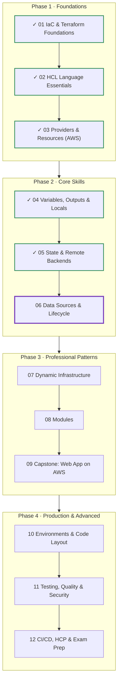
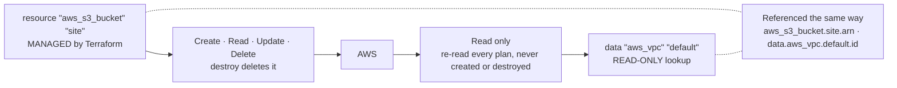
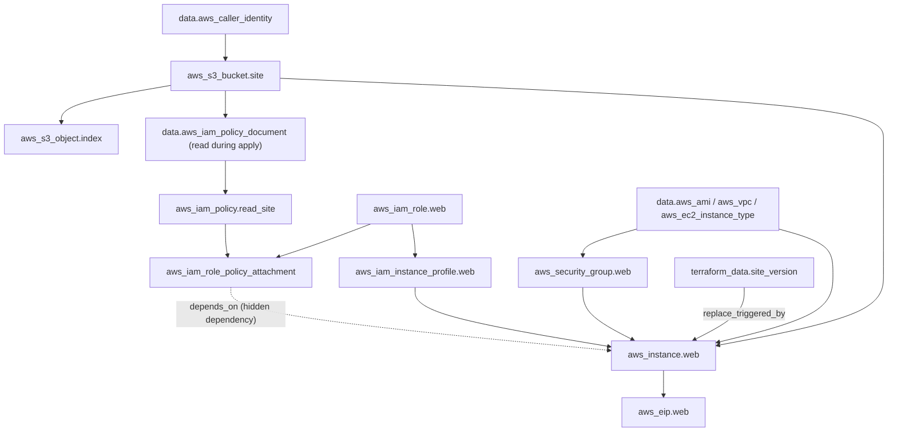
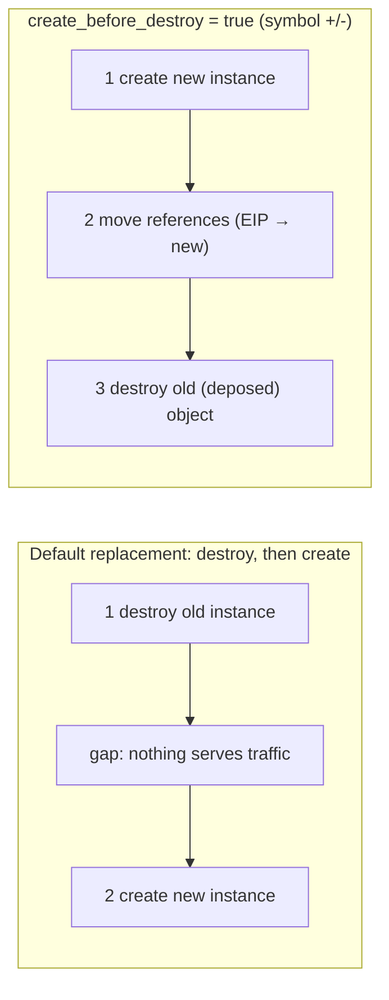
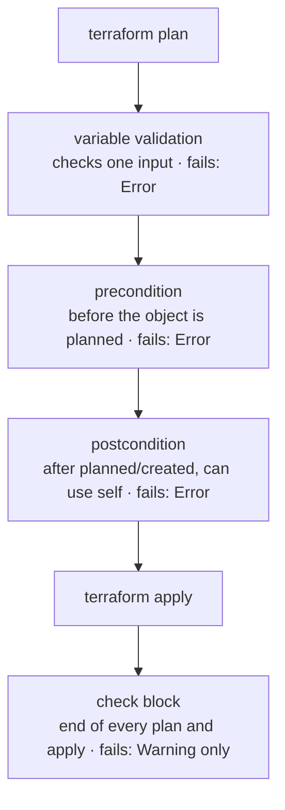
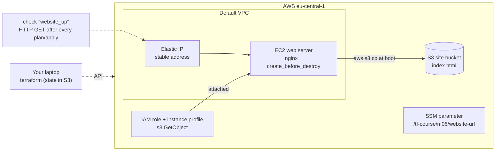

# Terraform: Zero to Advanced
## Module 06 — Data Sources, Dependencies & Lifecycle

> Query existing infrastructure, control the order and manner in which Terraform changes things, and guard your infrastructure with preconditions, postconditions and continuous checks.

| | |
|---|---|
| **Level** | Intermediate |
| **Time** | 4–5 hours (concepts + lab) |
| **Cost** | A few cents (t3.micro, Elastic IP) if you destroy the same day |
| **Terraform** | 1.12 or newer · AWS provider 6.x |

📄 **Full illustrated version:** [Module-06-Data-Sources-Dependencies-Lifecycle.pdf](./Module-06-Data-Sources-Dependencies-Lifecycle.pdf)

## Contents

- [1. Module Overview](#1-module-overview)
- [2. Core Concepts](#2-core-concepts)
- [3. Hands-on Lab — A Self-Checking, Safely Replaceable Web Server](#3-hands-on-lab--a-self-checking-safely-replaceable-web-server)
- [4. Quick Reference](#4-quick-reference)
- [5. Knowledge Check](#5-knowledge-check)
- [6. Summary & Next Steps](#6-summary--next-steps)

---

## 1. Module Overview


*Figure 0 — Where you are: Modules 01–05 done, Module 06 in progress.*

Real infrastructure never lives alone: it uses a VPC someone else built, an image AWS publishes, a role from the security team. And real changes need control: *replace this server without downtime*, *never delete that bucket*, *ignore the tag our backup tool adds*, *refuse to deploy if the inputs don't fit together*. This module gives you those tools: **data sources**, **explicit dependencies**, the **`lifecycle`** meta-argument and **custom conditions**.

#### Learning objectives — by the end of this module you can:

- Use **data sources** to look up AWS information and existing infrastructure, and explain when they are read.
- Build IAM policies safely with the **`aws_iam_policy_document`** data source.
- Tell **implicit** from **explicit** dependencies and use **`depends_on`** only when it is really needed.
- Control replacements with **`create_before_destroy`**, **`prevent_destroy`**, **`ignore_changes`**, **`replace_triggered_by`** and `apply -replace`.
- Protect configurations with **preconditions**, **postconditions** and **`check`** blocks — and know which ones block.
- Use the built-in **`terraform_data`** resource.

#### Prerequisites

- Module 05 completed — you need your **state bucket name** (this lab stores its state there).

## 2. Core Concepts

### 2.1 Data sources


*Figure 1 — Resources are managed; data sources are only read. Both are referenced the same way.*

A **data source** asks a provider for information and makes it available to your configuration. It never creates, changes or deletes anything. Use one whenever a value exists *outside* this configuration: an AMI ID that changes every few weeks, the current account ID, a VPC created by another team.

```hcl
data "aws_ami" "al2023" {             # data "<TYPE>" "<NAME>"
  most_recent = true
  owners      = ["amazon"]

  filter {
    name   = "name"
    values = ["al2023-ami-2023.*-x86_64"]
  }
}

# referenced with the data. prefix
ami = data.aws_ami.al2023.id
```

| Data source | Typical use |
|---|---|
| `aws_caller_identity` | Current account ID / ARN — build unique names, policies, checks |
| `aws_region` | Current region name (`.region` in provider 6) |
| `aws_availability_zones` | Which AZs are available — spread subnets and instances |
| `aws_ami` | The latest image matching a filter |
| `aws_vpc`, `aws_subnets` | Find networks by ID, tag or `default = true` |
| `aws_ssm_parameter` | Read values published by other teams or configurations |
| `aws_iam_policy_document` | Build IAM policy JSON in HCL — validated, readable, no string templates |
| `aws_ec2_instance_type` | Facts about an instance type (e.g. supported CPU architectures) |

#### When is a data source read?

Normally **during plan** — so plans show real, current values. If its arguments depend on something that doesn't exist yet (e.g. the ARN of a bucket you're creating in the same plan), Terraform **defers the read to apply** and shows it with the `<=` symbol: *will be read during apply*. Values derived from it are then *known after apply*.

> [!TIP]
> **Tip:** Sharing values between configurations: `terraform_remote_state` (Module 05) gives access to the other state's outputs but needs read access to the **whole** state. Publishing the value to **SSM Parameter Store** and reading it with `data "aws_ssm_parameter"` exposes only what you choose — the pattern used in this lab.

### 2.2 Dependencies


*Figure 2 — The lab's dependency graph. Solid arrows come from references; the dashed one needs depends_on.*

Terraform builds a graph from **references**: if resource B uses an attribute of A, A is created first and destroyed last. Independent resources are created **in parallel** (10 at a time by default; `-parallelism=N`). This **implicit** ordering is correct 99% of the time — and it's always preferable, because it can't drift out of sync with the code.

`depends_on` adds an **explicit** dependency for the remaining 1%: when B needs A **at runtime** but its arguments don't mention A. The classic case is in this lab — an EC2 instance whose boot script reads from S3 needs the IAM *policy attachment* to exist, yet the instance only references the *instance profile*:

```hcl
resource "aws_instance" "web" {
  iam_instance_profile = aws_iam_instance_profile.web.name   # implicit: profile first
  # ...
  depends_on = [aws_iam_role_policy_attachment.read_site]   # explicit: permission first
}
```

> [!WARNING]
> **Warning:** `depends_on` makes plans more conservative (values become *known after apply* more often). Use it only for genuinely hidden dependencies, always with a comment explaining why.

### 2.3 The lifecycle meta-argument

Every resource accepts a `lifecycle` block that changes **how** Terraform handles it:

| Argument | Effect | Typical use |
|---|---|---|
| `create_before_destroy = true` | On replacement, create the new object first, then destroy the old (`+/-`) | Servers behind an IP or load balancer, certificates, launch templates |
| `prevent_destroy = true` | Any plan that would destroy the object fails with an error | Databases, state buckets, KMS keys |
| `ignore_changes = [attr, ...]` | Differences in those attributes are ignored after creation | Tags added by other tools; `ami` so new image releases don't replace servers |
| `replace_triggered_by = [ref, ...]` | Replace this resource whenever a referenced resource changes | Roll servers when config or a version changes |
| `precondition` / `postcondition` | Custom checks (2.4) | Validate assumptions and guarantees |


*Figure 3 — Default replacement leaves a gap; create_before_destroy overlaps old and new.*

`create_before_destroy` needs names that can coexist: if a resource has a fixed unique name (e.g. an IAM role name), the new one can't be created while the old exists. Use `name_prefix` where the provider offers it.

Two CLI relatives: `terraform apply -replace=ADDR` forces one replacement now (the modern replacement for `taint`), and `-target=ADDR` limits a run to some resources — for emergencies only, since it bypasses the full plan.

#### terraform_data

`terraform_data` is a **built-in** resource (no provider needed) that simply stores a value. Its main use is as a trigger: `replace_triggered_by` only accepts references to resources, so wrap a plain value in `terraform_data` to make *"replace the server when this version changes"* possible.

```hcl
resource "terraform_data" "site_version" {
  input = var.site_version
}

# in aws_instance.web:
#   lifecycle { replace_triggered_by = [terraform_data.site_version] }
```

### 2.4 Custom conditions and checks


*Figure 4 — Where each kind of condition runs, and what happens when it fails.*

Variable validation (Module 04) checks one input. Three more tools check *relationships* and *results*:

| Tool | Lives in | Runs | On failure |
|---|---|---|---|
| **precondition** | `lifecycle` of a resource, data source or output | Before Terraform plans that object | **Error** — stops the run |
| **postcondition** | same; may use `self` | After the object is planned/read/created | **Error** — stops the run |
| **check** block | Top level, with optional scoped `data` source | At the end of every plan and apply | **Warning** — never blocks |

```hcl
lifecycle {
  precondition {
    condition = contains(
      data.aws_ec2_instance_type.selected.supported_architectures,
      data.aws_ami.al2023.architecture,
    )
    error_message = "${var.instance_type} can't run an ${data.aws_ami.al2023.architecture} AMI."
  }
}

check "website_up" {
  data "http" "home" { # scoped data source: only visible inside the check
    url = "http://${aws_eip.web.public_ip}"
  }

  assert {
    condition     = data.http.home.status_code == 200
    error_message = "The website returned HTTP ${data.http.home.status_code}."
  }
}
```

> [!IMPORTANT]
> **Key idea:** Rule of thumb: **preconditions** guard your *assumptions* (inputs fit together), **postconditions** guard your *guarantees* (what you promise to the next consumer), and **checks** continuously verify the *running system* without ever blocking a deployment.

---

## 3. Hands-on Lab — A Self-Checking, Safely Replaceable Web Server

**Goal:** build a web server that loads its page from S3 through an IAM role, has a stable Elastic IP, can be rolled to a new version with *create-before-destroy*, refuses incompatible inputs, ignores tags other tools add, and continuously checks that the site is up. The state lives in your Module 05 bucket.


*Figure 5 — Lab architecture.*

```text
lab-06-data-lifecycle/
├── terraform.tf      # versions + empty s3 backend
├── backend.hcl       # bucket from Module 05, key module-06/...
├── variables.tf
├── data.tf           # all data sources
├── iam.tf            # role, policy (from a policy document), instance profile
├── site.tf           # S3 bucket + index.html
├── web.tf            # security group, terraform_data, instance, Elastic IP
├── checks.tf         # check block
├── outputs.tf
└── templates/
    └── index.html.tftpl
```

### Task 1 — Set up the project

**`terraform.tf`**

```hcl
terraform {
  required_version = ">= 1.12.0"

  backend "s3" {}

  required_providers {
    aws = {
      source  = "hashicorp/aws"
      version = "~> 6.0"
    }
    http = {
      source  = "hashicorp/http"
      version = "~> 3.4"
    }
  }
}

provider "aws" {
  region = "eu-central-1"
}
```

**`backend.hcl`**

```hcl
bucket       = "tf-state-1a7d31df"              # your bucket from Module 05
key          = "module-06/terraform.tfstate"
region       = "eu-central-1"
use_lockfile = true
encrypt      = true
```

**`variables.tf`**

```hcl
variable "instance_type" {
  type        = string
  description = "EC2 instance type for the web server"
  default     = "t3.micro"
}

variable "site_version" {
  type        = string
  description = "Version of the web page; changing it rolls out a new server"
  default     = "1.0"
}
```

**`templates/index.html.tftpl`**

```text
<h1>Module 06 - site version ${version}</h1>
<p>Served from region ${region}</p>
```

### Task 2 — Data sources

**`data.tf`**

```hcl
data "aws_caller_identity" "current" {}

data "aws_region" "current" {}

data "aws_availability_zones" "available" {
  state = "available"

  lifecycle {
    postcondition {
      condition     = length(self.names) >= 2
      error_message = "This design needs at least two availability zones."
    }
  }
}

data "aws_vpc" "default" {
  default = true
}

data "aws_ami" "al2023" {
  most_recent = true
  owners      = ["amazon"]

  filter {
    name   = "name"
    values = ["al2023-ami-2023.*-x86_64"]
  }
}

data "aws_ec2_instance_type" "selected" {
  instance_type = var.instance_type
}
```

**`site.tf`**

```hcl
resource "aws_s3_bucket" "site" {
  # Account IDs are unique, so this name is unique too - no random suffix needed.
  bucket        = "tf-course-m06-site-${data.aws_caller_identity.current.account_id}"
  force_destroy = true # lab only
}

resource "aws_s3_object" "index" {
  bucket       = aws_s3_bucket.site.id
  key          = "index.html"
  content_type = "text/html"
  content = templatefile("${path.module}/templates/index.html.tftpl", {
    version = var.site_version
    region  = data.aws_region.current.region
  })
}
```

**`iam.tf`**

```hcl
data "aws_iam_policy_document" "ec2_assume" {
  statement {
    actions = ["sts:AssumeRole"]

    principals {
      type        = "Service"
      identifiers = ["ec2.amazonaws.com"]
    }
  }
}

data "aws_iam_policy_document" "read_site" {
  statement {
    actions   = ["s3:GetObject"]
    resources = ["${aws_s3_bucket.site.arn}/*"]
  }
}

resource "aws_iam_role" "web" {
  name               = "tf-course-m06-web"
  assume_role_policy = data.aws_iam_policy_document.ec2_assume.json
}

resource "aws_iam_policy" "read_site" {
  name   = "tf-course-m06-read-site"
  policy = data.aws_iam_policy_document.read_site.json
}

resource "aws_iam_role_policy_attachment" "read_site" {
  role       = aws_iam_role.web.name
  policy_arn = aws_iam_policy.read_site.arn
}

resource "aws_iam_instance_profile" "web" {
  name = "tf-course-m06-web"
  role = aws_iam_role.web.name
}
```

`aws_iam_policy_document` produces policy JSON from HCL. Compared with a hand-written JSON string it is validated, can reference other resources directly and is far easier to review. Now plan — don't create anything yet:

```bash
terraform init -backend-config=backend.hcl
terraform plan
```

*Expected output (abridged):*

```text
data.aws_caller_identity.current: Reading...
data.aws_region.current: Reading...
data.aws_availability_zones.available: Reading...
data.aws_ami.al2023: Reading...
...
data.aws_ami.al2023: Read complete after 1s [id=ami-0123456789abcdef0]
...
  # data.aws_iam_policy_document.read_site will be read during apply
  # (config refers to values not yet known)
 <= data "aws_iam_policy_document" "read_site" {
      + id   = (known after apply)
      + json = (known after apply)
      ...
    }
...
```

Most data sources were read **during plan**. `read_site` refers to the ARN of a bucket that doesn't exist yet, so it's deferred: `<=` and *will be read during apply*.

### Task 3 — The web server, its dependencies and lifecycle

**`web.tf`**

```hcl
resource "aws_security_group" "web" {
  name        = "tf-course-m06-web"
  description = "HTTP in, everything out"
  vpc_id      = data.aws_vpc.default.id
}

resource "aws_vpc_security_group_ingress_rule" "http" {
  security_group_id = aws_security_group.web.id
  cidr_ipv4         = "0.0.0.0/0"
  ip_protocol       = "tcp"
  from_port         = 80
  to_port           = 80
}

resource "aws_vpc_security_group_egress_rule" "all" {
  security_group_id = aws_security_group.web.id
  cidr_ipv4         = "0.0.0.0/0"
  ip_protocol       = "-1"
}

resource "terraform_data" "site_version" {
  input = var.site_version
}

resource "aws_instance" "web" {
  ami                    = data.aws_ami.al2023.id
  instance_type          = var.instance_type
  vpc_security_group_ids = [aws_security_group.web.id]
  iam_instance_profile   = aws_iam_instance_profile.web.name

  user_data = <<-EOT
    #!/bin/bash
    dnf install -y nginx
    aws s3 cp s3://${aws_s3_bucket.site.bucket}/index.html /usr/share/nginx/html/index.html \
      --region ${data.aws_region.current.region}
    systemctl enable --now nginx
  EOT

  metadata_options {
    http_tokens = "required"
  }

  tags = {
    Name = "tf-course-m06-web"
  }

  # The boot script reads from S3, so the policy must be attached before the instance boots.
  # Nothing above references the attachment, so Terraform can't infer this ordering.
  depends_on = [aws_iam_role_policy_attachment.read_site]

  lifecycle {
    create_before_destroy = true
    ignore_changes        = [ami, tags["PatchGroup"]]
    replace_triggered_by  = [terraform_data.site_version]

    precondition {
      condition = contains(
        data.aws_ec2_instance_type.selected.supported_architectures,
        data.aws_ami.al2023.architecture,
      )
      error_message = "${var.instance_type} can't run ${data.aws_ami.al2023.architecture}."
    }

    postcondition {
      condition     = self.metadata_options[0].http_tokens == "required"
      error_message = "IMDSv2 must be enforced on the web server."
    }
  }
}

resource "aws_eip" "web" {
  domain   = "vpc"
  instance = aws_instance.web.id

  tags = {
    Name = "tf-course-m06-web"
  }
}
```

**`outputs.tf`**

```hcl
output "website_url" {
  description = "Stable URL (Elastic IP)"
  value       = "http://${aws_eip.web.public_ip}"
}

output "instance_id" {
  value = aws_instance.web.id
}

output "availability_zones" {
  value = data.aws_availability_zones.available.names
}
```

Read the `lifecycle` block line by line — every rule of section 2.3 is there. `ignore_changes = [ami]` is a classic: without it, the first `plan` after AWS publishes a new Amazon Linux image would propose to **replace the server**. Now apply:

```bash
terraform apply
```

*Expected output (abridged):*

```text
Plan: 12 to add, 0 to change, 0 to destroy.
...
aws_iam_role_policy_attachment.read_site: Creation complete after 1s [id=tf-course-m06-web-...]
aws_instance.web: Creating...
aws_instance.web: Creation complete after 14s [id=i-0aaa111bbb222ccc3]
aws_eip.web: Creation complete after 2s [id=eipalloc-0...]

Apply complete! Resources: 12 added, 0 changed, 0 destroyed.

Outputs:

availability_zones = tolist([
  "eu-central-1a",
  "eu-central-1b",
  "eu-central-1c",
])
instance_id = "i-0aaa111bbb222ccc3"
website_url = "http://3.121.45.67"
```

Notice the order in the log: the policy attachment completed **before** the instance started — `depends_on` at work. After 1–2 minutes, `curl` the URL: *Module 06 - site version 1.0*.

### Task 4 — Continuous checks

**`checks.tf`**

```hcl
check "website_up" {
  data "http" "home" {
    url                = "http://${aws_eip.web.public_ip}"
    request_timeout_ms = 5000
  }

  assert {
    condition     = data.http.home.status_code == 200
    error_message = "The website returned HTTP ${data.http.home.status_code}."
  }
}
```

```bash
terraform plan
```

*Expected output (site is up):*

```text
data.http.home: Reading...
data.http.home: Read complete after 0s [id=http://3.121.45.67]

No changes. Your infrastructure matches the configuration.
```

Now break the system on purpose — stop the instance outside Terraform — and plan again:

```bash
aws ec2 stop-instances --instance-ids $(terraform output -raw instance_id)
terraform plan
```

*Expected output (abridged; wording depends on the failure):*

```text
╷
│ Warning: Error making request
│
│   with data.http.home,
│   on checks.tf line 2, in check "website_up":
│    2:   data "http" "home" {
│
│ Error making request: GET http://3.121.45.67 ... (Client.Timeout exceeded while awaiting headers)
╵
```

The check reports a **Warning**, not an Error: the plan still completes. That's by design — checks monitor the health of what's deployed without blocking deployments (a failing check may be exactly why you're deploying a fix). Start the instance again with `aws ec2 start-instances --instance-ids ...`, wait a minute, and the warning disappears. The Elastic IP stays attached through stop/start.

### Task 5 — A precondition stops bad input

`t4g` instances use ARM (Graviton) CPUs, but our AMI filter selects x86 images. Try it:

```bash
terraform plan -var="instance_type=t4g.micro"
```

*Expected output (abridged):*

```text
╷
│ Error: Resource precondition failed
│
│   on web.tf line ..., in resource "aws_instance" "web":
│   ...:       condition = contains(
│   ...:         data.aws_ec2_instance_type.selected.supported_architectures,
│   ...:         data.aws_ami.al2023.architecture,
│   ...:       )
│     ├────────────────
│     │ data.aws_ami.al2023.architecture is "x86_64"
│     │ data.aws_ec2_instance_type.selected.supported_architectures is list of string with 1 element
│
│ t4g.micro can't run x86_64.
╵
```

Without the precondition, AWS would have rejected the launch halfway through the apply — after other resources were already changed. Preconditions fail **at plan time**, before anything happens.

### Task 6 — Roll out a new version with create_before_destroy

Change the default of `site_version` to `"2.0"` (or pass `-var="site_version=2.0"`) and plan:

```bash
terraform apply
```

*Expected output (abridged):*

```text
  # aws_eip.web will be updated in-place
  ~ resource "aws_eip" "web" {
      ~ instance = "i-0aaa111bbb222ccc3" -> (known after apply)
      ...
  # aws_instance.web will be replaced due to changes in replace_triggered_by
+/- resource "aws_instance" "web" {
      ~ id = "i-0aaa111bbb222ccc3" -> (known after apply)
      ...
  # aws_s3_object.index will be updated in-place
  ~ resource "aws_s3_object" "index" {
      ~ content = <<-EOT
          - <h1>Module 06 - site version 1.0</h1>
          + <h1>Module 06 - site version 2.0</h1>
            <p>Served from region eu-central-1</p>
        EOT
      ...
  # terraform_data.site_version will be updated in-place
  ~ resource "terraform_data" "site_version" {
      ~ input  = "1.0" -> "2.0"
      ~ output = "1.0" -> (known after apply)
      ...
Plan: 1 to add, 3 to change, 1 to destroy.
...
aws_instance.web: Creating...
aws_instance.web: Creation complete after 13s [id=i-0ddd444eee555fff6]
aws_eip.web: Modifying... [id=eipalloc-0...]
aws_eip.web: Modifications complete after 2s [id=eipalloc-0...]
aws_instance.web (deposed object 3f2a9c1e): Destroying... [id=i-0aaa111bbb222ccc3]
aws_instance.web (deposed object 3f2a9c1e): Destruction complete after 41s

Apply complete! Resources: 1 added, 3 changed, 1 destroyed.
```

Note `+/-` (create *then* destroy) instead of `-/+`, and the order in the log: new instance → Elastic IP moved → old (*deposed*) instance destroyed. The URL never changed. There is still a short gap while the new server boots nginx — true zero downtime needs a load balancer with health checks, which you'll build in Module 09.

### Task 7 — ignore_changes for tags other tools manage

Imagine a patching tool tags servers. Simulate it, plus a second, unexpected tag:

```bash
ID=$(terraform output -raw instance_id)
aws ec2 create-tags --resources $ID --tags Key=PatchGroup,Value=weekly Key=Owner,Value=me
terraform plan
```

*Expected output (abridged):*

```text
  # aws_instance.web will be updated in-place
  ~ resource "aws_instance" "web" {
        id       = "i-0ddd444eee555fff6"
      ~ tags     = {
          - "Owner"      = "me" -> null
            # (2 unchanged elements hidden)
        }
      ~ tags_all = {
          - "Owner"      = "me" -> null
            # (2 unchanged elements hidden)
        }
        # (unchanged attributes hidden)
    }

Plan: 0 to add, 1 to change, 0 to destroy.
```

`PatchGroup` is ignored, exactly as declared; `Owner` is not, so Terraform plans to remove it. Apply to remove it. Use `ignore_changes` narrowly — ignoring all `tags` would also hide changes you *do* care about.

### Task 8 — Force a replacement on demand

A server misbehaves and you want a fresh one, with no code change:

```bash
terraform plan -replace=aws_instance.web
```

*Expected output (abridged):*

```text
  # aws_instance.web will be replaced, as requested
+/- resource "aws_instance" "web" {
...
Plan: 1 to add, 1 to change, 1 to destroy.
```

`-replace` respects `create_before_destroy` and shows up in the plan for review — the modern replacement for `terraform taint`. You don't need to apply it.

### Task 9 — Publish a value for other configurations

Publish the website URL to SSM Parameter Store, then read it from a completely separate configuration:

**`web.tf (addition)`**

```hcl
resource "aws_ssm_parameter" "website_url" {
  name  = "/tf-course/m06/website-url"
  type  = "String"
  value = "http://${aws_eip.web.public_ip}"
}
```

**`consumer/main.tf`**

```hcl
terraform {
  required_providers {
    aws = {
      source  = "hashicorp/aws"
      version = "~> 6.0"
    }
  }
}

provider "aws" {
  region = "eu-central-1"
}

data "aws_ssm_parameter" "website_url" {
  name = "/tf-course/m06/website-url"
}

output "website_url" {
  value = nonsensitive(data.aws_ssm_parameter.website_url.value)
}
```

```bash
terraform apply                 # in lab-06: creates the parameter
cd consumer
terraform init
terraform apply
```

*Expected output (consumer):*

```text
Apply complete! Resources: 0 added, 0 changed, 0 destroyed.

Outputs:

website_url = "http://3.121.45.67"
```

The provider marks `value` as sensitive because parameters *can* hold secrets; `nonsensitive()` tells Terraform this one is safe to show. The consumer needs only `ssm:GetParameter` on one parameter — not read access to another team's entire state.

### Task 10 — Clean up

```bash
cd ..
terraform destroy
```

*Expected output (abridged):*

```text
Plan: 0 to add, 0 to change, 13 to destroy.
...
aws_eip.web: Destroying... [id=eipalloc-0...]
aws_ssm_parameter.website_url: Destroying... [id=/tf-course/m06/website-url]
...
aws_instance.web: Destroying... [id=i-0ddd444eee555fff6]
...
Destroy complete! Resources: 13 destroyed.
```

Dependents go first (Elastic IP, parameter), then the instance, then what it depended on — the dependency graph in reverse. The consumer has no resources, so there's nothing to destroy there. The release of the Elastic IP matters: an unattached Elastic IP keeps costing money.

### Challenge — a second check

Add a check that warns when the instance is not running, without any data source. Then repeat the stop/start experiment from Task 4 and watch both warnings.

#### Solution

**`checks.tf (addition)`**

```hcl
check "instance_running" {
  assert {
    condition     = aws_instance.web.instance_state == "running"
    error_message = "The web server is ${aws_instance.web.instance_state}, not running."
  }
}
```

Checks can assert on any value Terraform knows — here an attribute refreshed from AWS on every plan. Because they only warn, they are safe to add to any configuration as living documentation of *what healthy means*.

#### Lab complete when you can tick every box

- [ ] I can explain why one data source was read during plan and another during apply (`<=`).
- [ ] I built IAM policies with `aws_iam_policy_document`.
- [ ] I can justify the one `depends_on` in this lab.
- [ ] I rolled out a new version with `+/-` and saw the deposed instance destroyed last.
- [ ] A precondition stopped bad input at plan time; a check warned without blocking.
- [ ] I shared a value through SSM Parameter Store and destroyed everything.

---

## 4. Quick Reference

### 4.1 Cheat sheet

| Need | Syntax |
|---|---|
| Look something up | `data "TYPE" "NAME" { ... }` → `data.TYPE.NAME.attr` |
| Build IAM JSON | `data "aws_iam_policy_document"` → `.json` |
| Hidden dependency | `depends_on = [aws_x.y]` (with a comment) |
| New before old | `lifecycle { create_before_destroy = true }` |
| Never destroy | `lifecycle { prevent_destroy = true }` |
| Ignore outside changes | `lifecycle { ignore_changes = [ami, tags["Key"]] }` |
| Replace when X changes | `lifecycle { replace_triggered_by = [terraform_data.x] }` |
| Replace now | `terraform apply -replace=ADDR` |
| Guard an assumption | `lifecycle { precondition { condition  error_message } }` |
| Guard a result | `lifecycle { postcondition { condition = self.x ... } }` |
| Monitor without blocking | `check "name" { data ... assert { ... } }` |
| Show a sensitive value that isn't secret | `nonsensitive(value)` |

### 4.2 Plan symbols so far

| Symbol | Meaning |
|---|---|
| `+` | create |
| `-` | destroy |
| `~` | update in place |
| `-/+` | replace: destroy, then create |
| `+/-` | replace: create, then destroy (`create_before_destroy`) |
| `<=` | data source read during apply |

### 4.3 Common errors and fixes

| Error | Usual cause | Fix |
|---|---|---|
| `Resource precondition failed` / `postcondition failed` | Your own rule caught a problem | Read your error message; fix the input or config |
| `Your query returned no results` | Data source filter matches nothing (wrong region, name) | Check filters, owners, region |
| `Your query returned more than one result` | Filter too broad and no `most_recent` | Narrow the filter or set `most_recent = true` |
| `EntityAlreadyExists` during `+/-` | Fixed unique name + create_before_destroy | Use `name_prefix` or drop create_before_destroy for that resource |
| `Instance cannot be destroyed` | `prevent_destroy` | Intended; remove the flag first if you really mean it |
| Boot script can't access S3 | Missing `depends_on` / permission | Check the role policy and attachment ordering |

## 5. Knowledge Check

**Q1. What's the difference between a resource and a data source?**

<details><summary>Show answer</summary>

A resource is managed (created, updated, destroyed) by Terraform; a data source is only read.

</details>

**Q2. What does `<=` mean in a plan?**

<details><summary>Show answer</summary>

A data source that will be read during apply, because its arguments depend on values not yet known.

</details>

**Q3. Why prefer `aws_iam_policy_document` over a JSON string?**

<details><summary>Show answer</summary>

It's validated HCL, can reference other resources directly, and is easier to read and review.

</details>

**Q4. When is `depends_on` needed?**

<details><summary>Show answer</summary>

When a resource needs another at runtime but doesn't reference any of its attributes — a hidden dependency.

</details>

**Q5. What changes with `create_before_destroy = true`?**

<details><summary>Show answer</summary>

On replacement, the new object is created before the old one is destroyed (`+/-`), shortening downtime.

</details>

**Q6. Why is `ignore_changes = [ami]` common on EC2 instances?**

<details><summary>Show answer</summary>

So a newly published AMI picked up by a data source doesn't trigger an unplanned server replacement.

</details>

**Q7. How do you replace a resource whenever a plain variable changes?**

<details><summary>Show answer</summary>

Wrap the value in `terraform_data` and reference it in `replace_triggered_by`.

</details>

**Q8. Precondition vs postcondition?**

<details><summary>Show answer</summary>

A precondition checks assumptions before the object is planned; a postcondition checks results afterwards and can use `self`.

</details>

**Q9. What happens when a `check` block assertion fails?**

<details><summary>Show answer</summary>

Terraform reports a warning; plan/apply still succeed.

</details>

**Q10. What replaced `terraform taint`?**

<details><summary>Show answer</summary>

`terraform apply -replace=ADDRESS`, which shows the replacement in the plan.

</details>

## 6. Summary & Next Steps

- **Data sources** read information; they're referenced as `data.TYPE.NAME.attr` and read at plan time unless they depend on unknown values (`<=`).
- Dependencies come from references; add `depends_on` only for hidden runtime dependencies — with a comment.
- `lifecycle` controls replacement and protection: `create_before_destroy`, `prevent_destroy`, `ignore_changes`, `replace_triggered_by`.
- `terraform_data` turns any value into a replacement trigger; `-replace` forces a replacement on demand.
- **Preconditions** and **postconditions** stop bad runs; **check** blocks warn about an unhealthy system without blocking.
- Share values between configurations through SSM Parameter Store and data sources.

**Next — Module 07: Dynamic Infrastructure.** So far every resource was written out by hand. Next you'll create many resources from one block with `count` and `for_each`, generate nested blocks with `dynamic`, build resources conditionally, and learn the addressing rules that keep large configurations stable.

#### Official references

- [Data sources](https://developer.hashicorp.com/terraform/language/data-sources)
- [depends_on](https://developer.hashicorp.com/terraform/language/meta-arguments/depends_on)
- [lifecycle](https://developer.hashicorp.com/terraform/language/meta-arguments/lifecycle)
- [Custom conditions](https://developer.hashicorp.com/terraform/language/expressions/custom-conditions)
- [Checks](https://developer.hashicorp.com/terraform/language/checks)
- [terraform_data](https://developer.hashicorp.com/terraform/language/resources/terraform-data)
