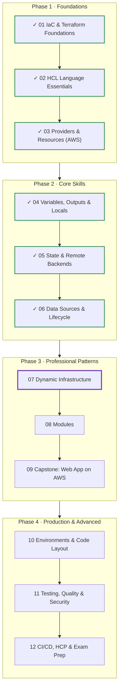
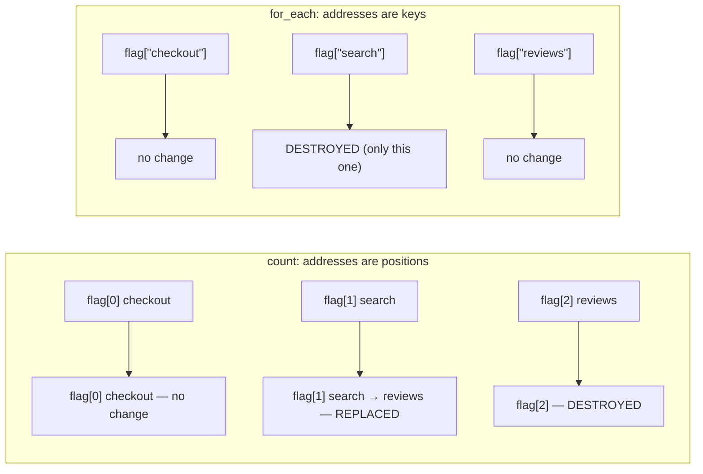
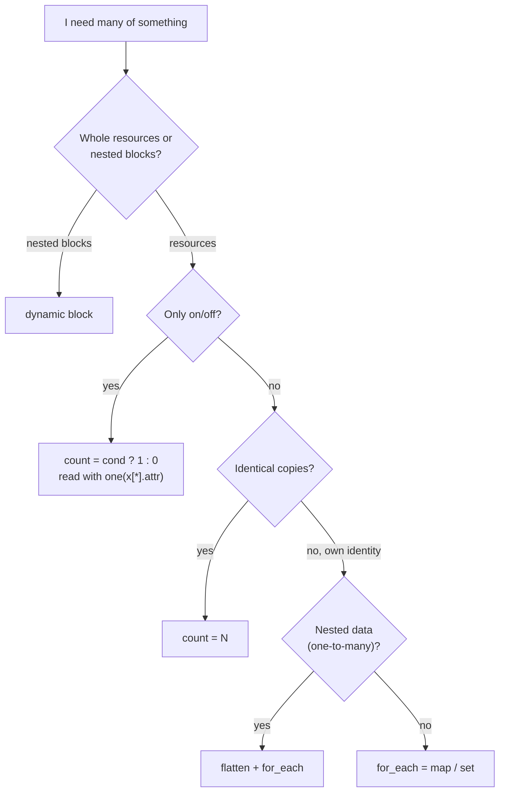
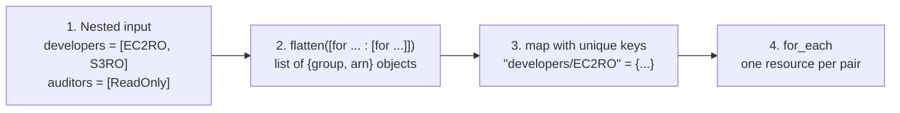
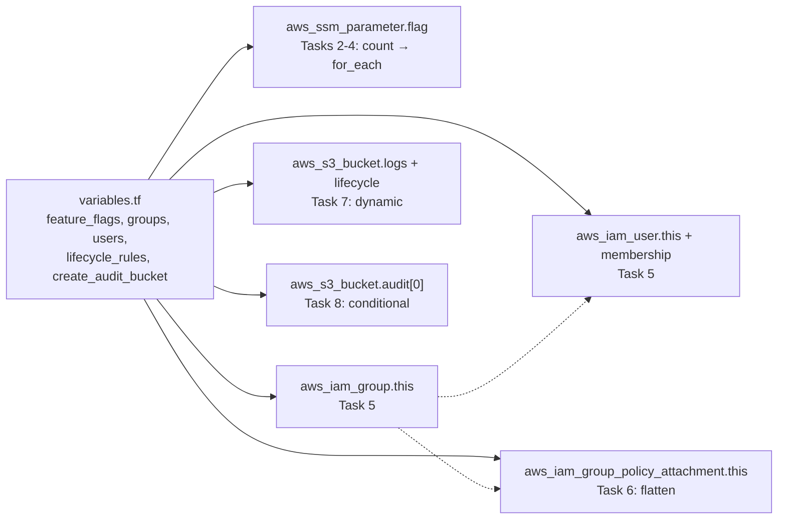

# Terraform: Zero to Advanced
## Module 07 — Dynamic Infrastructure

> Create many resources from one block with count and for_each, generate nested blocks with dynamic, build resources conditionally — and keep addresses stable as your data changes.

| | |
|---|---|
| **Level** | Intermediate |
| **Time** | 4–5 hours (concepts + lab) |
| **Cost** | ≈ $0 (IAM, SSM parameters and an empty S3 bucket) |
| **Terraform** | 1.12 or newer · AWS provider 6.x |

📄 **Full illustrated version:** [Module-07-Dynamic-Infrastructure.pdf](./Module-07-Dynamic-Infrastructure.pdf)

## Contents

- [1. Module Overview](#1-module-overview)
- [2. Core Concepts](#2-core-concepts)
- [3. Hands-on Lab — Data-Driven IAM, Flags and Buckets](#3-hands-on-lab--data-driven-iam-flags-and-buckets)
- [4. Quick Reference](#4-quick-reference)
- [5. Knowledge Check](#5-knowledge-check)
- [6. Summary & Next Steps](#6-summary--next-steps)

---

## 1. Module Overview


*Figure 0 — Where you are: Modules 01–06 done, Module 07 in progress.*

Until now, ten servers would have meant ten resource blocks. Real configurations are driven by **data**: a list of users, a map of buckets, a set of firewall rules. In this module you learn the four tools that turn data into infrastructure — **`count`**, **`for_each`**, **`dynamic`** blocks and **conditional** resources — and, just as important, how to keep resource **addresses stable** so that changing the data changes only what you meant.

#### Learning objectives — by the end of this module you can:

- Create multiple instances of a resource with **`count`** and **`for_each`**, and reference them correctly.
- Explain why `count` addresses shift when a list changes, and why `for_each` keys don't.
- Choose the right tool for a job using a simple decision guide.
- Turn nested data into resources with the **flatten pattern** and `setproduct`.
- Generate repeated nested blocks with **`dynamic`** blocks, including an optional block.
- Create resources **conditionally** and read them safely with `one()`.
- Migrate from `count` to `for_each` without recreating anything, using `moved` blocks.

#### Prerequisites

- Modules 02 (for expressions) and 05 (state bucket, `moved` blocks) completed.

## 2. Core Concepts

### 2.1 count

`count` is a **meta-argument** (it works on every resource and module) that creates N instances of a block. Inside the block, `count.index` is the instance number, starting at 0:

```hcl
variable "feature_flags" {
  type    = list(string)
  default = ["checkout", "search", "reviews"]
}

resource "aws_ssm_parameter" "flag" {
  count = length(var.feature_flags)

  name  = "/tf-course/m07/flags/${var.feature_flags[count.index]}"
  type  = "String"
  value = "off"
}
```

| You want… | Expression |
|---|---|
| One instance | `aws_ssm_parameter.flag[0]` |
| A list of all instances | `aws_ssm_parameter.flag` (a list) |
| One attribute of every instance | `aws_ssm_parameter.flag[*].name` (splat) |
| How many | `length(aws_ssm_parameter.flag)` |

### 2.2 for_each

`for_each` creates one instance per element of a **map** or a **set of strings**. Inside the block, `each.key` and `each.value` describe the current element. For a set, `each.key` and `each.value` are the same string.

```hcl
resource "aws_ssm_parameter" "flag" {
  for_each = toset(var.feature_flags)          # a list must be converted to a set

  name  = "/tf-course/m07/flags/${each.key}"
  type  = "String"
  value = "off"
}

resource "aws_iam_user" "this" {
  for_each = var.users                         # a map: key = user name, value = object

  name = "tf-course-m07-${each.key}"
  tags = { Department = each.value.department }
}
```

| You want… | Expression |
|---|---|
| One instance | `aws_iam_user.this["alice"]` |
| All instances | `aws_iam_user.this` (a **map** keyed like the input) |
| One attribute of every instance | `values(aws_iam_user.this)[*].arn` |
| A map of name → ARN | `{ for k, u in aws_iam_user.this : k => u.arn }` |

> [!WARNING]
> **Warning:** `for_each` keys must be **known at plan time**. Keys taken from variables, locals or literals are fine; keys derived from attributes of resources that don't exist yet (e.g. an ID that's *known after apply*) are rejected with *Invalid for_each argument*. Values, however, may be unknown.

### 2.3 count vs for_each: why addresses matter


*Figure 1 — Removing the middle element: count shifts every later address; for_each touches only the removed key.*

State identifies each instance by its **address**. With `count` the address is a position, so removing `search` from the middle makes `reviews` move from `[2]` to `[1]`: Terraform sees `[1]` changing its name (**replace**) and `[2]` disappearing (**destroy**). With `for_each` the address is the key itself — removing `search` destroys exactly one thing.


*Figure 2 — Choosing the right tool.*

> [!IMPORTANT]
> **Key idea:** Default to **`for_each`**. Use `count` for on/off switches (`count = var.enabled ? 1 : 0`) and for truly interchangeable copies. You cannot use `count` and `for_each` in the same block.

### 2.4 Conditional resources

`count = condition ? 1 : 0` creates a resource or not. Because the result is always a list of 0 or 1 elements, read it with `one()`, which returns the single element — or `null` if the list is empty:

```hcl
resource "aws_s3_bucket" "audit" {
  count  = var.create_audit_bucket ? 1 : 0
  bucket = "tf-course-m07-audit-${data.aws_caller_identity.current.account_id}"
}

output "audit_bucket" {
  value = one(aws_s3_bucket.audit[*].bucket)   # "tf-course-..." or null
}
```

Writing `aws_s3_bucket.audit[0].bucket` instead would fail with *Invalid index* whenever the bucket is disabled.

### 2.5 The flatten pattern


*Figure 3 — From nested data to one resource per pair.*

`for_each` needs **one map element per resource**. When your data is nested — each group has *several* policies — you need a resource for each *(group, policy)* pair. The standard recipe: a nested `for` expression, `flatten()` to make it one list, then a `for` expression that turns the list into a map with a **unique, readable key**:

```hcl
locals {
  group_policies = flatten([
    for group, arns in var.groups : [
      for arn in arns : {
        group      = group
        policy_arn = arn
      }
    ]
  ])
}

resource "aws_iam_group_policy_attachment" "this" {
  for_each = {
    for gp in local.group_policies : "${gp.group}/${basename(gp.policy_arn)}" => gp
  }

  group      = aws_iam_group.this[each.value.group].name
  policy_arn = each.value.policy_arn
}
```

For *every combination* of two independent lists (e.g. each service in each environment) use `setproduct(list_a, list_b)`, which returns all pairs.

### 2.6 dynamic blocks

```hcl
dynamic "rule" {                 # label = name of the nested block to generate
  for_each = var.lifecycle_rules  # collection: one block per element
  iterator = r                    # optional; default name is the label (rule)
  content {                       # body of each generated block
    id     = r.value.id           # r.key = index/key, r.value = element
    status = "Enabled"
  }
}
```
*Figure 4 — Anatomy of a dynamic block.*

`count` and `for_each` repeat **resources**. To repeat **nested blocks inside** one resource — rules, settings, listeners — use a `dynamic` block. A common trick makes a nested block **optional**: loop over a list with zero or one elements.

```hcl
dynamic "transition" {
  for_each = rule.value.transition_days == null ? [] : [rule.value.transition_days]
  content {
    days          = transition.value
    storage_class = "STANDARD_IA"
  }
}
```

> [!WARNING]
> **Warning:** Dynamic blocks make code harder to read. Use them when the number of blocks really comes from input data; for two fixed blocks, just write them out.

### 2.7 Changing from count to for_each

Switching an existing resource from `count` to `for_each` changes every address (`flag[0]` → `flag["checkout"]`). Without help Terraform would destroy and recreate everything. `moved` blocks (Module 05) map old addresses to new ones, so the switch is **0 to add, 0 to destroy**:

```hcl
moved {
  from = aws_ssm_parameter.flag[0]
  to   = aws_ssm_parameter.flag["checkout"]
}
```

Also note the CLI quoting for addresses with string keys: `terraform state show 'aws_iam_user.this["alice"]'` in bash/zsh. On Windows PowerShell 5 escape the inner quotes: `'aws_iam_user.this[\"alice\"]'`.

---

## 3. Hands-on Lab — Data-Driven IAM, Flags and Buckets

**Goal:** drive an entire configuration from variables — feature-flag parameters, IAM groups and users, policy attachments, a bucket with generated lifecycle rules and an optional audit bucket — then change the data and watch Terraform change only what you intended. IAM and SSM are free; the buckets stay empty.


*Figure 5 — Lab overview.*

```text
lab-07-dynamic/
├── terraform.tf      # versions + s3 backend (key module-07/...)
├── backend.hcl
├── variables.tf
├── locals.tf         # flatten pattern
├── flags.tf          # count, then for_each
├── iam.tf            # groups, users, memberships, attachments
├── buckets.tf        # dynamic blocks + conditional bucket
└── outputs.tf
```

### Task 1 — Set up

Copy `terraform.tf` and `backend.hcl` from Module 06, remove the `http` provider, and change the key to `module-07/terraform.tfstate`. Then create the variables:

**`variables.tf`**

```hcl
variable "feature_flags" {
  type        = list(string)
  description = "Feature flags to create as SSM parameters"
  default     = ["checkout", "search", "reviews"]
}

variable "groups" {
  type        = map(list(string))
  description = "IAM group name => list of managed policy ARNs"
  default = {
    developers = [
      "arn:aws:iam::aws:policy/AmazonEC2ReadOnlyAccess",
      "arn:aws:iam::aws:policy/AmazonS3ReadOnlyAccess",
    ]
    auditors = ["arn:aws:iam::aws:policy/ReadOnlyAccess"]
  }
}

variable "users" {
  type = map(object({
    department = string
    groups     = list(string)
  }))
  description = "IAM user name => department and group memberships"
  default = {
    alice = { department = "engineering", groups = ["developers"] }
    bob   = { department = "engineering", groups = ["developers", "auditors"] }
    carol = { department = "finance", groups = ["auditors"] }
  }

  validation {
    condition = alltrue(flatten([
      for u in var.users : [for g in u.groups : contains(keys(var.groups), g)]
    ]))
    error_message = "Every group a user belongs to must exist in var.groups."
  }
}

variable "lifecycle_rules" {
  type = list(object({
    id              = string
    prefix          = string
    expiration_days = number
    transition_days = optional(number)
  }))
  description = "Lifecycle rules for the logs bucket"
  default = [
    { id = "expire-tmp", prefix = "tmp/", expiration_days = 7 },
    { id = "archive-logs", prefix = "logs/", expiration_days = 90, transition_days = 30 },
  ]
}

variable "create_audit_bucket" {
  type        = bool
  description = "Create an extra bucket for audit exports"
  default     = false
}
```

Note the validation on `users`: a validation rule may reference **other variables** (Terraform 1.9+), so a typo like `groups = ["developer"]` is rejected before anything is planned.

```bash
terraform init -backend-config=backend.hcl
```

### Task 2 — count

**`flags.tf`**

```hcl
resource "aws_ssm_parameter" "flag" {
  count = length(var.feature_flags)

  name  = "/tf-course/m07/flags/${var.feature_flags[count.index]}"
  type  = "String"
  value = "off"
}
```

**`outputs.tf`**

```hcl
output "flag_names" {
  value = aws_ssm_parameter.flag[*].name
}
```

```bash
terraform apply
terraform state list
```

*Expected output (abridged):*

```text
Apply complete! Resources: 3 added, 0 changed, 0 destroyed.

Outputs:

flag_names = [
  "/tf-course/m07/flags/checkout",
  "/tf-course/m07/flags/search",
  "/tf-course/m07/flags/reviews",
]

aws_ssm_parameter.flag[0]
aws_ssm_parameter.flag[1]
aws_ssm_parameter.flag[2]
```

### Task 3 — The count trap

Product decides `search` is no longer a feature flag. Remove it from the list — run with `-var` so you don't have to edit the file — and **only plan**:

```bash
terraform plan -var='feature_flags=["checkout","reviews"]'
```

*Expected output (abridged):*

```text
  # aws_ssm_parameter.flag[1] must be replaced
-/+ resource "aws_ssm_parameter" "flag" {
      ~ arn   = "arn:aws:ssm:...:parameter/tf-.../search" -> (known after apply)
      ~ id    = "/tf-course/m07/flags/search" -> (known after apply)
      ~ name  = "/tf-course/m07/flags/search" -> "/tf-course/m07/flags/reviews" # forces replacement
        # (unchanged attributes hidden)
    }

  # aws_ssm_parameter.flag[2] will be destroyed
  # (because index [2] is out of range for count)
  - resource "aws_ssm_parameter" "flag" {
      - name  = "/tf-course/m07/flags/reviews" -> null
      ...
    }

Plan: 1 to add, 0 to change, 2 to destroy.
```

You removed one flag and Terraform wants to touch **two**: it destroys `reviews` and recreates it in slot `[1]`. For parameters that's harmless; for servers or databases it would be an outage. Don't apply — fix the design.

(On Windows PowerShell write the variable as `-var 'feature_flags=[\"checkout\",\"reviews\"]'`.)

### Task 4 — Switch to for_each without recreating anything

**`flags.tf (replace everything)`**

```hcl
resource "aws_ssm_parameter" "flag" {
  for_each = toset(var.feature_flags)

  name  = "/tf-course/m07/flags/${each.key}"
  type  = "String"
  value = "off"
}

moved {
  from = aws_ssm_parameter.flag[0]
  to   = aws_ssm_parameter.flag["checkout"]
}

moved {
  from = aws_ssm_parameter.flag[1]
  to   = aws_ssm_parameter.flag["search"]
}

moved {
  from = aws_ssm_parameter.flag[2]
  to   = aws_ssm_parameter.flag["reviews"]
}
```

**`outputs.tf (change)`**

```hcl
output "flag_names" {
  value = [for p in aws_ssm_parameter.flag : p.name]
}
```

```bash
terraform apply
```

*Expected output (abridged):*

```text
  # aws_ssm_parameter.flag[0] has moved to aws_ssm_parameter.flag["checkout"]
    resource "aws_ssm_parameter" "flag" {
        id    = "/tf-course/m07/flags/checkout"
        name  = "/tf-course/m07/flags/checkout"
        # (unchanged attributes hidden)
    }
  ...
Plan: 0 to add, 0 to change, 0 to destroy.
...
Apply complete! Resources: 0 added, 0 changed, 0 destroyed.
```

The splat `[*]` doesn't work on a map, which is why the output now uses a `for` expression. Note that the output list is sorted by key (`checkout`, `reviews`, `search`) — maps and sets are always iterated in lexical order. Now remove `search` for real: edit the default list, then:

```bash
terraform apply
```

*Expected output (abridged):*

```text
  # aws_ssm_parameter.flag["search"] will be destroyed
  # (because key ["search"] is not in for_each map)
  - resource "aws_ssm_parameter" "flag" { ... }

Plan: 0 to add, 0 to change, 1 to destroy.
```

Exactly one change. Delete the three `moved` blocks once applied — or keep them for teammates who haven't applied yet; a `moved` block whose target no longer exists is simply ignored.

### Task 5 — IAM groups and users from maps

**`iam.tf`**

```hcl
resource "aws_iam_group" "this" {
  for_each = var.groups

  name = "tf-course-m07-${each.key}"
}

resource "aws_iam_user" "this" {
  for_each = var.users

  name          = "tf-course-m07-${each.key}"
  force_destroy = true # lab only: allows deletion even if keys/passwords were added

  tags = {
    Department = each.value.department
  }
}

resource "aws_iam_user_group_membership" "this" {
  for_each = var.users

  user   = aws_iam_user.this[each.key].name
  groups = [for g in each.value.groups : aws_iam_group.this[g].name]
}
```

Look at the references: `aws_iam_user.this[each.key]` links each membership to *its* user, and `aws_iam_group.this[g]` looks groups up by key. Matching keys across resources like this is the backbone of data-driven Terraform.

```bash
terraform apply
terraform state list
```

*Expected output (abridged):*

```text
Plan: 7 to add, 0 to change, 0 to destroy.
...
Apply complete! Resources: 7 added, 0 changed, 0 destroyed.

aws_iam_group.this["auditors"]
aws_iam_group.this["developers"]
aws_iam_user.this["alice"]
aws_iam_user.this["bob"]
aws_iam_user.this["carol"]
aws_iam_user_group_membership.this["alice"]
aws_iam_user_group_membership.this["bob"]
aws_iam_user_group_membership.this["carol"]
aws_ssm_parameter.flag["checkout"]
aws_ssm_parameter.flag["reviews"]
```

```bash
terraform state show 'aws_iam_user.this["bob"]'
```

### Task 6 — The flatten pattern for policy attachments

**`locals.tf`**

```hcl
locals {
  group_policies = flatten([
    for group, arns in var.groups : [
      for arn in arns : {
        group      = group
        policy_arn = arn
      }
    ]
  ])
}
```

**`iam.tf (addition)`**

```hcl
resource "aws_iam_group_policy_attachment" "this" {
  for_each = {
    for gp in local.group_policies : "${gp.group}/${basename(gp.policy_arn)}" => gp
  }

  group      = aws_iam_group.this[each.value.group].name
  policy_arn = each.value.policy_arn
}
```

Before applying, inspect the intermediate value in the console (exit with `exit`):

```bash
terraform console
> local.group_policies
> { for gp in local.group_policies : "${gp.group}/${basename(gp.policy_arn)}" => gp.policy_arn }
```

*Expected output:*

```text
[
  {
    "group" = "auditors"
    "policy_arn" = "arn:aws:iam::aws:policy/ReadOnlyAccess"
  },
  {
    "group" = "developers"
    "policy_arn" = "arn:aws:iam::aws:policy/AmazonEC2ReadOnlyAccess"
  },
  {
    "group" = "developers"
    "policy_arn" = "arn:aws:iam::aws:policy/AmazonS3ReadOnlyAccess"
  },
]
{
  "auditors/ReadOnlyAccess" = "arn:aws:iam::aws:policy/ReadOnlyAccess"
  "developers/AmazonEC2ReadOnlyAccess" = "arn:aws:iam::aws:policy/AmazonEC2ReadOnlyAccess"
  "developers/AmazonS3ReadOnlyAccess" = "arn:aws:iam::aws:policy/AmazonS3ReadOnlyAccess"
}
```

```bash
terraform apply
```

*Expected output (abridged):*

```text
  # aws_iam_group_policy_attachment.this["auditors/ReadOnlyAccess"] will be created
  ...
Plan: 3 to add, 0 to change, 0 to destroy.
```

`basename()` takes the last part of a path — here the policy name — so the keys are short and readable. A good key is **unique, stable and meaningful**; never use list indexes as keys.

### Task 7 — dynamic blocks for lifecycle rules

**`buckets.tf`**

```hcl
data "aws_caller_identity" "current" {}

resource "aws_s3_bucket" "logs" {
  bucket        = "tf-course-m07-logs-${data.aws_caller_identity.current.account_id}"
  force_destroy = true # lab only
}

resource "aws_s3_bucket_lifecycle_configuration" "logs" {
  bucket = aws_s3_bucket.logs.id

  dynamic "rule" {
    for_each = var.lifecycle_rules
    content {
      id     = rule.value.id
      status = "Enabled"

      filter {
        prefix = rule.value.prefix
      }

      expiration {
        days = rule.value.expiration_days
      }

      # Optional nested block: zero or one transition, depending on the data
      dynamic "transition" {
        for_each = rule.value.transition_days == null ? [] : [rule.value.transition_days]
        content {
          days          = transition.value
          storage_class = "STANDARD_IA"
        }
      }
    }
  }
}
```

```bash
terraform apply
```

*Expected output (abridged):*

```text
  # aws_s3_bucket_lifecycle_configuration.logs will be created
  + resource "aws_s3_bucket_lifecycle_configuration" "logs" {
      + bucket = (known after apply)
      + id     = (known after apply)
      ...
      + rule {
          + id     = "expire-tmp"
          + status = "Enabled"
          + expiration {
              + days = 7
              ...
            }
          + filter {
              + prefix = "tmp/"
            }
        }
      + rule {
          + id     = "archive-logs"
          + status = "Enabled"
          + expiration {
              + days = 90
              ...
            }
          + filter {
              + prefix = "logs/"
            }
          + transition {
              + days          = 30
              + storage_class = "STANDARD_IA"
            }
        }
    }

Plan: 2 to add, 0 to change, 0 to destroy.
```

The plan shows ordinary `rule` blocks — `dynamic` is just a way of *writing* them. Only `archive-logs` got a `transition`, because `expire-tmp` has no `transition_days` (`optional()` made it `null`). Check in the console: *S3 → bucket → Management → Lifecycle rules*.

### Task 8 — A conditional resource

**`buckets.tf (addition)`**

```hcl
resource "aws_s3_bucket" "audit" {
  count = var.create_audit_bucket ? 1 : 0

  bucket        = "tf-course-m07-audit-${data.aws_caller_identity.current.account_id}"
  force_destroy = true # lab only
}
```

**`outputs.tf (addition)`**

```hcl
output "audit_bucket" {
  description = "Audit bucket name, or null if disabled"
  value       = one(aws_s3_bucket.audit[*].bucket)
}
```

```bash
terraform apply
terraform plan -var="create_audit_bucket=true"
```

*Expected output (abridged):*

```text
Apply complete! Resources: 0 added, 0 changed, 0 destroyed.
...
  # aws_s3_bucket.audit[0] will be created
  + resource "aws_s3_bucket" "audit" { ... }

Plan: 1 to add, 0 to change, 0 to destroy.

Changes to Outputs:
  + audit_bucket = "tf-course-m07-audit-123456789012"
```

With the default `false` nothing is created and `audit_bucket` is `null`, so it doesn't even appear in the outputs list. Try changing the output to `aws_s3_bucket.audit[0].bucket` and plan: *Invalid index* — that is why `one()` exists. Change it back.

### Task 9 — Outputs from for_each, and adding data

**`outputs.tf (additions)`**

```hcl
output "user_arns" {
  description = "User name => ARN"
  value       = { for name, u in aws_iam_user.this : name => u.arn }
}

output "group_members" {
  description = "Group => list of users"
  value = {
    for g in keys(var.groups) : g => [for name, u in var.users : name if contains(u.groups, g)]
  }
}
```

```bash
terraform apply
terraform output group_members
```

*Expected output:*

```text
{
  "auditors" = [
    "bob",
    "carol",
  ]
  "developers" = [
    "alice",
    "bob",
  ]
}
```

Now hire someone: add `dave = { department = "finance", groups = ["auditors"] }` to the `users` default and predict the plan before running it.

*Expected output (abridged):*

```text
  # aws_iam_user.this["dave"] will be created
  # aws_iam_user_group_membership.this["dave"] will be created
...
Plan: 2 to add, 0 to change, 0 to destroy.
```

A new team member is now a one-line change reviewed in a pull request — this is the real payoff of data-driven infrastructure. Apply it.

### Task 10 — Clean up

```bash
terraform destroy
```

*Expected output (abridged):*

```text
Plan: 0 to add, 0 to change, 17 to destroy.
...
Destroy complete! Resources: 17 destroyed.
```

17 = 2 flags + 2 groups + 4 users + 4 memberships + 3 policy attachments + 1 bucket + 1 lifecycle configuration. Data sources aren't counted.

### Challenge — every service in every environment

Create one SSM parameter per combination of `services = ["api", "web"]` and `environments = ["dev", "prod"]`, named `/tf-course/m07/<env>/<service>/owner` with value `platform-team`. Use `setproduct` and a readable key. Predict the plan summary first.

#### Solution

**`challenge.tf`**

```hcl
locals {
  services     = ["api", "web"]
  environments = ["dev", "prod"]
}

resource "aws_ssm_parameter" "owner" {
  for_each = {
    for pair in setproduct(local.environments, local.services) : "${pair[0]}/${pair[1]}" => {
      env     = pair[0]
      service = pair[1]
    }
  }

  name  = "/tf-course/m07/${each.value.env}/${each.value.service}/owner"
  type  = "String"
  value = "platform-team"
}
```

*Expected plan summary (on an empty state):*

```text
Plan: 4 to add, 0 to change, 0 to destroy.
```

Keys: `dev/api`, `dev/web`, `prod/api`, `prod/web`. Adding a third environment later creates exactly two new parameters and touches nothing else. Destroy when you're done.

#### Lab complete when you can tick every box

- [ ] I saw `count` replace and destroy two resources when one list element was removed.
- [ ] I migrated from `count` to `for_each` with `moved` blocks and *0 to destroy*.
- [ ] I used `each.key`/`each.value` and matched keys across resources.
- [ ] I built a flat map with `flatten` and readable keys.
- [ ] I generated repeated and optional nested blocks with `dynamic`.
- [ ] I created a conditional resource and read it with `one()`.

---

## 4. Quick Reference

### 4.1 Cheat sheet

| Need | Syntax |
|---|---|
| N identical copies | `count = 3` → `count.index` |
| On/off | `count = var.enabled ? 1 : 0` → `one(x[*].attr)` |
| One per item (set) | `for_each = toset(var.list)` → `each.key` |
| One per item (map) | `for_each = var.map` → `each.key`, `each.value` |
| Map from a list of objects | `for_each = { for o in var.list : o.name => o }` |
| All pairs of two lists | `setproduct(a, b)` |
| Flatten nested lists | `flatten([for k, v in m : [for x in v : {...}]])` |
| Repeat nested blocks | `dynamic "block" { for_each = ...  content { ... } }` |
| Optional nested block | `for_each = x == null ? [] : [x]` |
| Attribute of all instances (count) | `aws_x.y[*].attr` |
| Attribute of all instances (for_each) | `values(aws_x.y)[*].attr` or a `for` expression |
| count → for_each without recreating | `moved { from = x[0]  to = x["key"] }` |

### 4.2 Common errors and fixes

| Error | Usual cause | Fix |
|---|---|---|
| `Invalid for_each argument` (unknown keys) | Keys depend on values known only after apply | Derive keys from variables/literals; values may be unknown |
| `Invalid for_each argument` (list) | Passed a list of strings or objects | `toset(list)` or `{ for o in list : o.name => o }` |
| `Duplicate object key` | Two elements produce the same key in a `for` expression | Make keys unique (e.g. combine fields), or use `...` grouping |
| `Invalid index` | `x[0]` on a conditional resource that has 0 instances | Use `one(x[*].attr)` |
| `Unsupported attribute` on `x[*]` | Splat on a `for_each` resource (it's a map) | `values(x)[*].attr` |
| `count` and `for_each` both set | Not allowed in one block | Choose one |
| Unexpected replacements after editing a list | `count` index shift | Switch to `for_each` with `moved` blocks |

## 5. Knowledge Check

**Q1. What is the address of the second instance created with `count`?**

<details><summary>Show answer</summary>

`resource_type.name[1]` — indexes start at 0.

</details>

**Q2. Which collection types can `for_each` take?**

<details><summary>Show answer</summary>

A map, or a set of strings. Lists must be converted (`toset()` or a `for` expression into a map).

</details>

**Q3. You remove the first element of a 5-element list used with `count`. What happens?**

<details><summary>Show answer</summary>

Every later element shifts down an index, so 4 instances are changed or replaced and the last one destroyed.

</details>

**Q4. What are `each.key` and `each.value` for a set of strings?**

<details><summary>Show answer</summary>

Both are the same string — the set element.

</details>

**Q5. How do you safely read the attribute of a resource created with `count = var.on ? 1 : 0`?**

<details><summary>Show answer</summary>

`one(aws_x.y[*].attr)` — returns the value or `null`.

</details>

**Q6. Why are `for_each` keys required to be known at plan time?**

<details><summary>Show answer</summary>

Keys are part of resource addresses; Terraform must know which instances exist to build the plan.

</details>

**Q7. What problem does the flatten pattern solve?**

<details><summary>Show answer</summary>

Turning nested one-to-many data into one map element per resource, as `for_each` requires.

</details>

**Q8. When should you use a `dynamic` block?**

<details><summary>Show answer</summary>

When the number of nested blocks inside one resource comes from input data.

</details>

**Q9. How do you get a list of ARNs from a `for_each` resource?**

<details><summary>Show answer</summary>

`values(aws_x.y)[*].arn` or `[for k, v in aws_x.y : v.arn]`.

</details>

**Q10. How do you switch from `count` to `for_each` without recreating resources?**

<details><summary>Show answer</summary>

Add `moved` blocks from each `x[N]` to the matching `x["key"]`.

</details>

## 6. Summary & Next Steps

- `count` creates numbered copies; `for_each` creates keyed instances from a map or set — prefer `for_each`.
- Addresses are identity: index shifts cause replacements, keys don't.
- `count = cond ? 1 : 0` + `one()` for optional resources.
- Nested data → **flatten** (or `setproduct`) → map with unique, readable keys → `for_each`.
- `dynamic` blocks repeat nested blocks; `[] / [x]` makes a block optional.
- Use `moved` blocks to refactor addresses without touching real infrastructure.

**Next — Module 08: Modules.** You've been writing everything in one root configuration. Next you'll package code into **reusable modules** with clear inputs and outputs, compose them, version them, and use the thousands of community modules on the Terraform Registry.

#### Official references

- [count](https://developer.hashicorp.com/terraform/language/meta-arguments/count)
- [for_each](https://developer.hashicorp.com/terraform/language/meta-arguments/for_each)
- [dynamic blocks](https://developer.hashicorp.com/terraform/language/expressions/dynamic-blocks)
- [flatten function](https://developer.hashicorp.com/terraform/language/functions/flatten)
- [setproduct function](https://developer.hashicorp.com/terraform/language/functions/setproduct)
