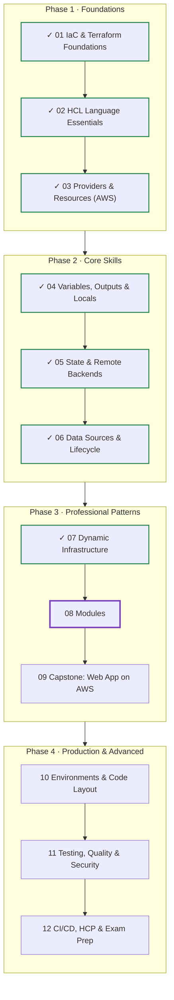
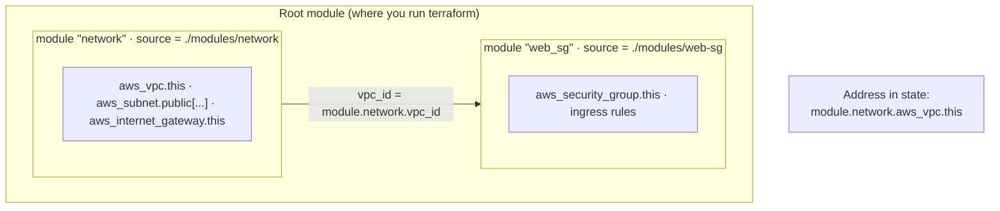
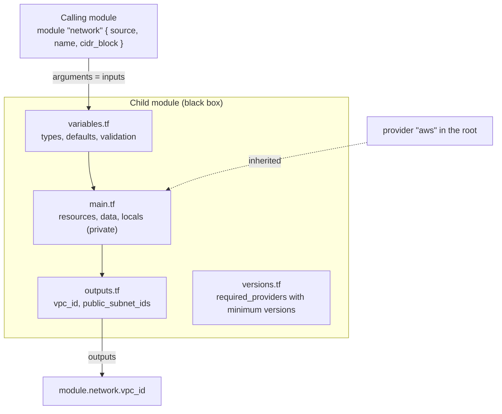
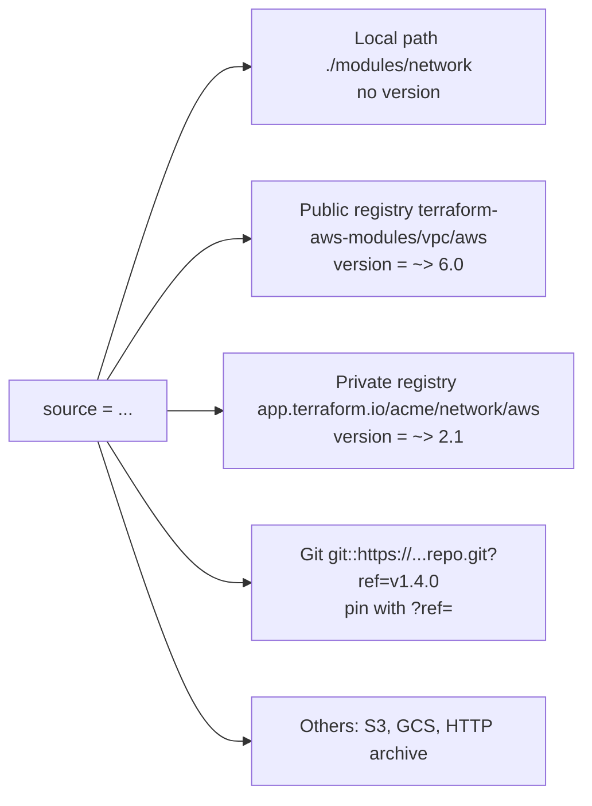
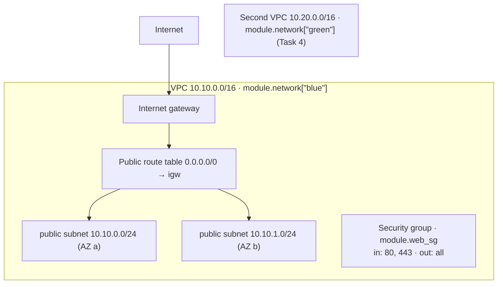

# Terraform: Zero to Advanced
## Module 08 — Modules

> Package infrastructure into reusable building blocks with clear inputs and outputs, compose them, version them, and use community modules from the Terraform Registry.

| | |
|---|---|
| **Level** | Intermediate |
| **Time** | 4–5 hours (concepts + lab) |
| **Cost** | $0 — VPCs, subnets, route tables and security groups are free |
| **Terraform** | 1.12 or newer · AWS provider 6.x |

📄 **Full illustrated version:** [Module-08-Modules.pdf](./Module-08-Modules.pdf)

## Contents

- [1. Module Overview](#1-module-overview)
- [2. Core Concepts](#2-core-concepts)
- [3. Hands-on Lab — Build, Compose and Reuse Modules](#3-hands-on-lab--build-compose-and-reuse-modules)
- [4. Quick Reference](#4-quick-reference)
- [5. Knowledge Check](#5-knowledge-check)
- [6. Summary & Next Steps](#6-summary--next-steps)

---

## 1. Module Overview


*Figure 0 — Where you are: Modules 01–07 done, Module 08 in progress.*

Every company eventually needs the same pieces again and again: a network, a web server pattern, a bucket with the right security settings. Copy-pasting them creates dozens of slightly different versions that nobody can maintain. **Modules** solve this: a module is a folder of Terraform code with **inputs and outputs**, which any configuration can call — like a function in programming. In this module you build two modules, compose them, call one several times, refactor safely into modules, and use modules from the public Registry.

#### Learning objectives — by the end of this module you can:

- Explain **root** and **child** modules and how values pass between them.
- Write a module with a clean interface: `variables.tf`, `main.tf`, `outputs.tf`, `versions.tf`, README.
- Call modules from **local paths, the Registry and Git**, and pin their versions.
- Use `for_each`, `count`, `depends_on` and `providers` on module blocks.
- **Compose** modules by passing one module's outputs into another.
- Move existing resources into a module without recreating them, using `moved` blocks.
- Judge when a module helps — and when it only adds indirection.

#### Prerequisites

- Modules 04 (variables/outputs), 05 (state bucket, `moved`) and 07 (`for_each`) completed.

## 2. Core Concepts

### 2.1 Root and child modules


*Figure 1 — The root module calls two child modules; one module's output feeds the other's input.*

You've been writing modules all along: **every folder of `.tf` files is a module**. The folder where you run `terraform` is the **root module**. A `module` block calls another folder — a **child module** — and Terraform includes its resources in the same plan and state, prefixed with `module.<name>.`

```hcl
module "network" {
  source = "./modules/network"     # where the code lives (required)

  name       = "tf-course-m08"       # everything else = the module's input variables
  cidr_block = "10.10.0.0/16"
}

# use an output of the module
vpc_id = module.network.vpc_id
```

#### Scope: a module is a black box


*Figure 2 — A module's interface: variables in, outputs out; everything else is private.*

- A child module **can't see** the caller's variables, locals or resources — only what's passed as arguments.
- The caller **can't see** the child's resources or locals — only its outputs (`module.network.vpc_id`).
- Providers are the exception: child modules **inherit** the default provider configurations of the root.

> [!IMPORTANT]
> **Key idea:** This isolation is the whole point. You can rewrite a module's internals freely as long as its inputs and outputs stay the same — exactly like changing a function's body without changing its signature.

### 2.2 Writing a good module

```text
modules/network/
├── README.md       # what it does, example usage, inputs and outputs
├── versions.tf     # required_version and required_providers (minimum versions)
├── variables.tf    # inputs: type, description, validation, sensible defaults
├── main.tf         # resources, data sources, locals
└── outputs.tf      # everything a caller might need
```

| Guideline | Why |
|---|---|
| **One clear purpose** (a network, a web tier) — not a whole company in one module | Small modules are easy to understand, test and reuse |
| **No `provider` blocks** in reusable modules; only `required_providers` | The caller decides region and credentials; provider blocks make modules impossible to use with `for_each` |
| Use **minimum** constraints in modules (`>= 6.0`), exact pinning in the root (`~> 6.0`) | Several modules can then agree on one provider version |
| Validate inputs, give **sensible defaults**, keep the required inputs few | Callers get good results with little configuration |
| **Output** IDs, ARNs and names generously | Callers can't reach inside — if you don't output it, it's unavailable |
| Name the main resource `this` when there's only one of its type | Common convention; addresses read well: `module.network.aws_vpc.this` |
| Don't wrap a single resource in a module | A module that only renames arguments adds indirection without value |

### 2.3 Module sources and versions


*Figure 3 — Where module code can come from, and how each is versioned.*

`terraform init` downloads every non-local module into `.terraform/modules/` (and records them in `.terraform/modules/modules.json`). Re-run `init` whenever you add a module or change its `source`/`version`; `terraform init -upgrade` fetches newer versions allowed by your constraints.

```hcl
module "vpc" {
  source  = "terraform-aws-modules/vpc/aws"   # <NAMESPACE>/<NAME>/<PROVIDER>
  version = "~> 6.0"                          # registry sources only
  # ...
}

module "network" {
  source = "git::https://github.com/acme/terraform-aws-network.git?ref=v1.4.0"
}
```

> [!WARNING]
> **Warning:** Always pin remote modules: `version` for registries, `?ref=<tag or commit>` for Git. An unpinned module silently changes when its author pushes — your next plan may contain surprises you didn't write.

**Publishing** your own module to the public Registry requires a public GitHub repository named `terraform-<PROVIDER>-<NAME>` (e.g. `terraform-aws-network`), the standard file layout, and **semantic version tags** such as `v1.2.0`. HCP Terraform offers a private registry with the same workflow (Module 12).

### 2.4 Meta-arguments on modules

| Meta-argument | Example | Effect |
|---|---|---|
| `for_each` / `count` | `for_each = var.networks` | Several instances: `module.network["blue"]` |
| `depends_on` | `depends_on = [aws_iam_role_policy_attachment.x]` | Whole module waits for something it doesn't reference |
| `providers` | `providers = { aws = aws.us }` | Pass a non-default (aliased) provider configuration to the child |

```hcl
module "network_us" {
  source = "./modules/network"
  providers = {
    aws = aws.us                 # the child's "aws" = the root's aws.us configuration
  }
  name       = "tf-course-m08-us"
  cidr_block = "10.30.0.0/16"
}
```

### 2.5 Refactoring into modules

Moving existing resources into a module changes their addresses (`aws_vpc.main` → `module.network.aws_vpc.this`). As in Module 07, `moved` blocks tell Terraform it's the same object. You can also move a whole module instance: `moved { from = module.network  to = module.network["blue"] }`.

#### When to write a module — and when not

| Write a module when… | Don't, when… |
|---|---|
| the same pattern is used **2+ times** (environments, teams, regions) | it's used once and unlikely to repeat |
| a pattern needs **enforced standards** (encryption on, public access off) | it only wraps one resource with the same arguments |
| a group of resources forms one **concept** ("a network") | you'd need to expose every argument anyway |

> [!TIP]
> **Tip:** Before writing your own, look at the Registry: *terraform-aws-modules* (VPC, EKS, RDS, ALB …) are widely used and well maintained. Read their code — it's an excellent way to learn advanced Terraform.

---

## 3. Hands-on Lab — Build, Compose and Reuse Modules

**Goal:** write a **network** module (VPC, public subnets across AZs, internet gateway, routing) and a **web-sg** module, compose them in a root configuration, deploy two networks from one module, move a module instance safely, and compare your module with the community VPC module. Everything in this lab is free.


*Figure 4 — What one network instance contains.*

```text
lab-08-modules/
├── terraform.tf            # versions + s3 backend (key module-08/...)
├── backend.hcl
├── providers.tf
├── main.tf                 # module calls
├── outputs.tf
├── modules/
│   ├── network/
│   │   ├── README.md
│   │   ├── versions.tf
│   │   ├── variables.tf
│   │   ├── main.tf
│   │   └── outputs.tf
│   └── web-sg/
│       ├── versions.tf
│       ├── variables.tf
│       ├── main.tf
│       └── outputs.tf
└── registry-demo/
    └── main.tf             # Task 8
```

### Task 1 — Write the network module

**`modules/network/versions.tf`**

```hcl
terraform {
  required_version = ">= 1.12.0"

  required_providers {
    aws = {
      source  = "hashicorp/aws"
      version = ">= 6.0" # minimum only: the root module pins the exact range
    }
  }
}
```

**`modules/network/variables.tf`**

```hcl
variable "name" {
  type        = string
  description = "Name prefix for all network resources"
}

variable "cidr_block" {
  type        = string
  description = "IPv4 CIDR block of the VPC, e.g. 10.10.0.0/16"

  validation {
    condition     = can(cidrhost(var.cidr_block, 0)) && endswith(var.cidr_block, "/16")
    error_message = "cidr_block must be a valid /16 IPv4 CIDR block."
  }
}

variable "az_count" {
  type        = number
  description = "Number of availability zones (one public subnet each)"
  default     = 2

  validation {
    condition     = var.az_count >= 1 && var.az_count <= 3
    error_message = "az_count must be between 1 and 3."
  }
}

variable "tags" {
  type        = map(string)
  description = "Extra tags for every resource"
  default     = {}
}
```

**`modules/network/main.tf`**

```hcl
data "aws_availability_zones" "available" {
  state = "available"
}

locals {
  azs = slice(data.aws_availability_zones.available.names, 0, var.az_count)
}

resource "aws_vpc" "this" {
  cidr_block           = var.cidr_block
  enable_dns_hostnames = true

  tags = merge(var.tags, { Name = var.name })
}

resource "aws_internet_gateway" "this" {
  vpc_id = aws_vpc.this.id

  tags = merge(var.tags, { Name = var.name })
}

resource "aws_subnet" "public" {
  for_each = { for i, az in local.azs : az => i }

  vpc_id                  = aws_vpc.this.id
  availability_zone       = each.key
  cidr_block              = cidrsubnet(var.cidr_block, 8, each.value)
  map_public_ip_on_launch = true

  tags = merge(var.tags, { Name = "${var.name}-public-${each.key}" })
}

resource "aws_route_table" "public" {
  vpc_id = aws_vpc.this.id

  route {
    cidr_block = "0.0.0.0/0"
    gateway_id = aws_internet_gateway.this.id
  }

  tags = merge(var.tags, { Name = "${var.name}-public" })
}

resource "aws_route_table_association" "public" {
  for_each = aws_subnet.public

  subnet_id      = each.value.id
  route_table_id = aws_route_table.public.id
}
```

Note `for_each = aws_subnet.public` on the associations: a `for_each` resource is a map, so it can drive another `for_each` directly — one association per subnet, keyed by AZ. Its keys come from the subnet keys (known at plan), so this is allowed even though the subnet IDs are not yet known.

**`modules/network/outputs.tf`**

```hcl
output "vpc_id" {
  description = "ID of the VPC"
  value       = aws_vpc.this.id
}

output "vpc_cidr_block" {
  description = "CIDR block of the VPC"
  value       = aws_vpc.this.cidr_block
}

output "public_subnet_ids" {
  description = "IDs of the public subnets, in AZ order"
  value       = [for az in local.azs : aws_subnet.public[az].id]
}

output "azs" {
  description = "Availability zones used"
  value       = local.azs
}
```

**`modules/network/README.md`**

```markdown
# network module

Creates a VPC with one public subnet per availability zone, an internet gateway
and a public route table.

## Usage

    module "network" {
      source     = "./modules/network"
      name       = "my-app"
      cidr_block = "10.10.0.0/16"
      az_count   = 2
    }

## Inputs: name, cidr_block (/16), az_count (1-3, default 2), tags (map)
## Outputs: vpc_id, vpc_cidr_block, public_subnet_ids, azs
```

### Task 2 — Write the web-sg module

`versions.tf` is identical to the network module's. Then:

**`modules/web-sg/variables.tf`**

```hcl
variable "name" {
  type        = string
  description = "Name of the security group"
}

variable "vpc_id" {
  type        = string
  description = "VPC to create the security group in"
}

variable "ingress_ports" {
  type        = list(number)
  description = "TCP ports to open"
  default     = [80]
}

variable "allowed_cidr" {
  type        = string
  description = "IPv4 CIDR allowed to reach the ports"
  default     = "0.0.0.0/0"
}
```

**`modules/web-sg/main.tf`**

```hcl
resource "aws_security_group" "this" {
  name        = var.name
  description = "Managed by the web-sg module"
  vpc_id      = var.vpc_id
}

resource "aws_vpc_security_group_ingress_rule" "this" {
  for_each = toset([for p in var.ingress_ports : tostring(p)])

  security_group_id = aws_security_group.this.id
  cidr_ipv4         = var.allowed_cidr
  ip_protocol       = "tcp"
  from_port         = tonumber(each.key)
  to_port           = tonumber(each.key)
}

resource "aws_vpc_security_group_egress_rule" "all" {
  security_group_id = aws_security_group.this.id
  cidr_ipv4         = "0.0.0.0/0"
  ip_protocol       = "-1"
}
```

**`modules/web-sg/outputs.tf`**

```hcl
output "security_group_id" {
  description = "ID of the security group"
  value       = aws_security_group.this.id
}
```

`for_each` needs a set of **strings**, so the port numbers are converted with `tostring()` and back with `tonumber()`.

### Task 3 — Compose the modules in the root

Copy `terraform.tf` and `backend.hcl` from Module 07 (key `module-08/terraform.tfstate`, aws `~> 6.0`, drop `random`). Create the provider and the module calls:

**`providers.tf`**

```hcl
provider "aws" {
  region = "eu-central-1"

  default_tags {
    tags = {
      Project = "terraform-course"
      Module  = "08"
    }
  }
}
```

**`main.tf`**

```hcl
module "network" {
  source = "./modules/network"

  name       = "tf-course-m08"
  cidr_block = "10.10.0.0/16"
}

module "web_sg" {
  source = "./modules/web-sg"

  name          = "tf-course-m08-web"
  vpc_id        = module.network.vpc_id
  ingress_ports = [80, 443]
}
```

**`outputs.tf`**

```hcl
output "vpc_id" {
  value = module.network.vpc_id
}

output "public_subnet_ids" {
  value = module.network.public_subnet_ids
}

output "web_sg_id" {
  value = module.web_sg.security_group_id
}
```

```bash
terraform init -backend-config=backend.hcl
terraform apply
terraform state list
```

*Expected output (abridged; IDs differ):*

```text
Initializing modules...
- network in modules/network
- web_sg in modules/web-sg
...
Plan: 11 to add, 0 to change, 0 to destroy.
...
Apply complete! Resources: 11 added, 0 changed, 0 destroyed.

Outputs:

public_subnet_ids = [
  "subnet-0a1b2c3d4e5f60718",
  "subnet-0f1e2d3c4b5a69788",
]
vpc_id = "vpc-0123456789abcdef0"
web_sg_id = "sg-0aa11bb22cc33dd44"

module.network.data.aws_availability_zones.available
module.network.aws_internet_gateway.this
module.network.aws_route_table.public
module.network.aws_route_table_association.public["eu-central-1a"]
module.network.aws_route_table_association.public["eu-central-1b"]
module.network.aws_subnet.public["eu-central-1a"]
module.network.aws_subnet.public["eu-central-1b"]
module.network.aws_vpc.this
module.web_sg.aws_security_group.this
module.web_sg.aws_vpc_security_group_egress_rule.all
module.web_sg.aws_vpc_security_group_ingress_rule.this["443"]
module.web_sg.aws_vpc_security_group_ingress_rule.this["80"]
```

11 resources = 7 in the network (VPC, gateway, 2 subnets, route table, 2 associations) + 4 in the security group module. Every address starts with `module.<name>.`. Terraform created the security group after the VPC because `module.web_sg` receives `module.network.vpc_id` — module outputs create dependencies just like resource references. Local modules are not copied: `init` just records their path.

### Task 4 — One module, many instances (and a safe move)

We need a second network. Convert the call to `for_each` over a map:

**`main.tf (replace)`**

```hcl
variable "networks" {
  type        = map(string)
  description = "Network name => /16 CIDR block"
  default = {
    blue = "10.10.0.0/16"
  }
}

module "network" {
  source   = "./modules/network"
  for_each = var.networks

  name       = "tf-course-m08-${each.key}"
  cidr_block = each.value
}

module "web_sg" {
  source = "./modules/web-sg"

  name          = "tf-course-m08-web"
  vpc_id        = module.network["blue"].vpc_id
  ingress_ports = [80, 443]
}
```

Update `outputs.tf` to `module.network["blue"].vpc_id` and `module.network["blue"].public_subnet_ids`, then plan:

```bash
terraform plan
```

*Expected output (abridged):*

```text
  # module.network.aws_vpc.this will be destroyed
  # (because module.network is not in configuration)
  ...
  # module.network["blue"].aws_vpc.this will be created
  ...
Plan: 11 to add, 0 to change, 11 to destroy.
```

The whole network would be destroyed and rebuilt — and because the VPC ID changes, the security group and its rules too. Tell Terraform the instance only **moved**:

**`main.tf (addition)`**

```hcl
moved {
  from = module.network
  to   = module.network["blue"]
}
```

```bash
terraform plan
```

*Expected output (abridged):*

```text
  # module.network.aws_vpc.this has moved to module.network["blue"].aws_vpc.this
  ~ resource "aws_vpc" "this" {
        id       = "vpc-0123456789abcdef0"
      ~ tags     = {
          ~ "Name" = "tf-course-m08" -> "tf-course-m08-blue"
        }
        ...
    }
  ...
Plan: 0 to add, 5 to change, 0 to destroy.
```

Nothing is destroyed. The only changes are the `Name` tags of the VPC, gateway, two subnets and route table, which now include `blue` — harmless in-place updates.

Apply, then add `green = "10.20.0.0/16"` to `networks` and plan:

*Expected output (abridged):*

```text
  # module.network["green"].aws_internet_gateway.this will be created
  ...
  # module.network["green"].aws_vpc.this will be created
  ...
Plan: 7 to add, 0 to change, 0 to destroy.
```

A whole second network in one line of data. Apply it and look at both VPCs in the console.

> [!TIP]
> **Tip:** Renaming tags is cheap, but a name change on a resource that uses the name as its identifier (IAM roles, buckets, security group `name`) forces replacement. Choose naming schemes before the first deployment.

### Task 5 — Module input validation from the caller's side

```bash
terraform plan -var='networks={blue="10.10.0.0/16",bad="10.40.0.0/24"}'
```

*Expected output (abridged):*

```text
╷
│ Error: Invalid value for variable
│
│   on main.tf line ..., in module "network":
│   ...:   cidr_block = each.value
│     ├────────────────
│     │ var.cidr_block is "10.40.0.0/24"
│
│ cidr_block must be a valid /16 IPv4 CIDR block.
│
│ This was checked by the validation rule at modules/network/variables.tf:...
╵
```

The module protects itself: whoever calls it gets a clear message pointing at *their* argument. This is why validation matters even more in modules than in root configurations.

### Task 6 — Change a module, see every caller affected

Add a cost-allocation tag inside the module — in `modules/network/main.tf`, change the VPC's tags to `merge(var.tags, { Name = var.name, Component = "network" })` — and plan:

*Expected output (abridged):*

```text
  # module.network["blue"].aws_vpc.this will be updated in-place
  ...
  # module.network["green"].aws_vpc.this will be updated in-place
  ...
Plan: 0 to add, 2 to change, 0 to destroy.
```

One change in the module, applied to every instance. That's the power — and the risk — of shared modules. In a team, the module would live in its own repository with versions, so each caller upgrades deliberately. Apply it.

### Task 7 — Inspect modules in the console

```bash
terraform console
> module.network["green"].public_subnet_ids
> { for k, m in module.network : k => m.vpc_cidr_block }
> keys(module.network)
> exit
```

*Expected output (IDs differ):*

```text
[
  "subnet-0...",
  "subnet-0...",
]
{
  "blue" = "10.10.0.0/16"
  "green" = "10.20.0.0/16"
}
[
  "blue",
  "green",
]
```

A module called with `for_each` is a **map of module objects**, so all the `for` expressions from Module 07 work on it.

### Task 8 — Compare with a Registry module

In a separate folder `registry-demo/` (local state, so it's independent), write the same kind of network with the community module — and only **plan**:

**`registry-demo/main.tf`**

```hcl
terraform {
  required_providers {
    aws = {
      source  = "hashicorp/aws"
      version = "~> 6.0"
    }
  }
}

provider "aws" {
  region = "eu-central-1"
}

module "vpc" {
  source  = "terraform-aws-modules/vpc/aws"
  version = "~> 6.0"

  name = "tf-course-m08-registry"
  cidr = "10.50.0.0/16"

  azs             = ["eu-central-1a", "eu-central-1b"]
  public_subnets  = ["10.50.0.0/24", "10.50.1.0/24"]
  private_subnets = ["10.50.10.0/24", "10.50.11.0/24"]

  enable_nat_gateway = false # NAT gateways cost money; we'll use one in Module 09
}
```

```bash
cd registry-demo
terraform init
terraform plan
```

*Expected output (abridged; the exact count depends on the module version):*

```text
Initializing modules...
Downloading registry.terraform.io/terraform-aws-modules/vpc/aws 6.x.x for vpc...
- vpc in .terraform/modules/vpc
...
Plan: 16 to add, 0 to change, 0 to destroy.
```

Open `.terraform/modules/vpc/main.tf`: the community module supports dozens of features (NAT gateways, VPC endpoints, flow logs, IPv6, database subnets…) through hundreds of inputs. Compare honestly: the Registry module saves you time and is battle-tested; your own module is small, readable and fits your standards exactly. Many teams **wrap** a community module in a thin module of their own that sets company defaults. Don't apply — `cd ..` back to the lab.

### Task 9 — Pin, upgrade and inspect module versions

```bash
cat registry-demo/.terraform/modules/modules.json
```

*Expected output (formatted):*

```text
{"Modules":[{"Key":"","Source":"","Dir":"."},
  {"Key":"vpc","Source":"registry.terraform.io/terraform-aws-modules/vpc/aws",
   "Version":"6.x.x","Dir":".terraform/modules/vpc"}]}
```

Unlike providers, module versions are **not** recorded in `.terraform.lock.hcl` — only your `version` constraint protects you. That's why exact or narrow constraints are common for modules: `version = "6.7.3"` or `"~> 6.7.0"`. To move to a newer allowed version run `terraform init -upgrade`, then read the plan.

### Task 10 — Clean up

```bash
terraform destroy
```

*Expected output (abridged):*

```text
Plan: 0 to add, 0 to change, 18 to destroy.
...
Destroy complete! Resources: 18 destroyed.
```

18 = two networks × 7 + the security group module's 4. The `registry-demo` was never applied, so there's nothing to destroy there.

### Challenge — an optional private tier

Extend the network module with an input `private_subnets` (bool, default `false`). When `true`, create one private subnet per AZ (CIDR index offset by 10, e.g. `10.10.10.0/24`) with **no** internet route, and output `private_subnet_ids` (empty list when disabled). Existing callers must see **no changes**.

#### Solution

**`modules/network/variables.tf (addition)`**

```hcl
variable "private_subnets" {
  type        = bool
  description = "Also create one private subnet per AZ (no internet route)"
  default     = false
}
```

**`modules/network/main.tf (addition)`**

```hcl
resource "aws_subnet" "private" {
  for_each = var.private_subnets ? { for i, az in local.azs : az => i } : {}

  vpc_id            = aws_vpc.this.id
  availability_zone = each.key
  cidr_block        = cidrsubnet(var.cidr_block, 8, each.value + 10)

  tags = merge(var.tags, { Name = "${var.name}-private-${each.key}" })
}
```

**`modules/network/outputs.tf (addition)`**

```hcl
output "private_subnet_ids" {
  description = "IDs of the private subnets (empty if disabled)"
  value       = [for az in local.azs : aws_subnet.private[az].id if var.private_subnets]
}
```

`for_each = cond ? {...} : {}` is the `for_each` equivalent of `count = cond ? 1 : 0`. Because the new input defaults to `false`, every existing caller plans *0 to add* — a **backward-compatible** change, which in a versioned module would be a *minor* release (1.1.0), not a major one. (The subnets have no route to the internet; Module 09 adds a NAT gateway for that.)

#### Lab complete when you can tick every box

- [ ] I wrote two modules with variables, outputs, versions and a README.
- [ ] I passed one module's output into another and saw the dependency.
- [ ] I called a module with `for_each` and moved an existing instance with a `moved` block.
- [ ] A module's own validation rejected a bad input from the caller.
- [ ] I used a Registry module with a pinned version and know modules aren't in the lock file.
- [ ] I made a backward-compatible change to a module.

---

## 4. Quick Reference

### 4.1 Cheat sheet

| Need | Syntax |
|---|---|
| Call a module | `module "x" { source = "./modules/x"  input = value }` |
| Use an output | `module.x.output_name` |
| Registry module | `source = "ns/name/provider"`  `version = "~> 1.2"` |
| Git module | `source = "git::https://host/repo.git//subdir?ref=v1.2.0"` |
| Many instances | `for_each = var.map` → `module.x["key"].output` |
| Aliased provider | `providers = { aws = aws.us }` |
| Move into a module | `moved { from = aws_vpc.main  to = module.network.aws_vpc.this }` |
| Move a module instance | `moved { from = module.network  to = module.network["blue"] }` |
| Install / update modules | `terraform init` / `terraform init -upgrade` / `terraform get` |

### 4.2 Common errors and fixes

| Error | Usual cause | Fix |
|---|---|---|
| `Module not installed` | Added/changed a module without `init` | `terraform init` |
| `Unsupported argument` in a module block | Passing an input the module doesn't declare | Check the module's `variables.tf` / README |
| `Missing required argument` | A required module input wasn't passed | Pass it, or give the variable a default in the module |
| `Unsupported attribute` on `module.x` | Reading something the module doesn't output | Add an output to the module |
| `Module is incompatible with count, for_each` | The module contains `provider` blocks | Remove provider blocks from the module; configure providers in the root |
| Everything recreated after refactoring | Addresses changed without `moved` blocks | Add `moved` blocks before applying |
| Module version doesn't satisfy constraints | Constraint too narrow or typo | Fix `version`, run `init -upgrade` |

## 5. Knowledge Check

**Q1. What is the root module?**

<details><summary>Show answer</summary>

The folder (configuration) where you run Terraform commands; every other module is a child it calls.

</details>

**Q2. Can a child module read the root's variables directly?**

<details><summary>Show answer</summary>

No. It only receives what is passed as arguments in the module block.

</details>

**Q3. How does a caller read a value created inside a module?**

<details><summary>Show answer</summary>

Only through the module's outputs: `module.<name>.<output>`.

</details>

**Q4. Why shouldn't reusable modules contain `provider` blocks?**

<details><summary>Show answer</summary>

The caller should decide region/credentials, and modules with provider blocks can't be used with `count`/`for_each`.

</details>

**Q5. Which module sources support the `version` argument?**

<details><summary>Show answer</summary>

Registry sources (public or private). For Git, pin with `?ref=`.

</details>

**Q6. Are module versions recorded in `.terraform.lock.hcl`?**

<details><summary>Show answer</summary>

No — only provider versions. Pin modules with exact or narrow constraints.

</details>

**Q7. How do you give a module an aliased provider configuration?**

<details><summary>Show answer</summary>

`providers = { aws = aws.us }` in the module block.

</details>

**Q8. You wrap existing `aws_vpc.main` into a module. How do you avoid recreation?**

<details><summary>Show answer</summary>

Add `moved { from = aws_vpc.main  to = module.network.aws_vpc.this }`.

</details>

**Q9. What does `for_each` on a module block produce?**

<details><summary>Show answer</summary>

A map of module instances addressed as `module.name["key"]`.

</details>

**Q10. What makes a module change backward-compatible?**

<details><summary>Show answer</summary>

Existing callers plan no changes — e.g. new inputs have defaults that preserve old behaviour.

</details>

## 6. Summary & Next Steps

- A module is a folder of `.tf` files; the one you run in is the **root**, the ones it calls are **children**.
- Modules are black boxes: **variables in, outputs out**; providers are inherited from the root.
- Good modules have one purpose, validated inputs, generous outputs, a README and no provider blocks.
- Sources: local, Registry (`version`), Git (`?ref=`) — always pin remote modules.
- `for_each`, `count`, `depends_on` and `providers` work on module blocks; `moved` refactors safely.
- Prefer well-maintained Registry modules for common patterns; write your own for your standards.

**Next — Module 09: Capstone — Web Application on AWS.** You'll combine everything so far into a real, production-style architecture: a multi-AZ VPC with public and private subnets, a NAT gateway, an Application Load Balancer, an Auto Scaling group of web servers, remote state and zero-downtime rolling updates.

#### Official references

- [Modules overview](https://developer.hashicorp.com/terraform/language/modules)
- [Module blocks](https://developer.hashicorp.com/terraform/language/modules/syntax)
- [Module sources](https://developer.hashicorp.com/terraform/language/modules/sources)
- [Developing modules](https://developer.hashicorp.com/terraform/language/modules/develop)
- [terraform-aws-modules/vpc](https://registry.terraform.io/modules/terraform-aws-modules/vpc/aws/latest)
