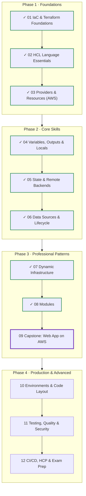
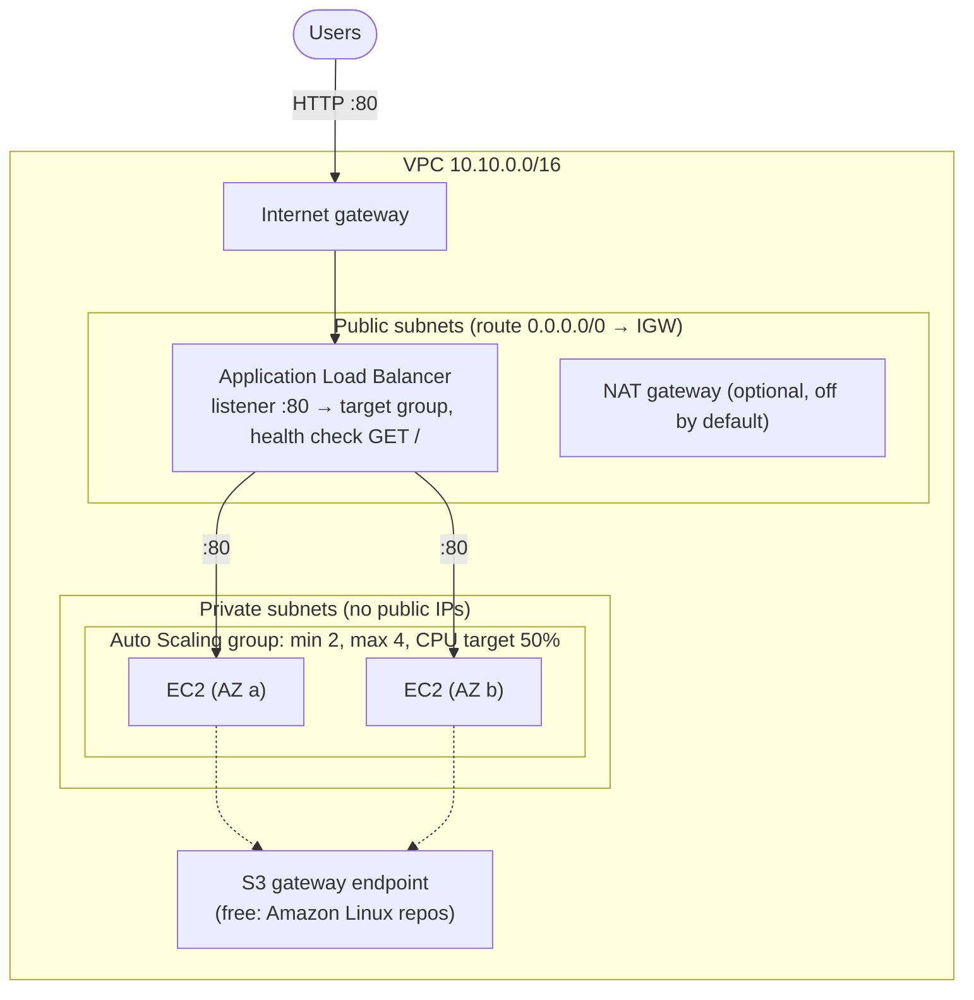
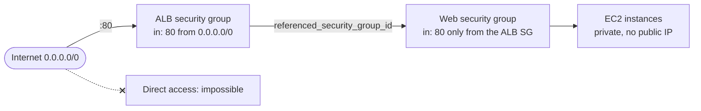
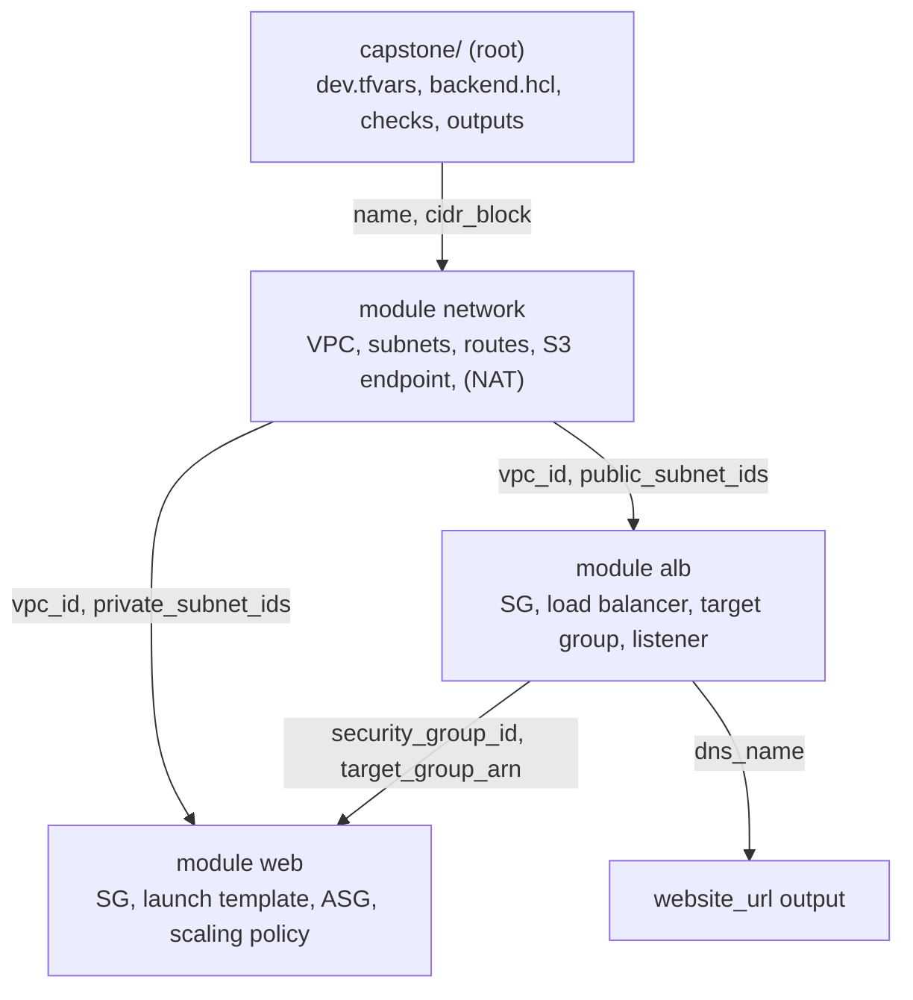
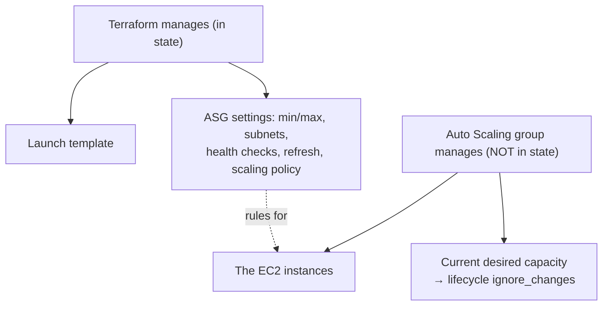
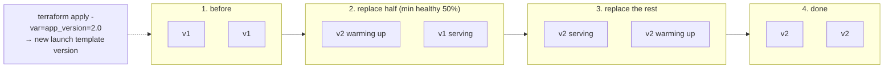
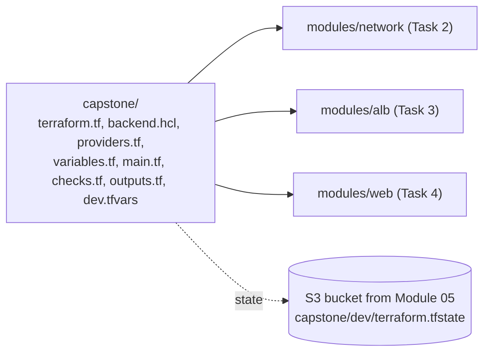

# Terraform: Zero to Advanced
## Module 09 — Capstone: Web Application on AWS

> Design and build a production-style, highly available web application: a multi-AZ network, a load balancer, an auto-scaling web tier and zero-downtime rolling updates — all from your own modules.

| | |
|---|---|
| **Level** | Intermediate → Advanced |
| **Time** | 5–6 hours (design + build + experiments) |
| **Cost** | ≈ $0.05–0.10 per hour while running — destroy the same day |
| **Terraform** | 1.12 or newer · AWS provider 6.x |

📄 **Full illustrated version:** [Module-09-Capstone-Web-App-on-AWS.pdf](./Module-09-Capstone-Web-App-on-AWS.pdf)

## Contents

- [1. Module Overview](#1-module-overview)
- [2. Architecture & Design Decisions](#2-architecture--design-decisions)
- [3. Build Lab — A Highly Available Web Application](#3-build-lab--a-highly-available-web-application)
- [4. Quick Reference](#4-quick-reference)
- [5. Knowledge Check](#5-knowledge-check)
- [6. Summary & Next Steps](#6-summary--next-steps)

---

## 1. Module Overview


*Figure 0 — Where you are: Modules 01–08 done, Module 09 (capstone) in progress.*

This is where everything comes together. You'll design and build the architecture behind a large share of real web applications on AWS: a **network across two availability zones**, an **Application Load Balancer** in public subnets, a fleet of web servers in **private subnets** managed by an **Auto Scaling group**, and **rolling updates** that ship a new version without dropping a single request. You'll write it as three modules, compose them, store the state remotely, and verify the system continuously with a `check` block.

#### Learning objectives — by the end of this module you can:

- Translate requirements into an AWS design and a **module structure**.
- Build a multi-AZ VPC with public and private subnets, routing, an S3 gateway endpoint and an optional NAT gateway.
- Create an **ALB**, target group and listener, and wire security groups by **reference** instead of CIDR.
- Run web servers with a **launch template** and an **Auto Scaling group**, including target-tracking scaling.
- Ship new versions with **instance refresh** (rolling updates) and prove there's no downtime.
- Explain which parts of the system Terraform owns and which the Auto Scaling group owns.

#### Prerequisites

- Modules 01–08 completed. You need your **state bucket** from Module 05 and the network module from Module 08.
- A terminal with `curl` (built into Windows 10+, macOS and Linux).

> [!WARNING]
> **Warning:** This lab uses resources that cost a little money while they run: the load balancer (plus its public IPv4 addresses) and two `t3.micro` instances — roughly $0.05–0.10 per hour, often covered by Free Tier credits. Build, experiment and **destroy on the same day** (Task 10). The NAT gateway is **off** by default.

## 2. Architecture & Design Decisions

### 2.1 Requirements

| Requirement | Design decision |
|---|---|
| Survive the loss of one data centre | Everything spans **two availability zones** |
| Web servers must not be reachable from the internet | Servers in **private subnets**, no public IPs; only the load balancer is public |
| Handle more traffic automatically | **Auto Scaling group** with a CPU target-tracking policy (2–4 instances) |
| Replace broken servers automatically | ASG uses the load balancer's **health checks** (`health_check_type = "ELB"`) |
| Release new versions without downtime | **Instance refresh**: replace instances gradually, keep ≥ 50% healthy |
| Keep costs low for a lab | S3 **gateway endpoint** (free) instead of a NAT gateway for package installs |
| Reusable for other environments (Module 10) | Three **modules** + a thin root configured by `.tfvars` |

### 2.2 The architecture


*Figure 1 — Target architecture.*

Traffic flows **Users → internet gateway → ALB (public subnets) → instances (private subnets)**. The instances need to download nginx at boot. Normally private instances reach the internet through a **NAT gateway** — which costs about $0.045 per hour plus data. Amazon Linux 2023 serves its package repositories from S3, so a free **S3 gateway endpoint** is enough for this lab; the NAT gateway stays available behind a variable for workloads that need general internet access.


*Figure 2 — Security groups chained by reference: only the load balancer can reach the servers.*

The web security group allows port 80 **from the ALB's security group** (`referenced_security_group_id`), not from an IP range. If the ALB scales or changes IPs, the rule stays correct — and nothing else can reach the servers.

### 2.3 Module structure


*Figure 3 — Three modules composed in a thin root.*

| Module | Resources | Key outputs |
|---|---|---|
| `network` | VPC, IGW, 2 public + 2 private subnets, 2 route tables, 4 associations, S3 endpoint, optional NAT | `vpc_id`, `public_subnet_ids`, `private_subnet_ids` |
| `alb` | Security group (+ rules), load balancer, target group, HTTP listener | `dns_name`, `security_group_id`, `target_group_arn` |
| `web` | Security group (+ rules), launch template, Auto Scaling group, scaling policy | `asg_name` |

### 2.4 Who owns what


*Figure 4 — Terraform manages the rules; the Auto Scaling group manages the instances.*

A crucial idea for real systems: Terraform creates the **launch template** and the **Auto Scaling group**, but the **instances** are created and destroyed by the ASG at runtime. They are *not* in Terraform's state. The desired capacity is changed by the scaling policy, so Terraform must be told to ignore it — otherwise every `apply` would scale the group back to the number in your code.

#### Rolling updates with instance refresh


*Figure 5 — Instance refresh replaces instances in batches while the rest keep serving.*

When the launch template changes (new AMI, new user data, new version), the ASG's `instance_refresh` setting starts a **rolling replacement**: launch new instances, wait until the load balancer reports them healthy, then terminate old ones — never dropping below `min_healthy_percentage`.

---

## 3. Build Lab — A Highly Available Web Application

**Goal:** build the architecture above from three modules, deploy it to `dev`, then prove its properties: load balancing across AZs, self-healing, scaling and a zero-downtime release.


*Figure 6 — Project layout.*

```text
capstone/
├── terraform.tf  backend.hcl  providers.tf
├── variables.tf  main.tf  checks.tf  outputs.tf
├── dev.tfvars
└── modules/
    ├── network/   versions.tf  variables.tf  main.tf  outputs.tf
    ├── alb/       versions.tf  variables.tf  main.tf  outputs.tf
    └── web/       versions.tf  variables.tf  main.tf  outputs.tf
                   templates/user_data.sh.tftpl
```

Every module's `versions.tf` is the same as in Module 08 (`required_version = ">= 1.12.0"`, aws `>= 6.0`).

### Task 1 — Root skeleton

**`terraform.tf`**

```hcl
terraform {
  required_version = ">= 1.12.0"

  backend "s3" {}

  required_providers {
    aws = {
      source  = "hashicorp/aws"
      version = "~> 6.0"
    }
    http = {
      source  = "hashicorp/http"
      version = "~> 3.4"
    }
  }
}
```

**`backend.hcl`**

```hcl
bucket       = "tf-state-1a7d31df"                  # your bucket from Module 05
key          = "capstone/dev/terraform.tfstate"
region       = "eu-central-1"
use_lockfile = true
encrypt      = true
```

**`providers.tf`**

```hcl
provider "aws" {
  region = var.aws_region

  default_tags {
    tags = {
      Project     = var.project
      Environment = var.environment
      ManagedBy   = "terraform"
    }
  }
}
```

**`variables.tf`**

```hcl
variable "aws_region" {
  type        = string
  description = "AWS region"
  default     = "eu-central-1"
}

variable "project" {
  type        = string
  description = "Project name used in resource names"
}

variable "environment" {
  type        = string
  description = "Environment name"

  validation {
    condition     = contains(["dev", "staging", "prod"], var.environment)
    error_message = "environment must be dev, staging or prod."
  }
}

variable "vpc_cidr" {
  type        = string
  description = "/16 CIDR block for the VPC"
}

variable "enable_nat_gateway" {
  type        = bool
  description = "Create a NAT gateway for private subnets (costs money)"
  default     = false
}

variable "instance_type" {
  type        = string
  description = "Instance type of the web servers"
  default     = "t3.micro"
}

variable "app_version" {
  type        = string
  description = "Application version shown on the page; changing it triggers a rolling update"
  default     = "1.0"
}

variable "min_size" {
  type        = number
  description = "Minimum number of web servers"
  default     = 2
}

variable "max_size" {
  type        = number
  description = "Maximum number of web servers"
  default     = 4
}
```

**`dev.tfvars`**

```hcl
project     = "webshop"
environment = "dev"
vpc_cidr    = "10.10.0.0/16"
```

### Task 2 — The network module

Start from your Module 08 network module (with the private-subnet challenge) and extend it. The complete `main.tf`:

**`modules/network/main.tf`**

```hcl
data "aws_availability_zones" "available" {
  state = "available"
}

data "aws_region" "current" {}

locals {
  azs     = slice(data.aws_availability_zones.available.names, 0, var.az_count)
  az_keys = { for i, az in local.azs : az => i }
}

resource "aws_vpc" "this" {
  cidr_block           = var.cidr_block
  enable_dns_support   = true
  enable_dns_hostnames = true

  tags = { Name = var.name }
}

resource "aws_internet_gateway" "this" {
  vpc_id = aws_vpc.this.id
  tags   = { Name = var.name }
}

resource "aws_subnet" "public" {
  for_each = local.az_keys

  vpc_id                  = aws_vpc.this.id
  availability_zone       = each.key
  cidr_block              = cidrsubnet(var.cidr_block, 8, each.value)
  map_public_ip_on_launch = true

  tags = { Name = "${var.name}-public-${each.key}", Tier = "public" }
}

resource "aws_subnet" "private" {
  for_each = local.az_keys

  vpc_id            = aws_vpc.this.id
  availability_zone = each.key
  cidr_block        = cidrsubnet(var.cidr_block, 8, each.value + 10)

  tags = { Name = "${var.name}-private-${each.key}", Tier = "private" }
}

resource "aws_route_table" "public" {
  vpc_id = aws_vpc.this.id
  tags   = { Name = "${var.name}-public" }
}

resource "aws_route" "public_internet" {
  route_table_id         = aws_route_table.public.id
  destination_cidr_block = "0.0.0.0/0"
  gateway_id             = aws_internet_gateway.this.id
}

resource "aws_route_table_association" "public" {
  for_each = aws_subnet.public

  subnet_id      = each.value.id
  route_table_id = aws_route_table.public.id
}

resource "aws_route_table" "private" {
  vpc_id = aws_vpc.this.id
  tags   = { Name = "${var.name}-private" }
}

resource "aws_route_table_association" "private" {
  for_each = aws_subnet.private

  subnet_id      = each.value.id
  route_table_id = aws_route_table.private.id
}

# Free: lets private instances reach S3 (incl. the Amazon Linux 2023 package repos)
resource "aws_vpc_endpoint" "s3" {
  vpc_id            = aws_vpc.this.id
  service_name      = "com.amazonaws.${data.aws_region.current.region}.s3"
  vpc_endpoint_type = "Gateway"
  route_table_ids   = [aws_route_table.private.id]

  tags = { Name = "${var.name}-s3" }
}

# Optional NAT gateway (one, in the first AZ, to keep costs down)
resource "aws_eip" "nat" {
  count  = var.enable_nat_gateway ? 1 : 0
  domain = "vpc"
  tags   = { Name = "${var.name}-nat" }
}

resource "aws_nat_gateway" "this" {
  count = var.enable_nat_gateway ? 1 : 0

  allocation_id = aws_eip.nat[0].id
  subnet_id     = aws_subnet.public[local.azs[0]].id
  tags          = { Name = var.name }

  depends_on = [aws_internet_gateway.this]
}

resource "aws_route" "private_nat" {
  count = var.enable_nat_gateway ? 1 : 0

  route_table_id         = aws_route_table.private.id
  destination_cidr_block = "0.0.0.0/0"
  nat_gateway_id         = aws_nat_gateway.this[0].id
}
```

Variables: `name`, `cidr_block` (/16 validation), `az_count` (default 2) and `enable_nat_gateway` (default `false`). Outputs:

**`modules/network/outputs.tf`**

```hcl
output "vpc_id" {
  value = aws_vpc.this.id
}

output "public_subnet_ids" {
  value = [for az in local.azs : aws_subnet.public[az].id]
}

output "private_subnet_ids" {
  value = [for az in local.azs : aws_subnet.private[az].id]
}
```

Design notes: the NAT gateway uses **`count` as an on/off switch** (Module 07); AWS recommends the explicit `depends_on` on the internet gateway for NAT gateways; and routes are separate `aws_route` resources so that the optional NAT route can be added without touching the route table.

### Task 3 — The ALB module

**`modules/alb/variables.tf`**

```hcl
variable "name" {
  type        = string
  description = "Name prefix (max 26 characters: load balancer names are limited to 32)"

  validation {
    condition     = length(var.name) <= 26
    error_message = "name must be at most 26 characters."
  }
}

variable "vpc_id" {
  type = string
}

variable "subnet_ids" {
  type        = list(string)
  description = "Public subnets in at least two AZs"

  validation {
    condition     = length(var.subnet_ids) >= 2
    error_message = "An ALB needs subnets in at least two availability zones."
  }
}
```

**`modules/alb/main.tf`**

```hcl
resource "aws_security_group" "this" {
  name        = "${var.name}-alb"
  description = "Load balancer: HTTP from the internet"
  vpc_id      = var.vpc_id
}

resource "aws_vpc_security_group_ingress_rule" "http" {
  security_group_id = aws_security_group.this.id
  cidr_ipv4         = "0.0.0.0/0"
  ip_protocol       = "tcp"
  from_port         = 80
  to_port           = 80
}

resource "aws_vpc_security_group_egress_rule" "all" {
  security_group_id = aws_security_group.this.id
  cidr_ipv4         = "0.0.0.0/0"
  ip_protocol       = "-1"
}

resource "aws_lb" "this" {
  name               = "${var.name}-alb"
  load_balancer_type = "application"
  internal           = false
  security_groups    = [aws_security_group.this.id]
  subnets            = var.subnet_ids
}

resource "aws_lb_target_group" "web" {
  name                 = "${var.name}-web"
  port                 = 80
  protocol             = "HTTP"
  vpc_id               = var.vpc_id
  deregistration_delay = 30 # seconds to drain connections (default 300)

  health_check {
    path                = "/"
    matcher             = "200"
    interval            = 15
    healthy_threshold   = 2
    unhealthy_threshold = 2
  }
}

resource "aws_lb_listener" "http" {
  load_balancer_arn = aws_lb.this.arn
  port              = 80
  protocol          = "HTTP"

  default_action {
    type             = "forward"
    target_group_arn = aws_lb_target_group.web.arn
  }
}
```

**`modules/alb/outputs.tf`**

```hcl
output "dns_name" {
  value = aws_lb.this.dns_name
}

output "security_group_id" {
  value = aws_security_group.this.id
}

output "target_group_arn" {
  value = aws_lb_target_group.web.arn
}
```

### Task 4 — The web module

**`modules/web/variables.tf`**

```hcl
variable "name" {
  type = string
}

variable "vpc_id" {
  type = string
}

variable "subnet_ids" {
  type        = list(string)
  description = "Private subnets for the instances"
}

variable "alb_security_group_id" {
  type        = string
  description = "Only this security group may reach the instances"
}

variable "target_group_arn" {
  type = string
}

variable "instance_type" {
  type    = string
  default = "t3.micro"
}

variable "app_version" {
  type = string
}

variable "environment" {
  type = string
}

variable "min_size" {
  type = number
}

variable "max_size" {
  type = number

  validation {
    condition     = var.max_size >= var.min_size
    error_message = "max_size must be greater than or equal to min_size."
  }
}
```

**`modules/web/templates/user_data.sh.tftpl`**

```bash
#!/bin/bash
dnf install -y nginx
TOKEN=$(curl -sX PUT "http://169.254.169.254/latest/api/token" \
  -H "X-aws-ec2-metadata-token-ttl-seconds: 300")
ID=$(curl -sH "X-aws-ec2-metadata-token: $TOKEN" \
  http://169.254.169.254/latest/meta-data/instance-id)
AZ=$(curl -sH "X-aws-ec2-metadata-token: $TOKEN" \
  http://169.254.169.254/latest/meta-data/placement/availability-zone)
echo "${environment} | version ${app_version} | $ID | $AZ" > /usr/share/nginx/html/index.html
systemctl enable --now nginx
```

In a template, only `${...}` is replaced by Terraform; `$TOKEN`, `$ID` and `$(...)` (no braces) are left for bash. The script asks the instance metadata service (IMDSv2) which instance and AZ it is, so you can *see* load balancing in action.

**`modules/web/main.tf`**

```hcl
data "aws_ami" "al2023" {
  most_recent = true
  owners      = ["amazon"]

  filter {
    name   = "name"
    values = ["al2023-ami-2023.*-x86_64"]
  }
}

resource "aws_security_group" "this" {
  name        = "${var.name}-web"
  description = "Web servers: HTTP from the load balancer only"
  vpc_id      = var.vpc_id
}

resource "aws_vpc_security_group_ingress_rule" "from_alb" {
  security_group_id            = aws_security_group.this.id
  referenced_security_group_id = var.alb_security_group_id
  ip_protocol                  = "tcp"
  from_port                    = 80
  to_port                      = 80
}

resource "aws_vpc_security_group_egress_rule" "all" {
  security_group_id = aws_security_group.this.id
  cidr_ipv4         = "0.0.0.0/0"
  ip_protocol       = "-1"
}

resource "aws_launch_template" "this" {
  name_prefix            = "${var.name}-web-"
  image_id               = data.aws_ami.al2023.id
  instance_type          = var.instance_type
  vpc_security_group_ids = [aws_security_group.this.id]
  update_default_version = true

  user_data = base64encode(templatefile("${path.module}/templates/user_data.sh.tftpl", {
    environment = var.environment
    app_version = var.app_version
  }))

  metadata_options {
    http_tokens = "required"
  }

  tag_specifications {
    resource_type = "instance"
    tags          = { Name = "${var.name}-web" }
  }
}

resource "aws_autoscaling_group" "this" {
  name                      = "${var.name}-web"
  min_size                  = var.min_size
  max_size                  = var.max_size
  desired_capacity          = var.min_size
  vpc_zone_identifier       = var.subnet_ids
  target_group_arns         = [var.target_group_arn]
  health_check_type         = "ELB"
  health_check_grace_period = 90

  launch_template {
    id      = aws_launch_template.this.id
    version = aws_launch_template.this.latest_version
  }

  instance_refresh {
    strategy = "Rolling"
    preferences {
      min_healthy_percentage = 50
    }
  }

  lifecycle {
    ignore_changes = [desired_capacity] # owned by the scaling policy at runtime
  }
}

resource "aws_autoscaling_policy" "cpu" {
  name                   = "${var.name}-cpu-target"
  autoscaling_group_name = aws_autoscaling_group.this.name
  policy_type            = "TargetTrackingScaling"

  target_tracking_configuration {
    predefined_metric_specification {
      predefined_metric_type = "ASGAverageCPUUtilization"
    }
    target_value = 50
  }
}
```

**`modules/web/outputs.tf`**

```hcl
output "asg_name" {
  value = aws_autoscaling_group.this.name
}
```

Read the ASG carefully: instances go into the **private** subnets; `health_check_type = "ELB"` makes the ASG replace instances the load balancer considers unhealthy; `version = ...latest_version` plus `instance_refresh` turns every launch-template change into a rolling update; `ignore_changes` hands `desired_capacity` to the scaling policy.

### Task 5 — Compose and deploy

**`main.tf`**

```hcl
locals {
  name = "${var.project}-${var.environment}"
}

module "network" {
  source = "./modules/network"

  name               = local.name
  cidr_block         = var.vpc_cidr
  enable_nat_gateway = var.enable_nat_gateway
}

module "alb" {
  source = "./modules/alb"

  name       = local.name
  vpc_id     = module.network.vpc_id
  subnet_ids = module.network.public_subnet_ids
}

module "web" {
  source = "./modules/web"

  name                  = local.name
  environment           = var.environment
  vpc_id                = module.network.vpc_id
  subnet_ids            = module.network.private_subnet_ids
  alb_security_group_id = module.alb.security_group_id
  target_group_arn      = module.alb.target_group_arn
  instance_type         = var.instance_type
  app_version           = var.app_version
  min_size              = var.min_size
  max_size              = var.max_size
}
```

**`checks.tf`**

```hcl
check "website_up" {
  data "http" "home" {
    url                = "http://${module.alb.dns_name}"
    request_timeout_ms = 5000
  }

  assert {
    condition     = data.http.home.status_code == 200
    error_message = "Website returned HTTP ${data.http.home.status_code}."
  }
}
```

**`outputs.tf`**

```hcl
output "website_url" {
  value = "http://${module.alb.dns_name}"
}

output "asg_name" {
  value = module.web.asg_name
}
```

```bash
terraform init -backend-config=backend.hcl
terraform fmt -recursive
terraform validate
terraform apply -var-file=dev.tfvars
```

*Expected output (abridged; takes 4–6 minutes):*

```text
Plan: 26 to add, 0 to change, 0 to destroy.
...
module.alb.aws_lb.this: Still creating... [02m30s elapsed]
module.alb.aws_lb.this: Creation complete after 2m42s [id=arn:aws:elasticloadbalancing:...]
...
module.web.aws_autoscaling_group.this: Still creating... [01m10s elapsed]
module.web.aws_autoscaling_group.this: Creation complete after 1m32s [id=webshop-dev-web]
module.web.aws_autoscaling_policy.cpu: Creation complete after 1s [id=webshop-dev-cpu-target]

Apply complete! Resources: 26 added, 0 changed, 0 destroyed.

Outputs:

asg_name = "webshop-dev-web"
website_url = "http://webshop-dev-alb-1234567890.eu-central-1.elb.amazonaws.com"
```

26 resources = network 14 (VPC, gateway, 4 subnets, 2 route tables, 1 route, 4 associations, S3 endpoint — the NAT parts are 0) + ALB 6 + web 6. `fmt -recursive` also formats the module folders. The ASG creation waits until its instances are **InService** — Terraform reports success only when the servers are actually up. The check block may warn on the very first apply if the targets aren't healthy yet; run `terraform plan` a minute later and the warning is gone.

### Task 6 — Load balancing across AZs

```bash
URL=$(terraform output -raw website_url)
for i in 1 2 3 4 5 6; do curl -s "$URL"; done
```

*Expected output (your IDs differ; order varies):*

```text
dev | version 1.0 | i-0a1b2c3d4e5f60718 | eu-central-1a
dev | version 1.0 | i-0f9e8d7c6b5a43210 | eu-central-1b
dev | version 1.0 | i-0a1b2c3d4e5f60718 | eu-central-1a
dev | version 1.0 | i-0f9e8d7c6b5a43210 | eu-central-1b
dev | version 1.0 | i-0f9e8d7c6b5a43210 | eu-central-1b
dev | version 1.0 | i-0a1b2c3d4e5f60718 | eu-central-1a
```

Two servers, two AZs, one URL. In PowerShell use `1..6 | % { (Invoke-WebRequest -UseBasicParsing $URL).Content }` after `$URL = terraform output -raw website_url`. Try to reach an instance directly: in the EC2 console the instances have **no public IP** — exactly as designed.

### Task 7 — Self-healing (and what Terraform doesn't see)

Simulate a crashed server by terminating one instance outside Terraform:

```bash
ID=$(aws autoscaling describe-auto-scaling-groups --auto-scaling-group-names webshop-dev-web \
  --query "AutoScalingGroups[0].Instances[0].InstanceId" --output text)
aws ec2 terminate-instances --instance-ids $ID
terraform plan -var-file=dev.tfvars
```

*Expected output (after the refresh lines):*

```text
No changes. Your infrastructure matches the configuration.
```

Terraform sees **no drift**: instances aren't in its state, and the ASG's settings are unchanged. Meanwhile the ASG notices it has one instance fewer than desired and launches a replacement. Keep the `curl` loop running: every request still succeeds (served by the surviving instance), and after 2–3 minutes a new instance ID appears. The system heals itself; Terraform only defined the rules.

### Task 8 — Zero-downtime release with instance refresh

In a **second terminal**, start a loop that prints one line per second:

```bash
URL=<your website_url>
while true; do
  echo "$(date +%T) $(curl -s -o /dev/null -w '%{http_code}' $URL) $(curl -s $URL)"
  sleep 1
done
```

In the first terminal, release version 2.0:

```bash
terraform apply -var-file=dev.tfvars -var="app_version=2.0"
```

*Expected output (abridged):*

```text
  # module.web.aws_autoscaling_group.this will be updated in-place
  ~ resource "aws_autoscaling_group" "this" {
        id    = "webshop-dev-web"
      ~ launch_template {
            id      = "lt-0abc123def4567890"
          ~ version = "1" -> (known after apply)
        }
        ...
    }

  # module.web.aws_launch_template.this will be updated in-place
  ~ resource "aws_launch_template" "this" {
      ~ latest_version = 1 -> (known after apply)
      ~ user_data      = "IyEvYmluL2Jh..." -> "IyEvYmluL2Jh..."
        ...
    }

Plan: 0 to add, 2 to change, 0 to destroy.
```

Terraform's job ends quickly — it creates launch template version 2 and points the ASG at it. The ASG then starts an **instance refresh**. Watch progress, and watch the loop in the other terminal:

```bash
aws autoscaling describe-instance-refreshes --auto-scaling-group-name webshop-dev-web \
  --query "InstanceRefreshes[0].[Status,PercentageComplete]" --output text
```

*Expected output in the loop terminal (abridged; takes ~5–10 minutes):*

```text
11:02:10 200 dev | version 1.0 | i-0a1b2c3d4e5f60718 | eu-central-1a
11:02:11 200 dev | version 1.0 | i-0f9e8d7c6b5a43210 | eu-central-1b
...
11:05:42 200 dev | version 2.0 | i-0c3d4e5f6a7b80912 | eu-central-1a
11:05:43 200 dev | version 1.0 | i-0f9e8d7c6b5a43210 | eu-central-1b
...
11:09:30 200 dev | version 2.0 | i-0c3d4e5f6a7b80912 | eu-central-1a
11:09:31 200 dev | version 2.0 | i-0e5f6a7b8c9d01234 | eu-central-1b
```

Every line is **200**: for a while v1 and v2 serve side by side, then only v2. That's a zero-downtime release, defined in about ten lines of Terraform. (`user_data` is shown base64-encoded because launch templates store it that way.) Stop the loop with Ctrl+C.

> [!IMPORTANT]
> **Key idea:** Changing the code was a one-line input change. The safety came from the **design**: health checks, `min_healthy_percentage`, connection draining (`deregistration_delay`) and two AZs. Terraform makes that design repeatable — it doesn't replace it.

### Task 9 — Scaling, and why ignore_changes matters

Raise the floor to three servers and plan:

```bash
terraform apply -var-file=dev.tfvars -var="app_version=2.0" -var="min_size=3"
```

*Expected output (abridged):*

```text
  # module.web.aws_autoscaling_group.this will be updated in-place
  ~ resource "aws_autoscaling_group" "this" {
      ~ min_size = 2 -> 3
        ...
    }

Plan: 0 to add, 1 to change, 0 to destroy.
```

Raising `min_size` above the current capacity makes the ASG launch a third instance. Note that the plan doesn't touch `desired_capacity` — the scaling policy (and the ASG itself) own it. Without `ignore_changes`, an apply during a traffic peak would **scale the group back down** to the number in your code. Check the *Auto Scaling groups → Activity* tab in the console to see the scaling events. Keep passing `-var="app_version=2.0"` — forgetting it would roll everything back to 1.0!

> [!TIP]
> **Tip:** That last sentence is the problem `-var` flags create: values that live only in your shell history. In Module 10 every environment's values live in version-controlled `.tfvars` files.

### Task 10 — Destroy everything

```bash
terraform destroy -var-file=dev.tfvars -var="app_version=2.0" -var="min_size=3"
aws ec2 describe-instances \
  --filters "Name=tag:Project,Values=webshop" "Name=instance-state-name,Values=running" \
  --query "Reservations[].Instances[].InstanceId"
```

*Expected output (abridged; takes a few minutes):*

```text
Plan: 0 to add, 0 to change, 26 to destroy.
...
module.web.aws_autoscaling_group.this: Still destroying... [01m50s elapsed]
module.web.aws_autoscaling_group.this: Destruction complete after 2m5s
...
Destroy complete! Resources: 26 destroyed.

[]
```

Destroying the ASG also terminates its instances (Terraform waits for that). The empty list confirms no instances are running. Check *EC2 → Load Balancers* and *VPC → NAT gateways* too: both should be empty.

### Challenge — alarm on unhealthy servers

Add a CloudWatch alarm to the root that fires when the target group has **one or more unhealthy hosts** for two consecutive minutes. Hints: metric `UnHealthyHostCount`, namespace `AWS/ApplicationELB`, dimensions `TargetGroup` and `LoadBalancer` use the **ARN suffix** — so add `arn_suffix` outputs to the ALB module. Predict the plan summary on a fresh deployment.

#### Solution

**`modules/alb/outputs.tf (additions)`**

```hcl
output "lb_arn_suffix" {
  value = aws_lb.this.arn_suffix
}

output "target_group_arn_suffix" {
  value = aws_lb_target_group.web.arn_suffix
}
```

**`alarms.tf`**

```hcl
resource "aws_cloudwatch_metric_alarm" "unhealthy_hosts" {
  alarm_name          = "${local.name}-unhealthy-hosts"
  namespace           = "AWS/ApplicationELB"
  metric_name         = "UnHealthyHostCount"
  statistic           = "Maximum"
  period              = 60
  evaluation_periods  = 2
  threshold           = 1
  comparison_operator = "GreaterThanOrEqualToThreshold"
  treat_missing_data  = "notBreaching"

  dimensions = {
    LoadBalancer = module.alb.lb_arn_suffix
    TargetGroup  = module.alb.target_group_arn_suffix
  }
}
```

*Expected plan summary (fresh deployment):*

```text
Plan: 27 to add, 0 to change, 0 to destroy.
```

Test it by terminating an instance (Task 7): the alarm goes to **ALARM** for a few minutes, then back to **OK** after the ASG heals the group. To get notified, add an SNS topic with an email subscription and set `alarm_actions = [aws_sns_topic.alerts.arn]`. Destroy when finished.

#### Lab complete when you can tick every box

- [ ] My servers run in private subnets and are reachable only through the load balancer.
- [ ] I saw requests alternate between two instances in two AZs.
- [ ] A terminated instance was replaced automatically while Terraform reported no changes.
- [ ] I released version 2.0 with an instance refresh and every request returned 200.
- [ ] I can explain why `desired_capacity` is in `ignore_changes`.
- [ ] I destroyed everything and verified nothing is running.

---

## 4. Quick Reference

### 4.1 Key AWS resources in this architecture

| Resource | Role |
|---|---|
| `aws_vpc`, `aws_subnet`, `aws_internet_gateway` | Network foundation across AZs |
| `aws_route_table`, `aws_route`, `aws_route_table_association` | Public route to the IGW; private subnets without one |
| `aws_vpc_endpoint` (Gateway, S3) | Free private access to S3 (and AL2023 repos) |
| `aws_nat_gateway` + `aws_eip` | Optional general internet access for private subnets (paid) |
| `aws_lb`, `aws_lb_target_group`, `aws_lb_listener` | Public entry point, health checks, routing |
| `aws_launch_template` | Blueprint of a web server (AMI, type, SG, user data) |
| `aws_autoscaling_group` | Keeps N healthy servers; rolling updates via `instance_refresh` |
| `aws_autoscaling_policy` (TargetTracking) | Scales on average CPU |
| `aws_vpc_security_group_ingress_rule` with `referenced_security_group_id` | SG-to-SG trust instead of IP ranges |

### 4.2 Common problems and fixes

| Symptom | Likely cause | Fix |
|---|---|---|
| HTTP 502/503 from the ALB | No healthy targets yet, or nginx not running | Wait 2–3 min; check target health in the console; check user data |
| Targets *unhealthy* | Web SG doesn't allow the ALB SG, or health check path wrong | Verify `referenced_security_group_id` and `path = "/"` |
| Instances can't install nginx | No S3 endpoint on the private route table (and no NAT) | Check `route_table_ids` of the endpoint |
| `apply` waits a long time on the ASG | Instances never become healthy | Fix the cause above; Terraform times out after 10 minutes by default |
| Apply scales the group down | `desired_capacity` not ignored | `lifecycle { ignore_changes = [desired_capacity] }` |
| Name too long error on `aws_lb` | ALB/target group names max 32 characters | Shorten `project`/`environment`; the module validates ≤ 26 |
| Release rolled back unexpectedly | Forgot a `-var` value on a later apply | Keep values in `.tfvars` (Module 10) |

## 5. Knowledge Check

**Q1. Why are the web servers in private subnets?**

<details><summary>Show answer</summary>

So they have no public IPs and can't be reached from the internet; only the load balancer is exposed.

</details>

**Q2. How do instances in private subnets install packages in this design without a NAT gateway?**

<details><summary>Show answer</summary>

Through a free S3 gateway endpoint, because Amazon Linux 2023 repositories are hosted in S3.

</details>

**Q3. Why reference the ALB's security group instead of a CIDR in the web SG rule?**

<details><summary>Show answer</summary>

It allows exactly the load balancer, regardless of its IP addresses, and nothing else.

</details>

**Q4. What does `health_check_type = "ELB"` change?**

<details><summary>Show answer</summary>

The ASG replaces instances that the load balancer reports unhealthy, not only those failing EC2 status checks.

</details>

**Q5. Why doesn't `terraform plan` show drift after an instance is terminated?**

<details><summary>Show answer</summary>

Instances are managed by the ASG and aren't in Terraform's state; the ASG's settings are unchanged.

</details>

**Q6. What triggers an instance refresh in this configuration?**

<details><summary>Show answer</summary>

A new launch template version (e.g. changed user data or AMI), because the ASG references `latest_version` and has an `instance_refresh` block.

</details>

**Q7. Why is `desired_capacity` in `ignore_changes`?**

<details><summary>Show answer</summary>

The scaling policy changes it at runtime; otherwise each apply would reset it to the coded value.

</details>

**Q8. What does `min_healthy_percentage = 50` mean during a rolling update?**

<details><summary>Show answer</summary>

At least half of the desired capacity must stay healthy while instances are replaced.

</details>

**Q9. Why did the deployment need subnets in two AZs for the ALB?**

<details><summary>Show answer</summary>

An Application Load Balancer requires subnets in at least two availability zones — and it gives high availability.

</details>

**Q10. Name one risk of passing values with `-var` in a long-lived environment.**

<details><summary>Show answer</summary>

Values aren't recorded; forgetting one on a later apply silently changes infrastructure (e.g. rolls back a version).

</details>

## 6. Summary & Next Steps

- Requirements drive design: multi-AZ, private servers, health-checked load balancing, automatic scaling and healing.
- Three focused modules (network, alb, web) composed in a thin root — the pattern used in real teams.
- Security groups reference each other; the S3 gateway endpoint replaces a NAT gateway for package installs.
- Terraform owns the launch template and ASG rules; the ASG owns the instances and current capacity.
- Instance refresh turns a launch-template change into a zero-downtime rolling update.
- Always destroy lab infrastructure — and verify.

**Next — Module 10: Environments & Code Layout.** You've built `dev`. Next you'll run **dev, staging and prod** from the same modules safely: directory-per-environment vs workspaces, separate state per environment, per-environment `.tfvars`, and promoting a change from dev to prod.

#### Official references

- [aws_autoscaling_group](https://registry.terraform.io/providers/hashicorp/aws/latest/docs/resources/autoscaling_group)
- [aws_lb](https://registry.terraform.io/providers/hashicorp/aws/latest/docs/resources/lb)
- [Instance refresh (AWS)](https://docs.aws.amazon.com/autoscaling/ec2/userguide/asg-instance-refresh.html)
- [Update AL2023 without internet access](https://repost.aws/knowledge-center/ec2-al1-al2-update-yum-without-internet)
- [Gateway endpoints for S3](https://docs.aws.amazon.com/vpc/latest/privatelink/vpc-endpoints-s3.html)
