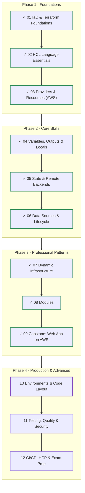
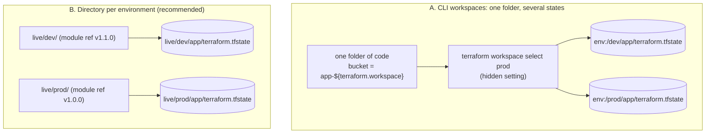
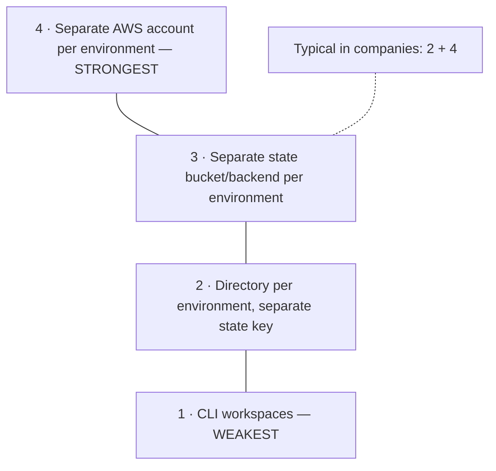
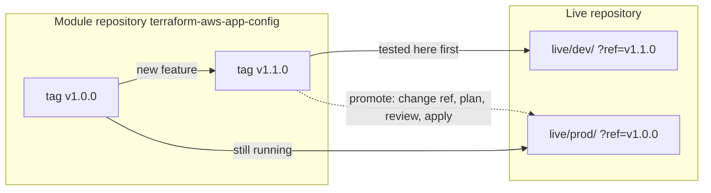
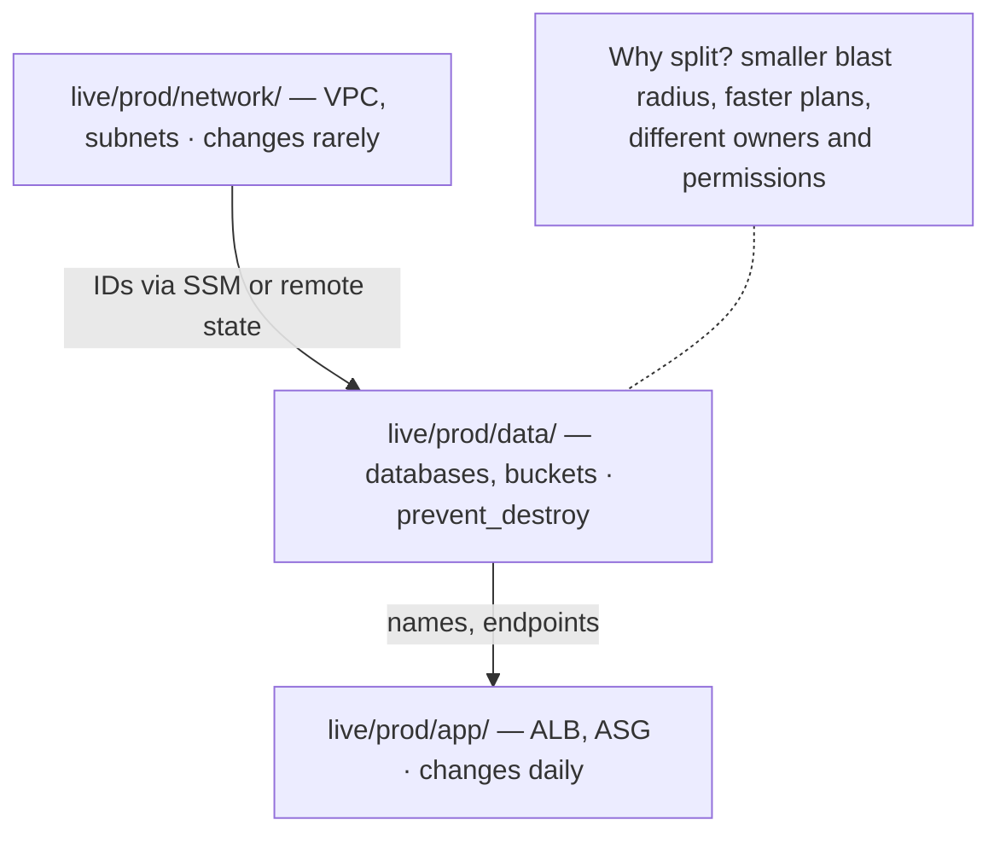
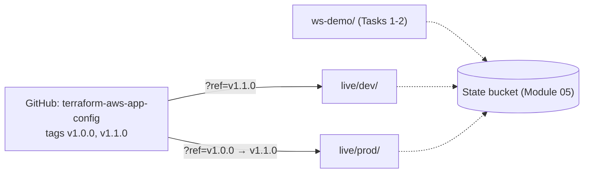

# Terraform: Zero to Advanced
## Module 10 — Environments & Code Layout

> Run dev, staging and prod from the same modules — safely isolated, explicitly configured and promoted step by step with versioned modules.

| | |
|---|---|
| **Level** | Advanced |
| **Time** | 4 hours (concepts + lab) |
| **Cost** | ≈ $0 (S3 buckets and SSM parameters) |
| **Terraform** | 1.12 or newer · AWS provider 6.x · a GitHub account |

📄 **Full illustrated version:** [Module-10-Environments-and-Code-Layout.pdf](./Module-10-Environments-and-Code-Layout.pdf)

## Contents

- [1. Module Overview](#1-module-overview)
- [2. Core Concepts](#2-core-concepts)
- [3. Hands-on Lab — Workspaces, Environment Folders and Promotion](#3-hands-on-lab--workspaces-environment-folders-and-promotion)
- [4. Quick Reference](#4-quick-reference)
- [5. Knowledge Check](#5-knowledge-check)
- [6. Summary & Next Steps](#6-summary--next-steps)

---

## 1. Module Overview


*Figure 0 — Where you are: Modules 01–09 done, Module 10 in progress.*

Every serious system runs in several **environments**: `dev` for experiments, `staging` for final tests, `prod` for customers. They should be **as similar as possible** (so what works in staging works in prod) and **as isolated as possible** (so a mistake in dev can never break prod). Terraform offers several ways to organise this. In this module you'll compare **CLI workspaces** with the **directory-per-environment** layout, design a repository structure, publish a versioned module on GitHub, and **promote** a change from dev to prod.

#### Learning objectives — by the end of this module you can:

- List what must be isolated between environments: state, credentials, configuration values and code version.
- Use **CLI workspaces** (`new`, `select`, `list`, `show`, `delete`, `terraform.workspace`) and explain their risks.
- Build a **directory-per-environment** layout with separate state keys and per-environment values.
- Version a module with **Git tags** and pin it with `?ref=` per environment.
- **Promote** a change from dev to prod with a reviewable diff.
- Add guardrails such as `allowed_account_ids`, and split large systems into **layers**.

#### Prerequisites

- Modules 05 (state bucket) and 08 (modules, Git sources) completed.
- A GitHub account and `git` installed (`git --version`).

## 2. Core Concepts

### 2.1 What separates one environment from another

| Dimension | Must differ because… | Typical mechanism |
|---|---|---|
| **State** | A plan for prod must never see or change dev's resources | Separate backend key, bucket or workspace |
| **Configuration values** | Prod is bigger, has longer retention, stricter access | Per-environment `.tfvars` |
| **Code version** | Prod runs the version that was tested; dev runs the newest | Module version pinning (`?ref=`, `version`) |
| **Credentials / account** | A dev mistake (or a compromised dev key) must not reach prod | Separate AWS accounts and roles |

### 2.2 Option A — CLI workspaces

A **workspace** is a named state inside one backend. Every configuration starts in the workspace `default`; `terraform workspace new dev` creates another, and `terraform.workspace` returns the current name, so the same code can produce different names:

```hcl
resource "aws_s3_bucket" "app" {
  bucket = "webshop-${terraform.workspace}-${data.aws_caller_identity.current.account_id}"
}
```

| Command | Effect |
|---|---|
| `terraform workspace list` | Show workspaces; `*` marks the current one |
| `terraform workspace new NAME` | Create a workspace and switch to it |
| `terraform workspace select NAME` | Switch to an existing workspace (`-or-create` creates it if missing) |
| `terraform workspace show` | Print the current workspace |
| `terraform workspace delete NAME` | Delete a workspace (its state must be empty) |

With the S3 backend, the `default` workspace uses your `key`; other workspaces are stored under `env:/<workspace>/<key>` (the `env:` prefix is configurable with `workspace_key_prefix`).

> [!WARNING]
> **Warning:** Workspaces share **the same code, the same backend and the same credentials**, and which environment you're about to change depends on an **invisible setting** — the last `workspace select`. HashiCorp's own documentation says workspaces are *not* a suitable isolation mechanism for environments that need separate credentials and access controls. Use them for **temporary, identical copies** (testing a feature branch, a short-lived demo).

> [!TIP]
> **Tip:** Don't confuse CLI workspaces with **HCP Terraform workspaces** (Module 12). An HCP Terraform workspace is a full unit of configuration, state, variables and permissions — much closer to an environment folder.

### 2.3 Option B — a directory per environment


*Figure 1 — Workspaces hide the environment in a setting; directories make it explicit.*

Each environment gets its own small root module that calls the **shared modules** with its own values and its own backend key. The environment is visible in the path you're standing in, in code review, and in the state key.

```text
live/
├── dev/
│   ├── main.tf            # calls the modules (ref = newest version)
│   ├── terraform.tf       # versions + backend "s3" {}
│   ├── backend.hcl        # key = "live/dev/app/terraform.tfstate"
│   └── terraform.tfvars   # dev values (loaded automatically)
└── prod/
    ├── main.tf            # calls the same modules (ref = tested version)
    ├── terraform.tf
    ├── backend.hcl        # key = "live/prod/app/terraform.tfstate"
    └── terraform.tfvars   # prod values
```

|   | CLI workspaces | Directory per environment |
|---|---|---|
| Which env am I changing? | Hidden (`terraform workspace show`) | Visible in the folder path |
| Different values | Conditionals on `terraform.workspace` or `-var-file` | `terraform.tfvars` per folder — automatic |
| Different code versions | Not possible (one folder) | Each folder pins its own module version |
| Different credentials/accounts | Awkward | Natural: each folder has its own provider settings |
| Duplication | None | Small: a thin `main.tf` per environment |
| Best for | Short-lived identical copies | **Long-lived environments** (dev/staging/prod) |

> [!TIP]
> **Tip:** The small duplication between folders is a feature: the differences between dev and prod are written down and reviewable. Tools such as **Terragrunt** or HCP Terraform **Stacks** reduce the boilerplate further for large organisations; learn the plain-Terraform layout first.

### 2.4 How strong should isolation be?


*Figure 2 — Levels of isolation between environments.*

The strongest and most common production setup uses **one AWS account per environment** (managed with AWS Organizations). Each environment folder then assumes a role in its own account, and the provider refuses to run against any other account:

```hcl
provider "aws" {
  region              = "eu-central-1"
  allowed_account_ids = ["111111111111"]          # prod account only

  assume_role {
    role_arn = "arn:aws:iam::111111111111:role/terraform-deployer"
  }
}
```

`allowed_account_ids` is a cheap, powerful guardrail even with a single account: if your credentials point somewhere unexpected, Terraform stops before doing anything.

### 2.5 Versioned modules and promotion


*Figure 3 — Environments pin module versions; promotion is a one-line, reviewed change.*

When environments reference shared modules by **local path**, every module change hits every environment at the next apply. Pinning a **Git tag** per environment gives you control:

1. Change the module, tag a new version (`v1.1.0`) following **semantic versioning**: patch = fix, minor = backward-compatible feature, major = breaking change.
2. Point `live/dev` at `?ref=v1.1.0`, run `terraform init` (to download it), plan, apply, test.
3. Open a pull request changing `live/prod` to `?ref=v1.1.0`. The diff is one line; the **plan** shows exactly what prod will get. Review, apply.

Teams often keep modules in one repository and the environment folders ("live" configuration) in another, so module releases and deployments are separate, auditable steps.

### 2.6 Layering large systems


*Figure 4 — Split an environment into layers with different change rates.*

One state for an entire production system means every plan refreshes hundreds of resources, and a small app change shares a blast radius with the VPC. Split each environment into **layers** (network → data → app), each with its own folder and state, and pass IDs between them through SSM parameters (Module 06) or `terraform_remote_state` (Module 05).

---

## 3. Hands-on Lab — Workspaces, Environment Folders and Promotion

**Goal:** experience CLI workspaces and their pitfall, then build a proper `live/dev` + `live/prod` layout that uses a module **versioned on your GitHub**, promote a change from dev to prod, and add an account guardrail. All resources are free.


*Figure 5 — Lab overview.*

Create one working folder `lab-10-environments/` for everything below. As always, set `AWS_PROFILE`, and replace `tf-state-1a7d31df` with your state bucket and `YOUR-GITHUB-USER` with your GitHub username.

### Task 1 — Workspaces in action

**`ws-demo/main.tf`**

```hcl
terraform {
  required_version = ">= 1.12.0"
  backend "s3" {}
  required_providers {
    aws = {
      source  = "hashicorp/aws"
      version = "~> 6.0"
    }
  }
}

provider "aws" {
  region = "eu-central-1"
}

resource "aws_ssm_parameter" "env" {
  name  = "/tf-course/m10/${terraform.workspace}/message"
  type  = "String"
  value = "Hello from ${terraform.workspace}"
}

output "parameter" {
  value = aws_ssm_parameter.env.name
}
```

**`ws-demo/backend.hcl`**

```hcl
bucket       = "tf-state-1a7d31df"
key          = "ws-demo/terraform.tfstate"
region       = "eu-central-1"
use_lockfile = true
```

```bash
cd ws-demo
terraform init -backend-config=backend.hcl
terraform workspace new dev
terraform apply -auto-approve
terraform workspace new staging
terraform apply -auto-approve
terraform workspace list
```

*Expected output (abridged):*

```text
Created and switched to workspace "dev"!

You're now on a new, empty workspace. Workspaces isolate their state,
so if you run "terraform plan" Terraform will not see any existing state
for this configuration.
...
Apply complete! Resources: 1 added, 0 changed, 0 destroyed.

Outputs:

parameter = "/tf-course/m10/dev/message"
...
parameter = "/tf-course/m10/staging/message"

  default
  dev
* staging
```

(`-auto-approve` is fine for throw-away lab resources — never use it by habit on real infrastructure.) Now look at where the states live:

```bash
aws s3 ls s3://tf-state-1a7d31df/ --recursive | grep ws-demo
```

*Expected output:*

```text
2026-10-27 09:12:03        1650 env:/dev/ws-demo/terraform.tfstate
2026-10-27 09:12:41        1690 env:/staging/ws-demo/terraform.tfstate
```

### Task 2 — The workspace trap

Imagine you meant to change **dev**, but the last command you ran selected `staging`. Change the value to `"Hello from ${terraform.workspace} - v2"` and run plan:

```bash
terraform plan
terraform workspace show
```

*Expected output (abridged):*

```text
  # aws_ssm_parameter.env will be updated in-place
  ~ resource "aws_ssm_parameter" "env" {
        id    = "/tf-course/m10/staging/message"
      ~ value = (sensitive value)
      ...
Plan: 0 to add, 1 to change, 0 to destroy.

staging
```

Nothing in the plan warns you that it's **staging** — only the ID gives it away. In real environments the resources look identical. This is the core weakness of workspaces. Undo the change and clean up both workspaces (a workspace can only be deleted when its state is empty, and not while it's selected):

```bash
terraform destroy -auto-approve
terraform workspace select dev
terraform destroy -auto-approve
terraform workspace select default
terraform workspace delete dev
terraform workspace delete staging
cd ..
```

### Task 3 — A module for the environments

Create a new folder `terraform-aws-app-config/` (outside the live folders) with this small module. It creates an application bucket and a configuration parameter, with environment-specific settings:

**`terraform-aws-app-config/versions.tf`**

```hcl
terraform {
  required_version = ">= 1.12.0"
  required_providers {
    aws = {
      source  = "hashicorp/aws"
      version = ">= 6.0"
    }
  }
}
```

**`terraform-aws-app-config/variables.tf`**

```hcl
variable "project" {
  type        = string
  description = "Project name"
}

variable "environment" {
  type        = string
  description = "Environment name"
}

variable "versioning" {
  type        = bool
  description = "Keep old object versions"
  default     = false
}

variable "settings" {
  type        = map(string)
  description = "Application settings stored as JSON in SSM"
  default     = {}
}
```

**`terraform-aws-app-config/main.tf`**

```hcl
data "aws_caller_identity" "current" {}

locals {
  name = "${var.project}-${var.environment}"
}

resource "aws_s3_bucket" "app" {
  bucket        = "${local.name}-app-${data.aws_caller_identity.current.account_id}"
  force_destroy = var.environment != "prod" # protect prod data
}

resource "aws_s3_bucket_versioning" "app" {
  bucket = aws_s3_bucket.app.id
  versioning_configuration {
    status = var.versioning ? "Enabled" : "Suspended"
  }
}

resource "aws_ssm_parameter" "settings" {
  name  = "/${var.project}/${var.environment}/settings"
  type  = "String"
  value = jsonencode(var.settings)
}
```

**`terraform-aws-app-config/outputs.tf`**

```hcl
output "bucket_name" {
  value = aws_s3_bucket.app.bucket
}

output "settings_parameter" {
  value = aws_ssm_parameter.settings.name
}
```

### Task 4 — Publish it with a version tag

On GitHub create a new **public** repository named `terraform-aws-app-config` (no README, so it's empty). Then push the module and tag it:

```bash
cd terraform-aws-app-config
git init -b main
git add .
git commit -m "app-config module: bucket + settings parameter"
git remote add origin https://github.com/YOUR-GITHUB-USER/terraform-aws-app-config.git
git push -u origin main
git tag v1.0.0
git push origin v1.0.0
cd ..
```

On GitHub, *Tags* now shows `v1.0.0`. That tag is an immutable name for this exact code — what environments will pin. (A private repository also works if your Git credentials can access it.)

### Task 5 — The dev environment

**`live/dev/terraform.tf`**

```hcl
terraform {
  required_version = ">= 1.12.0"
  backend "s3" {}
  required_providers {
    aws = {
      source  = "hashicorp/aws"
      version = "~> 6.0"
    }
  }
}

provider "aws" {
  region = "eu-central-1"

  default_tags {
    tags = {
      Project     = var.project
      Environment = var.environment
    }
  }
}
```

**`live/dev/main.tf`**

```hcl
variable "project" {
  type = string
}

variable "environment" {
  type = string
}

variable "versioning" {
  type = bool
}

variable "settings" {
  type = map(string)
}

module "app" {
  source = "git::https://github.com/YOUR-GITHUB-USER/terraform-aws-app-config.git?ref=v1.0.0"

  project     = var.project
  environment = var.environment
  versioning  = var.versioning
  settings    = var.settings
}

output "bucket_name" {
  value = module.app.bucket_name
}
```

**`live/dev/terraform.tfvars`**

```hcl
project     = "webshop"
environment = "dev"
versioning  = false
settings = {
  log_level    = "debug"
  feature_beta = "on"
}
```

**`live/dev/backend.hcl`**

```hcl
bucket       = "tf-state-1a7d31df"
key          = "live/dev/app/terraform.tfstate"
region       = "eu-central-1"
use_lockfile = true
encrypt      = true
```

```bash
cd live/dev
terraform init -backend-config=backend.hcl
terraform apply
```

*Expected output (abridged):*

```text
Initializing modules...
Downloading git::https://github.com/YOUR-GITHUB-USER/terraform-aws-app-config.git?ref=v1.0.0 for app...
- app in .terraform/modules/app
...
Plan: 3 to add, 0 to change, 0 to destroy.
...
Apply complete! Resources: 3 added, 0 changed, 0 destroyed.

Outputs:

bucket_name = "webshop-dev-app-123456789012"
```

No `-var-file` needed: `terraform.tfvars` in the folder is loaded automatically. Standing in `live/dev` *is* choosing the environment.

### Task 6 — The prod environment

Copy the folder and change only what should differ:

```bash
cd ..
cp -r dev prod          # Windows PowerShell: Copy-Item -Recurse dev prod
cd prod
rm -rf .terraform       # PowerShell: Remove-Item -Recurse -Force .terraform
```

**`live/prod/terraform.tfvars`**

```hcl
project     = "webshop"
environment = "prod"
versioning  = true
settings = {
  log_level    = "warn"
  feature_beta = "off"
}
```

In `live/prod/backend.hcl` set `key = "live/prod/app/terraform.tfstate"`. Don't copy `.terraform/` — it remembers dev's backend. Then:

```bash
terraform init -backend-config=backend.hcl
terraform apply
```

*Expected output (abridged):*

```text
Plan: 3 to add, 0 to change, 0 to destroy.
...
Apply complete! Resources: 3 added, 0 changed, 0 destroyed.

Outputs:

bucket_name = "webshop-prod-app-123456789012"
```

Two environments, two states, one module. Prove the isolation: in `live/dev` run `terraform state list` — you see only dev's three resources. A plan in dev cannot even *see* prod.

### Task 7 — Release v1.1.0 and test it in dev

Add a feature to the module — a lifecycle rule that deletes old object versions after N days:

**`terraform-aws-app-config/variables.tf (addition)`**

```hcl
variable "noncurrent_days" {
  type        = number
  description = "Delete old object versions after this many days (only if versioning is on)"
  default     = 30
}
```

**`terraform-aws-app-config/main.tf (addition)`**

```hcl
resource "aws_s3_bucket_lifecycle_configuration" "app" {
  count  = var.versioning ? 1 : 0
  bucket = aws_s3_bucket.app.id

  rule {
    id     = "expire-old-versions"
    status = "Enabled"

    filter {}

    noncurrent_version_expiration {
      noncurrent_days = var.noncurrent_days
    }
  }

  depends_on = [aws_s3_bucket_versioning.app]
}
```

```bash
cd ../../terraform-aws-app-config
git add . && git commit -m "Expire noncurrent versions" && git push
git tag v1.1.0 && git push origin v1.1.0
```

It's backward compatible (new input with a default), so it's a **minor** release. Turn versioning on in dev to exercise the feature — set `versioning = true` in `live/dev/terraform.tfvars` — and change dev's `?ref=v1.0.0` to `?ref=v1.1.0`. Then:

```bash
cd ../live/dev
terraform plan
```

*Expected output (abridged):*

```text
╷
│ Error: Module source has changed
│
│   on main.tf line ..., in module "app":
│   ...:   source = "git::https://github.com/YOUR-GITHUB-USER/terraform-aws-app-config.git?ref=v1.1.0"
│
│ The source address was changed since this module was installed. Run "terraform init" to
│ install all modules required by this configuration.
╵
```

```bash
terraform init -backend-config=backend.hcl
terraform apply
```

*Expected output (abridged):*

```text
  # module.app.aws_s3_bucket_lifecycle_configuration.app[0] will be created
  ...
  # module.app.aws_s3_bucket_versioning.app will be updated in-place
  ~ resource "aws_s3_bucket_versioning" "app" {
      ~ versioning_configuration {
          ~ status = "Suspended" -> "Enabled"
        ...
Plan: 1 to add, 1 to change, 0 to destroy.
```

Dev now runs v1.1.0; prod is untouched and still on v1.0.0.

### Task 8 — Promote to prod

```bash
cd ../prod
diff ../dev/main.tf main.tf
```

*Expected output (abridged):*

```text
15c15
< source = "git::https://github.com/YOUR-GITHUB-USER/terraform-aws-app-config.git?ref=v1.1.0"
---
> source = "git::https://github.com/YOUR-GITHUB-USER/terraform-aws-app-config.git?ref=v1.0.0"
```

The **only** code difference between dev and prod is the version — everything else lives in `terraform.tfvars`. Promote by changing prod's ref to `v1.1.0`:

```bash
terraform init -backend-config=backend.hcl
terraform plan
```

*Expected output (abridged):*

```text
  # module.app.aws_s3_bucket_lifecycle_configuration.app[0] will be created
  + resource "aws_s3_bucket_lifecycle_configuration" "app" {
      + rule {
          + id     = "expire-old-versions"
          + status = "Enabled"
          + noncurrent_version_expiration {
              + noncurrent_days = 30
            }
          ...
        }
    }

Plan: 1 to add, 0 to change, 0 to destroy.
```

Exactly what was tested in dev, nothing more. In a team this plan would be attached to the pull request (Module 12 automates that). Apply it.

### Task 9 — An account guardrail

Find your account ID with `aws sts get-caller-identity --query Account --output text`. In `live/prod/terraform.tf`, add a **wrong** ID first to see the guardrail fire:

**`live/prod/terraform.tf (change)`**

```hcl
provider "aws" {
  region              = "eu-central-1"
  allowed_account_ids = ["000000000000"] # deliberately wrong (Task 9)
  # default_tags { ... } as before
}
```

```bash
terraform plan
```

*Expected output (abridged; wording may vary slightly):*

```text
╷
│ Error: AWS account ID not allowed: 123456789012
│
│   with provider["registry.terraform.io/hashicorp/aws"],
│   on terraform.tf line ..., in provider "aws":
│ ...
╵
```

Terraform refused before reading or changing anything. Put your real account ID in the list and plan again — *No changes*. In a multi-account setup, dev's folder lists the dev account and prod's the prod account, so running prod code with dev credentials (or the other way round) is impossible.

### Task 10 — Clean up

```bash
terraform destroy          # in live/prod
cd ../dev
terraform destroy
```

*Expected output in prod — only if the bucket contains objects:*

```text
module.app.aws_s3_bucket.app: Destroying... [id=webshop-prod-app-123456789012]
╷
│ Error: deleting S3 Bucket (webshop-prod-app-123456789012): operation error S3: DeleteBucket,
│ ... BucketNotEmpty: The bucket you tried to delete is not empty ...
╵
```

If you uploaded anything to the prod bucket, `force_destroy = false` protects it — by design. Empty it first (`aws s3 rm s3://<bucket> --recursive`, plus old versions in the console's *Show versions* view) and destroy again. With an empty bucket both destroys simply succeed: *Destroy complete! Resources: 4 destroyed.* Keep the GitHub repository — you'll use it in Modules 11 and 12.

### Challenge — add staging in three steps

Create `live/staging` on version `v1.1.0` with `versioning = true` and `log_level = "info"`. List the files you change and predict the plan summary before running it.

#### Solution

1. Copy `live/dev` to `live/staging` (without `.terraform/`).
2. In `backend.hcl`: `key = "live/staging/app/terraform.tfstate"`.
3. In `terraform.tfvars`: `environment = "staging"`, `versioning = true`, `log_level = "info"`.

*Expected plan summary:*

```text
Plan: 4 to add, 0 to change, 0 to destroy.
```

Four resources, because versioning is on and v1.1.0 therefore adds the lifecycle configuration. A whole new environment: three edits, all reviewable. Destroy it afterwards.

#### Lab complete when you can tick every box

- [ ] I created, used and deleted CLI workspaces and saw where their state lives.
- [ ] I can explain why the workspace trap is dangerous.
- [ ] I published a module on GitHub with version tags.
- [ ] My dev and prod folders have separate state keys and differ only in values and module version.
- [ ] I promoted v1.1.0 from dev to prod with a one-line change.
- [ ] `allowed_account_ids` stopped a run against the wrong account.

---

## 4. Quick Reference

### 4.1 Commands and settings

| Need | Command / setting |
|---|---|
| List / create / switch workspaces | `terraform workspace list` / `new NAME` / `select NAME` |
| Current workspace | `terraform workspace show` or `terraform.workspace` in code |
| Delete a workspace | `terraform workspace delete NAME` (empty state, not selected) |
| Workspace state path in S3 | `env:/<workspace>/<key>` (`workspace_key_prefix`) |
| Environment values | `terraform.tfvars` in each environment folder |
| Separate state | `key = "live/<env>/<component>/terraform.tfstate"` |
| Pin a module version (Git) | `source = "git::https://.../repo.git?ref=v1.1.0"` |
| After changing a module ref | `terraform init` (downloads the new version) |
| Account guardrail | `allowed_account_ids = ["..."]` in the provider |
| Cross-account access | `assume_role { role_arn = "..." }` in the provider |

### 4.2 Common errors and fixes

| Error / symptom | Usual cause | Fix |
|---|---|---|
| `Module source has changed` | Changed `source`/`?ref=` without `init` | `terraform init` |
| `Workspace ... is not empty` | Deleting a workspace that still has resources | Destroy in that workspace first |
| Prod plan shows dev's resources | Copied `.terraform/` or forgot to change `key` | Delete `.terraform/`, fix `backend.hcl`, `init -reconfigure` |
| `AWS account ID not allowed` | Credentials point at another account | Use the right profile/role; check `allowed_account_ids` |
| Git module download fails | Repo private/renamed, or tag missing | Check URL, access, and that the tag was pushed |
| `BucketNotEmpty` on destroy | `force_destroy = false` and objects exist | Intended protection: empty the bucket deliberately |

## 5. Knowledge Check

**Q1. Which four things should differ between environments?**

<details><summary>Show answer</summary>

State, configuration values, code (module) version, and credentials/account.

</details>

**Q2. Where does the S3 backend store the state of a workspace named `dev`?**

<details><summary>Show answer</summary>

Under `env:/dev/<key>` in the same bucket (prefix configurable via `workspace_key_prefix`).

</details>

**Q3. Why are CLI workspaces risky for prod?**

<details><summary>Show answer</summary>

Same code, backend and credentials, and the target environment depends on an invisible selected workspace.

</details>

**Q4. When are CLI workspaces a good fit?**

<details><summary>Show answer</summary>

For short-lived, identical copies — e.g. testing a feature branch or a temporary demo.

</details>

**Q5. How does a directory-per-environment layout select values without `-var-file`?**

<details><summary>Show answer</summary>

Each folder has its own `terraform.tfvars`, which Terraform loads automatically.

</details>

**Q6. How do dev and prod run different versions of the same module?**

<details><summary>Show answer</summary>

Each environment pins its own version: `?ref=<tag>` for Git or `version` for registries.

</details>

**Q7. What must you run after changing a module's `?ref=`?**

<details><summary>Show answer</summary>

`terraform init`, so the new version is downloaded.

</details>

**Q8. What does `allowed_account_ids` protect against?**

<details><summary>Show answer</summary>

Running a configuration with credentials for the wrong AWS account.

</details>

**Q9. Why split an environment into network, data and app layers?**

<details><summary>Show answer</summary>

Smaller blast radius, faster plans and separate ownership/permissions per layer.

</details>

**Q10. What is the difference between a CLI workspace and an HCP Terraform workspace?**

<details><summary>Show answer</summary>

A CLI workspace is just another state for the same folder; an HCP Terraform workspace bundles configuration, state, variables and permissions.

</details>

## 6. Summary & Next Steps

- Environments must be isolated in **state**, **values**, **code version** and ideally **credentials/account**.
- CLI workspaces = several states for one folder; convenient for temporary copies, weak for real environments.
- Directory per environment = thin roots with their own `terraform.tfvars` and backend key — explicit and reviewable.
- Pin modules per environment with **Git tags / registry versions**; promotion is a one-line, planned change.
- Use `allowed_account_ids` and separate AWS accounts for strong isolation; split big systems into **layers**.

**Next — Module 11: Testing, Quality & Security.** Before any change reaches prod it should be checked automatically: formatting and validation, linting with **TFLint**, security scanning with **Trivy**, and **`terraform test`** for your modules — including fast tests with mocked providers.

#### Official references

- [CLI workspaces](https://developer.hashicorp.com/terraform/cli/workspaces)
- [S3 backend: workspaces](https://developer.hashicorp.com/terraform/language/backend/s3)
- [Module sources (Git)](https://developer.hashicorp.com/terraform/language/modules/sources)
- [AWS provider: assume_role and allowed_account_ids](https://registry.terraform.io/providers/hashicorp/aws/latest/docs)
- [Semantic versioning](https://semver.org/)
