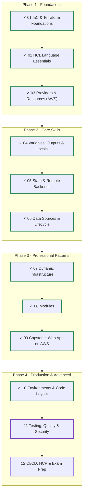
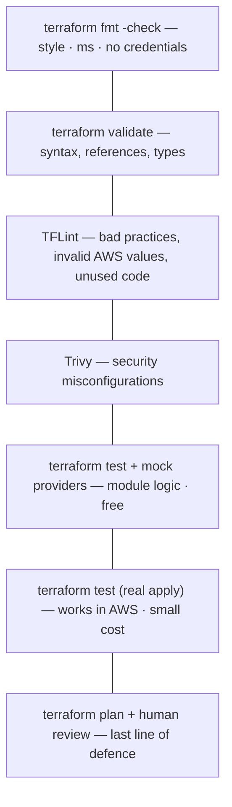
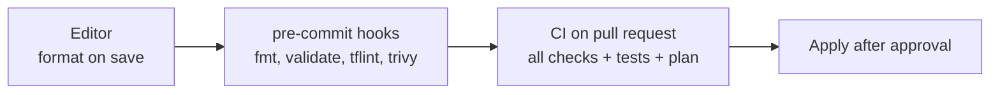
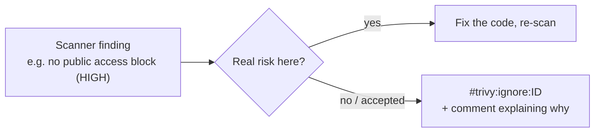
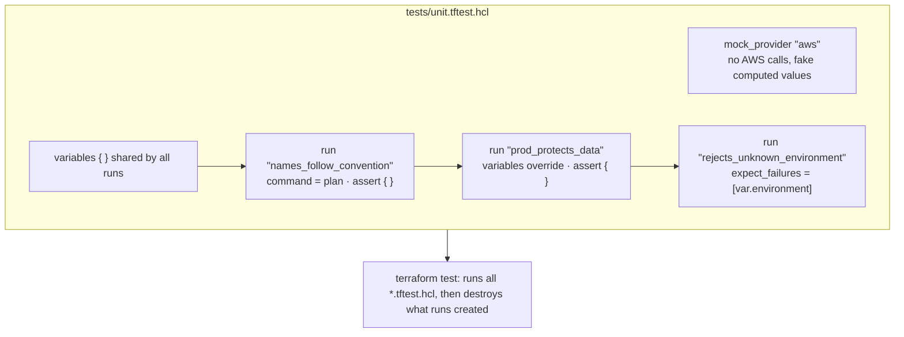
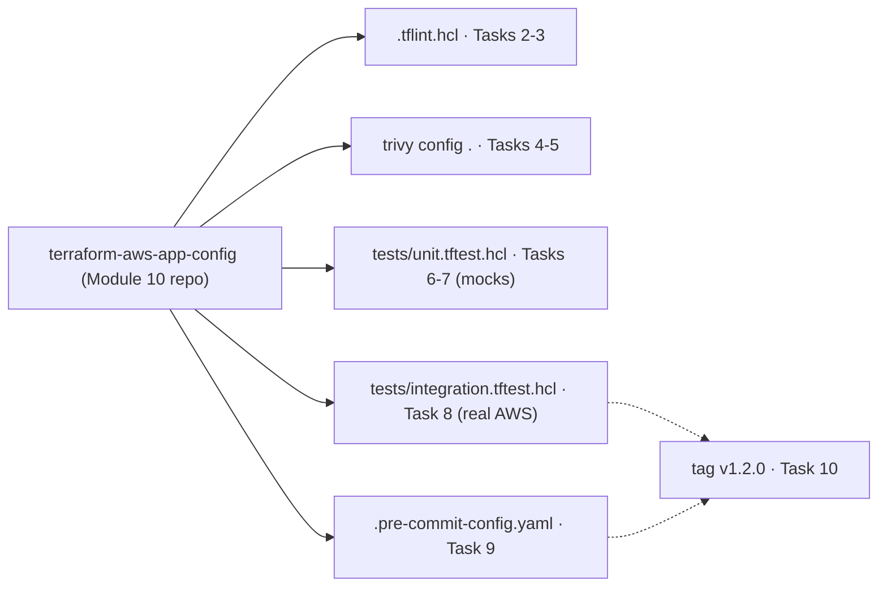

# Terraform: Zero to Advanced
## Module 11 — Testing, Quality & Security

> Catch mistakes before they reach AWS: formatting and validation, linting with TFLint, security scanning with Trivy, and automated tests with terraform test and mock providers.

| | |
|---|---|
| **Level** | Advanced |
| **Time** | 4–5 hours (concepts + lab) |
| **Cost** | ≈ $0 (mock tests are free; integration test cleans up) |
| **Terraform** | 1.12 or newer · TFLint · Trivy · Python (for pre-commit) |

📄 **Full illustrated version:** [Module-11-Testing-Quality-Security.pdf](./Module-11-Testing-Quality-Security.pdf)

## Contents

- [1. Module Overview](#1-module-overview)
- [2. Core Concepts](#2-core-concepts)
- [3. Hands-on Lab — Test and Secure Your Module](#3-hands-on-lab--test-and-secure-your-module)
- [4. Quick Reference](#4-quick-reference)
- [5. Knowledge Check](#5-knowledge-check)
- [6. Summary & Next Steps](#6-summary--next-steps)

---

## 1. Module Overview


*Figure 0 — Where you are: Modules 01–10 done, Module 11 in progress.*

So far, `terraform plan` and your own eyes were the only checks between an idea and production. That doesn't scale: humans miss a public bucket in a 300-line plan, and a module change can quietly break a caller you didn't think of. Professional teams layer **automated checks** in front of every change — cheap, fast ones on every save, slower, more thorough ones on every pull request. In this module you add all of them to the module you published in Module 10.

#### Learning objectives — by the end of this module you can:

- Explain the layers of Terraform quality checks and what each one can and can't catch.
- Enforce formatting and validation, including in folders without a backend.
- Configure **TFLint** with the Terraform and AWS rulesets and fix its findings.
- Scan for security misconfigurations with **Trivy**, and fix or explicitly ignore findings.
- Write **`terraform test`** files: `run` blocks, `assert`, variables, `expect_failures`.
- Use **mock providers** for fast, free unit tests, and real applies for integration tests.
- Run all checks automatically before each commit with **pre-commit**.

#### Prerequisites

- Module 10 completed: your `terraform-aws-app-config` repository on GitHub, cloned locally.
- Terraform 1.7+ for mock providers (you have 1.12+).

## 2. Core Concepts

### 2.1 Layers of checks


*Figure 1 — Each layer catches a different class of problem; cheap checks run first.*

| Check | Catches | Can't catch |
|---|---|---|
| `fmt -check` | Inconsistent formatting | Anything about meaning |
| `validate` | Syntax errors, unknown arguments, wrong types, broken references | Invalid *values* (e.g. a misspelled instance type), cloud rules |
| TFLint | Provider-specific invalid values, deprecated syntax, unused variables, missing versions | Security posture, business logic |
| Trivy | Insecure settings: public access, missing encryption, open ports (hundreds of rules) | Whether the module does what *you* intended |
| `terraform test` (mock) | Your logic: naming, conditionals, counts, validation rules | Real cloud behaviour (API limits, permissions) |
| `terraform test` (apply) | That AWS accepts and builds it | Changes to existing environments (that's what plan review is for) |


*Figure 2 — Where the checks run.*

### 2.2 fmt and validate in automation

```bash
terraform fmt -check -recursive    # non-zero exit code if any file needs formatting
terraform init -backend=false      # install providers/modules without configuring state
terraform validate                 # needs init, but no credentials
```

`-backend=false` lets you validate a root module in CI without access to its state bucket. For a reusable module (no backend) plain `terraform init` is enough.

### 2.3 TFLint

**TFLint** is a pluggable linter. Rulesets are plugins: the **terraform** ruleset (built in) enforces language best practices; the **aws** ruleset knows AWS values — it will tell you `t3.mirco` is not an instance type *before* AWS rejects it halfway through an apply.

**`.tflint.hcl`**

```hcl
plugin "terraform" {
  enabled = true
  preset  = "recommended"   # unused declarations, typed variables, required versions ...
}

plugin "aws" {
  enabled = true
  version = "0.47.0"        # check github.com/terraform-linters/tflint-ruleset-aws for the latest
  source  = "github.com/terraform-linters/tflint-ruleset-aws"
}
```

```bash
tflint --init        # download the plugins
tflint               # lint the current directory
tflint --recursive   # lint every module folder below
```

### 2.4 Security scanning with Trivy

**Trivy** (by Aqua Security; it absorbed the earlier *tfsec* project) scans Terraform code against hundreds of security rules. Each finding has an ID, a severity and a link explaining the risk and the fix. **Checkov** is a popular alternative with similar coverage.

```bash
trivy config .                          # scan the current folder
trivy config --severity HIGH,CRITICAL . # only serious findings
trivy config --exit-code 1 .            # fail (for CI) if anything is found
```


*Figure 3 — Every finding gets a decision: fix it, or ignore it explicitly with a reason.*

```hcl
# Access logging is not needed for this low-value config bucket (decision 2026-10, platform team).
#trivy:ignore:AVD-AWS-0089
resource "aws_s3_bucket" "app" {
  # ...
}
```

> [!WARNING]
> **Warning:** Never silence a scanner globally to make a pipeline green. Ignore one rule, on one resource, with a written reason — so reviewers can challenge it.

### 2.5 terraform test


*Figure 4 — Anatomy of a test file.*

Tests are written in HCL, in files ending in **`.tftest.hcl`** (in the module folder or a `tests/` folder). `terraform test` runs each file's `run` blocks **in order** against the module in the current directory, and at the end **destroys** everything the runs created.

| Element | Meaning |
|---|---|
| `variables { }` | Input values for the module; at file level for all runs, or inside a `run` to override |
| `run "name" { }` | One test step. `command = plan` (fast, nothing created) or `apply` (the default) |
| `assert { condition  error_message }` | Must be true after the step; can reference the module's resources, outputs and variables |
| `expect_failures = [ ... ]` | The step **should** fail on these checkable objects (validation, conditions) — tests your guards |
| `mock_provider "aws" { }` | Replace the real provider: no API calls, fake values for computed attributes (Terraform 1.7+) |
| `mock_data` / `mock_resource` | Fixed values for specific data sources or resources inside a mock provider |
| `override_resource` / `override_data` | Override one object's values in a test, even with the real provider |

**`tests/unit.tftest.hcl (excerpt)`**

```hcl
mock_provider "aws" {
  mock_data "aws_caller_identity" {
    defaults = {
      account_id = "123456789012"
    }
  }
}

variables {
  project     = "webshop"
  environment = "dev"
}

run "names_follow_convention" {
  command = plan

  assert {
    condition     = aws_s3_bucket.app.bucket == "webshop-dev-app-123456789012"
    error_message = "Bucket name must be <project>-<environment>-app-<account id>."
  }
}
```

> [!IMPORTANT]
> **Key idea:** Mock tests are **unit tests**: they run in seconds, need no credentials and cost nothing, so you can run them on every commit. Keep a few real-apply **integration tests** for the confidence that AWS actually accepts the configuration.

### 2.6 pre-commit

**pre-commit** is a small Python tool that runs checks automatically when you `git commit` and blocks the commit if one fails. The community repository *antonbabenko/pre-commit-terraform* packages hooks for `fmt`, `validate`, TFLint, Trivy and `terraform-docs`. Secret scanners such as **gitleaks** fit into the same hook list and stop access keys from ever reaching Git history.

---

## 3. Hands-on Lab — Test and Secure Your Module

**Goal:** take the `terraform-aws-app-config` module from Module 10, add linting, security scanning, unit tests with mocks, an integration test against AWS and pre-commit hooks — then release it as `v1.2.0`.


*Figure 5 — Lab overview.*

```text
terraform-aws-app-config/
├── .tflint.hcl
├── .pre-commit-config.yaml
├── versions.tf  variables.tf  main.tf  outputs.tf
└── tests/
    ├── unit.tftest.hcl          # mock provider, seconds, free
    └── integration.tftest.hcl   # real AWS, minutes
```

### Task 1 — Install the tools and run the basics

| Tool | macOS | Windows | Linux |
|---|---|---|---|
| TFLint | `brew install tflint` | `choco install tflint` | install script from the TFLint README |
| Trivy | `brew install trivy` | `choco install trivy` (or download the release ZIP) | package repos in the Trivy docs |
| pre-commit | `pip install pre-commit` | `pip install pre-commit` | `pip install pre-commit` |

```bash
git clone https://github.com/YOUR-GITHUB-USER/terraform-aws-app-config.git
cd terraform-aws-app-config
terraform init
terraform fmt -check -recursive && echo "format OK"
terraform validate
```

*Expected output (abridged):*

```text
Terraform has been successfully initialized!
format OK
Success! The configuration is valid.
```

`fmt -check` prints nothing and exits with 0 when everything is formatted; it prints file names and exits with 3 otherwise — exactly what a pipeline needs. Add `.terraform/` and `.terraform.lock.hcl` to `.gitignore` in this **module** repository: lock files belong in root configurations, not in reusable modules.

### Task 2 — Lint with TFLint

Create `.tflint.hcl` from section 2.3, then add a deliberate mistake — an unused variable — to `variables.tf`:

**`variables.tf (temporary addition)`**

```hcl
variable "unused_flag" {
  type    = bool
  default = false
}
```

```bash
tflint --init
tflint
```

*Expected output (abridged; versions differ):*

```text
Installing "aws" plugin...
Installed "aws" (source: github.com/terraform-linters/tflint-ruleset-aws, version: 0.47.0)

1 issue(s) found:

Warning: variable "unused_flag" is declared but not used (terraform_unused_declarations)

  on variables.tf line 29:
  29: variable "unused_flag" {

Reference: https://github.com/terraform-linters/tflint-ruleset-terraform/blob/v0.x.x/docs/rules/terraform_unused_declarations.md
```

`terraform validate` was happy with this; TFLint isn't. Unused inputs confuse the people calling your module. Delete the variable and run `tflint` again: no output means no issues.

### Task 3 — Catch an invalid AWS value

Create a scratch file with a typo that `validate` can't see:

**`scratch.tf (temporary)`**

```hcl
resource "aws_instance" "scratch" {
  ami           = "ami-0123456789abcdef0"
  instance_type = "t3.mirco"
}
```

```bash
terraform validate
tflint
```

*Expected output (abridged):*

```text
Success! The configuration is valid.

1 issue(s) found:

Error: "t3.mirco" is an invalid value as instance_type (aws_instance_invalid_type)

  on scratch.tf line 3:
   3:   instance_type = "t3.mirco"
```

`validate` only knows `instance_type` must be a *string*. The AWS ruleset knows the list of real instance types. Without TFLint you'd learn this from a failed apply. Delete `scratch.tf`.

### Task 4 — Scan for security issues

```bash
trivy config .
```

*Expected output (abridged; rule IDs, counts and wording depend on your Trivy version):*

```text
main.tf (terraform)
===================
Tests: 10 (SUCCESSES: 3, FAILURES: 7)
Failures: 7 (UNKNOWN: 0, LOW: 1, MEDIUM: 0, HIGH: 6, CRITICAL: 0)

AVD-AWS-0086 (HIGH): No public access block so not blocking public acls
AVD-AWS-0087 (HIGH): No public access block so not blocking public policies
AVD-AWS-0091 (HIGH): No public access block so not blocking public acls
AVD-AWS-0093 (HIGH): No public access block so not restricting public buckets
AVD-AWS-0088 (HIGH): Bucket does not have encryption enabled
AVD-AWS-0132 (HIGH): Bucket does not encrypt data with a customer managed key.
AVD-AWS-0089 (LOW): Bucket has logging disabled
...
```

Each finding is followed by the code location and a link with details. Your module creates a bucket **without a public access block** — a real gap (the Module 03 lab had one, this module forgot it). Read each finding and decide, as in Figure 3.

### Task 5 — Fix what matters, ignore what doesn't (with a reason)

**`main.tf (additions)`**

```hcl
resource "aws_s3_bucket_public_access_block" "app" {
  bucket = aws_s3_bucket.app.id

  block_public_acls       = true
  block_public_policy     = true
  ignore_public_acls      = true
  restrict_public_buckets = true
}

resource "aws_s3_bucket_server_side_encryption_configuration" "app" {
  bucket = aws_s3_bucket.app.id

  rule {
    apply_server_side_encryption_by_default {
      sse_algorithm = "AES256"
    }
  }
}
```

The remaining two findings are design decisions for this small config bucket: S3-managed keys are acceptable (customer-managed KMS keys cost money and add key-policy work), and access logging isn't needed. Record that above the bucket resource, using the IDs **your** Trivy printed:

**`main.tf (comments above the bucket)`**

```hcl
# Accepted risks for this low-value config bucket (reviewed by: you, 2026-10):
# - SSE-S3 encryption is sufficient; no customer-managed KMS key.
# - Access logging not required.
#trivy:ignore:AVD-AWS-0132
#trivy:ignore:AVD-AWS-0089
resource "aws_s3_bucket" "app" {
  # ... unchanged ...
}
```

```bash
trivy config .
tflint && terraform fmt -check -recursive && terraform validate
```

*Expected output (abridged):*

```text
main.tf (terraform)
===================
Tests: 10 (SUCCESSES: 10, FAILURES: 0)
...
Success! The configuration is valid.
```

### Task 6 — Unit tests with a mock provider

**`tests/unit.tftest.hcl`**

```hcl
mock_provider "aws" {
  mock_data "aws_caller_identity" {
    defaults = {
      account_id = "123456789012"
    }
  }
}

variables {
  project     = "webshop"
  environment = "dev"
  settings = {
    log_level = "debug"
  }
}

run "names_follow_convention" {
  command = plan

  assert {
    condition     = aws_s3_bucket.app.bucket == "webshop-dev-app-123456789012"
    error_message = "Bucket name must be <project>-<environment>-app-<account id>."
  }

  assert {
    condition     = aws_ssm_parameter.settings.name == "/webshop/dev/settings"
    error_message = "Settings parameter must be /<project>/<environment>/settings."
  }
}

run "dev_defaults" {
  command = plan

  assert {
    condition     = aws_s3_bucket_versioning.app.versioning_configuration[0].status == "Suspended"
    error_message = "Versioning must be off by default."
  }

  assert {
    condition     = length(aws_s3_bucket_lifecycle_configuration.app) == 0
    error_message = "No lifecycle rule without versioning."
  }

  assert {
    condition     = aws_s3_bucket.app.force_destroy == true
    error_message = "Non-prod buckets should be easy to clean up."
  }
}

run "prod_protects_data" {
  command = apply # with a mock provider this is still free and instant

  variables {
    environment = "prod"
    versioning  = true
  }

  assert {
    condition     = aws_s3_bucket.app.force_destroy == false
    error_message = "Prod buckets must never be force-destroyed."
  }

  assert {
    condition     = length(aws_s3_bucket_lifecycle_configuration.app) == 1
    error_message = "Versioned buckets need the expiry rule."
  }

  assert {
    condition     = output.bucket_name == "webshop-prod-app-123456789012"
    error_message = "The bucket_name output must expose the bucket."
  }
}
```

```bash
terraform test -filter=tests/unit.tftest.hcl
```

*Expected output:*

```text
tests/unit.tftest.hcl... in progress
  run "names_follow_convention"... pass
  run "dev_defaults"... pass
  run "prod_protects_data"... pass
tests/unit.tftest.hcl... tearing down
tests/unit.tftest.hcl... pass

Success! 3 passed, 0 failed.
```

Three tests, a few seconds, no AWS account involved. Break something to see a failure: in `main.tf` change `force_destroy = var.environment != "prod"` to `force_destroy = true` and run the tests again:

*Expected output (abridged):*

```text
  run "prod_protects_data"... fail
╷
│ Error: Test assertion failed
│
│   on tests/unit.tftest.hcl line ..., in run "prod_protects_data":
│   ...:     condition     = aws_s3_bucket.app.force_destroy == false
│     ├────────────────
│     │ aws_s3_bucket.app.force_destroy is true
│
│ Prod buckets must never be force-destroyed.
╵
...
Failure! 2 passed, 1 failed.
```

A one-word change that could have deleted production data is caught in seconds. Revert it.

### Task 7 — Test first: reject unknown environments

The module accepts any `environment` today — `environmnet = "porduction"` would quietly create a bucket called `webshop-porduction-app-...`. Write the test **before** the fix:

**`tests/unit.tftest.hcl (addition)`**

```hcl
run "rejects_unknown_environment" {
  command = plan

  variables {
    environment = "production"
  }

  expect_failures = [
    var.environment,
  ]
}
```

```bash
terraform test -filter=tests/unit.tftest.hcl
```

*Expected output (abridged):*

```text
  run "rejects_unknown_environment"... fail
╷
│ Error: Missing expected failure
│
│   on tests/unit.tftest.hcl line ..., in run "rejects_unknown_environment":
│   ...:     var.environment,
│
│ The checkable object, var.environment, was expected to report an error but did not.
╵
...
Failure! 3 passed, 1 failed.
```

Red — as expected. Now add the guard to `variables.tf`:

**`variables.tf (change)`**

```hcl
variable "environment" {
  type        = string
  description = "Environment name"

  validation {
    condition     = contains(["dev", "staging", "prod"], var.environment)
    error_message = "environment must be dev, staging or prod."
  }
}
```

*Expected output after the fix (abridged):*

```text
  run "rejects_unknown_environment"... pass
...
Success! 4 passed, 0 failed.
```

This *test-first* rhythm (red → green) proves the test can actually fail, so a passing run means something.

### Task 8 — An integration test against real AWS

**`tests/integration.tftest.hcl`**

```hcl
provider "aws" {
  region = "eu-central-1"
}

variables {
  project     = "tftest"
  environment = "dev"
  versioning  = true
}

run "creates_real_resources" {
  # command = apply is the default: real resources are created, then destroyed at the end

  assert {
    condition     = startswith(output.bucket_name, "tftest-dev-app-")
    error_message = "Unexpected bucket name."
  }

  assert {
    condition     = aws_s3_bucket_versioning.app.versioning_configuration[0].status == "Enabled"
    error_message = "Versioning should be enabled in AWS."
  }
}
```

```bash
export AWS_PROFILE=terraform
terraform test -filter=tests/integration.tftest.hcl
```

*Expected output (takes about a minute):*

```text
tests/integration.tftest.hcl... in progress
  run "creates_real_resources"... pass
tests/integration.tftest.hcl... tearing down
tests/integration.tftest.hcl... pass

Success! 1 passed, 0 failed.
```

While it runs, you'd see the `tftest-dev-app-...` bucket appear in the S3 console; after *tearing down* it's gone. Each test file has its own state, held in memory — if a test is interrupted, Terraform prints which resources it couldn't clean up so you can delete them by hand. Plain `terraform test` now runs **both** files; in CI you'd typically run the unit file on every commit and the integration file on pull requests.

### Task 9 — Run everything before each commit

**`.pre-commit-config.yaml`**

```yaml
repos:
  - repo: https://github.com/antonbabenko/pre-commit-terraform
    rev: v1.96.1 # use the latest release from the repository's Releases page
    hooks:
      - id: terraform_fmt
      - id: terraform_validate
      - id: terraform_tflint
      - id: terraform_trivy
```

```bash
pre-commit install
pre-commit run --all-files
```

*Expected output (abridged):*

```text
Terraform fmt............................................................Passed
Terraform validate.......................................................Passed
Terraform validate with tflint...........................................Passed
Terraform validate with trivy............................................Passed
```

From now on every `git commit` in this repository runs these hooks first. Try it: un-indent a line in `main.tf`, `git commit -am "test"` — the commit is **blocked**, `fmt` reformats the file, and you simply add and commit again.

### Task 10 — Release v1.2.0

```bash
git add .
git commit -m "Add public access block, encryption, validation, tests and linting"
git push
git tag v1.2.0 && git push origin v1.2.0
```

Is this a minor or a major release? The new validation can **reject** inputs that v1.1.0 accepted, and the new public access block is a change for existing buckets — but every documented, sensible input still works, so most teams would call it **minor** (1.2.0) and mention it in release notes. If you'd treat any newly rejected input as breaking, it would be 2.0.0 — the point is to decide deliberately. Update `live/dev` to `?ref=v1.2.0`, `terraform init` and `plan` to see what existing environments would get. There's nothing to destroy: the tests cleaned up after themselves.

### Challenge — test the settings JSON

Add a unit test that checks the SSM parameter contains the settings as JSON, with `log_level = "debug"`. Note: the provider marks `value` as sensitive.

#### Solution

**`tests/unit.tftest.hcl (addition)`**

```hcl
run "settings_are_json" {
  command = plan

  assert {
    condition     = jsondecode(nonsensitive(aws_ssm_parameter.settings.value)).log_level == "debug"
    error_message = "Settings parameter must contain the settings map as JSON."
  }
}
```

`jsondecode` turns the stored string back into an object so you test *meaning*, not exact string formatting. `nonsensitive` is fine here because the test values aren't secrets. Expected result: *Success! 5 passed, 0 failed.*

#### Lab complete when you can tick every box

- [ ] `fmt -check`, `validate`, `tflint` and `trivy config` all pass on my module.
- [ ] TFLint caught an unused variable and an invalid instance type that `validate` missed.
- [ ] I fixed the security findings that mattered and ignored the rest with written reasons.
- [ ] My unit tests run with a mock provider and caught a dangerous change.
- [ ] I wrote a failing test first, then made it pass.
- [ ] An integration test created and destroyed real resources; pre-commit runs on every commit.

---

## 4. Quick Reference

### 4.1 Commands

| Command | Purpose |
|---|---|
| `terraform fmt -check -recursive` | Fail if any file is unformatted |
| `terraform init -backend=false` + `terraform validate` | Validate without state access or credentials |
| `tflint --init` / `tflint` / `tflint --recursive` | Install plugins / lint / lint all module folders |
| `trivy config .` / `--severity HIGH,CRITICAL` / `--exit-code 1` | Security scan / filter / fail CI on findings |
| `#trivy:ignore:<ID>` | Ignore one rule on the next resource (add a reason!) |
| `terraform test` | Run all `*.tftest.hcl` files |
| `terraform test -filter=tests/unit.tftest.hcl` | Run one test file |
| `terraform test -verbose` | Also print the plan/state of each run |
| `pre-commit install` / `pre-commit run --all-files` | Enable hooks / run them on everything |

### 4.2 Common errors and fixes

| Error | Usual cause | Fix |
|---|---|---|
| `Test assertion failed` | The module's behaviour differs from the assertion | Read the values shown; fix the module (or the test if it was wrong) |
| `Missing expected failure` | A guard you expected doesn't exist or doesn't trigger | Add/fix the validation or condition |
| `No valid credential sources` in a test | Integration test without credentials, or mock missing | Set `AWS_PROFILE`, or add a `mock_provider` to the file |
| Assertion on a value *known after apply* fails in a plan run | `command = plan` can't see computed values | Use `command = apply` (with a mock provider it's still free) |
| TFLint `Failed to initialize plugins` | Plugins not installed | `tflint --init` |
| Trivy still reports an ignored finding | Wrong ID, or comment not directly above the resource | Copy the ID from your output; place the comment right above |
| pre-commit hook `terraform_tflint` fails to start | TFLint not installed or not on PATH | Install TFLint; check `tflint --version` |

## 5. Knowledge Check

**Q1. What can TFLint catch that `terraform validate` cannot?**

<details><summary>Show answer</summary>

Provider-specific invalid values (e.g. a non-existent instance type), unused declarations and other best-practice issues.

</details>

**Q2. Why run `terraform init -backend=false` in CI?**

<details><summary>Show answer</summary>

To install providers and modules for `validate` without needing access to the state backend.

</details>

**Q3. A scanner reports a finding you've consciously accepted. What's the professional way to handle it?**

<details><summary>Show answer</summary>

Ignore that rule on that resource with an inline ignore and a comment explaining the reason — never disable the scanner globally.

</details>

**Q4. What does `terraform test` do with resources created by `run` blocks?**

<details><summary>Show answer</summary>

It destroys them at the end of each test file.

</details>

**Q5. What is the difference between `command = plan` and `command = apply` in a run block?**

<details><summary>Show answer</summary>

Plan only computes a plan (fast, nothing created, computed values unknown); apply creates resources (with a real or mocked provider).

</details>

**Q6. What does a mock provider give you?**

<details><summary>Show answer</summary>

Tests without credentials, API calls or cost; computed attributes get generated fake values.

</details>

**Q7. How do you test that a validation rule rejects bad input?**

<details><summary>Show answer</summary>

Run with the bad value and `expect_failures = [var.<name>]`.

</details>

**Q8. Why write a test before the fix?**

<details><summary>Show answer</summary>

To prove the test can fail — a test that never fails proves nothing.

</details>

**Q9. Where should `.terraform.lock.hcl` be committed: root configurations or reusable modules?**

<details><summary>Show answer</summary>

Root configurations; reusable modules leave provider selection to their callers.

</details>

**Q10. What does pre-commit add on top of CI checks?**

<details><summary>Show answer</summary>

Immediate feedback before a commit is created, so problems never enter the history or reach CI.

</details>

## 6. Summary & Next Steps

- Layer checks from cheap to thorough: `fmt` → `validate` → TFLint → Trivy → mock tests → integration tests → plan review.
- TFLint catches invalid provider values and unused code; Trivy catches insecure configurations.
- Fix real risks; ignore accepted ones explicitly, per resource, with a reason.
- `terraform test` uses `run`, `assert`, `variables` and `expect_failures`; mock providers make unit tests free and fast.
- pre-commit runs the checks on every commit; CI runs them on every pull request (next module).

**Next — Module 12: CI/CD, HCP Terraform & Exam Prep.** You'll automate everything: a **GitHub Actions** pipeline that authenticates to AWS with **OIDC** (no stored keys), runs these checks, posts the plan on pull requests and applies after merge; an introduction to **HCP Terraform**; debugging and advanced refactoring; and a complete review for the **Terraform Associate (004)** exam with a mock exam.

#### Official references

- [terraform test](https://developer.hashicorp.com/terraform/language/tests)
- [Mocks in tests](https://developer.hashicorp.com/terraform/language/tests/mocking)
- [TFLint](https://github.com/terraform-linters/tflint)
- [Trivy: misconfiguration scanning](https://trivy.dev/latest/docs/scanner/misconfiguration/)
- [pre-commit-terraform](https://github.com/antonbabenko/pre-commit-terraform)
