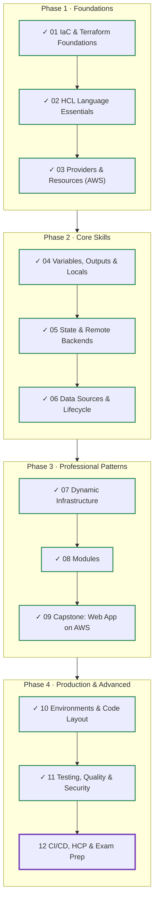
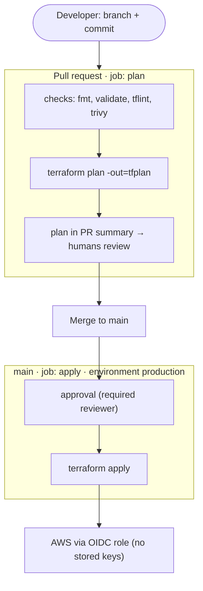
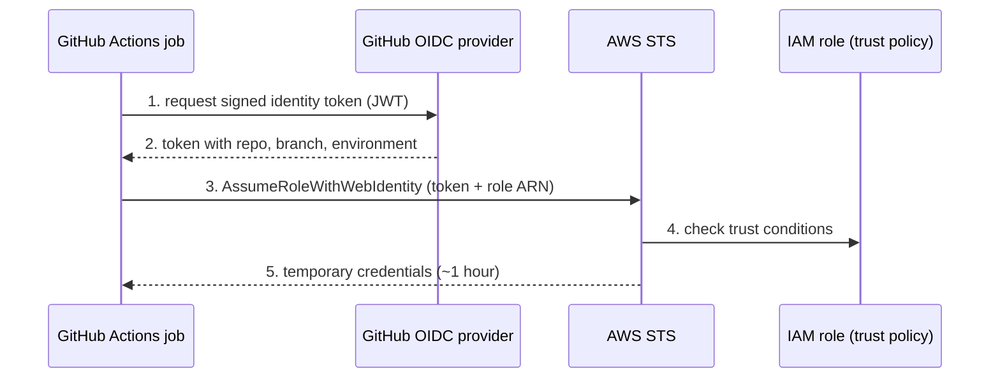
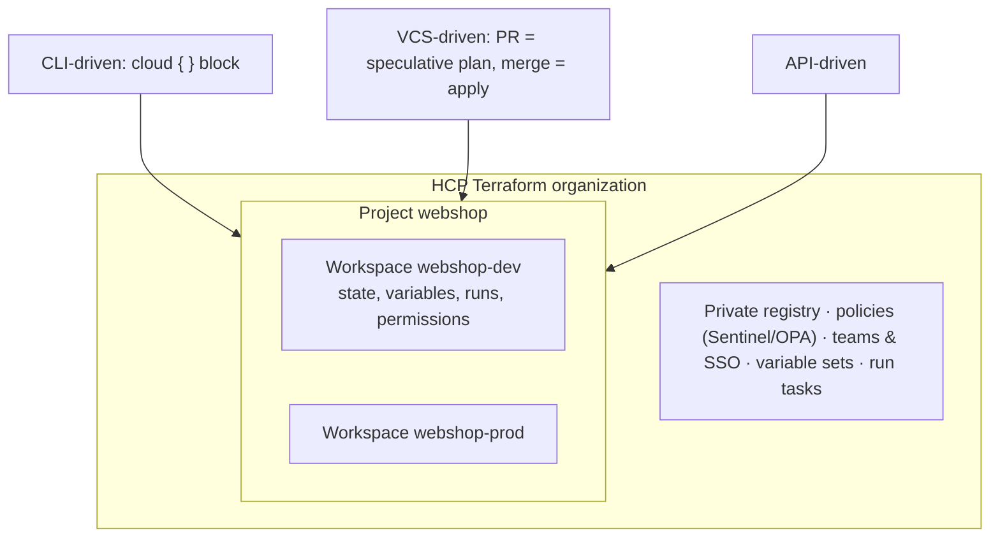
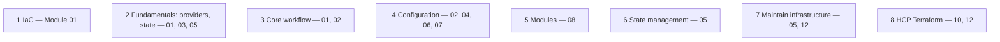
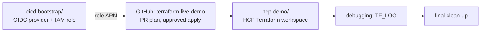

# Terraform: Zero to Advanced
## Module 12 — CI/CD, HCP Terraform & Exam Prep

> Automate Terraform with a secure GitHub Actions pipeline, meet HCP Terraform, debug like a professional — and prepare for the Terraform Associate (004) certification.

| | |
|---|---|
| **Level** | Advanced |
| **Time** | 5–6 hours (concepts + lab + mock exam) |
| **Cost** | ≈ $0 (GitHub Actions and HCP Terraform free tiers) |
| **Terraform** | 1.12 or newer · GitHub account · HCP Terraform account |

📄 **Full illustrated version:** [Module-12-CICD-HCP-Terraform-Exam-Prep.pdf](./Module-12-CICD-HCP-Terraform-Exam-Prep.pdf)

## Contents

- [1. Module Overview](#1-module-overview)
- [2. Core Concepts](#2-core-concepts)
- [3. Hands-on Lab — A Secure Terraform Pipeline](#3-hands-on-lab--a-secure-terraform-pipeline)
- [4. Quick Reference & Exam Review](#4-quick-reference--exam-review)
- [5. Mock Exam (20 questions)](#5-mock-exam-20-questions)
- [6. Course Summary & Next Steps](#6-course-summary--next-steps)

---

## 1. Module Overview


*Figure 0 — Final module: Modules 01–11 done.*

Up to now you ran Terraform from your laptop with your own credentials. In a team that doesn't work: who ran what, with which code, approved by whom? In this final module you move Terraform into a **pipeline**: every change is a pull request, the plan is visible to reviewers, and only an approved merge applies — with short-lived credentials and no secrets stored anywhere. You'll also meet **HCP Terraform**, HashiCorp's managed service, learn to **debug** Terraform itself, and finish with a structured review and a **mock exam** for the HashiCorp Certified: Terraform Associate (004).

#### Learning objectives — by the end of this module you can:

- Design a plan-on-PR / apply-on-merge workflow with a human approval gate.
- Authenticate GitHub Actions to AWS with **OIDC** — no access keys in GitHub.
- Write a GitHub Actions workflow that runs checks, posts the plan and applies after approval.
- Explain HCP Terraform organizations, projects, workspaces, run modes and governance features.
- Use the `cloud` block and `terraform login` to run plans remotely.
- Debug with `TF_LOG` and `TF_LOG_PATH`.
- Map every Associate (004) exam objective to what you learned, and test yourself.

#### Prerequisites

- Modules 05 (state bucket), 10 (GitHub repo) and 11 (checks) completed; a GitHub account; `git`.

## 2. Core Concepts

### 2.1 Terraform in a pipeline


*Figure 1 — Plan on every pull request, apply only after merge and approval.*

| Principle | Why |
|---|---|
| **Every change is a pull request** | Code review and an audit trail: who changed what, why, and who approved |
| **The plan is part of the review** | Reviewers judge the *effect* on infrastructure, not just the diff |
| **Only the pipeline applies** | No laptop with prod credentials; consistent tool versions |
| **Approval gate before apply** | A human confirms; GitHub *environments* with required reviewers implement it |
| **One run at a time per state** | `concurrency` in the workflow plus state locking prevent races |
| **Non-interactive flags** | `-input=false`, `-no-color`, and `-auto-approve` only in the gated apply job |

> [!TIP]
> **Tip:** For maximum safety, apply the **exact saved plan** that was reviewed (`terraform plan -out=tfplan`, upload it as an artifact, `terraform apply tfplan`). The simpler approach used in this lab re-plans on `main`; the approval step lets the reviewer check that second plan in the job log before it runs.

### 2.2 OIDC: credentials without secrets


*Figure 2 — GitHub proves the job's identity; AWS exchanges it for temporary credentials.*

Storing an AWS access key as a GitHub secret works, but it's a long-lived key that can leak and must be rotated. With **OpenID Connect (OIDC)** GitHub issues each job a signed identity token describing *which repository, branch and environment* it runs for. An IAM role **trusts GitHub's OIDC provider**, but only for tokens that match conditions you set — so even a fork or another repository can't assume it.

```hcl
data "aws_iam_policy_document" "github_trust" {
  statement {
    actions = ["sts:AssumeRoleWithWebIdentity"]

    principals {
      type        = "Federated"
      identifiers = [aws_iam_openid_connect_provider.github.arn]
    }

    condition {
      test     = "StringEquals"
      variable = "token.actions.githubusercontent.com:aud"
      values   = ["sts.amazonaws.com"]
    }

    condition {
      test     = "StringLike"
      variable = "token.actions.githubusercontent.com:sub"
      values = [
        "repo:YOUR-GITHUB-USER/terraform-live-demo:pull_request",
        "repo:YOUR-GITHUB-USER/terraform-live-demo:environment:production",
      ]
    }
  }
}
```

The `sub` (subject) claim depends on the trigger: `repo:OWNER/REPO:pull_request` for PR jobs, `repo:OWNER/REPO:environment:NAME` for jobs that use a GitHub environment, `repo:OWNER/REPO:ref:refs/heads/main` for other jobs on main. Real setups usually use **two roles**: a read-only role for plans and a write role for applies.

### 2.3 HCP Terraform


*Figure 3 — HCP Terraform structure and run modes.*

**HCP Terraform** (formerly Terraform Cloud) runs Terraform for you and adds team features. **Terraform Enterprise** is the self-hosted edition of the same product. The free tier currently includes up to **500 managed resources** with unlimited users.

| Concept | Meaning |
|---|---|
| **Organization** | Top-level account for a company or team |
| **Project** | Groups workspaces; permissions can be set per project |
| **Workspace** | One configuration's state, variables, run history and permissions — roughly one environment folder |
| **Run modes** | VCS-driven (watches a repo), CLI-driven (`cloud` block), API-driven |
| **Remote execution** | Plans/applies run on HashiCorp infrastructure (or your own **agents**); *local* execution only stores state |
| **Variable sets** | Variables (e.g. credentials) shared by many workspaces |
| **Sentinel / OPA policies** | Policy as code: e.g. "no public buckets", "only approved instance types", checked between plan and apply |
| **Private registry** | Share versioned modules and providers inside the organization |
| **Dynamic provider credentials** | OIDC from HCP Terraform to AWS/Azure/GCP — the same idea as section 2.2 |

```hcl
terraform {
  cloud {
    organization = "my-org"

    workspaces {
      name = "webshop-dev"      # or: tags = ["webshop"] to work with several workspaces
    }
  }
}
```

The `cloud` block replaces a `backend` block. `terraform login` stores an API token locally; `terraform init` connects the folder to the workspace (and can migrate existing state into it).

### 2.4 Debugging Terraform

| Tool | Use |
|---|---|
| `TF_LOG=TRACE\|DEBUG\|INFO\|WARN\|ERROR` | Verbose logs to stderr — TRACE is the most detailed |
| `TF_LOG_PATH=terraform.log` | Write logs to a file (needs `TF_LOG` set) |
| `TF_LOG_CORE` / `TF_LOG_PROVIDER` | Log only Terraform core or only providers |
| `crash.log` | Written when Terraform panics; attach it to bug reports |
| `terraform console`, `terraform graph`, `terraform providers` | Inspect expressions, the dependency graph and provider requirements |

> [!WARNING]
> **Warning:** Debug logs can contain secrets (request bodies, tokens). Never commit them or paste them publicly without redacting.

### 2.5 The Terraform Associate (004) exam


*Figure 4 — Exam objectives and where this course covered them.*

The 004 version of the exam tests **Terraform 1.12**. Compared with 003 it adds explicit objectives on resource dependencies, **custom conditions**, **ephemeral values and write-only arguments**, and HCP Terraform **projects** — all covered in this course. Check the official HashiCorp certification page for the current format, duration, price and booking details before you register.

---

## 3. Hands-on Lab — A Secure Terraform Pipeline

**Goal:** create an OIDC trust between GitHub and AWS with Terraform, build a GitHub Actions workflow that plans on pull requests and applies after approval, try HCP Terraform, debug with logs — and finally clean up everything from the whole course.


*Figure 5 — Lab overview.*

### Task 1 — Bootstrap the OIDC provider and role

Create a GitHub repository **`terraform-live-demo`** (public or private, empty) now — the role refers to it. Then, locally, a folder `cicd-bootstrap/` with the usual `terraform.tf` (aws `~> 6.0`, S3 backend with `key = "cicd-bootstrap/terraform.tfstate"`):

**`cicd-bootstrap/main.tf`**

```hcl
provider "aws" {
  region = "eu-central-1"
}

variable "github_repo" {
  type        = string
  description = "OWNER/REPO allowed to assume the role"
}

variable "state_bucket" {
  type        = string
  description = "State bucket from Module 05"
}

resource "aws_iam_openid_connect_provider" "github" {
  url            = "https://token.actions.githubusercontent.com"
  client_id_list = ["sts.amazonaws.com"]
}

data "aws_iam_policy_document" "github_trust" {
  statement {
    actions = ["sts:AssumeRoleWithWebIdentity"]

    principals {
      type        = "Federated"
      identifiers = [aws_iam_openid_connect_provider.github.arn]
    }

    condition {
      test     = "StringEquals"
      variable = "token.actions.githubusercontent.com:aud"
      values   = ["sts.amazonaws.com"]
    }

    condition {
      test     = "StringLike"
      variable = "token.actions.githubusercontent.com:sub"
      values = [
        "repo:${var.github_repo}:pull_request",
        "repo:${var.github_repo}:environment:production",
      ]
    }
  }
}

resource "aws_iam_role" "github" {
  name               = "github-terraform"
  assume_role_policy = data.aws_iam_policy_document.github_trust.json
}

data "aws_iam_policy_document" "deploy" {
  statement {
    sid       = "State"
    actions   = ["s3:ListBucket", "s3:GetObject", "s3:PutObject", "s3:DeleteObject"]
    resources = ["arn:aws:s3:::${var.state_bucket}", "arn:aws:s3:::${var.state_bucket}/*"]
  }

  statement {
    sid       = "ManagedResources"
    actions   = ["ssm:*"]
    resources = ["arn:aws:ssm:eu-central-1:*:parameter/live-demo/*"]
  }

  statement {
    sid       = "DescribeParameters"
    actions   = ["ssm:DescribeParameters"]
    resources = ["*"]
  }
}

resource "aws_iam_role_policy" "deploy" {
  name   = "deploy"
  role   = aws_iam_role.github.id
  policy = data.aws_iam_policy_document.deploy.json
}

output "role_arn" {
  value = aws_iam_role.github.arn
}
```

```bash
terraform init -backend-config=backend.hcl
terraform apply -var="github_repo=YOUR-GITHUB-USER/terraform-live-demo" \
                -var="state_bucket=tf-state-1a7d31df"
```

*Expected output (abridged):*

```text
Plan: 3 to add, 0 to change, 0 to destroy.
...
Outputs:

role_arn = "arn:aws:iam::123456789012:role/github-terraform"
```

Least privilege: the pipeline may only touch the state bucket and SSM parameters under `/live-demo/`. An AWS account has only one OIDC provider per URL — if you already created one for GitHub, import it (Module 05) instead of creating a second. Recent AWS provider versions no longer need a `thumbprint_list`.

### Task 2 — The configuration to deploy

Clone the empty repository and add a tiny configuration:

**`terraform-live-demo/main.tf`**

```hcl
terraform {
  required_version = ">= 1.12.0"
  backend "s3" {}
  required_providers {
    aws = {
      source  = "hashicorp/aws"
      version = "~> 6.0"
    }
  }
}

provider "aws" {
  region = "eu-central-1"
}

variable "features" {
  type    = map(string)
  default = { checkout = "on" }
}

resource "aws_ssm_parameter" "feature" {
  for_each = var.features

  name  = "/live-demo/features/${each.key}"
  type  = "String"
  value = each.value
}
```

**`terraform-live-demo/backend.hcl`**

```hcl
bucket       = "tf-state-1a7d31df"
key          = "live-demo/terraform.tfstate"
region       = "eu-central-1"
use_lockfile = true
encrypt      = true
```

### Task 3 — Configure GitHub

1. Repository → *Settings → Secrets and variables → Actions → Variables* → **New repository variable**: `AWS_ROLE_ARN` = the `role_arn` output. (A role ARN isn't secret; no secrets are needed at all.)
2. *Settings → Environments* → **New environment** `production` → enable **Required reviewers** and add yourself.
3. *Settings → Branches* (or *Rules*) → protect `main`: require a pull request before merging, and require the `plan` status check once it has run once.

### Task 4 — The workflow

**`.github/workflows/terraform.yml`**

```yaml
name: terraform

on:
  pull_request:
    branches: [main]
  push:
    branches: [main]

permissions:
  id-token: write      # required for OIDC
  contents: read

concurrency:
  group: terraform-live-demo   # never two runs on the same state at once
  cancel-in-progress: false

env:
  TF_IN_AUTOMATION: "true"
  AWS_REGION: eu-central-1

jobs:
  plan:
    if: github.event_name == 'pull_request'
    runs-on: ubuntu-latest
    steps:
      - uses: actions/checkout@v4
      - uses: hashicorp/setup-terraform@v3
        with:
          terraform_version: "1.12.2"
          terraform_wrapper: false
      - uses: aws-actions/configure-aws-credentials@v4
        with:
          role-to-assume: ${{ vars.AWS_ROLE_ARN }}
          aws-region: ${{ env.AWS_REGION }}
      - run: terraform fmt -check -recursive
      - run: terraform init -input=false -backend-config=backend.hcl
      - run: terraform validate -no-color
      - run: terraform plan -input=false -no-color -out=tfplan
      - name: Plan to job summary
        run: |
          echo '### Terraform plan' >> "$GITHUB_STEP_SUMMARY"
          echo '```' >> "$GITHUB_STEP_SUMMARY"
          terraform show -no-color tfplan >> "$GITHUB_STEP_SUMMARY"
          echo '```' >> "$GITHUB_STEP_SUMMARY"

  apply:
    if: github.event_name == 'push'
    runs-on: ubuntu-latest
    environment: production   # waits for a required reviewer
    steps:
      - uses: actions/checkout@v4
      - uses: hashicorp/setup-terraform@v3
        with:
          terraform_version: "1.12.2"
          terraform_wrapper: false
      - uses: aws-actions/configure-aws-credentials@v4
        with:
          role-to-assume: ${{ vars.AWS_ROLE_ARN }}
          aws-region: ${{ env.AWS_REGION }}
      - run: terraform init -input=false -backend-config=backend.hcl
      - run: terraform apply -input=false -no-color -auto-approve
```

> [!TIP]
> **Tip:** Action versions move on. Check each action's *Releases* page and use the current major version (e.g. `configure-aws-credentials` and `setup-terraform` have newer majors than shown here); pinning to a full commit SHA is the most secure option. Use the Terraform version you use locally.

Make the first commit directly to `main` with all three files (`main.tf`, `backend.hcl`, the workflow) — `git add . && git commit -m "Initial config and pipeline" && git push`. The push triggers the **apply** job, which pauses for your approval (*Actions* → run → *Review deployments* → approve). It creates the `checkout` parameter. From now on every change goes through a pull request.

### Task 5 — A pull request with a plan

```bash
git switch -c add-search-flag
# edit main.tf: default = { checkout = "on", search = "off" }
git commit -am "Add search feature flag"
git push -u origin add-search-flag
```

Open a pull request on GitHub. The **plan** job runs; open it → *Summary*:

*Expected plan summary in GitHub (abridged):*

```text
### Terraform plan

  # aws_ssm_parameter.feature["search"] will be created
  + resource "aws_ssm_parameter" "feature" {
      + name  = "/live-demo/features/search"
      + type  = "String"
      + value = (sensitive value)
      ...
    }

Plan: 1 to add, 0 to change, 0 to destroy.
```

The reviewer sees the exact effect on AWS without running anything locally. In the job log, the *Configure AWS credentials* step shows that it assumed `github-terraform` — no keys were stored anywhere.

### Task 6 — Merge, approve, apply

1. Merge the pull request.
2. *Actions* → the new run shows **apply — Waiting** for review. Click *Review deployments* → `production` → **Approve and deploy**.
3. When it finishes, check: `aws ssm get-parameter --name /live-demo/features/search`.

*Expected output in the apply job log (last line):*

```text
Apply complete! Resources: 1 added, 0 changed, 0 destroyed.
```

Now test a guardrail: open a PR that adds `resource "aws_s3_bucket" "x" { bucket = "live-demo-x-123" }`. The plan succeeds (planning needs read access only to state), but if you merged it the apply would fail with `AccessDenied` — the role may only manage SSM parameters. Close that PR without merging.

### Task 7 — HCP Terraform in 10 minutes

1. Sign up at **app.terraform.io**, create an organization (e.g. `yourname-learning`).
2. Locally: `terraform login` → a browser opens → create a token → paste it into the terminal.
3. Create a folder `hcp-demo/` with the file below and run `terraform init` then `terraform apply`.

**`hcp-demo/main.tf`**

```hcl
terraform {
  cloud {
    organization = "yourname-learning"

    workspaces {
      name = "hcp-demo"
    }
  }

  required_providers {
    random = {
      source  = "hashicorp/random"
      version = "~> 3.7"
    }
  }
}

resource "random_pet" "name" {
  length = 3
}

output "name" {
  value = random_pet.name.id
}
```

*Expected output (abridged):*

```text
Initializing HCP Terraform...
...
HCP Terraform has been successfully initialized!

Running apply in HCP Terraform. Output will stream here. Pressing Ctrl-C
will cancel the remote apply if it's still pending. If the apply started it
will stop streaming the logs, but will not stop the apply running remotely.

To view this run in a browser, visit:
https://app.terraform.io/app/yourname-learning/hcp-demo/runs/run-AbCdEf123456
...
Apply complete! Resources: 1 added, 0 changed, 0 destroyed.

Outputs:

name = "jolly-quietly-octopus"
```

`init` created the workspace automatically. The run happened **remotely** — open the link: you'll see the plan, the apply, the state versions and the outputs in the web UI. No local state file exists. Explore *Settings*, *Variables* and the organization's *Projects*. Then `terraform destroy` and delete the workspace in the UI.

### Task 8 — Debug logging

```bash
cd ../terraform-live-demo
export AWS_PROFILE=terraform
export TF_LOG=DEBUG TF_LOG_PATH=./terraform-debug.log
terraform init -backend-config=backend.hcl && terraform plan
unset TF_LOG TF_LOG_PATH
grep -c "DEBUG" terraform-debug.log
grep -m3 "provider.terraform-provider-aws" terraform-debug.log
```

*Expected output (abridged; numbers and lines differ):*

```text
...
2416
2026-10-27T10:21:44.120Z [DEBUG] provider.terraform-provider-aws_v6.x.x: ...
...
```

Every API call, retry and decision is in the log — invaluable for strange provider errors or slow plans. Delete the log file afterwards (it can contain sensitive data). In PowerShell: `$env:TF_LOG="DEBUG"; $env:TF_LOG_PATH="terraform-debug.log"`.

### Task 9 — Destroy the pipeline's resources

The last change goes through the pipeline too: open a PR that sets `default = {}` for `features` — the plan shows `2 to destroy`. Merge and approve: the pipeline removes both parameters. Then remove the OIDC trust:

```bash
cd ../cicd-bootstrap
terraform destroy -var="github_repo=YOUR-GITHUB-USER/terraform-live-demo" \
                  -var="state_bucket=tf-state-1a7d31df"
```

*Expected output (abridged):*

```text
Plan: 0 to add, 0 to change, 3 to destroy.
...
Destroy complete! Resources: 3 destroyed.
```

### Task 10 — Final course clean-up: the state bucket

Make sure every lab (Modules 05–12) has been destroyed — list what's left in your state bucket: `aws s3 ls s3://tf-state-1a7d31df/ --recursive`. State files of destroyed configurations are small and contain no resources. Then remove the protection and destroy the bootstrap from Module 05:

```bash
# Module 05 bootstrap/main.tf:  prevent_destroy = true  ->  false
cd <path>/lab-05-state/bootstrap
terraform apply        # records the lifecycle change (0 to change)
terraform destroy
```

*Expected output (abridged):*

```text
Plan: 0 to add, 0 to change, 5 to destroy.
...
Destroy complete! Resources: 5 destroyed.
```

`force_destroy = true` on that bucket also deletes all state versions. Finally check *Billing → Bills* and *Cost Explorer* in AWS, and delete the IAM users from Module 07 if anything remained. Keep your GitHub repositories — they're your portfolio.

### Challenge — a read-only plan role

Split the single role into two: `github-terraform-plan` (trusted only for `pull_request`, read-only: state `GetObject`/`ListBucket` + lock file write, `ssm:Get*`/`Describe*`) and `github-terraform-apply` (trusted only for `environment:production`, the current permissions). Use two repository variables and reference the right one in each job. Why does the plan role still need to write the lock file?

#### Solution outline

Create two `aws_iam_role` resources from two trust documents (each with one `sub` value) and two permission documents. In the workflow use `vars.AWS_PLAN_ROLE_ARN` in the plan job and `vars.AWS_APPLY_ROLE_ARN` in the apply job. The plan role needs `s3:PutObject`/`s3:DeleteObject` on `live-demo/terraform.tfstate.tflock` because `terraform plan` takes the state lock (or run plans with `-lock=false`, accepting a tiny race). Result: a malicious pull request can at most *read* your infrastructure, never change it.

#### Lab complete when you can tick every box

- [ ] GitHub Actions authenticated to AWS through OIDC — no keys stored.
- [ ] A pull request showed the plan; the apply waited for my approval.
- [ ] The role's least-privilege policy blocked an unexpected resource type.
- [ ] I ran a remote plan/apply in HCP Terraform with the `cloud` block.
- [ ] I produced and read a `TF_LOG=DEBUG` log.
- [ ] I destroyed everything, including the course's state bucket.

---

## 4. Quick Reference & Exam Review

### 4.1 CI/CD and HCP Terraform cheat sheet

| Need | How |
|---|---|
| Non-interactive runs | `-input=false`, `-no-color`, `TF_IN_AUTOMATION=true` |
| Plan file | `terraform plan -out=tfplan` → `terraform show tfplan` → `terraform apply tfplan` |
| OIDC in GitHub Actions | `permissions: id-token: write` + `configure-aws-credentials` with `role-to-assume` |
| Approval gate | GitHub environment with required reviewers |
| No parallel runs | `concurrency` group + state locking |
| Log in to HCP Terraform | `terraform login` |
| Use HCP Terraform | `terraform { cloud { organization  workspaces { name \| tags } } }` |
| Debug | `TF_LOG=DEBUG TF_LOG_PATH=file` |

### 4.2 One-page exam review

| Objective | Must-know points |
|---|---|
| 1 IaC | Declarative, idempotent, versioned, reviewable; multi-cloud with one workflow; providers make it service-agnostic |
| 2 Fundamentals | `required_providers` source/version, lock file, `init -upgrade`, aliases, state purpose, local vs remote |
| 3 Workflow | write → init → fmt/validate → plan → apply → destroy; what each command changes |
| 4 Configuration | resource vs data; references; variables (types, validation, precedence, sensitive); outputs; complex types; functions & expressions; `depends_on`; pre/postconditions & `check`; ephemeral values, write-only args, Vault |
| 5 Modules | Sources (local, registry, git), `version` (registry only), inputs/outputs scope, root vs child |
| 6 State | Local backend; locking; `backend` block & partial config; drift & `-refresh-only`; never commit state |
| 7 Maintain | `import` block & `-generate-config-out`; `terraform state list/show/mv/rm`; `moved`/`removed`; `TF_LOG` |
| 8 HCP Terraform | Organizations, projects, workspaces; VCS/CLI/API runs; variable sets; policies; private registry; `cloud` block |

**Exam tips:** read every word of the question ("*must*", "*first*", "*not*"); many questions describe a command's side effect — remember which commands change state (`apply`, `destroy`, `import`, `state mv/rm`) and which don't (`plan`, `validate`, `fmt`, `show`); and know the exact names of flags and blocks. Practise with the official sample questions and the HashiCorp tutorials for objectives you feel least sure about.

## 5. Mock Exam (20 questions)

**Q1. Which command downloads the providers declared in a configuration?**

<details><summary>Show answer</summary>

`terraform init`.

</details>

**Q2. True or false: `terraform plan` changes your infrastructure.**

<details><summary>Show answer</summary>

False — plan only proposes changes; only `apply` (and `destroy`) change infrastructure.

</details>

**Q3. A provider constraint is `~> 5.2`. Which versions are allowed?**

<details><summary>Show answer</summary>

>= 5.2 and < 6.0.

</details>

**Q4. Which file records the exact provider versions and checksums selected?**

<details><summary>Show answer</summary>

`.terraform.lock.hcl`.

</details>

**Q5. How do you reference attribute `id` of data source `aws_vpc.main`?**

<details><summary>Show answer</summary>

`data.aws_vpc.main.id`.

</details>

**Q6. A value is set via `TF_VAR_region`, `terraform.tfvars` and `-var`. Which wins?**

<details><summary>Show answer</summary>

The `-var` command-line value.

</details>

**Q7. Does `sensitive = true` keep a value out of the state file?**

<details><summary>Show answer</summary>

No — it only redacts CLI output. Use ephemeral values / write-only arguments to keep values out of state.

</details>

**Q8. Which block lets you rename a resource without destroying it?**

<details><summary>Show answer</summary>

A `moved` block.

</details>

**Q9. Which command shows all resources tracked in state?**

<details><summary>Show answer</summary>

`terraform state list`.

</details>

**Q10. What is the purpose of state locking?**

<details><summary>Show answer</summary>

To prevent concurrent operations from corrupting or overwriting state.

</details>

**Q11. Which argument pins a module from the Terraform Registry?**

<details><summary>Show answer</summary>

`version`.

</details>

**Q12. Can a child module read the root module's variables directly?**

<details><summary>Show answer</summary>

No — values must be passed as module arguments.

</details>

**Q13. Which meta-argument creates instances keyed by map keys?**

<details><summary>Show answer</summary>

`for_each`.

</details>

**Q14. What does a failed `check` block assertion do?**

<details><summary>Show answer</summary>

Produces a warning; the run continues.

</details>

**Q15. Which command brings an existing resource into Terraform in a reviewable way since 1.5?**

<details><summary>Show answer</summary>

An `import` block (optionally with `terraform plan -generate-config-out=FILE`).

</details>

**Q16. How do you accept infrastructure drift into state without changing resources?**

<details><summary>Show answer</summary>

`terraform apply -refresh-only`.

</details>

**Q17. Which environment variable enables detailed Terraform logging?**

<details><summary>Show answer</summary>

`TF_LOG` (e.g. `TF_LOG=TRACE`), with `TF_LOG_PATH` to write to a file.

</details>

**Q18. What replaces a `backend` block when using HCP Terraform?**

<details><summary>Show answer</summary>

The `cloud` block inside `terraform { }`.

</details>

**Q19. In HCP Terraform, what groups workspaces for permissions and organization?**

<details><summary>Show answer</summary>

Projects.

</details>

**Q20. Which HCP Terraform feature enforces rules like "no public S3 buckets" before apply?**

<details><summary>Show answer</summary>

Policies (policy as code with Sentinel or OPA).

</details>

## 6. Course Summary & Next Steps

Congratulations — you went from zero to building, testing and automating production-style infrastructure. Looking back over the twelve modules:

| Phase | You can now… |
|---|---|
| Foundations (01–03) | Explain IaC and Terraform's architecture, read and write HCL, and manage real AWS resources safely |
| Core skills (04–06) | Build configurable code with variables and outputs, keep secrets out of state, run shared remote state with locking, and control lifecycle and dependencies |
| Professional patterns (07–09) | Generate infrastructure from data, design reusable modules, and deliver a highly available, auto-scaling web application with zero-downtime releases |
| Production (10–12) | Isolate and promote environments, test and scan every change, and run everything through a secure, reviewed pipeline |

#### Where to go next

- **Certify:** book the HashiCorp Certified: Terraform Associate (004) exam once the mock exam feels easy.
- **Build a portfolio project:** e.g. your capstone in a public repository with modules, tests and a pipeline.
- **Go deeper:** HCP Terraform Stacks, Terragrunt, policy as code (OPA/Sentinel), Kubernetes with Terraform, and the Terraform Authoring and Operations Professional certification.
- **Read great code:** the source of the *terraform-aws-modules* collection.

#### Official references

- [Automate Terraform with GitHub Actions](https://developer.hashicorp.com/terraform/tutorials/automation/github-actions)
- [GitHub OIDC with AWS](https://docs.github.com/en/actions/security-for-github-actions/security-hardening-your-deployments/configuring-openid-connect-in-amazon-web-services)
- [HCP Terraform documentation](https://developer.hashicorp.com/terraform/cloud-docs)
- [Debugging Terraform](https://developer.hashicorp.com/terraform/internals/debugging)
- [Terraform Associate (004) review](https://developer.hashicorp.com/terraform/tutorials/certification-004/associate-review-004)
